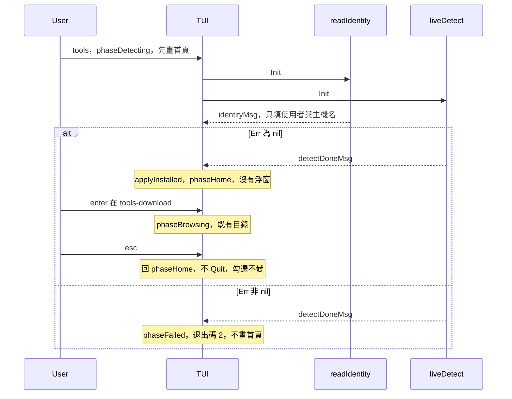
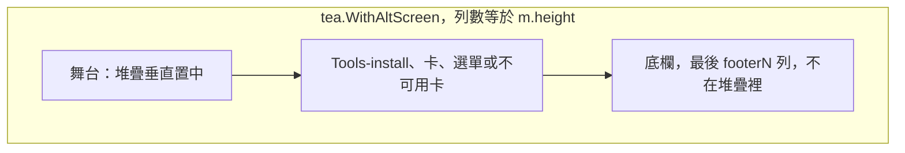
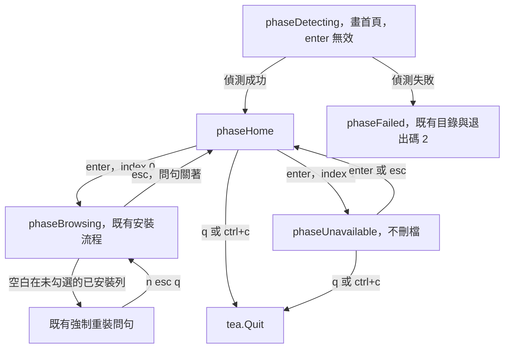

# `tools` TUI 首頁：置中的 `Tools-install`、本機卡與兩個選項

| 欄位 | 值 |
| --- | --- |
| 作者 | 待填 |
| 日期 | 2026-11-13 |
| 狀態 | Draft |
| 模組 | `github.com/shuhi/dotfiles` |
| 適用樹 | `/home/shuhi/project/Dotfiles` |
| 範圍 | 無子命令的 TTY 進入 TUI 之後，先畫首頁，再進入既有目錄。不改安裝語意 |
| 不取代 | `docs/tools-installer-design.md` 的套件名稱、argv、`shadowed`、alias、go tarball、release。`docs/tools-tui-earth-design.md` 的目錄色票、底欄折行、目錄按鍵字面值。`docs/tools-installed-skip-design.md` 的 `--force` 與「不做解除安裝」。`docs/tools-installed-row-design.md` 的已安裝列 `#423F59`、`(已安裝)` 右緣、32 個 ID 的 `ProbeGroups`、標題列 `#394934`。本文件只推翻該文件的進入浮窗：`entryOpen`、`placeEntry`、`任意鍵關閉` 刪除，偵測成功改進首頁。首頁與不可用畫面另用本文件的藍主題，不回寫 `earthStyles` |

## Overview

今天 stdin 是 TTY、沒有子命令時，`cmd/tools` 直接開目錄。`liveDetect` 成功會把 `entryOpen` 設真，在目錄正中蓋一個只含系統與架構的浮窗。本文件拿掉這個浮窗，改成一個真正的首頁 phase。

首頁整疊在框架正中，不貼左上。由上到下是：

1. 一行粗體標題，字面值正好是 `Tools-install`。整段在終端機寬度裡置中。漸變只塗在實際畫出的字形上。
2. 一張置中的長方形卡。卡有標頭列、一條點線，然後兩欄四個值：系統、架構、使用者、電腦名稱。
3. 卡下方一個兩列選單。字面值正好是 `tools-download` 與 `tools-uninstall`。選中列是整列高亮，左邊一個標記，右邊同一列有短提示。

`tools-download` 進入今天的目錄安裝流程：瀏覽、紫色已安裝列、強制重裝問句、confirm、apply。不另寫一套安裝器。`tools-uninstall` 可以選，但只打開一個說明畫面，寫明此動作不可用，不刪任何檔。`enter` 或 `esc` 回首頁。

版面對齊參考圖 `/mnt/e/御芳/download/MyData/photo_2026-11-13_10-19-17.jpg` 的三層結構（大標題、中間卡、下方高亮選單），不抄圖裡的 `femasHR`、Swarm／MySQL 列、九項維運選單。目錄仍是 Andromeda，不把目錄色票換成圖裡的青色。

首頁與不可用畫面離開 Andromeda。標題是桃 `#F0ADA0` 到青 `#9EE2F0` 的粗體漸變，畫在頁面 `#15243C` 上。`#84A2D4` 是卡的填色，不是整頁背景，也不是目錄標題列的 `#394934`。首頁不呼叫 `paintTitle`。上一輪草稿的 cream on bark，以及「不新增任何 hex」，只對這兩個畫面作廢。

## Background & Motivation

現況來自這些檔案，不是構想：

- `cmd/tools/main.go` 的 `run`：沒有子命令且 `isTTY(stdin)` 為假時印用法、退出碼 2。為真時 `runTUI`。`Styled` 仍是 `isTTY(stdout) && os.Getenv("NO_COLOR") == ""`。`tools apply` 走 `runApply`，不進 TUI。
- `internal/tui/model.go` 的 `New`：`Info` 的 GOOS、GOARCH、Manager、SystemText 都空時 phase 是 `phaseDetecting`，否則 `phaseBrowsing`。`entryOpen` 零值是 false。`scroll` 沒有寫入者。`Init` 只在 detecting 回 `liveDetect`。
- `internal/tui/update.go` 的 `detectDoneMsg`：`Err != nil` 時 `phaseFailed`、`exitCode = 2`、`entryOpen` 維持 false。成功時 `applyInstalled`、`entryOpen = true`、`phaseBrowsing`。`onKey` 在 `askName != ""` 時先走 `onAskKey`；接著若 `entryOpen`，任何鍵只把旗標清掉，`tea.Cmd` 是 nil，連 `q` 與 `ctrl+c` 都不離開。
- `internal/tui/view.go` 的 `placeEntry`／`boxPanel`／`entryLines`：浮窗蓋在目錄 body 上。5 列放得下時含固定字 `任意鍵關閉`。系統與架構的空值規則與 `FormatHeader` 同一套。`showsStatus` 含 detecting、browsing、failed，所以偵測中也畫目錄。
- `internal/tui/keymap.go` 的 `browsingHelp` 字面值是 `操作  ↑/k 上一項  ↓/j 下一項  space 勾選/取消  enter 安裝已勾選  a 切換本類  A 切換全部  d 只顯示計畫  g 頂端  G 底端  q 離開`。`esc` 不在這句裡。confirm 的 `n/esc 返回` 是另一個常數。
- `internal/platform/detect.go` 的 `Info` 只有 `OS`、`Arch`、`Manager`。沒有使用者、沒有主機名。`FormatHeader` 與 `entryLines` 只讀 `SystemText`、`Family`、`GOARCH`、`UnameM`、`Manager`。
- `os/user` 與 `os.Hostname` 今天沒有被 TUI 呼叫。標準庫即可，`go.mod` 不必加依賴。
- `internal/install/alias.go` 的 `AliasSymlinks` 只會產生兩條 Debian symlink：`~/.local/bin/fd` → `/usr/bin/fdfind`，`~/.local/bin/bat` → `/usr/bin/batcat`。`internal/release/unpack.go` 的 `InstallLayout` 把 release 二進位寫到 `filepath.Join(home, ".local", "bin", spec.BinaryName)`。`internal/release/match.go` 的 `BinaryName` 是 `starship`、`eza`、`zellij`、`fastfetch`、`rg`、`fd`、`bat`、`fzf`、`nvim`、`ms`。`LayoutTree` 還會寫分享目錄。沒有一份「這次行程寫了哪些路徑」的清單。`install.log` 記的是 status，不是檔案清單。

痛點：

1. 系統與架構只在偵測成功後的浮窗出現一次，任意鍵就消失，而且沒有使用者與電腦名稱。
2. 浮窗蓋在目錄上，目錄才是第一眼。使用者要的是先看到 `Tools-install`，再選要進目錄還是解除安裝。
3. 前一份設計明確不做解除安裝，也不能對 git、vim 這類發行版套件下 `apt-get remove`／`dnf remove`／`brew uninstall`。選單仍必須有 `tools-uninstall`，而且按鍵不能留成未定。

參考圖只提供層次：標題在內容區上方置中、標題下是一張卡（標頭、點狀分隔、兩欄短狀態）、卡下是直向選單，選中列是整列色帶、左標記、名稱、同一列右側短提示。其餘列較暗、沒有色帶。整疊在終端機中間。

## Goals & Non-Goals

### Goals

- 偵測成功後進 `phaseHome`，不再設 `entryOpen`。目錄 body 不再畫進入浮窗，畫面上不再出現 `任意鍵關閉`。
- 首頁與「此動作不可用」畫面的標題、卡、選單整疊在框架裡水平且垂直置中。底欄若保留，釘在最後 `footerN` 列，不算進這疊。框架列數仍是 `m.height`。
- 標題字面值正好是 `Tools-install`。選單字面值正好是 `tools-download`、`tools-uninstall`。四個欄位標籤用繁體中文：`系統`、`架構`、`使用者`、`電腦名稱`。標籤留在左欄與右欄，不把每個儲存格再水平置中。
- 標題整段用既有 `placeHeader` 在終端機寬度裡置中，餘數在右邊。置中用的空白只有頁面背景，沒有漸變前景。不把每個字形各自再置中，也不為了置中拆掉兩欄卡。漸變只塗在截斷之後畫出來的字形上。plain 與 `NO_COLOR` 沒有 ANSI、沒有漸變。標題在 styled 路徑維持粗體（SGR 1）。
- 系統與架構只讀既有 `platform.Info`，空值規則沿用 `FormatHeader`／`entryLines`。不新增第二套 OS 偵測，不在 `View` 裡呼叫 `uname`、`LoadOSRelease`、`DetectManager`。
- 使用者是行程使用者，取 `os/user` 的 `Current().Username`。電腦名稱是 `os.Hostname`。任一呼叫失敗、空字串、或含控制字元，卡內顯示固定字 `未知`，不 panic，不把 `err.Error()` 畫出來。測試注入這四個字串。沒有網路。
- `tools-download` 把 phase 設成 `phaseBrowsing`，之後就是今天的目錄、紫色已安裝列、強制重裝問句與安裝。不呼叫第二個 installer。
- `tools-uninstall` 進入 `phaseUnavailable`。畫面寫明不可用，不執行 `os.Remove`，不組套件管理器的移除 argv。`enter` 與 `esc` 回首頁，`q` 離開。這個畫面用同一套首頁主題，標題同樣漸變、同樣置中。
- 目錄上用一個現有、且不在 `browsingHelp` 字面值裡的鍵回首頁：`esc`。不改 `keymap.go` 的說明字面值。`phaseFailed` 的說明列仍含 `enter` 與 `d`。強制重裝問句開著時，`onAskKey` 仍先贏。
- `m.scroll` 維持不被寫入。`width < 5` 不 panic。窄寬用 `ansi.Truncate`。plain／`NO_COLOR` 沒有 ANSI。`lipgloss` 只在 styled 路徑。不上外層 `Width` 去包已經上色的字串。不用 `bubbles/list`，不用 `bubbles/help`。
- `tools apply`、非 TTY 無子命令的退出碼 2、`--force` 的範圍都不變。32 個目錄 ID、套件名稱、`ProbeGroups`、紫色已安裝列留著。不碰既有目錄：`ghostty/` 是已經有 `config` 的設定目錄，不是空目錄；`wezterm/` 與 `WSL/` 維持空目錄。本設計不建立、不刪除它們。

### Non-Goals

- 不把首頁標題畫成 `#394934`，也不呼叫 `paintTitle`。`#394934` 仍只屬於目錄的 `FormatHeader` 那一列，不得出現在首頁標題上。
- 不改目錄 phase 的色票。已安裝列 `#423F59`（`48;2;65;63;89`）、目錄標題 `#394934`（`48;2;56;73;52`）、強制重裝列 `#3F445B`、金色 `*`、clay、olive、目錄底欄 key `#6DCAE8`（`38;2;109;202;232`）都不改。這些 token 不拿來畫首頁或不可用畫面。
- 不把 `#84A2D4` 當整頁背景。標題兩端都是亮色，直接鋪上去讀不清，對比寫在色票一節。也不把 Andromeda muted `#7E8294` 退回來當首頁未選中列。
- 不把已上色的標題再送進外層 `Width`。不先對完整字串上色再截掉，以致窄終端只剩漸變的左端。
- 不複製 `femasHR`、不畫 Swarm／MySQL／元件那種產品狀態，不把套件管理器名稱放進這張卡。卡上沒有第五個資料欄。
- 不對發行版套件做解除安裝。沒有 `apt-get remove`、`dnf remove`、`yum remove`、`pacman -R`、`zypper remove`、`apk del`、`xbps-remove`、`brew uninstall`、`brew unlink`。也不刪 `~/.local/bin` 裡的 alias 或 release 二進位。理由在 Alternatives。
- 不改 `FormatItem`、`FormatHeader`、`FormatResult`、`BuildInstall`、`AliasSymlinks`、`ApplyAlias`、`InstallLayout`。
- 不改 `keymap.go`。目錄說明那句、confirm／installing／report 三個常數的字面值都不改。
- 不把 `phaseFailed` 的 `enter`、`d`、`ctrl+c` 吃鍵邏輯改掉。失敗說明列仍是 browsing 那一句。
- 不讓首頁的 `enter` 直接開始安裝。它只進入目錄。目錄裡的 `enter` 仍是「安裝已勾選」。
- 不寫 `m.scroll`。不用滑鼠。不加 feature flag。

## Proposed Design

### 參考圖對到什麼，不對到什麼

| 參考圖 | 本首頁 |
| --- | --- |
| 上方大字 `femasHR` | 一行 `Tools-install`，整段置中。終端機沒有字級，所以「大」是粗體，不是像素字，也不是 ASCII art。每個字形不再各自置中 |
| 青色標題 | 不用整片青色當標題底。字形是 `#F0ADA0` 到 `#9EE2F0` 的漸變，置中空白只有頁面背景 |
| 卡的標頭（徽章、產品名、右側編號） | 只有固定標頭 `本機`。沒有徽章，沒有管理器名稱 |
| 點狀橫線 | ASCII `.`，每個顯示寬 1。不是 `…`，不是 `·`，不是 `lipgloss` 的 `Border` |
| 兩欄短狀態 | 左欄 `系統`、`架構`；右欄 `使用者`、`電腦名稱` |
| 選中列整條色帶、左標記、右提示 | 色帶等於卡寬，不是整條終端機。底是 `#BBCCE7`，字是深色墨水 `#0B121E`。標記是 `>` 加一格空白，不用 `▶` |
| 九個維運項 | 只有兩列 |

### 色：首頁主題，目錄色票不動

`earthStyles` 的欄位與字面值不改。目錄繼續用那組 Andromeda。首頁與不可用畫面用另一組常數，放在 `home.go`，透過既有的 `palette.ink`／`palette.gap`／`palette.padTo` 上色，不把新 hex 寫進 `earthStyles`。`paintTitle` 的唯一呼叫點仍是目錄的 `FormatHeader`。首頁標題不得呼叫它，標題那一列不得含 `48;2;56;73;52`。

lipgloss 沒有文字漸變。漸變是自己算的。演算法鎖死成 sRGB 8-bit 線性內插，再交給與現有測試相同的 termenv TrueColor 量化。量化是 `uint8` 截斷（`colorful.Hex` 之後 `uint8(f.R*255)`），不是四捨五入。hex 的整數通道不等於發出的 SGR。測試鎖 SGR。

量測用的 renderer 與 `internal/tui/style_test.go` 的 `testRenderer` 相同：`lipgloss.NewRenderer(io.Discard)`、`SetColorProfile(termenv.TrueColor)`、`SetHasDarkBackground(true)`。2026-11-13 在這個模組上量過，lipgloss v1.1.0 的 `Inline(true)` 輸出與 `termenv.RGBColor.Sequence` 一致。對比是 WCAG 相對亮度，用發出的 `uint8` 通道，不用截斷前的 hex 整數，也不用 Python 浮點當成 lipgloss 的結果。

#### 標題漸變

主題文字是字面值 `Tools-install`。`[]rune` 的長度是 13，`ansi.StringWidth` 也是 13。產品句子裡若寫成 12，會把最後一個 `l` 丟掉。未截斷時表有 13 列，`t = i/12`。

置中沿用 `placeHeader`：先 `ansi.Truncate(text, width, "…")`，再 `left = (width-w)/2`，餘數在右邊。置中用的空白不是漸變的一部分，只有頁面背景、沒有前景。不要把 13 個字形各自再置中。

漸變跨的是截斷之後留下的字形，不是先對 13 字上色再截掉。窄終端機仍看得到由桃到青的整段。

```go
const (
	titleStart = "#F0ADA0" // 通道 240,173,160
	titleEnd   = "#9EE2F0" // 通道 158,226,240
)

func lerpTitle(n, i int) string {
	if n <= 1 {
		return titleStart
	}
	t := float64(i) / float64(n-1)
	r := uint8(math.Round(240 + (158-240)*t))
	g := uint8(math.Round(173 + (226-173)*t))
	b := uint8(math.Round(160 + (240-160)*t))
	return fmt.Sprintf("#%02X%02X%02X", r, g, b)
}
```

`math.Round` 是 Go 的半值遠離 0。這個 hex 再送進 `lipgloss.Color`，由 renderer 做第二次量化。

可見字串來自 `placeHeader` 的回傳值，規則是：

- 回傳正好是 `…`：沒有留下的字形。`n == 1`，唯一一格是起點 `#F0ADA0`。寬度 1 就是這個情形，SGR `38;2;240;173;160`。
- 回傳以 `…` 結尾，而且不是完整的 `Tools-install`：`…` 不是多出來的色標。`n` 是 `…` 前面留下的 rune 數。第 i 格（i 從 0）用 `lerpTitle(n, i)`。省略號複製最後一個保留格的顏色。`n == 1` 時那一格與省略號都是起點。`n > 1` 時最後一格的 `t` 是 1，也就是終點 `#9EE2F0`，省略號跟它同色。
- 否則對畫面上的每個 rune 做漸變。寬度足夠時就是下面這 13 格。

寬度 4 的 `placeHeader` 回傳 `Too…`。留下 `T`、`o`、`o`，`n == 3`。三格是起點 `#F0ADA0`（`38;2;240;173;160`）、中點 `#C7C8C8`（`38;2;199;200;200`）、終點 `#9EE2F0`（`38;2;158;226;240`）。省略號再複製終點，不是第四個色標，也不是 13 格表裡的第 4 格。

未截斷的 13 格。hex 是 `math.Round` 之後的內插，SGR 是 `testRenderer` 量到的前景。只有 i=3 的 B 被 termenv 從 180 截成 179。其餘格的發出通道等於 hex 整數。每一格都加粗體 `1;`，背景是頁面 `48;2;21;36;60`。

| i | rune | t | hex | 量到的 `38;2;R;G;B` |
| --- | --- | --- | --- | --- |
| 0 | `T` | 0 | `#F0ADA0` | `38;2;240;173;160` |
| 1 | `o` | 1/12 | `#E9B1A7` | `38;2;233;177;167` |
| 2 | `o` | 2/12 | `#E2B6AD` | `38;2;226;182;173` |
| 3 | `l` | 3/12 | `#DCBAB4` | `38;2;220;186;179` |
| 4 | `s` | 4/12 | `#D5BFBB` | `38;2;213;191;187` |
| 5 | `-` | 5/12 | `#CEC3C1` | `38;2;206;195;193` |
| 6 | `i` | 6/12 | `#C7C8C8` | `38;2;199;200;200` |
| 7 | `n` | 7/12 | `#C0CCCF` | `38;2;192;204;207` |
| 8 | `s` | 8/12 | `#B9D0D5` | `38;2;185;208;213` |
| 9 | `t` | 9/12 | `#B3D5DC` | `38;2;179;213;220` |
| 10 | `a` | 10/12 | `#ACD9E3` | `38;2;172;217;227` |
| 11 | `l` | 11/12 | `#A5DEE9` | `38;2;165;222;233` |
| 12 | `l` | 1 | `#9EE2F0` | `38;2;158;226;240` |

i=3 的測試要看到 `38;2;220;186;179`。hex 的 B 是 `B4`（180），不得把 180 寫進 SGR。

上色方式：每個 rune 各自 `ink(string(r), lerp, page, true)`。左補白是 `gap(spaces, page)`，沒有前景。右補白用 `padTo`，它只在尾端再接 `gap`，不把已上色的字串送進 `Width` 或 `Height`。`palette.blank` 仍只服務目錄的 bark 空列。首頁的直向空列另畫，背景是頁面色，做法與 `blank` 相同：對空字串使用 `Width`，因為那時候還沒有前景。

plain 與 `NO_COLOR` 走 `renderPlain`，標題是置中的純文字，沒有 ANSI，沒有漸變。

#### 以 `#84A2D4` 為錨的搭配

`#84A2D4` 經 `colorful.Hex` 的 HSL 是 H=217.5、S=0.481928、L=0.674510。它是偏亮的灰藍。同一個 renderer 把它當背景時發出 `48;2;131;162;211`，不是 132,162,212。R 從 132 截成 131，B 從 212 截成 211。

標題直接鋪在這片顏色上讀不清。左端發出 `38;2;240;173;160`，對比 1.386:1。右端發出 `38;2;158;226;240`，對比 1.807:1。較差的是左端。兩端都低於 4.5。所以 `#84A2D4` 不是頁面背景。

頁面改成同一色相、明顯更深的藍。`colorful.Hsl(217.5, 0.481928, 0.16)` 給出 `#15243C`。發出的背景是 `48;2;21;36;60`，三個通道都沒有再被截掉。左端對這個頁面是 8.292:1，右端是 10.812:1。13 格裡最差的就是左端 8.292:1，其餘格更高。兩端都過 AAA 的 7:1。這個深淺已經定死，不再留給實作時選擇。

`#84A2D4` 在首頁看得到的角色是卡的填色，含 ASCII 框的 `+`、`-`、`|` 與卡的內部。不是選中列的底，也不是頁面。不可用畫面的卡用同一個填色。

其餘搭配色用同一個 `colorful.Hsl` 呼叫、只改 L，再把得到的 hex 送進同一個 renderer。對比用發出的通道。

| 角色 | hex | L | 量到的 SGR | 對比 |
| --- | --- | --- | --- | --- |
| 頁面、舞台空列、標題補白、卡與選單的頁邊、未選中列的底 | `#15243C` | 0.16 | `48;2;21;36;60` | 標題左端 8.292:1，右端 10.812:1 |
| 卡的填色，含框 | `#84A2D4` | 0.6745 | `48;2;131;162;211` | 見上面。標題不放在這層 |
| 卡上的字、標頭、點線、選中列的字 | `#0B121E` | 0.08 | `38;2;11;18;30` | 對卡 7.212:1。對選中列 11.527:1 |
| 選中列的底 | `#BBCCE7` | 0.82 | `48;2;187;204;231` | 對頁面 9.562:1。比卡更亮，在深頁面上讀成高亮 |
| 未選中列的前景、底欄說明、溢出那一句 | `#7F9ED2` | 0.66 | `38;2;127;158;210` | 對頁面 5.723:1。對首頁底欄 5.120:1 |
| 首頁與不可用畫面的底欄色帶 | `#1A2D4C` | 0.20 | `48;2;26;44;76` | 比頁面亮一階，仍是同一條藍 |
| 首頁底欄按鍵，以及 `操作` 這三個字 | `#9EE2F0` |  | `38;2;158;226;240` | 對底欄 9.672:1。對頁面 10.812:1。這是漸變右端，不是目錄的 key |

`#7F9ED2` 不用再更深。同色相 L=0.62 的 `#6F92CD` 在頁面上 4.942:1，在底欄上只有 4.421:1。L=0.58 的 `#6087C8` 在頁面上 4.296:1。Andromeda muted `#7E8294` 發出 `38;2;126;130;147`，在這個頁面上是 4.077:1，而且色相不是 217.5。未選中列不退回 muted。

選中列的字用墨水，不用漸變。漸變兩端放在 `#BBCCE7` 上是 1.153:1 與 1.131:1。墨水在色帶上是 11.527:1。

#### 首頁與不可用畫面的表面

| 表面 | 前景 | 背景 | 粗體 | 量到的參數 |
| --- | --- | --- | --- | --- |
| 標題字形 | 上面 13 格，或截斷後重算的那組 | `#15243C` | 是 | 每格 `1;38;2;…` 加 `48;2;21;36;60`。i=3 是 `1;38;2;220;186;179` |
| 標題左右的置中空白 | 無前景 | `#15243C` |  | 只有 `48;2;21;36;60` |
| 卡的框、標頭、兩個欄位列、點線 | `#0B121E` | `#84A2D4` | 只有標頭 | `38;2;11;18;30` 與 `48;2;131;162;211`。標頭另含 `1;` |
| 卡與選單左右的頁邊 | 無前景 | `#15243C` |  | `48;2;21;36;60`。不是 bark `48;2;43;44;58` |
| 選中列的 `>` 與名稱 | `#0B121E` | `#BBCCE7` | 是 | `1;38;2;11;18;30` 與 `48;2;187;204;231` |
| 選中列的提示 | `#0B121E` | `#BBCCE7` | 否 | `38;2;11;18;30` 與 `48;2;187;204;231`，沒有 `1;` |
| 選中列名稱與提示之間的空白 | 無前景 | `#BBCCE7` |  | 只有 `48;2;187;204;231` |
| 未選中選單列 | `#7F9ED2` | `#15243C` | 否 | `38;2;127;158;210` 與 `48;2;21;36;60` |
| 放不下時的 `…還有 N 行` | `#7F9ED2` | `#15243C` | 否 | 同上。不是 cream on bark |
| 首頁底欄色帶 |  | `#1A2D4C` |  | `48;2;26;44;76` |
| 首頁底欄按鍵 | `#9EE2F0` | `#1A2D4C` | 否 | `38;2;158;226;240` |
| 首頁底欄說明 | `#7F9ED2` | `#1A2D4C` | 否 | `38;2;127;158;210` |
| 首頁底欄的 `操作` | `#9EE2F0` | `#15243C` | 否 | `38;2;158;226;240` 與 `48;2;21;36;60` |
| 目錄 `FormatHeader` | cream `#E1E3E4` | title `#394934` | 是 | 不變。`48;2;56;73;52`。首頁不得出現 |
| 目錄已安裝列 |  | `#423F59` |  | 不變。`48;2;65;63;89` |
| 目錄強制重裝列 |  | `#3F445B` |  | 不變。`48;2;63;68;91` |
| 目錄游標列 |  | cursor `#333648` |  | 不變。`48;2;51;54;72`。首頁選中列不得出現 |
| 目錄底欄按鍵 | key `#6DCAE8` | footer `#393E53` | 否 | 不變。`38;2;109;202;232` 與 `48;2;56;62;83`。首頁底欄不得出現 |
| 金色 `*`、clay、olive | 既有 token |  |  | 只留在目錄。首頁不使用 |

欄位標籤仍是左欄 `系統`／`架構`、右欄 `使用者`／`電腦名稱`，不是每個儲存格再水平居中。選單列仍是左標記 `>`、名稱、右側短提示。高亮色帶的寬度是卡寬，不是整條終端機。卡縮成終端機寬度時，色帶才等於那一列。

首頁與不可用畫面不得含 `\x1b[7;`，不得含目錄 key `38;2;109;202;232`，不得含已安裝紫 `48;2;65;63;89`，不得含 cream `38;2;225;227;227`，不得含 bark `48;2;43;44;58`，不得含 muted `38;2;126;130;147`。

片段仍是 `Inline(true)`，前景與背景一起設。頁邊與列尾用 `gap` 或 `padTo` 補頁面色。禁止把拼好的 ANSI 再送進 `Width` 或 `Height`。首頁底欄不呼叫目錄的 `paintFooter`，見底欄一節。

### Phase

既有 iota 的數值不重排。兩個新 phase 接在 `phaseFailed` 後面：

```go
const (
	phaseDetecting phase = iota // 0
	phaseBrowsing               // 1
	phaseConfirm                // 2
	phaseInstalling             // 3
	phaseReport                 // 4
	phaseFailed                 // 5
	phaseHome                   // 6
	phaseUnavailable            // 7
)
```

`entryOpen` 欄位刪除。`model` 改成：

```go
homeIndex int    // 0 = tools-download，1 = tools-uninstall。零值是 0
homeUser  string // 已清洗。空字串表示尚未載入，畫面仍顯示「未知」
homeHost  string
```

合併後，`showsStatus` 只對 `phaseBrowsing` 與 `phaseFailed` 為真。detecting 不再畫目錄，也不再畫 `已勾選`。`headerN == 0` 的 phase 是 detecting、home、unavailable，三者的 `statusN` 也是 0，直向空間全部是舞台加底欄。

PR 1 先不碰到 detecting。它的 `catalogChrome` 只對 `phaseHome` 與 `phaseUnavailable` 回 false，`showsStatus` 仍含 detecting，detecting 仍畫今天的目錄與 `browsingHelp`。下面這段是 PR 2 合併之後的樣子。PR 2 才把 `phaseDetecting` 放進這個 case。

```go
func catalogChrome(ph phase) bool {
	switch ph {
	case phaseDetecting, phaseHome, phaseUnavailable:
		return false
	default:
		return true
	}
}
```

`frameSize` 裡今天無條件佔一列 header 的那段，改成 `catalogChrome(m.phase)` 為真才佔。底欄仍先夾進 `m.height`，算法其餘不變。首頁底欄的自然寬比目錄短，所以寬度 80 時 styled 的 `footerN` 是 1，不是目錄的 2。見底欄一節。PR 1 的 home 與 unavailable 已經是 `headerN == 0`。detecting 的 `headerN == 0` 只在 PR 2。

### 四個字串從哪來

系統與架構在 `View` 裡從 `m.info` 格式化，不另存一份，避免和 `FormatHeader` 分成兩套偵測。使用者與電腦名稱存在 model，由 `Init` 的 `tea.Cmd` 填，不在 `View` 裡呼叫作業系統。

```go
const identityFallback = "未知"

func homeSystem(info platform.Info) string {
	if info.OS.SystemText == "" {
		return identityFallback
	}
	return info.OS.SystemText
}

func homeArch(info platform.Info) string {
	uname := info.Arch.UnameM
	if uname == "" {
		uname = identityFallback
	}
	fam := info.Arch.Family
	if fam == "" {
		fam = "unknown"
	}
	return fmt.Sprintf("%s（GOARCH=%s, uname-m=%s）", fam, info.Arch.GOARCH, uname)
}
```

`homeArch` 就是刪除前 `entryLines` 的架構半段，含全形括號 `（）`。`GOARCH` 空著就保持空，`FormatHeader` 也是這樣，不另造一個替代字。零值 `Info` 的架構顯示是 `unknown（GOARCH=, uname-m=未知）`。系統顯示是 `未知`。

使用者與主機名：

```go
func resolveIdentity(current func() (string, error), hostname func() (string, error)) (user, host string) {
	return cleanIdentity(callIdentity(current)), cleanIdentity(callIdentity(hostname))
}

func callIdentity(fn func() (string, error)) string {
	if fn == nil {
		return ""
	}
	s, err := fn()
	if err != nil {
		return ""
	}
	return s
}

func cleanIdentity(s string) string {
	s = strings.TrimSpace(s)
	if s == "" {
		return identityFallback
	}
	for _, r := range s {
		if r < 0x20 || r == 0x7f {
			return identityFallback
		}
	}
	return s
}
```

正式路徑：

```go
func readIdentity() identityMsg {
	user, host := resolveIdentity(func() (string, error) {
		cu, err := user.Current()
		if err != nil {
			return "", err
		}
		return cu.Username, nil
	}, os.Hostname)
	return identityMsg{User: user, Host: host}
}
```

`Username` 是登入名，不是 gecos 的 `Name`。`os.Hostname` 是本機 `gethostname`，不做 DNS。`user.Current` 在 Linux 上走 `getpwuid`，不開 HTTP。若 NSS 本身會阻塞，那是行程既有的帳號查詢，本設計不加 timeout，也不改走網路 API。

`cleanIdentity` 碰到任何控制字元（含 ESC、換行）就整筆換成 `未知`，不裁掉再留剩下的字。錯誤字串不進畫面。測試直接呼叫 `resolveIdentity`，傳入回錯誤、回空字串、回 `"shuhi\n"`、回含 `\x1b` 的函式，預期都是 `未知`。成功值原樣返回。畫面測試不呼叫這兩個 OS 函式，而是把 `m.info`、`m.homeUser`、`m.homeHost` 設成四個字串。`homeUser` 或 `homeHost` 仍是空字串時，卡上也顯示 `未知`，這樣偵測完成前的第一幀不必特殊處理。

`Update` 收到 `identityMsg` 只寫這兩個欄位，不改 phase，不改 `installed`，不改 `scroll`。它跟 `detectDoneMsg` 誰先到都可以。

`Init` 一律帶上這個 Cmd。detecting 再並行 `liveDetect`：

```go
func (m model) Init() tea.Cmd {
	load := func() tea.Msg { return readIdentity() }
	if m.phase != phaseDetecting {
		return load
	}
	uname := m.deps.Uname
	return tea.Batch(load, func() tea.Msg { return liveDetect(uname) })
}
```

今天非 detecting 的 `Init` 回 nil。改成載入身分，目錄測試沒有人斷言 `Init()` 是 nil。不要把 `user.Current` 塞進 `liveDetect`：查詢失敗不能變成 `phaseFailed`。

### 偵測成功與失敗

```go
case detectDoneMsg:
	m.info = msg.Info
	if msg.Err != nil {
		m.phase = phaseFailed
		m.status = msg.Err.Error()
		m.exitCode = 2
		return m, nil
	}
	m.applyInstalled(msg.Installed)
	m.phase = phaseHome
	m.status = ""
	return m, nil
```

沒有 `entryOpen`。`installedMsg` 仍只重刷標記，不把 phase 改回首頁，安裝結束不會再跳一次首頁。

失敗仍是今天的目錄失敗畫面：標題列、目錄、`m.status`、browsing 說明。不畫 `Tools-install`。`esc` 在 failed 沒有新行為，`browseKey` 認不得就忽略。`q` 仍離開。說明列仍含 `enter` 與 `d 只顯示計畫`，這兩個鍵仍被 `onKey` 吃掉。

合併後，偵測進行中（`phaseDetecting`）畫的是同一套首頁，不是目錄。系統與架構用上面的空值，使用者與主機名在 `identityMsg` 之前是 `未知`。這個 phase 的 `enter` 不進目錄，避免管理器還沒有就打開安裝畫面。`q` 與 `ctrl+c` 會離開。今天 detecting 忽略全部按鍵，包含 `q`。畫面、底欄、按鍵要同一批改：底欄寫了 `q 離開`，`onKey` 就要離開。這一批是 PR 2。PR 1 的 detecting 仍是今天的目錄、`browsingHelp`，按鍵仍全部忽略。



### 首頁這一疊

直向，自然高度 11 列：

| 偏移 | 內容 |
| --- | --- |
| 0 | `Tools-install` |
| 1 | 空列 |
| 2 | 卡的上框 |
| 3 | 標頭 `本機` |
| 4 | 點線 |
| 5 | `系統` 與 `使用者` |
| 6 | `架構` 與 `電腦名稱` |
| 7 | 卡的下框 |
| 8 | 空列 |
| 9 | 選中或未選中的 `tools-download` |
| 10 | 另一列 `tools-uninstall` |

預設 `homeIndex == 0`，所以第 9 列是選中的 `tools-download`。

水平：標題用既有 `placeHeader`，在 `m.width` 裡置中，餘數在右邊。置中空白只有頁面背景。卡與兩列選單同寬，一起在 `m.width` 裡置中，餘數同樣在右邊。標題比卡短，所以標題的左緣比較大。三者的中心都在終端機中線，不要求左緣對齊。不為了置中把兩欄卡拆開，也不把欄位標籤改成在儲存格裡居中。

卡的內文寬是算出來的，不寫死 64。演算法：

```go
func padWidth(s string, w int) string {
	n := w - ansi.StringWidth(s)
	if n < 0 {
		n = 0
	}
	return s + strings.Repeat(" ", n)
}

leftW := max(ansi.StringWidth(system), ansi.StringWidth(arch))
rightW := max(ansi.StringWidth(user), ansi.StringWidth(host))
row := padWidth(leftLabel, 4) + "  " + padWidth(leftValue, leftW) +
	"  " + padWidth(rightLabel, 8) + "  " + padWidth(rightValue, rightW)
```

左標籤 `系統`、`架構` 顯示寬都是 4。右標籤欄寬 8，因為 `電腦名稱` 是 8，`使用者` 是 6，後面補 2 格。標籤與值之間兩個空白，兩欄之間也是這兩個空白，不再加第二種間隔。

框沿用舊浮窗的 ASCII，不用 Unicode 框線，也不用 `lipgloss.Border`（那個會走 `Width`）：

```go
top := "+" + strings.Repeat("-", content+2) + "+"
inner := "| " + padWidth(text, content) + " |"
```

`content` 是上面 `row` 的顯示寬。點線是 `strings.Repeat(".", content)`。標頭是 `padWidth("本機", content)`。

選單列與卡同寬。名稱欄是 `max(14, 15) = 15`：`tools-download` 是 14，`tools-uninstall` 是 15。提示都是 12：`進入目錄安裝`、`此動作不可用`。標記佔 2：選中是 `> `，未選中是兩個空白。

```go
gap := cardWidth - 2 - 15 - 12
row := mark + padWidth(name, 15) + strings.Repeat(" ", gap) + hint
```

`cardWidth` 就是上框的顯示寬。`gap < 1` 時不走這條，改走下面的窄寬規則。

用 `github.com/charmbracelet/x/ansi` v0.11.6 的 `StringWidth`（`EastAsianWidth: false`）對這個 fixture 量過。fixture 是 `FormatHeader` 的 Fedora 值，加上測試注入的 `shuhi` 與 `dotfiles`：

| 值 | 字串 | 顯示寬 |
| --- | --- | --- |
| 系統 | `Fedora Linux 45 (WSL) [GOOS=linux]` | 34 |
| 架構 | `x86_64（GOARCH=amd64, uname-m=x86_64）` | 38 |
| 使用者 | `shuhi` | 5 |
| 電腦名稱 | `dotfiles` | 8 |

`leftW` 38，`rightW` 8，內文 64，框寬 68（66 個 `-` 加兩個 `+`）。80 欄時左緣 `(80-68)/2 = 6`，右邊也是 6。標題寬 13，左緣 `(80-13)/2 = 33`，右邊 34。

80 欄的六列卡，顯示寬都是 68：

```text
+------------------------------------------------------------------+
| 本機                                                             |
| ................................................................ |
| 系統  Fedora Linux 45 (WSL) [GOOS=linux]      使用者    shuhi    |
| 架構  x86_64（GOARCH=amd64, uname-m=x86_64）  電腦名稱  dotfiles |
+------------------------------------------------------------------+
```

`]` 與 `使` 之間是 6 格（左值補 4，加欄間 2）。`者` 與 `s` 之間是 4 格（標籤補 2，加分隔 2）。`shuhi` 後面補 3 格才到內文寬。`）` 與 `電` 之間是 2 格。`稱` 與 `d` 之間是 2 格。`dotfiles` 沒有尾端補白。

同一寬度的兩列選單，`gap` 是 39：

```text
> tools-download                                        進入目錄安裝
  tools-uninstall                                       此動作不可用
```

`tools-download` 與 `進` 之間是 40 格（名稱補 1，加 39）。`tools-uninstall` 與 `此` 之間是 39 格。

直向置中發生在舞台，不包含底欄：

```go
stageH := m.height - footerN
top := 0
if stageH > len(stack) {
	top = (stageH - len(stack)) / 2
}
```

餘數留在下方，與 `placeHeader` 把餘數留在右邊同一套。放不下時不置中，改呼叫既有 `clipLines`：留下前 `stageH-1` 列，最後一列是 `…還有 N 行`，`N` 是沒畫出的堆疊列數，不含這行提示。`stageH == 1` 且溢出時，舞台只有這句。`stageH == 0` 時不畫堆疊。plain 與 styled 都印這句。styled 時它是 `#7F9ED2` on `#15243C`（`38;2;127;158;210` 與 `48;2;21;36;60`），不是 cream on bark，也不是卡的填色。

寬度 80、高度 40、首頁底欄 1 列時，舞台 39，堆疊 11，`top = 14`。plain 列號（0 起算）：

| 列 | 內容 |
| --- | --- |
| 0–13 | 空 |
| 14 | 33 格空白、`Tools-install`、34 格空白 |
| 15 | 空 |
| 16–21 | 左 6 格空白、上面的六列卡、右 6 格空白。每列顯示寬 80 |
| 22 | 空 |
| 23 | 左 6、選中的 `tools-download` 那一列、右 6 |
| 24 | 左 6、`tools-uninstall` 那一列、右 6 |
| 25–38 | 空 |
| 39 | `操作  ↑/k 上一項  ↓/j 下一項  enter 進入  q 離開` |

最後一列就是這句，plain 不補到 80。沒有 `\x1b`。沒有 `任意鍵關閉`。沒有 `browsingHelp`。沒有 `系統:` 開頭的目錄標題（系統在卡裡，前面有框的 `| `）。第 0 列是空的。`m.scroll` 仍是 0。

`headerN == 0`、`footerN == 1`、高度 40 時舞台是 39，`top = 14`，標題落在第 14 列。若 `frameSize` 仍佔目錄標題（`headerN == 1`）而 `statusN` 仍是 0，body 只剩 38 列，堆疊在 body 裡的 `top` 變成 13，絕對列號仍是 14，第 0 列卻變成 `paintTitle`。plain 會看到 `系統:`，styled 會看到 `48;2;56;73;52`。所以第 14 列對了還不夠。`TestHomeFrame` 要鎖第 0 列是空的，而且整幀不含 `系統:`。`TestHomeStyled` 要鎖整幀不含 `48;2;56;73;52`，也不含 bark `48;2;43;44;58`。這個 fixture 的 phase 是 home。它不要求 PR 1 去改 detecting 的畫面。detecting 的 `headerN == 0` 仍是 PR 2。

styled 用 `renderStyled(m, testRenderer())`，不走 `render(m, true)`。第 14 列去掉 ANSI 之後是 33 格空白、`Tools-install`、34 格空白。第一個 `38;2` 之前的前綴含 `48;2;21;36;60`、不含 `38;2`，那是左補白，只有頁面背景。13 個字形依序含色票表的 13 組前景，而且都帶 `1;`。其中 i=3 是 `38;2;220;186;179`，不是 `38;2;220;186;180`。最後一個 `l` 是 `38;2;158;226;240`。字形的背景也是 `48;2;21;36;60`。右補白只有頁面背景，不再出現漸變前景。這一列不含 `48;2;56;73;52`，不含 bark `48;2;43;44;58`，不含 cream `38;2;225;227;227`。

第 16 與第 21 列是框，第 19 與第 20 列是欄位。框、欄位與第 18 列的點線都是墨水 `38;2;11;18;30` 加卡底 `48;2;131;162;211`。左右各 6 格是頁面 `48;2;21;36;60`，不是 bark，也不是卡底。第 17 列是標頭 `本機`，同一組墨水與卡底，另含 `1;`。第 18 列是點線，不含 muted `38;2;126;130;147`，不含 cream `38;2;225;227;227`。

第 23 列的 `>` 與 `tools-download` 含 `1;38;2;11;18;30` 與 `48;2;187;204;231`。提示 `進入目錄安裝` 含 `38;2;11;18;30` 與同一個選中底，沒有 `1;`。名稱與提示之間的空白只有 `48;2;187;204;231`。頁邊 6 格是頁面背景，不是選中底。這一列不含 `38;2;109;202;232`，不含 `48;2;65;63;89`，不含 `48;2;51;54;72`，不含 `\x1b[7;`。第 24 列含 `38;2;127;158;210` 與 `48;2;21;36;60`，不含 `48;2;187;204;231`。

底欄不走目錄的 `paintFooter`。第 39 列含底欄色帶 `48;2;26;44;76`、按鍵 `38;2;158;226;240`、說明 `38;2;127;158;210`。`操作` 這三個字的背景是頁面 `48;2;21;36;60`，前景是 `38;2;158;226;240`。這一列不含目錄 key `38;2;109;202;232`，不含目錄 footer `48;2;56;62;83`。

高亮色帶的寬度是卡寬 68，不是終端機 80。兩邊各 6 格頁面色不在色帶裡。參考圖的色帶是選單自己的寬度，整疊又在畫面中間，所以不做成橫跨 alt screen 的一條。

### 窄寬

`m.width <= 0`：不呼叫負數的 `strings.Repeat`。`m.height <= 0` 仍回 `""`，與今天的 `render` 相同。`height > 0` 且 `width <= 0` 時照樣排出 `m.height` 列，內容是空字串或底欄在寬度不足時的既有截斷，不 panic。

`width` 1 到 4：不畫框，不畫點線，不畫四個欄位。堆疊是截斷後的標題、一條空列、兩條截斷後的選單。選單先組 `> tools-download` 或 `  tools-uninstall`（這個寬度放不下提示），再 `ansi.Truncate(..., width, "…")`。量過：寬度 4 的標題是 `Too…`，寬度 1 是 `…`，寬度 4 的選中列是 `> t…`。然後整疊仍在舞台裡垂直置中。

`width >= 5` 時內文預算 `B = width - 4`。自然內文放得進 `B` 就用自然卡，水平置中，選單與卡同寬。放不進時卡寬等於 `width`，沒有頁邊，高亮色帶就是整列。

兩欄的固定開銷是 18：左標籤 4、分隔 2、欄間 2、右標籤 8、分隔 2。兩個值至少各 1 格，所以 `B >= 20` 才維持兩欄。`remain = B - 18`，`leftBudget = remain / 2`，`rightBudget = remain - leftBudget`。每個值 `ansi.Truncate` 到自己的預算，再補到該預算，兩列才對得齊。

寬度 40 時 `B = 36`，`remain = 18`，兩個預算都是 9。同一 fixture 量過：系統變成 `Fedora L…`，架構變成 `x86_64（…`，`shuhi` 補到 9，`dotfiles` 補到 9。

`5 <= width` 且 `B < 20`（也就是寬度 5 到 23）：改成四列單欄，每列是 `標籤 + "  " + 值`，再 `ansi.Truncate` 到 `B` 並補滿 `B`。標籤不再補到 8。卡變成 7 列（上框、標頭、點線、四個欄、下框），堆疊從 11 變 12。順序是系統、架構、使用者、電腦名稱。

選單在 `cardWidth >= 30` 時用名稱欄 15 與右緣提示（30 是標記 2 + 名稱 15 + 至少 1 格間隔 + 提示 12）。小於 30 時不保留提示。先 `shown := ansi.Truncate(mark+name, cardWidth, "…")`，再補空白到卡寬，補白數小於 0 就夾成 0：

```go
pad := cardWidth - ansi.StringWidth(shown)
if pad < 0 {
	pad = 0
}
row := shown + strings.Repeat(" ", pad)
```

補滿之後的這一列就是色帶，顯示寬等於 `cardWidth`。補白跟該列同一個背景：選中是 `#BBCCE7`，未選中是 `#15243C`。選中列的補白沒有前景，跟名稱與提示之間的空白同一種畫法。`> tools-download` 的顯示寬是 16，所以寬度 20 時截斷不會切字，後面補 4 格，色帶仍是 20，不是 16。自然卡 68 大於 30，所以上面的 80 欄 fixture 仍看得到提示，不走這條補白。寬度 1 到 4 沒有卡，仍是上面量過的截斷字串。`> t…` 與 `…` 的顯示寬已經等於終端機寬，補白數是 0。

全形字讓 `Truncate` 比預算少 1 時，少的那一格進該欄的補白，不放進框外。框線的顯示寬仍等於卡寬。

### 不可用畫面

`phaseUnavailable` 用同一個置中函式。堆疊 8 列：標題 `Tools-install`、空列、然後六列卡。沒有選單。

卡的內文寬是三行的最大顯示寬。量過是 32：

| 行 | 字串 | 顯示寬 |
| --- | --- | --- |
| 標頭 | `tools-uninstall` | 15 |
| 第一句 | `此動作不可用` | 12 |
| 第二句 | `不移除發行版套件，也不刪除檔案。` | 32 |

`，`（U+FF0C）與 `。`（U+3002）在這版 `ansi` 都是 2。第二句是 8 個漢字、全形逗號、6 個漢字、句號：16+2+12+2。框寬 36。

```text
+----------------------------------+
| tools-uninstall                  |
| ................................ |
| 此動作不可用                     |
| 不移除發行版套件，也不刪除檔案。 |
+----------------------------------+
```

標頭這一行是選單字面值 `tools-uninstall`，粗體墨水 `#0B121E` on 卡底 `#84A2D4`，讓人知道自己選了哪一列。點線是同一組墨水與卡底，不粗體。另外兩行也不粗體。標題仍是 `Tools-install` 的同一套漸變、同一套置中，背景仍是 `#15243C`。沒有第三句，沒有 `任意鍵關閉`。這個畫面不得含 `48;2;56;73;52`、`48;2;43;44;58`、`38;2;225;227;227`、`38;2;109;202;232`。

80×40、底欄 1 列時，舞台 39，`top = (39-8)/2 = 15`。標題在第 15 列，卡在第 17 到 22 列。左緣 `(80-36)/2 = 22`，右邊也是 22。

窄寬與首頁同一套：`B < 32` 時三行各自 `Truncate` 到 `B`。`width < 5` 時不畫框，只留截斷後的標題與第二句。不 panic。

這個畫面不讀磁碟，不呼叫 `exec`，不呼叫 `os.Remove`。

### 按鍵

`onKey` 的第一個分支仍是 `askName != ""` 時 `onAskKey`。問句開著時，`y`、`n`、`esc`、`q` 的行為與今天一字不差：`y` 只把 `askTold` 設真，文案變成 `請加上 --force 後重新執行`，不設 `Force`；`n`、`esc`、`q` 關問句，`tea.Cmd` 是 nil，不離開，也不回首頁。問句關掉之後下一次 `esc` 才回首頁。

刪掉今天的 `if m.entryOpen` 整段。

```go
func (m model) homeKey(k tea.KeyMsg, allowEnter bool) (tea.Model, tea.Cmd) {
	switch {
	case key.Matches(k, m.keys.Up):
		if m.homeIndex > 0 {
			m.homeIndex--
		}
	case key.Matches(k, m.keys.Down):
		if m.homeIndex < 1 {
			m.homeIndex++
		}
	case key.Matches(k, m.keys.Quit):
		return m, tea.Quit
	case allowEnter && k.String() == "enter":
		return m.activateHome()
	}
	return m, nil
}

func (m model) activateHome() (tea.Model, tea.Cmd) {
	switch m.homeIndex {
	case 0:
		m.phase = phaseBrowsing
		m.status = ""
	case 1:
		m.phase = phaseUnavailable
	default:
		m.homeIndex = 0
	}
	return m, nil
}
```

`Up`／`Down` 的 binding 已經含 `k`／`j` 與方向鍵。不新增 binding，不改 `browsing()`。`homeIndex` 不環繞，停在 0 與 1。`enter` 用 `k.String() == "enter"`，不呼叫 `key.Matches(m.keys.Install)`，避免和「安裝已勾選」綁在一起。`activateHome` 不呼叫 `enterConfirm`、`startInstall`、`browseKey`。目錄游標、勾選、`installed`、`force`、`scroll` 都不改。

`Quit` binding 含 `q` 與 `ctrl+c`，所以這兩個鍵在首頁都會離開。底欄只寫 `q`，與目錄相同。其他鍵在首頁忽略，包含空白、`a`、`A`、`d`、`g`、`G`、`y`、`n`、`esc`。空白不得改 `selected`。

| phase | 鍵 | 結果 |
| --- | --- | --- |
| detecting | `↑/k`、`↓/j` | 只移動 `homeIndex`，夾在 0 與 1 |
| detecting | `enter` | 忽略。phase 維持 detecting |
| detecting | `q`、`ctrl+c` | `tea.Quit` |
| home | `↑/k`、`↓/j` | 同上 |
| home | `enter` 且 index 0 | `phaseBrowsing`。下一個畫面是既有目錄 |
| home | `enter` 且 index 1 | `phaseUnavailable` |
| home | `q`、`ctrl+c` | `tea.Quit`。這和舊浮窗相反：舊浮窗的第一個 `q` 只關窗 |
| home | `esc`、空白、`a`、`d` | 忽略 |
| unavailable | `enter`、`esc` | `phaseHome`，`homeIndex` 不變，`Cmd` 是 nil |
| unavailable | `q`、`ctrl+c` | `tea.Quit` |
| unavailable | 方向鍵、空白 | 忽略 |
| browsing，問句關著 | `esc` | `phaseHome`。不離開，不改勾選、游標、`scroll` |
| browsing，問句開著 | `esc` | 只關問句，停在 browsing |
| browsing | `q` | 仍是 `tea.Quit`。不拿 `q` 當回首頁 |
| confirm | `n`、`esc` | 仍回 browsing，不回首頁。再按一次 `esc` 才到首頁 |
| report | `esc` 或其他非 `q` | 仍回 browsing。再按一次 `esc` 才到首頁 |
| failed | `esc` | 沒有新行為。不回首頁 |
| installing | `ctrl+c` | 仍是 `cancelInstall` |

`esc` 不寫進 `browsingHelp`。`keymap.go` 不改。這和今天 `home`／`end` 會移動、底欄卻只寫 `g`／`G` 是同一種取捨：說明字面值是既有契約。回首頁的鍵寫在本文件與首頁底欄，不寫進目錄底欄。

從目錄回來時 `homeIndex` 保持離開前的值。第一次進來是 0，所以測試在 `detectDone` 之後送一次 `enter` 就會到目錄，然後才能送空白、`a`、`A`。不要再送 `esc` 來「關浮窗」：browsing 上的 `esc` 會離開目錄。

`askName != ""` 時畫面仍走今天的 `placeAsk`，而且這個分支在首頁堆疊之前。正常流程不會在首頁把 `askName` 設上，因為只有 `browseKey` 會設。若兩個同時為真，問句蓋住舞台，按鍵走 `onAskKey`。不要在關問句時順便改 phase。

### 底欄

合併後，首頁與 detecting 共用一句，放在 `footer.go`，不放進 `keymap.go`。PR 1 只讓 `phaseHome` 用這句。detecting 改用這句是 PR 2，而且跟 detecting 的畫面與 `homeKey` 同一批：

```go
const homeHelp = "操作  ↑/k 上一項  ↓/j 下一項  enter 進入  q 離開"
```

`ansi.StringWidth` 是 48。`操作` 4，`↑/k 上一項` 10，`↓/j 下一項` 10，`enter 進入` 10，`q 離開` 6，加上 `操作` 後面與三段之間的四個 `  `。

不可用畫面：

```go
const unavailableHelp = "操作  enter 返回  esc 返回  q 離開"
```

顯示寬 34。

合併後，`footerHints` 與 `plainHelp` 對 `phaseDetecting`、`phaseHome` 回 `homeHelp` 的片段，對 `phaseUnavailable` 回 `unavailableHelp` 的片段。其餘 phase 維持今天的 `default`，也就是 `browsingHelp`。PR 1 的這兩個函式只認 `phaseHome` 與 `phaseUnavailable`。`phaseDetecting` 在 PR 1 仍走 `default`。PR 2 改 `footer.go`，才把 detecting 加進 `homeHelp`。片段沿用目錄的 `hint`：第一個是 `{Key: "操作"}`，其餘是按鍵與說明。首頁是 `↑/k`／`上一項`、`↓/j`／`下一項`、`enter`／`進入`、`q`／`離開`。不可用畫面是 `enter`／`返回`、`esc`／`返回`、`q`／`離開`。plain 仍是那一整句，沒有 ANSI。

styled 的折行仍走 `layoutFooter`／`layoutFooterSpans`，`maxLines` 仍是 3，片段仍是原子。寬度 80 時這兩句都是 1 列。寬度小於 48 時首頁底欄才折行，規則與目錄底欄相同，不另寫一套。被硬切的那一截用 `#7F9ED2` on `#1A2D4C`。

目錄的 `paintFooter` 不改。合併後 detecting、home、unavailable 不呼叫它。PR 1 只讓 home 與 unavailable 走 `paintHomeFooter`；detecting 仍走目錄的 `paintFooter`。`paintHomeFooter` 的畫法：色帶是 `#1A2D4C`，鋪滿終端機寬度，不在置中的那一疊裡。`操作` 用 `#9EE2F0` on 頁面 `#15243C`。按鍵用 `#9EE2F0` on 底欄色帶。說明用 `#7F9ED2` on 底欄色帶。片段之間的空白只有底欄背景。這個底欄不含 `38;2;109;202;232`。目錄底欄的 key、footer、mode 三個 token 維持原樣。

plain 的說明仍是一整句，放在框架最後一列，不在字串中間插 `\n`。`TestKeymapHelpVisible` 的 browsing／confirm／installing／report／failed 字面值不變。failed 仍含 `enter` 與 `d`。

首頁沒有 `已勾選` 列，沒有 `m.status` 列。合併後，目錄的 status 區塊不在 detecting、home、unavailable 出現。PR 1 只拿掉 home 與 unavailable；detecting 的 status 留到 PR 2。

### 畫面結構



目錄 phase 的結構不變：`FormatHeader` 仍是第 0 列、底仍是 `#394934`，已安裝列仍是 `#423F59` 與右緣 `(已安裝)`，底欄仍是 browsing 那一句。首頁不呼叫 `paintTitle`、`paintItem`、`placeEntry`。



`m.scroll` 仍不寫。`window` 仍每次從 0 算，而且只服務目錄。首頁沒有目錄視窗。

## API / Interface Changes

不改匯出簽名：`tui.New`、`SetDeps`、`ExitCode`、`FormatHeader`、`FormatItem`、`install.AlreadySatisfied`、`ApplyAlias`、`AliasSymlinks`。`cmd/tools` 的 `usage`、`run`、`runApply`、`runTUI` 的 `Styled` 運算式不改。

套件內部，以下是合併後：

- 刪除 `model.entryOpen`、`entryLines`、`placeEntry`、`boxPanel`、`paintEntryBox`，以及 `onKey` 裡清 `entryOpen` 的分支。刪除與 detecting 改走首頁都在 PR 2。
- `render` 在 detecting、home、unavailable 走新的堆疊。`askName != ""` 仍比堆疊優先。PR 1 的新堆疊只服務 home 與 unavailable。
- `showsStatus` 不再包含 detecting。`frameSize` 對 detecting、home、unavailable 不留 header、不留 status。PR 1 只對 home 與 unavailable 這樣做。detecting 的 `headerN == 0` 只在 PR 2。
- 新增未匯出的 `phaseHome`、`phaseUnavailable`、`homeIndex`、`homeUser`、`homeHost`、`identityMsg`、`resolveIdentity`、`readIdentity`、`homeSystem`、`homeArch`、`homeKey`、`activateHome`。
- `footer.go` 新增 `homeHelp`、`unavailableHelp` 與 `paintHomeFooter`。目錄的 `paintFooter` 不改。`keymap.go` 的常數與 `browsingHelp` 不動。
- `home.go` 放首頁色常數、`lerpTitle` 與 `paintHomeTitle`。不改 `earthStyles` 的字面值。首頁不呼叫 `paintTitle`。
- `Init` 在非 detecting 時不再回 nil，改回 `readIdentity`。detecting 是 `tea.Batch(readIdentity, liveDetect)`。

沒有新的命令列旗標。沒有新的環境變數。`NO_COLOR` 與非 TTY 的閘門仍在 `runTUI`。

## Data Model Changes

沒有磁碟 schema，沒有遷移。`installlog.Record` 不變。首頁與不可用畫面不寫 log。

model 刪一個布林，加三個欄位：

```go
homeIndex int
homeUser  string
homeHost  string
```

`scroll` 保持零值。`installed` 與 `force` 的型別不變。`homeIndex` 只有 0 與 1 有意義。

## Alternatives Considered

### 保留 `entryOpen` 浮窗，只在浮窗下面加兩個選項

浮窗已經置中，改動看起來比較小。

駁回。浮窗蓋在目錄上，任意鍵就消失，不是首頁。偵測中還會先閃目錄。本文件用 `phaseHome` 取代它，`entryOpen` 必須刪掉，目錄 body 不再呼叫 `placeEntry`。

### 讓 `tools-uninstall` 刪除本工具自己寫過的檔

具體範圍只有這些，不是發行版套件：

- `AliasSymlinks` 的兩條：`~/.local/bin/fd` 的 `Readlink` 正好是 `/usr/bin/fdfind`，以及 `~/.local/bin/bat` 正好是 `/usr/bin/batcat`。條件與 `alias.go` 相同，而且只在目標吻合時 `os.Remove` 那條 symlink。
- `InstallLayout` 寫入的 `~/.local/bin/` 加上 `match.go` 的 `BinaryName`：`starship`、`eza`、`zellij`、`fastfetch`、`rg`、`fd`、`bat`、`fzf`、`nvim`、`ms`。`LayoutTree` 另外還有 fastfetch、nvim、mitos 的分享目錄。

駁回。沒有寫入清單。`install.log` 只有 status。使用者自己放進 `~/.local/bin/nvim` 的檔，和這支程式下載的檔，路徑相同。依目錄 ID 刪除會刪到不是這次安裝寫的檔。`fd` 同時可能是 Debian alias，也可能是 release 的 `BinaryName`，兩條規則疊在同一個路徑上。`docs/tools-installed-skip-design.md` 已把解除安裝列為不做。選單改成可選的說明畫面，按鍵在上面寫死。以後若要刪，必須先有寫入清單，那是另一份設計。

### `apt-get remove`、`dnf remove`、`brew uninstall`

選單字面上像是解除安裝，直接對 32 個 ID 組移除 argv 最直覺。

駁回。前兩份安裝設計都禁止移除 OS 套件，也禁止 `curl | sh` 與 `chsh`。git、vim、zsh 是發行版的基礎套件。`BuildInstall` 的允許清單沒有 remove。本畫面不組這些 argv，測試要確認不可用畫面的純文字不含 `apt-get`、`dnf`、`yum`、`pacman`、`brew uninstall`。

### 上一輪草稿：cream on bark，而且不新增 hex

上一輪把首頁標題寫成 cream `#E1E3E4` 粗體 on bark `#2B2D3A`，選中列的底用 cursor `#333648`，卡用 cream on footer `#393E53`，並寫「不新增任何 hex」。那是草稿。

這次的產品決定取代它：標題漸變 `#F0ADA0` 到 `#9EE2F0`，主題以 `#84A2D4` 做設計，主題文字整段置中。作廢的範圍只限首頁與不可用畫面。目錄的 Andromeda 全部留下：已安裝列 `#423F59`（`48;2;65;63;89`）、目錄標題 `#394934`（`48;2;56;73;52`）、強制重裝列 `#3F445B`、金色 `*`、clay、olive、底欄 key。

### 整頁背景直接用 `#84A2D4`

錨色當頁面，少一個顏色。

駁回。`#84A2D4` 發出 `48;2;131;162;211`。標題左端對它是 1.386:1，右端是 1.807:1。較差的是左端，兩端都低於 4.5。頁面改成同色相 L=0.16 的 `#15243C`（`48;2;21;36;60`），左端成為 8.292:1。`#84A2D4` 改當卡的填色。卡上的字用 `#0B121E`，對卡是 7.212:1。

### 首頁標題用 `#394934` 當色塊

與目錄標題同一色，少一個決定。

駁回。`#394934` 鎖的是 `FormatHeader` 那一整列的底。`paintTitle` 的唯一呼叫點仍是那一列。首頁標題是堆疊裡的一行漸變字，不是第二條標題列。若 `headerN` 仍是 1，堆疊的絕對列號可以仍是 14，第 0 列卻是綠底標題。`TestHomeStyled` 鎖的是整幀不得出現 `48;2;56;73;52`，不是只看第 14 列。`TestHomeFrame` 另鎖第 0 列是空的，而且整幀沒有 `系統:`。這個駁回不再引用「不新增 hex」或 cream on bark。那兩句是上一輪草稿。

### 選中列用目錄的 `key` `#6DCAE8` 或 cursor `#333648`

上一輪用 cursor 當選中列，並因為「不換成參考圖的青色」而駁回把 `#6DCAE8` 鋪成色帶。標題現在改由使用者指定的桃到青漸變來畫，那句駁回不再適用於標題字形。

選中列的底仍然不是這兩個 token。`#6DCAE8`（`38;2;109;202;232`）繼續只出現在目錄底欄。首頁選單列與首頁底欄都不得含它。cursor `#333648` 繼續只給目錄游標。選中列的底是 `#BBCCE7`。漸變右端 `#9EE2F0` 用在標題字形與首頁底欄按鍵，不用來鋪選中列：鋪上去之後深色墨水還讀得清楚，但會和標題右端糊成同一塊亮青。`#BBCCE7` 對頁面是 9.562:1，墨水對這條色帶是 11.527:1。

### 未選中列退回 Andromeda muted `#7E8294`

少一個前景。

駁回。muted 發出 `38;2;126;130;147`，畫在頁面 `#15243C` 上是 4.077:1，低於 4.5，色相也不是 217.5。同色相 L=0.62 的 `#6F92CD` 在頁面上 4.942:1，在首頁底欄上只有 4.421:1。L=0.58 的 `#6087C8` 在頁面上 4.296:1。未選中前景鎖 `#7F9ED2`：頁面 5.723:1，底欄 5.120:1。

### 另開一個只改色的 PR

配色與版面拆開，審閱時比較乾淨。

駁回。顏色只影響首頁與不可用畫面的繪製。這兩個畫面是 PR 1 才畫出來的。拆出去之後，PR 1 的 `TestHomeStyled` 不是沒有 SGR 可鎖，就是會鎖住已經作廢的 cream on bark，PR 1 就不能單獨審。漸變、卡的填色、頁面、選中列與首頁底欄都放進 PR 1。不另開只改色的 PR。

### 用 `bubbles/list` 畫兩列選單

駁回。目錄設計已經不用 list。這裡只有兩列，游標是 `homeIndex`，不是 `m.cursor`，list 會再帶來一套視窗與說明元件。`bubbles/help` 也不用，理由與底欄設計相同。

### 把 `esc` 寫進目錄底欄

使用者才知道怎麼回首頁。

駁回。`browsingHelp` 的字面值是 `TestKeymapHelpVisible` 的契約。`esc` 今天就不在那句裡。回首頁的行為寫在 `onKey`，不改 `keymap.go`。

## Security & Privacy Considerations

首頁多顯示兩個本機識別：登入名與主機名。它們只畫在本機 alt screen，不進 `install.log`，不進 argv，不送網路。系統與架構仍是 `platform.Info` 已經會放進 `FormatHeader` 的那些欄位。

不可用畫面沒有刪除、沒有子程序。`ValidateArgv` 的拒絕清單不變。sudo 的允許清單不變。

威脅：

| 威脅 | 嚴重度 | 處理 |
| --- | --- | --- |
| `tools-uninstall` 被做成 `apt-get remove` 或 `brew uninstall`，刪掉 git、vim | 高 | phase 只換畫面。不呼叫 `exec`，不呼叫 `os.Remove`。測試鎖畫面上沒有這些 argv |
| 依 `BinaryName` 刪除 `~/.local/bin/nvim` 等，刪到使用者自己的檔 | 高 | 不實作刪除。Alternatives 寫明沒有寫入清單 |
| 主機名或使用者名含 ESC，把卡的 ANSI 切開 | 中 | `cleanIdentity` 見到 `r < 0x20` 或 DEL 就整筆換成 `未知`。不顯示 `err.Error()` |
| `NO_COLOR` 或非 TTY 仍畫出 ANSI | 中 | 閘門仍在 `runTUI`。`render(m, false)` 不呼叫 `lipgloss` |
| 問句開著時 `esc` 直接回首頁，把「關閉問句」和「離開目錄」合成一次 | 中 | `onAskKey` 維持第一個分支。第一次 `esc` 只關問句 |
| 偵測尚未完成就 `enter` 進目錄並開始安裝 | 中 | detecting 的 `enter` 忽略。只有 `phaseHome` 的 `enter` 會進 browsing，而且那一次不呼叫 `startInstall` |
| 寬度小於 5 時 `strings.Repeat` 得到負數而 panic | 中 | 所有補白先夾到 0。測試覆蓋寬度 0、1、4 |
| 上好色的卡再送進外層 `Width`，重置碼之後露出終端機底色 | 低 | 與目錄相同，片段自帶背景。首頁頁邊用 `gap` 補 `#15243C`，不把已上色的標題送進 `Width` |
| 登入名出現在終端機回捲 | 低 | 接受。目錄標題本來就有系統與架構。程式不另寫檔 |

沒有新的檔案讀取。身分查詢不是 HTTP。目錄探測仍是既有的 `os.Stat` 與條件式的 `xcode-select -p`，不因為首頁而多跑。

## Observability

沒有 metrics，沒有新的 log 列。首頁與不可用畫面不呼叫 `Deps.Log`。

操作者看得到的是卡上的四個值，以及不可用卡的兩句固定文案。偵測失敗仍是 `m.status` 與退出碼 2，畫面回到既有失敗目錄，不是首頁。

回歸靠測試，不靠截圖。顏色測試用既有 `testRenderer()` 與 `renderStyled`，不用 `render(m, true)`。

| 測試 | 斷言 |
| --- | --- |
| `TestResolveIdentity` | 成功值原樣。`error`、空字串、只含空白、含 `\n`、含 `\x1b` 都是 `未知`。nil 函式也是 `未知`。不開網路 |
| `TestHomeFrame` | Fedora info，`homeUser=shuhi`，`homeHost=dotfiles`，80×40，phase 是 home，plain。列數 40。第 0 列是空的。整幀不含 `系統:` 開頭的目錄標題。第 14 列是置中的 `Tools-install`。第 16–21 列是上面的卡，左右各 6 格。第 23、24 列是兩列選單。最後一列等於 `homeHelp`。不含 `\x1b`，不含 `任意鍵關閉`，不含 `browsingHelp`。`scroll` 是 0。不斷言 detecting |
| `TestHomeStyled` | 同一 fixture，phase 是 home，走 `renderStyled(m, testRenderer())`。整幀不含 `48;2;56;73;52`，也不含 bark `48;2;43;44;58`，不只檢查第 14 列。第 14 列含頁面 `48;2;21;36;60`、粗體，以及 13 格表的每一組 `38;2`，其中 i=3 是 `38;2;220;186;179`。第一個 `38;2` 之前不含前景。不含 cream `38;2;225;227;227`。第 17 列的 `本機` 含 `1;38;2;11;18;30` 與 `48;2;131;162;211`，頁邊是 `48;2;21;36;60`。第 18 列點線是同一組墨水與卡底，不含 `38;2;126;130;147`。第 23 列含 `48;2;187;204;231` 與 `1;38;2;11;18;30`，提示沒有 `1;`，頁邊不是選中底。不含 `38;2;109;202;232`、`48;2;65;63;89`、`48;2;51;54;72`、`\x1b[7;`。第 24 列含 `38;2;127;158;210` 與頁面背景，不含 `48;2;187;204;231`。第 39 列含 `48;2;26;44;76` 與按鍵 `38;2;158;226;240`。`操作` 的背景是 `48;2;21;36;60`。不含目錄 key 與目錄 footer `48;2;56;62;83`。不斷言 detecting |
| `TestHomeNarrow` | 寬度 4、高度 10：不 panic，plain 無 ANSI，不含 `+`，含 `Too…`。styled 的 `Too…` 含起點 `38;2;240;173;160`、中點 `38;2;199;200;200`、終點 `38;2;158;226;240`，省略號沿用終點，不是 13 格表的第 4 格。寬度 1 的 `…` 只有 `38;2;240;173;160`。寬度 0、高度 5：列數 5，不 panic。寬度 40：系統值是 `Fedora L…`，架構值是 `x86_64（…`，仍有框，兩欄不拆。寬度 20、高度 40：選中列 plain 的 `ansi.StringWidth` 是 20。styled 時這 20 格的背景都是 `48;2;187;204;231`，含名稱後面的補白，不是只塗 `> tools-download` 的 16 格 |
| `TestHomeKeys` | `j`／`k` 只在 0 與 1 之間移動，不環繞，不改 `m.cursor`，不寫 `scroll`，不改 `selected`。index 0 的 `enter` 進 browsing，畫面含 `基礎`，不含首頁那張卡的 `本機` 標頭作為唯一內容。index 1 的 `enter` 進 unavailable，含第二句，不含 `apt-get`、`dnf`、`brew uninstall`。unavailable 的 `enter` 與 `esc` 回 home，`Cmd` 是 nil。home 的 `q` 是 `tea.Quit`。home 的空白不改勾選 |
| `TestCatalogEscReturnsHome` | browsing、問句空、`esc` 回 home，勾選與游標不變，`scroll` 是 0，`Cmd` 是 nil。`browsingHelp` 字串仍是舊的整句 |
| `TestAskBeatsEsc` | `askName` 非空時 `esc` 只清問句，phase 仍是 browsing。`y` 仍只設 `askTold`。`q` 仍不離開 |
| `TestDetectOpensHome` | 成功的 `detectDoneMsg` 得到 `phaseHome`、`installed` 已套用、`scroll` 是 0，plain 畫面含 `Tools-install`，不含 `任意鍵關閉`。失敗得到 `phaseFailed`、`installed == nil`、退出碼 2，畫面不含 `Tools-install`。`installedMsg` 不改回 home |
| `TestDetectingEnterIgnored` | detecting 的 `enter` 不改 phase。`q` 與 `ctrl+c` 是 `tea.Quit`。畫面本體含 `Tools-install`，不含目錄標題 `系統:`，不含 `browsingHelp`。最後一列是 `homeHelp`。這個測試在 PR 2，不在 PR 1 |
| `TestKeymapHelpVisible` | 字面值不變。failed 仍含 `enter` 與 `d 只顯示計畫` |
| `TestNoColorIsPlainText` | 目錄 plain 仍無 ANSI。另對首頁 plain 斷言沒有 `\x1b` |

`TestEntryPopup`、`closeEntry` 與 `TestDetectDoneAndRefresh` 一起改。前兩個刪除。`TestDetectDoneAndRefresh` 拿掉 `entryOpen`：成功時期待 `phaseHome`，不再期待 `phaseBrowsing` 加浮窗；失敗仍是 `phaseFailed`。`TestReinstallAsk`、`TestForceSpaceTogglesInstalled`、`TestASkipsInstalled` 在 `detectDone` 之後先送 `enter` 進入目錄，再送原本的空白、`y`、`a`、`A`。不要用 `esc` 代替舊的關窗鍵。這些都在 PR 2。

## Rollout Plan

沒有 feature flag。合併後，TTY 上的 `tools` 在偵測成功時先到首頁。`NO_COLOR` 非空或 stdout 不是 TTY 時首頁仍在，只是沒有 ANSI。非 TTY 且沒有子命令仍退出碼 2，進不了首頁。`tools apply` 不經過首頁。

回退是 revert 這兩個 TUI commit。沒有資料要遷。`entryOpen` 刪除後，舊測試不能再編譯，所以兩個 PR 要一起看測試，不能只 revert 其中一個畫面 PR 而留下 `entryOpen` 的呼叫。

不在這些 PR 裡執行真實套件安裝，也不對本機跑移除命令。手動看一次即可：寬度 80 的 TUI，標題是 `Tools-install` 且沒有 `48;2;56;73;52`，卡在中間，`enter` 進目錄，`esc` 回首頁，`tools-uninstall` 沒有子程序。

## Risks

| 風險 | 嚴重度 | 緩解 |
| --- | --- | --- |
| 實作者留下 `entryOpen`，首頁與浮窗同時存在 | 高 | 刪除欄位，編譯失敗即擋下。畫面測試禁止 `任意鍵關閉` |
| `q` 在首頁被做成「關閉」而不離開，沿用舊浮窗 | 高 | `TestHomeKeys` 要求第一個 `q` 就是 `tea.Quit`。舊浮窗的「第一個 q 不離開」明確作廢 |
| 不可用畫面仍呼叫套件管理器 | 高 | 該 phase 沒有 `exec` 呼叫。測試禁止移除 argv 的子字串。PR 不改 `internal/pm`、`internal/install` |
| 為了提示 `esc` 而改 `browsingHelp` | 高 | `keymap.go` 不在 PR 檔案清單裡。`TestKeymapHelpVisible` 維持原句 |
| 偵測中的 `q` 從「忽略」變成離開 | 低 | 只發生在 detecting，因為底欄現在寫 `q 離開`。detect 是本地查詢，離開後沒有殘留安裝 |
| 目錄底欄不寫 `esc`，使用者不知道能回首頁 | 低 | 接受。與 `g`／`home` 的現況相同。不改說明契約 |
| 漸變標題直接鋪在 `#84A2D4` 上，較差一端 1.386:1 | 中 | 頁面用 `#15243C`，較差一端 8.292:1。`#84A2D4` 只當卡的填色。卡上的字用 `#0B121E`，對卡 7.212:1 |
| 先對 13 字上色再 `Truncate`，窄終端只剩桃色 | 中 | 先走 `placeHeader` 的截斷，再對留下的 rune 重算 `t=i/(n-1)`。寬度 4 的 `Too…` 仍含起點、中點、終點 |
| 把 hex 整數當成 SGR，i=3 的 B 寫成 180 | 中 | `TestHomeStyled` 鎖 `38;2;220;186;179`。卡底鎖 `48;2;131;162;211`，不是 132,162,212 |
| 置中空白被塗上漸變前景 | 中 | 空白走 `gap`，只有 `48;2;21;36;60`。第一個 `38;2` 之前不得再有前景 |
| 80 欄首頁底欄是 1 列，有人用目錄的 `footerN == 2` 去算第 14 列 | 中 | 文件寫明 `homeHelp` 寬 48，寬度 80 時 styled 也是 1 列。黃金列號依此 |
| 身分字串很長，把卡撐出畫面 | 低 | `B` 不足時 `Truncate`。寬度 40 的例子已量過 |
| `Init` 在 browsing 不再回 nil，測試若執行該 Cmd 會呼叫 `user.Current` | 低 | 本機查詢。單元測試注入 `resolveIdentity`，不依賴這次呼叫的成功 |

## Open Questions

沒有會擋住實作的未決事項。頁面不是 `#84A2D4`，已定成 `#15243C`。`#84A2D4` 的角色是卡的填色。漸變演算法、13 格的 SGR、選中列、未選中前景、首頁底欄與按鍵都寫死在上面。

以後若要真正移除本工具寫過的檔，先要有寫入清單，再另寫設計。本文件不留一個「按鍵待定」的分支。

## References

- 參考圖 `/mnt/e/御芳/download/MyData/photo_2026-11-13_10-19-17.jpg`：只取標題、卡、選單三層與置中。不取產品名。目錄不改成圖裡的青色。首頁標題是使用者指定的桃到青漸變。
- `docs/tools-tui-earth-design.md`：目錄的 bark、cursor、footer、cream、muted、key 的 hex 與實際 SGR。首頁不沿用這組來畫標題、卡或選中列。禁止外層 `Width`。`m.scroll` 不寫。不用 `bubbles/list` 與 `bubbles/help`。
- 2026-11-13 以這個模組的 `testRenderer`（lipgloss v1.1.0、termenv v0.16.0、TrueColor）量到的漸變 SGR 與背景 SGR。對比用發出的通道。
- `docs/tools-installed-row-design.md`：`entryOpen` 與 `placeEntry` 是本文件刪除的對象。標題列 `#394934`（`48;2;56;73;52`）留在目錄。已安裝列 `#423F59` 留在目錄。
- `docs/tools-installed-skip-design.md`：不做解除安裝。`--force` 不擴大。
- `internal/tui/model.go`：`New`、`liveDetect`、`entryOpen`、`scroll`。
- `internal/tui/update.go`：`detectDoneMsg`、`onKey`、`onAskKey`。
- `internal/tui/view.go`：`FormatHeader`、`entryLines`、`placeEntry`、`frameSize`、`showsStatus`。
- `internal/tui/keymap.go`：`browsingHelp` 字面值。本文件不改這個檔。
- `internal/tui/styles.go`：`earthStyles`、`paintTitle`、`ink`、`gap`、`padTo`。
- `internal/tui/footer.go`：`footerHints`、`plainHelp`、`layoutFooter`。目錄的 `paintFooter` 不改。首頁另寫 `paintHomeFooter`。
- `internal/platform/detect.go`：`Info` 沒有使用者與主機名。
- `internal/install/alias.go`：兩條 Debian symlink。
- `internal/release/unpack.go`：`InstallLayout` 的 `~/.local/bin/<BinaryName>`。
- `internal/release/match.go`：十個 `BinaryName`。
- `cmd/tools/main.go`：TTY 閘門、`Styled`、無子命令退出碼 2。
- `github.com/charmbracelet/x/ansi` v0.11.6：本文件的 13、14、15、32、34、38、48、64、68 都是對這版 `StringWidth` 量的。

## Key Decisions

1. **`entryOpen` 刪除，偵測成功進 `phaseHome`。** 目錄不再畫浮窗，也不再出現 `任意鍵關閉`。失敗仍是 `phaseFailed`，不畫首頁。合併後，偵測中就畫首頁，但 `enter` 要等成功之後才進目錄。這批 detecting 的畫面、`homeHelp` 與 `homeKey` 在 PR 2 一起落地。PR 1 的 detecting 仍是今天的目錄。
2. **首頁與不可用畫面離開 Andromeda。標題是 13 個 rune 的粗體漸變，`#84A2D4` 是卡的填色。** 字面值 `Tools-install` 整段置中，置中空白沒有漸變前景。漸變只塗在截斷後的字形上，左端 `#F0ADA0`、右端 `#9EE2F0`，sRGB 8-bit 線性內插後再經 termenv TrueColor 量化。頁面是 `#15243C`，因為標題直接鋪在 `#84A2D4` 上，較差一端只有 1.386:1；鋪在 `#15243C` 上是 8.292:1。選中列的底是 `#BBCCE7`，字是 `#0B121E`。未選中前景是 `#7F9ED2`。目錄的 `paintTitle`、`#394934`、已安裝紫、底欄 key 都不改。上一輪的 cream on bark 與「不新增 hex」作廢。配色放在畫首頁的 PR 1，不另開只改色的 PR。
3. **四個值的來源固定。** 系統與架構只格式化 `platform.Info`，空值與 `FormatHeader` 相同，外加空的 `SystemText` 顯示 `未知`。使用者是 `Current().Username`，電腦名稱是 `os.Hostname`。失敗或控制字元一律是 `未知`。測試注入四個字串，不打網路。
4. **`tools-download` 就是今天的目錄。** `enter` 只把 phase 設成 browsing，不呼叫 `startInstall`。紫色列、強制重裝、`--force`、32 個 ID 都不改。
5. **`tools-uninstall` 是可選的說明畫面，不刪檔。** 文案是 `此動作不可用` 與 `不移除發行版套件，也不刪除檔案。`。沒有移除 argv。刪除 `~/.local/bin` 產物的方案因為沒有寫入清單而駁回。
6. **回目錄的上一頁是 `esc`，而且不改 `keymap.go`。** `esc` 不在 `browsingHelp` 裡。問句開著時 `onAskKey` 先贏。confirm 與 report 的 `esc` 仍先回目錄。failed 的 `esc` 不回首頁。
7. **首頁的 `q` 會離開。** 這是對舊浮窗「`q` 只關窗」的明確替換。`ctrl+c` 走同一個 Quit binding。
8. **整疊置中，底欄不在疊裡。** 80×40 的黃金位置是標題第 14 列、卡第 16–21 列、選單第 23–24 列、底欄第 39 列。寬度小於 5 不畫框、不 panic。`m.scroll` 不寫。

## PR Plan

### PR 1：`tui: draw the centered Tools-install home`

- 檔案：`internal/tui/model.go`（只加 phase 常數與 `homeIndex`、`homeUser`、`homeHost`；這個 PR 還不改 `detectDone`，也不刪 `entryOpen`）、`internal/tui/view.go`、`internal/tui/footer.go`、`internal/tui/home.go`、`internal/tui/home_test.go`。不改 `keymap.go`，不改 `update.go`，不改 `cmd/tools`。
- 相依：無。
- 說明：`phaseHome` 與 `phaseUnavailable` 可以直接設在 model 上再 `render`。`footerHints`、`plainHelp`、`showsStatus`、`frameSize` 的特例只含這兩個 phase。`phaseDetecting` 留在今天的目錄：`headerN == 1`、`showsStatus` 仍含它、底欄仍是 `browsingHelp`、按鍵仍全部忽略。不把 detecting 畫成首頁，也不讓底欄先寫 `q 離開`。80×40 的 Fedora fixture（`shuhi`、`dotfiles`，phase 是 home）鎖住本文件的列號、第 0 列是空的、整幀沒有 `系統:`、68 寬的卡、36 寬的不可用卡、plain 沒有 ANSI。styled 用 `testRenderer` 鎖漸變 SGR、頁面 `48;2;21;36;60`、卡底 `48;2;131;162;211`、墨水 `38;2;11;18;30`、選中列 `48;2;187;204;231`、未選中 `38;2;127;158;210`、首頁底欄 `48;2;26;44;76`。整幀不含 `48;2;56;73;52` 與 `48;2;43;44;58`。i=3 是 `38;2;220;186;179`。寬度 0、1、4、20、40 不 panic。寬度 4 的 `Too…` 仍是整段桃到青。寬度 20 的選中色帶顯示寬是 20。寬度 40 的截斷是 `Fedora L…` 與 `x86_64（…`。`homeHelp` 與 `paintHomeFooter` 在 `footer.go`，只服務 home 與 unavailable。`earthStyles` 的目錄色票不改，所以既有浮窗測試在這個 PR 仍綠。不可用畫面沒有刪除程式可測。`m.scroll` 不寫。配色就在這個 PR，不另開只改色的 PR。

### PR 2：`tui: enter the catalog from home and drop the entry popup`

- 檔案：`internal/tui/model.go`、`internal/tui/update.go`、`internal/tui/view.go`（刪除 `placeEntry`、`boxPanel`、`entryLines`、`paintEntryBox`）、`internal/tui/footer.go`、`internal/tui/home.go`、`internal/tui/installed_test.go`、`internal/tui/keys_test.go`（只在既有說明測試仍通過的前提下加首頁案例；不改那句 browsing 字面值）。不改 `keymap.go`，不改 `internal/install`，不改 `internal/pm`，不改 `internal/release`。
- 相依：PR 1。
- 說明：刪除 `entryOpen`。`detectDone` 成功進 `phaseHome` 並 `applyInstalled`；失敗仍是 `phaseFailed`、退出碼 2。`Init` 加上 `readIdentity`，`resolveIdentity` 的失敗案例在這個 PR。同一批把 detecting 換成首頁堆疊：`catalogChrome` 對 detecting 回 false，`headerN == 0`，`showsStatus` 拿掉 detecting，`footer.go` 讓 detecting 用 `homeHelp` 與 `paintHomeFooter`，`homeKey` 接上（`enter` 忽略，`q` 與 `ctrl+c` 離開）。畫面、底欄、按鍵不拆開。browsing 在問句關著時 `esc` 回首頁。問句、confirm、report、installing、failed 的鍵維持本文件的表。`TestEntryPopup` 與 `closeEntry` 刪除。`TestDetectDoneAndRefresh` 拿掉 `entryOpen`，成功時期待 `phaseHome`。`TestDetectingEnterIgnored` 要求本體含 `Tools-install`，不含目錄標題與 `browsingHelp`，最後一列是 `homeHelp`。三個會先關浮窗的測試改成先 `enter` 再送空白或 `a`。`TestKeymapHelpVisible` 的字面值不變，failed 仍提到 `enter` 與 `d`。仍然沒有套件移除。
