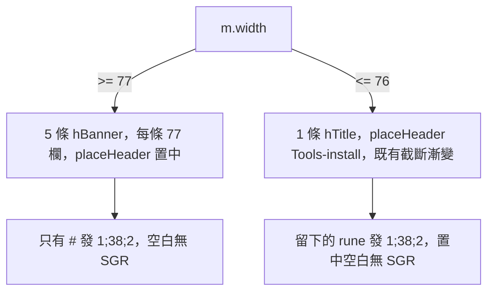
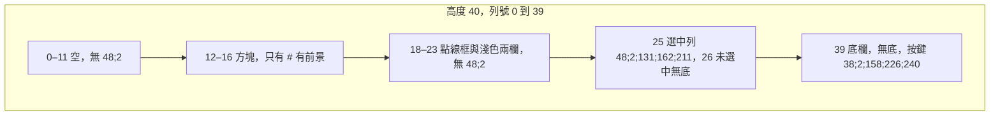

# `tools` 首頁視覺修訂：五行 `Tools-install` 方塊、無填色點線框、只有選中列有底色

> **2026-11-17 更新（進度頁）：** 確認頁、python 的 y 確認、強制重裝 y/n 問句與跳出到 shell 執行命令都已移除；改為 TUI 內的進度頁與 sudo 密碼頁，見 `docs/tools-progress-design.md`。本文件與它衝突的段落以新文件為準。

> **2026-11-17 更新：** 所有畫面已不畫背景色（含選中選單列），只用文字顏色，見 `docs/tools-uninstall-design.md` 第 1 節。本文件與它衝突的段落以新文件為準。

| 欄位 | 值 |
| --- | --- |
| 作者 | 待填 |
| 日期 | 2026-11-13 |
| 狀態 | Draft |
| 模組 | `github.com/shuhi/dotfiles` |
| 適用樹 | `/home/shuhi/project/Dotfiles` |
| 範圍 | 已落地的首頁與「此動作不可用」畫面的視覺。不改安裝語意、不改目錄 |
| 不取代 | `docs/tools-installer-design.md` 的套件名稱、argv、`shadowed`、alias、go tarball、release。`docs/tools-tui-earth-design.md` 與 `docs/tools-installed-row-design.md` 的目錄色票：已安裝列 `#423F59`（`48;2;65;63;89`）、目錄標題 `#394934`（`48;2;56;73;52`）、強制重裝列 `#3F445B`（`48;2;63;68;91`）、金色 `*`、目錄底欄 key `#6DCAE8`。`docs/tools-installed-skip-design.md` 的 `--force` 與「不做解除安裝」。`keymap.go` 的字面值。本文件只推翻 `docs/tools-home-design.md` 裡首頁與不可用畫面的底色、框線、字色與標題列數。按鍵、phase、身分、兩欄公式、漸變演算法留著 |

## Overview

首頁與不可用畫面已經在 `internal/tui/home.go` 落地。標題是一行粗體 `Tools-install`，頁面底是 `#15243C`，卡是填滿的 `#84A2D4`，框是 `+`、`-`、`|`，卡內文字是深色墨水 `#0B121E`，選中列底是 `#BBCCE7`，首頁底欄另有 `#1A2D4C` 色帶。使用者要的修訂是：主題文字要再放大；除了選中的那一列，背景不要有顏色；方框不要填色，框線跟卡內那條點線一樣，用模組裡已有的 Bubble Tea／lipgloss 畫線，不顯示填色方塊；框內文字改淺、欄位維持整齊。

終端機改不了字級。現況的粗體已經用過，所以「放大」改成五行、每字 5 欄的 `#` 方塊，字面值仍是 `Tools-install` 這 13 個 rune。方塊放不進終端機寬度時，整段退回今天的一行標題，沿用同一個桃到青漸變。頁面、標題補白、卡的內部、卡的框、未選中列、不可用畫面、首頁底欄都不發背景 SGR。唯一的背景是選中選單列，錨色 `#84A2D4`，2026-11-13 用本模組的 `testRenderer` 重測，發出的參數仍是 `48;2;131;162;211`。

這份修訂只作用在首頁、偵測中（它已經走同一條首頁堆疊）與不可用畫面。目錄的 `paintTitle`、`paintItem`、`paintFooter`、`earthStyles` 字面值都不動。

## Background & Motivation

現況不是構想，是這些函式今天的行為：

- `internal/tui/home.go` 的 `paintHomeTitle` 對每個 rune 呼叫 `palette.ink(..., pageColor, true)`。`pageColor` 是 `#15243C`。置中空白走 `palette.gap(..., pageColor)`，右補白走 `palette.padTo`。漸變函式 `lerpTitle` 已鎖成 sRGB 8-bit 線性內插再交 `termenv` TrueColor。
- `homeCard`／`buildUnavailable` 用 `plusLine` 畫 `+` 與 `-`，用 `cardInner` 畫 `| ` 與 ` |`。內部分隔是 `cardInner(strings.Repeat(".", content))`，點的顯示寬是 1。`paintCardLine` 把整列，包含框，塗成墨水 `#0B121E` 加卡底 `#84A2D4`。
- `paintMenuLine` 未選中用 `dimColor` `#7F9ED2` 加 `pageColor`；選中用墨水加 `selectColor` `#BBCCE7`。頁邊用 `pageColor`。
- `homeBlank` 對空列呼叫 `Width(width)` 配 `pageColor`。`styles.go` 的註解寫明：已經上色的列不准再送進 `Width`。空字串才可以走 `Width`，因為那時還沒有前景。本修訂連這個頁面底都拿掉。
- `internal/tui/footer.go` 的 `paintHomeHint`／`paintHomeFooterSpan` 把按鍵放在 `homeKeyColor` `#9EE2F0` 加 `footColor` `#1A2D4C`，說明放在 `dimColor` 加 `footColor`，`操作` 放在 `homeKeyColor` 加 `pageColor`。目錄的 `paintFooter` 是另一條路，底仍是 `#393E53`。
- `internal/tui/view.go` 的 `placeHeader` 先 `ansi.Truncate`，再 `left = (width-w)/2`，餘數在右邊。`catalogChrome` 對 detecting、home、unavailable 回 false。`frameSize` 因此不佔目錄標題列。80 欄時 `homeHelp` 寬 48，styled 的 `footerN` 是 1。
- `internal/tui/home_test.go` 的 `TestHomeFrame` 把 80×40 的一行標題鎖在第 14 列，卡在第 16–21 列，選單在第 23–24 列，第 0 列是空字串。`TestHomeStyled` 鎖頁面 `48;2;21;36;60`、卡底 `48;2;131;162;211`、選中列 `48;2;187;204;231`。

痛點：

1. 粗體一行在 80×40 裡不夠被看成主題。使用者再次要求放大。
2. 頁面、卡、框、未選中列、底欄都在發 `48;2`。使用者只要選中列有顏色，其餘透出終端機自己的底。
3. 框是實心色塊上的 `+---+`，和卡內那條 `.` 點線不是同一種線，而且「不顯示」被做成一塊填色矩形。
4. `#0B121E` 是為了壓在亮卡 `#84A2D4` 上才選的深色。卡不再填色之後，框內文字要改淺，欄位仍要對齊。

`docs/tools-home-design.md` 裡和本請求衝突的句子，以本文件為準，而且只對首頁、偵測中與不可用畫面作廢。目錄段落一句都不作廢。

## Goals & Non-Goals

### Goals

- 寬度夠時，主題文字是 5 列、每字 5 欄的 `#` 方塊，來源字面值正好是 `Tools-install`。漸變只塗在 `#` 上，不塗置中空白，也不塗字形裡的空格。置中用 `placeHeader` 的餘數在右。寬度不夠時整段退回一行，不切到一半字形，不 panic，不呼叫外部 `figlet`。
- 除了選中的選單列，首頁與不可用畫面不發任何背景 SGR：沒有 `48;2`，沒有 SGR 7。終端機底色透出來。
- 選中列的底是錨色 `#84A2D4`，鎖重測後的 `48;2;131;162;211`。這一列的字改回 `#0B121E`，因為淺色字在這層底上的對比是 1.990:1。其餘文字維持淺色。
- 卡沒有填色，框也沒有前景色與背景色。框與內部分隔只用 ASCII `.`，由現有的 `plusLine`／`cardInner` 畫，不走 `lipgloss.Style.Border`。plain 與 styled 的框是同一組 rune。plain 沒有 ANSI。
- 框內文字、未選中選單、溢出那一句、首頁底欄的說明，前景鎖 `#D7E4EA` 發出的 `38;2;215;227;234`，沒有背景。兩欄公式不變。80 欄 Fedora／`shuhi`／`dotfiles` 的 plain 列寫死在下面。
- 不可用畫面用同一套方塊標題、同一套無填色點線框、同一套淺色字。文案仍是 `此動作不可用` 與 `不移除發行版套件，也不刪除檔案。`。
- 80×40 的列號按變高的標題重算。第 0 列仍是空的。底欄仍是最後一列，不在置中的那一疊裡。首頁底欄去掉填色。按鍵字形保留 `#9EE2F0` 前景。目錄底欄不變。
- 按鍵、phase、偵測中先畫首頁、`esc` 回首頁、`q` 離開、`tools-download` 只進目錄、`tools-uninstall` 不刪檔，全部維持 `docs/tools-home-design.md`。寬度小於 5 不 panic。截斷仍用 `ansi.Truncate`。不上外層 `Width` 去包已上色的字串。`m.scroll` 不寫。不用 `bubbles/list`，不用 `bubbles/help`。plain 與 `NO_COLOR` 沒有 ANSI。styled 測試走 `testRenderer` 與 `renderStyled`。

### Non-Goals

- 不改 `earthStyles` 的 hex，不改 `paintTitle`、`paintItem`、`paintInstalledItem`、`paintFooter`、`paintHeader`。目錄標題不得出現在首頁，首頁也不得出現 `48;2;56;73;52`、`48;2;65;63;89`、`48;2;63;68;91`、`48;2;43;44;58`、`38;2;109;202;232`、`38;2;225;227;227`。
- 不改 `keymap.go`、`update.go` 的按鍵表、`view.go` 的 `placeHeader`／`frameSize`／`catalogChrome`／`clipLines`。
- 不改身分規則。`cleanIdentity`、`未知`、`homeSystem`、`homeArch`、測試注入的四個字串留著。
- 不對發行版套件組移除 argv，不呼叫 `os.Remove`。不可用畫面的純文字仍不得含 `apt-get`、`dnf`、`yum`、`pacman`、`brew uninstall`。
- 不加依賴。`go.mod` 不動。不執行 `figlet`，也不把 figlet 字型檔放進模組。
- 不把方塊字改成全形或 East Asian Ambiguous 的 `█`。那些在 `ansi.StringWidth`（`EastAsianWidth: false`）是寬 1，在部分終端機卻是寬 2，80 欄會折行。
- 不開只改色、不改點線框的 PR。兩件事在同一批 `paintCardLine` 裡，拆開不能單獨審。

## Proposed Design

### 標題方塊

`homeTitleText` 仍是 `Tools-install`。`[]rune` 長度 13，`ansi.StringWidth` 也是 13。產品句子若寫成 12，會把最後一個 `l` 丟掉。

終端機沒有字級。方塊是手寫的 5×5 點陣，不是像素縮放，也不是子程序。墨水 rune 是 ASCII `#`（U+0023），空格是 ASCII 空白（U+0020）。字與字之間再隔 1 格空白。13 字 × 5 欄 + 12 個間隔 = 77。這個 77 是方塊的顯示寬，也是回退門檻。

需要的 rune 是 `T`、`o`、`l`、`s`、`-`、`i`、`n`、`t`、`a`。`t` 與 `T` 不同。同一個字母的兩次出現（兩個 `o`、兩個 `s`、三個 `l`）共用點陣，但顏色按來源索引分開，見漸變一節。

```go
const (
	titleGlyphW   = 5
	titleGlyphH   = 5
	titleGlyphGap = 1
)

// titleBlockWidth is 13*5 + 12*1 = 77.
func titleBlockWidth() int { return 77 }

var titleGlyph = map[rune][5]string{
	'T': {"#####", "  #  ", "  #  ", "  #  ", "  #  "},
	'o': {" ### ", "#   #", "#   #", "#   #", " ### "},
	'l': {"#    ", "#    ", "#    ", "#    ", "#####"},
	's': {" ####", "#    ", " ### ", "    #", "#### "},
	'-': {"     ", "     ", "#####", "     ", "     "},
	'i': {"  #  ", "     ", "  #  ", "  #  ", "  #  "},
	't': {"  #  ", "#####", "  #  ", "  #  ", "  ## "},
	'n': {"#   #", "##  #", "# # #", "#  ##", "#   #"},
	'a': {"     ", " ### ", "#   #", "#   #", " ####"},
}
```

每一格都是顯示寬 1。第 `i` 個字（`i` 從 0）佔方塊內的欄 `[i*6, i*6+5)`。第 `i*6+5` 欄是間隔，最後一個字後面沒有間隔。空格不是墨水。`-` 的第 0、1、3、4 列、`a` 的第 0 列、`i` 的第 1 列整格都是空格，該字在那一列沒有 SGR。

五行方塊，字與字之間一格，還沒置中：

```text
#####  ###   ###  #      ####         #   #   #  ####   #         #     #    
  #   #   # #   # #     #                 ##  # #     #####  ###  #     #    
  #   #   # #   # #      ###  #####   #   # # #  ###    #   #   # #     #    
  #   #   # #   # #         #         #   #  ##     #   #   #   # #     #    
  #    ###   ###  ##### ####          #   #   # ####    ##   #### ##### #####
```

上面每行顯示寬 77。最後一個 `l` 的空欄是行尾空白，複製時以程式裡的字串字面值為準，不要依賴被編輯器吃掉的行尾空白。組行的函式：

```go
func titleBannerRows() [5]string {
	rs := []rune(homeTitleText)
	var out [5]string
	for row := 0; row < titleGlyphH; row++ {
		var b strings.Builder
		for i, r := range rs {
			if i > 0 {
				b.WriteByte(' ')
			}
			g, ok := titleGlyph[r]
			if !ok {
				b.WriteString(strings.Repeat(" ", titleGlyphW))
				continue
			}
			b.WriteString(g[row])
		}
		out[row] = b.String()
	}
	return out
}
```

缺字不 panic。`Tools-install` 的每個 rune 都在表裡，缺字分支只是防表被改壞：那 5 欄畫成空白，沒有墨水，沒有 SGR。

`buildTitle` 在 `width >= 77` 時回 5 條 `hBanner`，`text` 是上面的 77 格字串。`width < 77` 時回 1 條今天的 `hTitle`，不帶方塊。回退從寬度 76 開始，含 76。寬度 77 時方塊剛好滿寬，`left = 0`。不要在 76 欄把方塊送進 `ansi.Truncate`，半個 `#` 不是字。

置中呼叫既有 `placeHeader(row, width)`。`row` 顯示寬 77，且 `width >= 77`，所以 `Truncate` 是空操作，`left = (width-77)/2`，餘數在右邊。這就是 `placeHeader` 的規則，不要改 `placeHeader`，也不要對字面值 `Tools-install` 取 left 再拿去擺 77 欄的方塊。後者在 80 欄會得到 left 33，方塊會超出右緣。

80 欄：`left = (80-77)/2 = 1`，右邊 `80-1-77 = 2`。五行的 plain 是 `spaces(1) + row + spaces(2)`，顯示寬 80。styled 的左 1 格與右 2 格是原始空白，沒有 SGR。方塊內部的空白，包含字形洞與字間距，也是原始空白，沒有 SGR。只有 `#` 上色。

每個 `#` 單獨呼叫前景函式，粗體，不設背景。字索引 `letter = col / 6`，`col` 是方塊內的欄，不含左邊那 1 格。`col%6 == 5` 是間隔，字元一定是空白，不會是 `#`。顏色是 `lerpTitle(13, letter)`，和一行標題未截斷時的 13 格同一張表。一個字的五行共用該字的顏色，字本身不再做第二次漸變。

`#` 的個數，測試用來數 SGR 出現次數。每個 `#` 一次 `ink` 等級的呼叫，不把相鄰同色合併，所以次數等於個數：

| i | rune | `#` 數 | hex | 量到的 `38;2` |
| --- | --- | --- | --- | --- |
| 0 | `T` | 9 | `#F0ADA0` | `38;2;240;173;160` |
| 1 | `o` | 12 | `#E9B1A7` | `38;2;233;177;167` |
| 2 | `o` | 12 | `#E2B6AD` | `38;2;226;182;173` |
| 3 | `l` | 9 | `#DCBAB4` | `38;2;220;186;179` |
| 4 | `s` | 13 | `#D5BFBB` | `38;2;213;191;187` |
| 5 | `-` | 5 | `#CEC3C1` | `38;2;206;195;193` |
| 6 | `i` | 4 | `#C7C8C8` | `38;2;199;200;200` |
| 7 | `n` | 13 | `#C0CCCF` | `38;2;192;204;207` |
| 8 | `s` | 13 | `#B9D0D5` | `38;2;185;208;213` |
| 9 | `t` | 10 | `#B3D5DC` | `38;2;179;213;220` |
| 10 | `a` | 11 | `#ACD9E3` | `38;2;172;217;227` |
| 11 | `l` | 9 | `#A5DEE9` | `38;2;165;222;233` |
| 12 | `l` | 9 | `#9EE2F0` | `38;2;158;226;240` |

合計 129 個 `#`。每一個的 SGR 是 `1;38;2;R;G;B`，沒有 `48;2`。i=3 仍是 `38;2;220;186;179`，不是 `38;2;220;186;180`。這張表是 2026-11-13 用下面的 renderer 對 `lerpTitle` 的 hex 重測的，和 `docs/tools-home-design.md` 的 13 格一致。

`lerpTitle` 的函式本體不改。一行回退也用它，規則不改：先 `placeHeader(homeTitleText, width)`，再對留下的 rune 重算 `t = i/(n-1)`。寬度 4 的可見字串仍是 `Too…`，`n == 3`，三格是起點 `38;2;240;173;160`、中點 `38;2;199;200;200`、終點 `38;2;158;226;240`，省略號複製終點，不是 13 格表的第 4 格。寬度 1 的 `…` 只有起點。和今天的差別只有一點：這些字形沒有背景。第一個 `38;2` 前面不得有 `48;2`。

80 欄的畫面不含連續子字串 `Tools-install`。方塊把字母拆開了。`TestNoColorIsPlainText`、`TestDetectOpensHome`、`TestDetectingEnterIgnored` 今天在預設 80×40 上找這個子字串，要改成找方塊第 0 列的 `#####`，或直接比對五行。失敗的 `phaseFailed` 仍是目錄，不得含這五行，也不得含 `Tools-install`。寬度小於 77 的一行回退仍含這個子字串（寬度 4 則是 `Too…`）。



### 沒有背景，除了選中列

`palette.ink`、`palette.gap`、`palette.padTo` 都會設背景。首頁若繼續呼叫它們，就會再發出 `48;2`。新增一個只設前景的函式，放在 `home.go`，不改 `styles.go` 的三個舊函式：

```go
func homeFG(p palette, text string, c lipgloss.Color, bold bool) string {
	st := p.r.NewStyle().Inline(true).Foreground(c)
	if bold {
		st = st.Bold(true)
	}
	return st.Render(text)
}
```

`homeFG` 不呼叫 `Background`，不呼叫 `Width`，不呼叫 `Reverse`。選中列是唯一還要背景的表面，那一列繼續用 `palette.ink` 與 `palette.gap`，背景引數是錨色，不是頁面色。

`homeBlank` 在 styled 也回 `""`。`renderStyled` 拿它當舞台多餘列的 fill，所以那些列沒有 `48;2`，也不是 80 格空白。plain 本來就是 `""`。第 0 列因此在 plain 與 styled 都是空字串。

右補白改成自己用 `ansi.StringWidth` 算完，再接 `spaces`。不要對已經上色的標題、卡或選單呼叫 `padTo`，也不要呼叫 `lipgloss` 的 `Width` 或 `Height`。

從 `home.go` 刪掉不再繪製的常數：`pageColor` `#15243C`、舊的 `selectColor` `#BBCCE7`、`dimColor` `#7F9ED2`、`footColor` `#1A2D4C`。`#84A2D4` 留下，但只當選中列的底，常數名改成 `selectColor`，避免再被讀成卡的填色。`inkColor` `#0B121E` 留下，只給選中列。`homeKeyColor` `#9EE2F0` 留下，只給首頁底欄的按鍵字形。新增 `textColor` `#D7E4EA`。

### 選中列的錨色與對比

量測用 `internal/tui/style_test.go` 的 `testRenderer`：`lipgloss.NewRenderer(io.Discard)`、`SetColorProfile(termenv.TrueColor)`、`SetHasDarkBackground(true)`。lipgloss v1.1.0、termenv v0.16.0、`go-colorful` v1.3.0。`termenv.RGBColor.Sequence` 是 `uint8(f.R*255)` 截斷，不是四捨五入。對比用發出的通道做 WCAG 2.1 相對亮度，門檻 4.5:1。終端機格子不是 CSS 的大字，不套 3:1。

2026-11-13 重測：

| hex | 整數通道 | 發出的前景 | 發出的背景 |
| --- | --- | --- | --- |
| `#84A2D4` | 132,162,212 | `38;2;131;162;211` | `48;2;131;162;211` |
| `#0B121E` | 11,18,30 | `38;2;11;18;30` | `48;2;11;18;30` |
| `#D7E4EA` | 215,228,234 | `38;2;215;227;234` | 不使用 |
| `#9EE2F0` | 158,226,240 | `38;2;158;226;240` | 不使用 |

`#84A2D4` 的 R 從 132 截成 131，B 從 212 截成 211。和上一份文件量到的卡底相同。測試寫 `48;2;132;162;212` 會失敗。`#D7E4EA` 的 G 從 228 截成 227。測試寫 `38;2;215;228;234` 會失敗。

`#D7E4EA` 對選中底 `131,162,211` 的對比是 1.990:1（未捨入 1.9898）。低於 4.5。所以選中列的字不用淺色，改用既有墨水 `#0B121E`。墨水對同一個底是 7.212:1（未捨入 7.2120）。其餘表面沒有我們發的背景，淺色留在那裡：框內文字、未選中選單、溢出句、底欄說明。淺色對純黑是 16.065:1，方向是給深色終端機看的。`testRenderer` 已設 `HasDarkBackground(true)`，目錄也是 Andromeda 深色。本文件不為未知的淺色終端機再做一套前景。

選中列的結構沿用 `menuLine`。80 欄、卡寬 68、左緣 6 時，色帶仍是卡寬 68，不是終端機 80。左右各 6 格是原始空白，沒有 `48;2`。色帶裡的 `>` 與名稱是粗體墨水，提示不是粗體，名稱與提示之間的空白只有背景、沒有前景，跟今天 `palette.gap` 的畫法一樣，只是底從 `#BBCCE7` 換成 `#84A2D4`。未選中列的文字是淺色、不粗體、沒有背景，補白也是原始空白。

`cardWidth >= 30` 的提示幾何不變。小於 30 時仍先 `ansi.Truncate(mark+name, cardWidth, "…")` 再補到卡寬。寬度 20 的 plain 選中列仍是 `> tools-download` 加 4 格空白，顯示寬 20。styled 時這 20 格的背景都是 `48;2;131;162;211`，不是舊的 `48;2;187;204;231`，也不是只塗 16 格字。

### 點線框

內部分隔今天就是 ASCII `.`。框改成同一種點、同一種顯示寬，不另造 `─`、`│`、`+`、`-`、`|`。`lipgloss.ASCIIBorder` 是 `+` `-` `|`，`NormalBorder` 是 `─` `│`，兩者都是第二種線，不用。

畫框的函式是 `home.go` 裡現有的兩個，不走 `lipgloss.Style.Border`，也不呼叫未匯出的 `applyBorder`。`Style.Render` 在字串含換行時會跑 `alignTextHorizontal`。卡的文字要先上淺色前景，再送進 `Render` 就是「已上色的字串走外層寬度」。`styles.go` 已禁止這條。`styleBorder` 在前景與背景都沒設時會回原始 rune，但它只從 `Render` 進得去。

`plusLine` 改名 `dotRule`。`cardInner` 留名，側邊 rune 從 `|` 改成 `.`：

```go
func dotRule(content int) string {
	if content < 0 {
		content = 0
	}
	return strings.Repeat(".", content+4)
}

func cardInner(body string) string {
	return ". " + body + " ."
}
```

| 部位 | rune | 誰畫 |
| --- | --- | --- |
| 四個角 | `.` | `dotRule` 的兩端，各 1 格 |
| 上緣、下緣 | `.` | `dotRule` 的中間 `content+2` 格。整列長 `content+4`，沒有空白 |
| 左緣、右緣 | `.` | `cardInner` 的第一格與最後一格 |
| 側邊內距 | 一個空白 | `cardInner` 的第 2 格與倒數第 2 格。這是距，不是第二種線 |
| 內部分隔 | `.` | `cardInner(strings.Repeat(".", content))`。點從文字的第一欄開始，兩側仍是 `. ` 與 ` .` |

上緣是 `content+4` 個連續的 `.`。內部分隔不是同一條字串：第 2 格與倒數第 2 格是空白，中間才是 `content` 個 `.`。80 欄那張卡的內文寬 64，所以分隔列的 68 格核心是 `.`、空白、64 個 `.`、空白、`.`。不要把它「簡化」成 `dotRule`，否則點會吃掉文字欄的起點，兩欄對不齊。

`hKind` 加上 `hRule`。上緣、下緣、內部分隔是 `hRule`。標頭是 `hHead`。欄位是 `hCard`。`hRule` 在 styled 也只做 `plainPad`，不呼叫 `homeFG`，不呼叫 `ink`。plain 與 styled 的框因此是同一組 rune，styled 的框列沒有 `\x1b`。

`hHead` 與 `hCard` 的 `text` 仍是 `cardInner` 的結果。上色時剝掉首尾各 2 個 rune（`.` 與空白），只對中間的 body 呼叫 `homeFG`，再把 `. ` 與 ` .` 用原始字串接回去。標頭 body 粗體，欄位 body 不粗體。這樣主機名裡若有 `.`，不會被當成框。`hRule` 不走這條，所以分隔列的點不會被塗上淺色。

80 欄 fixture 的卡核心，顯示寬都是 68，左緣 6，右緣 6。plain 整列：

```text
      ....................................................................      
      . 本機                                                             .      
      . ................................................................ .      
      . 系統  Fedora Linux 45 (WSL) [GOOS=linux]      使用者    shuhi    .      
      . 架構  x86_64（GOARCH=amd64, uname-m=x86_64）  電腦名稱  dotfiles .      
      ....................................................................      
```

這六列是 `spaces(6) + core + spaces(6)`。core 由 `dotRule(64)`、`cardInner(padWidth("本機", 64))`、`cardInner(strings.Repeat(".", 64))` 與下面兩條 `fieldRow` 組成。styled 時第 1、3、4 條 core 的 body 才有 `38;2;215;227;234`。第 1 條另有 `1;`。第 0、2、5 條沒有 `\x1b`。左右 6 格沒有 `\x1b`。整張卡沒有 `48;2`。

不可用畫面的卡，內文寬 32，框寬 36，80 欄左緣 `(80-36)/2 = 22`，右邊也是 22。plain：

```text
                      ....................................                      
                      . tools-uninstall                  .                      
                      . ................................ .                      
                      . 此動作不可用                     .                      
                      . 不移除發行版套件，也不刪除檔案。 .                      
                      ....................................                      
```

標頭 `tools-uninstall` 是粗體淺色。另外兩句不粗體。三句的字面值不改。框列沒有 `\x1b`。這個畫面沒有選單，所以整幀沒有 `48;2`。

### 淺色與兩欄

淺色選 `#D7E4EA`。它比墨水 `#0B121E` 淺，飽和度低，色相偏冷，放在桃 `#F0ADA0` 到青 `#9EE2F0` 旁邊不會跟標題兩端搶。它不是目錄的 cream `#E1E3E4`（那個發出 `38;2;225;227;227`），也不是漸變 13 格裡的任何一格。發出的前景鎖 `38;2;215;227;234`。

兩欄公式不改，`fieldRow` 不改：

```go
func fieldRow(ll, lv string, lw int, rl, rv string, rw int) string {
	return padWidth(ll, 4) + "  " + padWidth(lv, lw) + "  " + padWidth(rl, 8) + "  " + padWidth(rv, rw)
}
```

| 段 | 寬 | 80 欄 fixture |
| --- | --- | --- |
| 左標籤 | 4 | `系統`、`架構` 都是 4，不補 |
| 標籤與值 | 2 格空白 | 固定 |
| 左值 | `max(系統寬, 架構寬)`，放不下時改預算 | 38。系統 34，後面補 4 |
| 欄間 | 2 格空白 | `]` 與 `使` 之間因此是 6 |
| 右標籤 | 8 | `使用者` 寬 6，補 2。`電腦名稱` 寬 8，不補 |
| 標籤與值 | 2 格空白 | `者` 與 `s` 之間因此是 4。`稱` 與 `d` 之間是 2 |
| 右值 | `max(使用者寬, 主機名寬)` | 8。`shuhi` 補 3。`dotfiles` 不補 |

固定開銷仍是 18。`B >= 20` 才維持兩欄，否則四列單欄。這些門檻不改。身分仍是 `homeSystem`、`homeArch`、`shownID`。空值、錯誤、控制字元仍是 `未知`。測試仍注入 `Fedora Linux 45 (WSL) [GOOS=linux]`、`x86_64（GOARCH=amd64, uname-m=x86_64）`、`shuhi`、`dotfiles`。

上面兩條欄位列的 body，顯示寬 64，就是 `fieldRow` 的回傳值。接上 `cardInner` 之後是上一節的第 4、第 5 列核心。

### 80×40 的列號

寬度 80 大於 77，標題佔 5 列。首頁堆疊從 11 列變成 15 列：

| 堆疊偏移 | 內容 |
| --- | --- |
| 0–4 | 方塊五行 |
| 5 | 空列 |
| 6 | 上緣 `dotRule` |
| 7 | 標頭 `本機` |
| 8 | 內部分隔 |
| 9 | `系統` 與 `使用者` |
| 10 | `架構` 與 `電腦名稱` |
| 11 | 下緣 |
| 12 | 空列 |
| 13 | `tools-download` |
| 14 | `tools-uninstall` |

`footerN` 在寬度 80 仍是 1。`homeHelp` 顯示寬 48，`unavailableHelp` 顯示寬 34，`layoutFooter` 都排得進一列。`headerN` 與 `statusN` 仍是 0。舞台高 `40-1 = 39`。`top = (39-15)/2 = 12`。餘數在下方。第 0 列是空的。底欄是第 39 列，不在這 15 列裡。

| 列 | plain |
| --- | --- |
| 0–11 | 空字串 |
| 12–16 | 方塊五行。左 1、右 2。第 12 列是 `T` 的 `#####` 那一列 |
| 17 | 空字串 |
| 18–23 | 上一節的六列卡，每列顯示寬 80，左右各 6 |
| 24 | 空字串 |
| 25 | `      > tools-download                                        進入目錄安裝      ` |
| 26 | `        tools-uninstall                                       此動作不可用      ` |
| 27–38 | 空字串 |
| 39 | `操作  ↑/k 上一項  ↓/j 下一項  enter 進入  q 離開` |

第 25 列：`tools-download` 與 `進` 之間 40 格。第 26 列：`tools-uninstall` 與 `此` 之間 39 格。這兩段幾何跟今天一樣，只是從第 23–24 列移到第 25–26 列。預設 `homeIndex == 0`，所以第 25 列是選中列。

不可用畫面堆疊 12 列：方塊 5、空列、卡 6。`top = (39-12)/2 = 13`。

| 列 | plain |
| --- | --- |
| 0–12 | 空字串 |
| 13–17 | 同一套方塊，左 1、右 2 |
| 18 | 空字串 |
| 19–24 | 上一節的六列不可用卡，左右各 22 |
| 25–38 | 空字串 |
| 39 | `操作  enter 返回  esc 返回  q 離開` |

styled 的空列也是 `""`，不是 80 格頁面色。方塊列、卡列、選單列的 `ansi.StringWidth` 仍是 80。底欄 plain 不補到 80，字串等於 `homeHelp` 或 `unavailableHelp`。styled 底欄用原始空白補到 `m.width`，那些空白沒有 SGR。

高度 3、寬度 80、plain：`bodyH = 2`，堆疊 15，`clipLines` 留 1 列方塊，第二列是 `…還有 14 行`，第三列是 `homeHelp`。今天這組高度寫的是 `…還有 10 行`，因為舊堆疊是 11。styled 的這句是 `38;2;215;227;234`，沒有 `48;2`，沒有 `48;2;131;162;211`。

寬度 76 及以下不畫方塊，堆疊回到 11（兩欄卡）或 12（寬度 5–23 的四列單欄）。那是回退，不是 80 欄的黃金列號。寬度 40、高度 40 的一行標題因此仍落在舞台裡的舊相對位置，但框 rune 已是 `.`，而且標題沒有背景。



### 首頁底欄

使用者要求背景除了選中列以外都不要有顏色，所以首頁底欄去掉 `#1A2D4C` 與頁面色。目錄底欄不在這句話的範圍裡，`paintFooter` 仍鋪 `#393E53`。

`paintHomeHint` 與 `paintHomeFooterSpan` 不再呼叫 `ink`、`gap`、`padTo`。

| 片段 | 前景 | 背景 | 粗體 |
| --- | --- | --- | --- |
| `操作`，以及按鍵 `↑/k`、`↓/j`、`enter`、`esc`、`q` | `#9EE2F0`，`38;2;158;226;240` | 無 | 否 |
| 說明，含 `上一項`、`下一項`、`進入`、`返回`、`離開` | `#D7E4EA`，`38;2;215;227;234` | 無 | 否 |
| 片段之間的空白、硬切剩下的字、`footerEllipsis` | 硬切與省略號用淺色；間隔空白無前景 | 無 | 否 |

`操作` 沿用今天的按鍵色，不再單獨鋪頁面底。它不是選中列。80 欄第 39 列含 `38;2;158;226;240` 與 `38;2;215;227;234`，不含 `48;2`，不含目錄 key `38;2;109;202;232`，不含目錄 footer `48;2;56;62;83`。

偵測中走 `paintHomeFooter`，所以同一套無填色底欄。`phaseFailed`、browsing、confirm、installing、report 仍走 `paintFooter`。

### 窄寬與裁切

`width <= 0` 不呼叫負數的 `Repeat`。`height <= 0` 仍回 `""`。`width` 0 到 76 的標題是一行回退。`width` 1 到 4 仍不畫卡：堆疊是截斷標題、空列、兩條截斷選單。寬度 4 的標題是 `Too…`，選中列是 `> t…`。`width >= 5` 的卡預算 `B = width-4` 與兩欄／單欄門檻不改。全形讓 `Truncate` 短 1 時，短的那一格進該欄補白，不放進框外。

方塊路徑不呼叫 `Truncate`。一行路徑才呼叫。`strings.Repeat` 的次數先夾到大於等於 0。

### 不變的行為

以下仍以 `docs/tools-home-design.md` 為準，本文件不重寫按鍵表：

- `phaseDetecting` 畫首頁，`enter` 不進目錄，`q` 與 `ctrl+c` 離開。
- `phaseHome` 的 `enter`：index 0 進 `phaseBrowsing`，index 1 進 `phaseUnavailable`。不呼叫 `startInstall`。
- 不可用畫面的 `enter` 與 `esc` 回首頁。`q` 離開。
- browsing 在問句關著時 `esc` 回首頁。問句開著時 `onAskKey` 先贏。
- `tools-uninstall` 不執行 `exec`，不執行 `os.Remove`。
- `m.scroll` 沒有寫入者。`keymap.go` 不改。`phaseFailed` 仍是目錄失敗畫面，說明列仍含 `enter` 與 `d`。

## API / Interface Changes

沒有匯出簽名的變更。`tui.New`、`SetDeps`、`ExitCode`、`FormatHeader`、`FormatItem` 不動。`cmd/tools` 的 `Styled` 閘門不動。

套件內部：

- `home.go`：`plusLine` 改名 `dotRule`。`cardInner` 的側邊改成 `.`。新增 `hBanner`、`hRule`、`titleGlyph`、`titleBannerRows`、`buildTitle`、`homeFG`、`textColor`。`paintHomeTitle` 去掉所有背景。`paintCardLine` 只為 `hHead`／`hCard` 的 body 上前景。`hRule` 不上色。`paintMenuLine` 的頁邊改成原始空白，選中底改成 `#84A2D4`，未選中前景改成 `textColor`。`homeBlank` 回 `""`。刪除 `pageColor`、`dimColor`、`footColor` 與舊的 `#BBCCE7`。
- `footer.go`：只改 `paintHomeHint` 與 `paintHomeFooterSpan`。`paintFooter`、`homeHelp`、`unavailableHelp`、`footerHints`、`plainHelp` 的字面值不改。
- `styles.go`、`view.go`、`update.go`、`keymap.go`、`model.go` 不改。`view.go` 繼續呼叫 `homeBlank` 與 `paintHomeFooter`，行為跟著這兩個函式走。

## Data Model Changes

沒有新欄位，沒有磁碟遷移。`homeIndex`、`homeUser`、`homeHost`、`scroll` 的型別與寫入規則不變。方塊是常數，不進 model。

## Alternatives Considered

### 維持頁面 `#15243C` 與卡填色 `#84A2D4`

這是 `docs/tools-home-design.md` 的現況。標題漸變鋪在深頁面上，左端對比 8.292:1。卡上的墨水對卡底 7.212:1。

駁回。使用者要求背景不要有顏色，只有選中時才有顏色，而且方框不顯示填色。頁面底與卡填色都作廢。`#84A2D4` 改到選中列。這個決定只影響首頁、偵測中與不可用畫面。目錄不跟著變透明。

### 選中列沿用 `#BBCCE7`，錨色繼續只當卡的填色

少一次對比計算。`#BBCCE7` 發出 `48;2;187;204;231`，墨水對它是 11.527:1。

駁回。錨色是使用者指定的主題色。卡不再填色之後，它若不出場，畫面上就沒有這層顏色。選中列是唯一允許的背景，所以錨色放在那裡。`#BBCCE7` 從 `home.go` 刪除。

### 選中列也用淺色 `#D7E4EA`

少一個前景。

駁回。淺色對 `48;2;131;162;211` 是 1.990:1，低於 4.5。選中列改墨水，對比 7.212:1。淺色留在沒有背景的表面。

### 框用 `lipgloss.ASCIIBorder` 或 `NormalBorder`

模組裡現成的框。`ASCIIBorder` 的角是 `+`，邊是 `-` 與 `|`。`NormalBorder` 的角是 `┌┐└┘`，邊是 `─` 與 `│`。

駁回。內部分隔的線重是 ASCII `.`。這兩組都是第二種線。使用者也要求框跟那條線一樣。另外 `Style.Border` 只能經 `Style.Render` 畫出來，多行內容會進 `alignTextHorizontal`。卡的 body 已經帶前景，不能再送進去。

### 自訂 `lipgloss.Border`，每個邊都填 `.`

線重對了，而且 `styleBorder` 在沒有前景與背景時會回原始 rune。

駁回。那個 Border 仍要經過 `Render` 才畫得出邊，問題與上一則相同。`dotRule` 與 `cardInner` 已經擁有上緣、側邊與內部分隔，改 rune 就夠了。不包一層沒有呼叫點的 Border 常數。

### 只把現有的一行標題加粗，或在上下各加一條線

改動最小。

駁回。現況已經是粗體。使用者再次要求放大。上下加線沒有把字母變高。五行點陣才是可測試的放大。寬度不夠才退回這一行，而且退回時仍保留漸變。

### 執行 `figlet`，或把 figlet 字型嵌進模組

字母比較像展示字。

駁回。不新增依賴，不呼叫外部二進位，也不把另一份字型的版權文本抄進樹裡。點陣是這份文件裡的 9 個字，工程師可以對 `#` 的個數寫測試。

### 用 `█` 或 `▀▄` 當墨水

看起來更實。

駁回。U+2588 在 Unicode 是 Ambiguous。本模組的 `ansi.StringWidth` 把它算成 1，使用者的終端機若把 Ambiguous 畫成 2，80 欄的方塊會折行。`#` 在兩種算法都是 1。

### 只改色、框留到下一個 PR

審閱diff 較小。

駁回。無填色與否就是框怎麼畫。只改色的 PR 要么仍鎖住已經作廢的 `48;2;131;162;211` 卡底，要么畫出沒有線的文字，不能單獨判斷「跟點線一樣」。顏色、方塊、點線框、底欄去填色放在同一個 PR。

### 首頁底欄保留 `#1A2D4C`，只把它說成不是頁面

底欄今天就有自己的色帶，按鍵青字在上面是 9.672:1。

駁回。使用者說背景只有選中時才有顏色。首頁底欄不是選中列。按鍵改成同一支青字前景、沒有底。目錄底欄的 `#393E53` 不在這次範圍，`TestStyledFooterBackground` 繼續鎖目錄那兩列的 `48;2;56;62;83`。

## Security & Privacy Considerations

這次沒有新的識別資料，沒有新的子程序，沒有新的檔案讀取。登入名與主機名仍只畫在本機 alt screen。`cleanIdentity` 見到 `r < 0x20` 或 DEL 仍整筆換成 `未知`。不可用畫面仍不呼叫 `exec` 與 `os.Remove`。

| 威脅 | 嚴重度 | 處理 |
| --- | --- | --- |
| 拿掉背景之後，把使用者名稱送進會重設 SGR 的 `Width`，ESC 殘留把後面的列染色 | 中 | 名稱仍先被 `cleanIdentity` 拒絕控制字元。畫卡只用 `homeFG` 與字串拼接，不呼叫 `Width` |
| 選中列的淺色在 `#84A2D4` 上讀不清，使用者誤觸 `tools-uninstall` | 低 | 該列改墨水，對比 7.212:1。而且該列只打開說明畫面，不刪檔 |
| 方塊或框的 rune 被終端機當成控制序列 | 低 | 只用 `#`、空白、`.` 與既有文案。沒有 ESC |
| 為了畫框去殼執行 `figlet` | 中 | 點陣是常數。測試不需要外部二進位 |
| 修訂時誤改目錄底欄或 `paintTitle`，把 `#394934` 或已安裝紫換掉 | 高 | `styles.go` 的 `paintTitle` 與 `paintFooter` 不在修改範圍。首頁測試繼續禁止 `48;2;56;73;52` 與 `48;2;65;63;89` |

## Observability

沒有新的 log，沒有 metrics。首頁與不可用畫面仍不呼叫 `Deps.Log`。偵測失敗仍是 `m.status` 與退出碼 2。

回歸靠 `renderStyled(m, testRenderer())`，不靠 `render(m, true)`，不靠截圖。

| 測試 | 斷言 |
| --- | --- |
| `TestHomeFrame` | 80×40、phase home、plain。40 列。第 0 列是 `""`。第 12–16 列是方塊，左 1 右 2，顯示寬 80。第 18–23 列是點線卡，左右各 6，不含 `+` 與 `\|`。第 25、26 列是兩條選單。第 39 列等於 `homeHelp`。整幀不含 `Tools-install` 這個連續子字串，不含 `系統:`，不含 `\x1b`，不含 `任意鍵關閉`。`scroll` 是 0 |
| `TestHomeStyled` | 同一 fixture，`renderStyled`。整幀的 `48;2` 只有 `48;2;131;162;211`，而且只出現在第 25 列，格數 68。第 12–16 列合計 129 次粗體前景，次數符合上表，i=3 是 `38;2;220;186;179`，沒有 `48;2`。第一個 `38;2` 之前只有空白。第 18、20、23 列沒有 `\x1b`。第 19 列的 `本機` 含 `1;38;2;215;227;234`，不含 `48;2`。第 21、22 列含 `38;2;215;227;234`，不含 `1;`，不含 `48;2`。第 26 列含淺色前景，不含 `48;2;131;162;211`。第 39 列含 `38;2;158;226;240` 與 `38;2;215;227;234`，不含 `48;2`。整幀不含 `48;2;21;36;60`、`48;2;26;44;76`、`48;2;187;204;231`、`48;2;56;73;52`、`48;2;43;44;58`、`48;2;65;63;89`、`38;2;225;227;227`、`38;2;109;202;232`、`38;2;127;158;210`、`\x1b[7;` |
| `TestUnavailableFrame` | 標題改到第 13–17 列。卡在第 19–24 列，左右各 22，核心是上一節的 36 寬點線。文案不變。styled 整幀沒有 `48;2`。窄寬 4 仍是 `Too…` 與截斷的第二句，沒有 `+` |
| `TestHomeNarrow` | 寬度 4 仍含 `Too…`，styled 仍是三格起點、中點、終點，省略號沿用終點，且沒有 `48;2`。寬度 1 的 `…` 只有起點。寬度 0、高度 5 不 panic。寬度 40 仍是 `Fedora L…` 與 `x86_64（…`，框是 `.` 不是 `+`。寬度 20 的選中色帶是 20 格 `48;2;131;162;211`。高度 3、寬度 80 的第二列是 `…還有 14 行`，styled 為淺色且沒有 `48;2` |
| `TestNoColorIsPlainText` | 目錄 plain 仍無 ANSI。首頁 plain 無 ANSI，含方塊第 0 列的 `#####`，不要再要求連續的 `Tools-install` |
| `TestDetectOpensHome`、`TestDetectingEnterIgnored` | 80×40 的成功畫面含方塊、不含連續的 `Tools-install`。失敗畫面兩者都不含。按鍵斷言不改 |
| `TestStyledFooterBackground` | 目錄底欄仍是 `48;2;56;62;83` 與 key `38;2;109;202;232`。這個測試的 fixture 不是首頁，期望值不動 |
| 既有按鍵測試 | `TestHomeKeys`、`TestCatalogEscReturnsHome`、`TestAskBeatsEsc`、`TestKeymapHelpVisible` 的行為與字面值不改 |

## Rollout Plan

沒有 feature flag。一個 PR 合併後，TTY 上的首頁立即換成方塊與無填色框。`NO_COLOR` 或 stdout 不是 TTY 時仍是同一組 rune，只是沒有 ANSI。`tools apply` 與非 TTY 無子命令的退出碼 2 不經過這條繪製。

回退是 revert 這一個 commit。沒有資料要遷。目錄測試不應變紅；若變紅，就是 PR 改到了 `paintFooter` 或 `earthStyles`，應修 PR 而不是放寬目錄斷言。

不在 PR 裡執行套件安裝，也不對本機跑移除。手動看一次 80 欄即可：五行標題、卡是點不是色塊、只有 `tools-download` 那一列有藍底、`enter` 進目錄、`esc` 回來、`tools-uninstall` 沒有子程序。

## Risks

| 風險 | 嚴重度 | 緩解 |
| --- | --- | --- |
| 用 `placeHeader("Tools-install")` 的 left 33 去擺 77 欄方塊，右緣被切掉 | 高 | 方塊列自己呼叫 `placeHeader(row, width)`。80 欄測試鎖左 1、右 2、顯示寬 80 |
| 寬度 76 仍去截方塊，畫出半個字母 | 高 | `width < 77` 整段改走一行。測試在寬度 76 看到連續的 `Tools-install`，看不到五行裡的第二列 `#####` 那條橫槓字 |
| `palette.ink` 被拿去畫框或標題，整幀再冒出 `48;2` | 高 | 框走 `plainPad`。標題與卡的 body 走 `homeFG`。首頁 styled 測試只允許第 25 列出現 `48;2`，而且參數必須是 `48;2;131;162;211` |
| 淺色直接寫在選中列上，對比 1.990:1 | 高 | 該列鎖 `1;38;2;11;18;30` 與 `48;2;131;162;211`。測試看到 `38;2;215;227;234` 配這個背景就失敗 |
| 內部分隔被改成 `dotRule`，點線吃掉一格內距，兩欄錯位 | 中 | 分隔列的期望字串是 `. ` + 64 個 `.` + ` .`，不是 68 個連續 `.` |
| 80 欄測試仍找子字串 `Tools-install`，方塊落地後假失敗 | 中 | 同一 PR 改 `TestHomeFrame`、`TestNoColorIsPlainText`、`TestDetectOpensHome`、`TestDetectingEnterIgnored` |
| 高度 3 仍斷言 `…還有 10 行` | 中 | 堆疊 15、留 1，`N` 是 14 |
| 把 `#D7E4EA` 的整數 G 228 寫進 SGR | 中 | 鎖 `38;2;215;227;234` |
| 首頁底欄的去填色被做成目錄底欄一起透明 | 高 | `paintFooter` 不改。`TestStyledFooterBackground` 仍鎖 `48;2;56;62;83` |
| `█` 或框線 Unicode 在 Ambiguous 寬度下把 80 欄撐折 | 中 | 墨水只用 `#`，框只用 `.` 與空白 |

## Open Questions

沒有會擋住實作的未決事項。方塊的列數、rune、77 欄門檻、漸變落在哪一格、錨色的 SGR、選中列改用墨水、點線框的函式、淺色的 SGR、80×40 的列號、底欄去掉填色，都寫死在上面。

以後若要真正移除本工具寫過的檔，仍先要有寫入清單，那不在這份視覺修訂裡。

## References

- `docs/tools-home-design.md`：被本文件局部推翻的首頁規格。漸變演算法、13 格 SGR、`placeHeader`、兩欄公式、身分、按鍵、phase、不解除安裝仍以該文件為準。
- `docs/tools-installed-row-design.md`：目錄已安裝列 `#423F59`、標題列 `#394934`、強制重裝列。本文件不改這些 SGR。
- `docs/tools-tui-earth-design.md`：禁止把已上色字串送進外層 `Width`。`m.scroll` 不寫。不用 `bubbles/list` 與 `bubbles/help`。
- `internal/tui/home.go`：`lerpTitle`、`paintHomeTitle`、`plusLine`、`cardInner`、`paintCardLine`、`paintMenuLine`、`homeBlank`、`buildHome`、`buildUnavailable`。
- `internal/tui/footer.go`：`paintHomeFooter`、`paintHomeHint`、`paintFooter`。
- `internal/tui/styles.go`：`palette.ink`、`palette.gap`、`palette.padTo`。目錄色票。
- `internal/tui/view.go`：`placeHeader`、`frameSize`、`renderStyled`、`clipLines`。
- `internal/tui/style_test.go`：`testRenderer`。目錄底欄測試 `TestStyledFooterBackground`。
- `internal/tui/home_test.go`：`TestHomeFrame`、`TestHomeStyled`、`TestHomeNarrow`、`TestUnavailableFrame`。
- lipgloss v1.1.0 的 `borders.go`：`ASCIIBorder` 是 `+` `-` `|`，`applyBorder` 由 `Style.Render` 呼叫。本文件不使用它們。
- termenv v0.16.0 的 `RGBColor.Sequence`：`uint8` 截斷。2026-11-13 以 `testRenderer` 重測 `#84A2D4`、`#D7E4EA`、`#0B121E`、`#9EE2F0` 與 13 格漸變。
- `github.com/charmbracelet/x/ansi` v0.11.6：77、68、64、36、32、48、34 這些顯示寬都按這版 `StringWidth`（`EastAsianWidth: false`）計算。

## Key Decisions

1. **主題文字用 5×5 的 `#` 方塊，寬度 77 以下退回一行。** 終端機不能改字級，粗體已經用過。方塊是 `home.go` 裡的常數，不呼叫 `figlet`。80 欄左補 1、右補 2，這是 `placeHeader` 的餘數在右。漸變只塗 129 個 `#`，空白沒有 SGR。回退從寬度 76 開始，截斷規則與 13 格 SGR 不改。
2. **背景只留選中列，錨色重測仍是 `48;2;131;162;211`。** 頁面 `#15243C` 與卡填色 `#84A2D4` 作廢。`#D7E4EA` 在這層底上是 1.990:1，所以選中列的字用 `#0B121E`，對比 7.212:1。其他表面用淺色 `38;2;215;227;234`，沒有背景。
3. **框與內部分隔都是 ASCII `.`，由 `dotRule` 與 `cardInner` 畫。** 不使用 `lipgloss.Border`，因為那會把已上色的卡送進 `Render`。`hRule` 不上色。plain 與 styled 的框 rune 相同。內部分隔保留兩側各一格空白，不併進上緣那條實心點線。
4. **兩欄幾何與身分規則不動。** 左標籤 4、右標籤 8、段間 2 格。80 欄 fixture 的 plain 卡與選單字串寫死。`未知` 與四個注入字串留著。
5. **首頁底欄去掉填色，目錄底欄不碰。** 按鍵與 `操作` 維持 `#9EE2F0` 前景。說明改淺色。`paintFooter` 仍是 `#393E53`。
6. **80×40 的首頁標題從第 14 列改到第 12–16 列，卡在第 18–23 列，選單在第 25–26 列，底欄仍是第 39 列。** 第 0 列是空字串。不可用畫面的方塊從第 13 列開始。高度 3 的溢出從 10 行改成 14 行。
7. **一個 PR。** 方塊、去背、點線框、淺色與選中列是同一批繪製，不能拆成只改色的 PR。

## PR Plan

### PR 1：`tui: enlarge the home title and drop home fills`

- 檔案：`internal/tui/home.go`、`internal/tui/footer.go`、`internal/tui/home_test.go`、`internal/tui/style_test.go`（只改 `TestNoColorIsPlainText` 對首頁子字串的斷言）、`internal/tui/keys_test.go`（只改 `TestDetectingEnterIgnored` 對 `Tools-install` 的子字串斷言）。不改 `styles.go`、`view.go`、`update.go`、`keymap.go`、`model.go`、`internal/install`、`internal/pm`、`go.mod`。
- 相依：無。
- 說明：`width >= 77` 時首頁與不可用畫面畫五行 `#` 方塊，否則維持一行 `Tools-install`。漸變只在墨水上，沒有背景。`plusLine` 改為 `dotRule`，`cardInner` 改用 `.`，`hRule` 不上色，卡內文字改 `38;2;215;227;234`。選中列底鎖 `48;2;131;162;211`，字鎖 `38;2;11;18;30`。首頁底欄去掉 `48;2`，按鍵維持 `38;2;158;226;240`。80×40 的列號改成第 0 列為空、方塊在第 12–16 列、卡在第 18–23 列、選單在第 25–26 列。目錄的 `paintFooter` 與 `earthStyles` 不動，`TestStyledFooterBackground` 維持原期望。寬度 0、1、4、20、40 不 panic。不可用文案與「不刪檔」不變。`m.scroll` 不寫。
