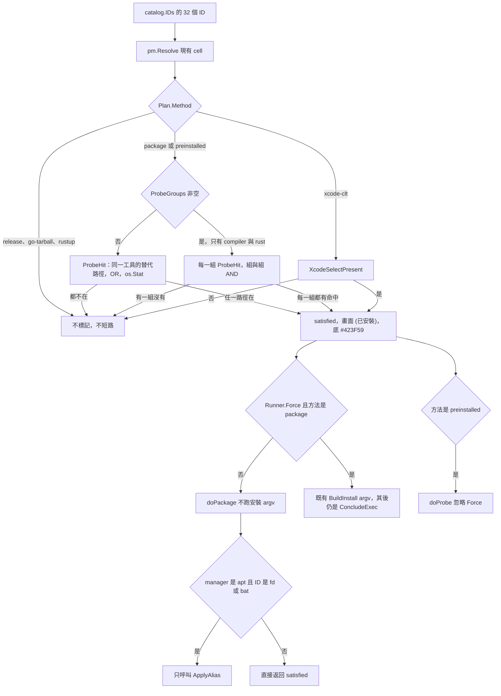
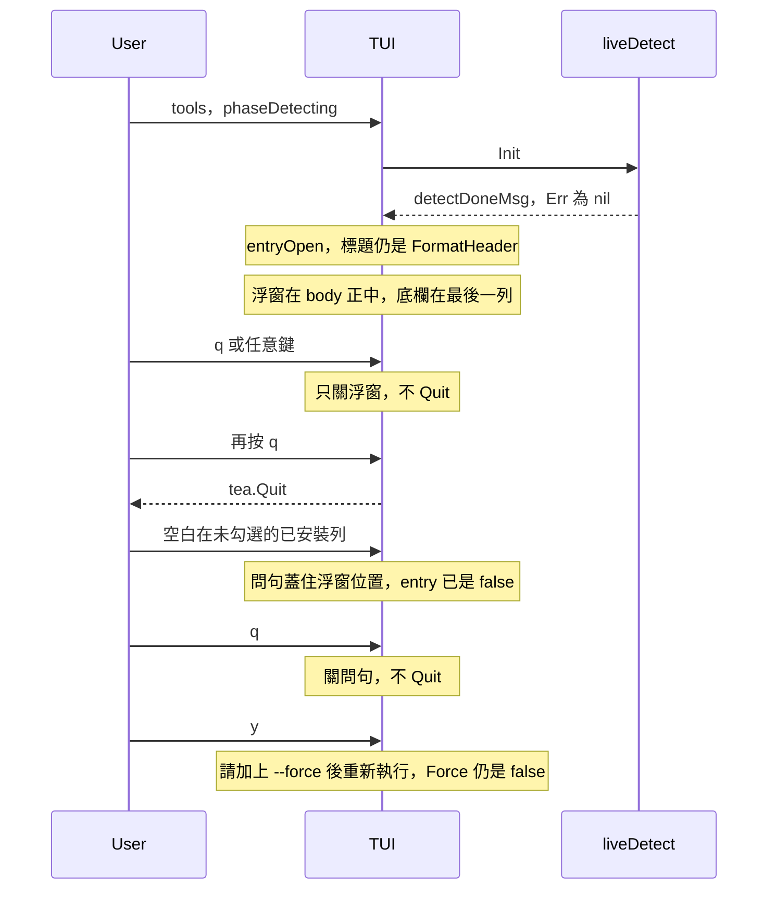
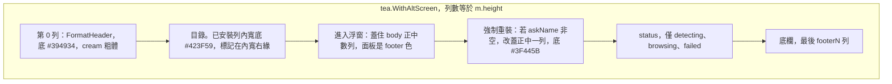

# `tools` 安裝畫面：已安裝列 `#423F59`、右緣 `(已安裝)`、目錄探測與進入浮窗

| 欄位 | 值 |
| --- | --- |
| 作者 | 待填 |
| 日期 | 2026-11-12 |
| 狀態 | Draft |
| 模組 | `github.com/shuhi/dotfiles` |
| 適用樹 | `/home/shuhi/project/Dotfiles` |
| 範圍 | 已安裝列的底色與標記位置、32 個目錄 ID 的離線探測、進入時的系統／架構浮窗、標題列底色 |
| 不取代 | `docs/tools-installer-design.md` 的套件名稱、argv、`shadowed`、go tarball、release，以及 `AliasSymlinks` 的目標與條件：`~/.local/bin/fd` → `/usr/bin/fdfind`，`~/.local/bin/bat` → `/usr/bin/batcat`，而且只在發行版命令名存在、`/usr/bin/fd` 或 `/usr/bin/bat` 不存在時建立。`ApplyAlias` 的函式本體不改。`docs/tools-tui-earth-design.md` 的其餘色票、底欄、按鍵字面值。`docs/tools-installed-skip-design.md` 的 `--force` 範圍、`satisfied` 狀態字、反白以外的表格留白與置中標題。本文件推翻該文件三條：沒有 `ProbeFiles` 就不標記也不略過；已安裝列用 SGR 7、標記接在名稱欄後面；「不把 fdfind／batcat 當成已安裝，不跳過套件」。第三條只推翻到這裡：apt 的 `fd`／`bat` 列可以標記並略過安裝 argv，但 `Force == false` 的 satisfied 短路仍要呼叫既有的 `ApplyAlias`，不把 symlink 一起略過 |

## Overview

目錄列今天只在 `install.AlreadySatisfied` 為真時畫 `(已安裝)`。這個判斷今天是 `ProbeFiles` 的 `os.Stat` OR，加上 `xcode-select -p` 的 exit 0。本文件保留 OR 給同一工具的替代路徑；`compiler` 與 `rust` 改成組間 AND，見探測一節。`less` 剛被寫成每個管理器都是 `@then:less:/usr/bin/less`，所以 Fedora 上 `exists` 全真時 `marksFromPlans` 只有 `less`。使用者要的不是再為 `less` 加一種畫法，而是這支安裝器已經擁有的 32 個目錄 ID：這台電腦已經有的那些相關項目，列底都是 `#423F59`，而且 `(已安裝)` 寫在該列最右邊。標記字面值仍是 ASCII 括號的 `(已安裝)`，不另造第二個字串。

畫面另外兩件事與探測無關。標題列今天的底是 Sonokai Andromeda `bg4` `#3F445B`。標題改成使用者指定的 `#394934`，這個 hex 不是 Andromeda token，不准改成鄰近的 `bg_green` `#394634`。進來且偵測成功時，在目錄區正中跳出另一個浮窗，只顯示現有 `platform.Info` 的系統與架構。頂端 `FormatHeader` 那一列留著。強制重裝那句 `<name> 已安裝。要強制重新下載嗎？` 也留著，它不是這個浮窗。

`#423F59` 是 Andromeda `bg_purple`（`autoload/sonokai.vim` 的 andromeda 調色盤）。在本模組的 `lipgloss` v1.1.0、`termenv` v0.16.0、`TrueColor` 下，它印出的背景參數是 `48;2;65;63;89`，R 從 66 截成 65。`#394934` 印出 `48;2;56;73;52`，R 從 57 截成 56。測試鎖這兩組參數，不鎖 hex 的整數 RGB。

## Background & Motivation

現況來自這些檔案，不是構想：

- `internal/pm/names.go` 的 `less` 是 `base("@then:less:/usr/bin/less")`。`whois`、`traceroute` 只有 brew 有 `@then:`。`make`、`net-tools` 只有 brew 是 `@pre:`。其餘 package cell 的 `parseCell` default 分支不填 `ProbeFiles`。dnf 的 `git` 就是空的。`mitos` 全管理器、dnf／yum 的 `starship`、apt／dnf／yum 的 `zellij` 是 `MethodRelease`。
- `internal/install/exec.go` 的 `AlreadySatisfied`：`MethodPackage` 與 `MethodPreinstalled` 是 `len(probes) > 0 && ProbeHit`。`ProbeHit` 是 OR。`MethodXcodeCLT` 只看 `xcodeOK`。release、go-tarball、rustup 恆為 false。`XcodeSelectPresent` 要求 exit 0 且 `ErrText` 空。
- `internal/install/runner.go` 的 `doPackage`：`!r.Force && AlreadySatisfied(...)` 時狀態 `satisfied`，不跑 argv，而且在 `ConcludeExec` 之前返回。`doProbe` 不讀 `Force`。`RunXcode` 只在 `!force && XcodeSelectPresent` 時短路。`doRelease`、`doGo`、`doRustup` 不讀 `ProbeFiles`，也不讀 `Force`。
- `ApplyAlias` 今天只在 `ConcludeExec` 裡呼叫（`internal/install/exec.go`）。`internal/install/alias.go` 的 `AliasSymlinks`：`!exists("/usr/bin/fd") && exists("/usr/bin/fdfind")` 時要 `~/.local/bin/fd` → `/usr/bin/fdfind`；`!exists("/usr/bin/bat") && exists("/usr/bin/batcat")` 時要 `~/.local/bin/bat` → `/usr/bin/batcat`。`ApplyAlias` 只在 `res.Method == "package"` 且 ID 是 `fd` 或 `bat`、`successStatus`（含 `satisfied`）為真、`home != ""` 時做事。`home == ""` 直接返回。它不執行安裝 argv。
- `internal/install/steps.go` 的 `itemStep` 已經把 `Plan.ProbeFiles` 抄進 `Step`。探測資料改在 `names.go` 就會同時進 TUI 與 runner，不必再寫第二套條件。
- `internal/tui/model.go` 的 `marksFromPlans` 對 `catalog.IDs()` 的每個 `Plan` 呼叫 `AlreadySatisfied`。`exists` 正式路徑是 `os.Stat` 的 `err == nil`。`applyInstalled` 在命中時把 `selected[id]` 清成 false，字形因此是 `[ ]`。`m.scroll` 沒有寫入者。
- `internal/tui/view.go` 的 `itemLine` 把 `(已安裝)` 接在名稱補白後面，描述再接在標記後面。`formatRow` 只在左緣加 inset。styled 的 `paintItem` 對已安裝列從游標到標記欄呼叫 `palette.rev`（SGR 7）。寬度 80、沒有描述時，標記之後到內寬右緣是名稱色反白，不是一個固定的底色 hex。
- `internal/tui/styles.go` 的 `header` 是 `#3F445B`。`paintHeader` 用 cream 粗體（標題）或 cream 非粗體（強制重裝那一列）畫在這個底上。`internal/tui/style_test.go` 鎖的是 `\x1b[1;38;2;225;227;227;48;2;63;68;91m`。
- `internal/tui/update.go` 的 `onAskKey`：`y` 只把 `askTold` 設真，文案變成 `請加上 --force 後重新執行`，不設 `Force`，不進 confirm。`n`、`esc`、`q` 關掉這個框，`q` 的 `tea.Cmd` 是 nil，不離開。`keymap.go` 的 help 字面值不動。`phaseFailed` 仍吃掉 `enter`、`d`、`ctrl+c`，說明列仍是 browsing 那一句。
- `cmd/tools/main.go` 的 `runTUI` 以 `tui.New(platform.Info{})` 啟動，`New` 在 GOOS、GOARCH、Manager、SystemText 都空時把 phase 設成 `phaseDetecting`，`Init` 才跑 `liveDetect`。浮窗的「進來時」就是這次偵測成功，不是 `New` 的零值。

痛點：

1. 機器上已有 git、curl、vim 時，列上看起來與沒裝一樣。只有 `less` 會變已安裝。
2. 已安裝列的視覺是反白，終端機對調之後人看到的底色是前景色，不是一個穩定的 `#423F59`。標記卡在名稱右邊，描述還會把它再往右推。
3. 標題列的 `#3F445B` 不是使用者現在要的標題色。
4. 系統與架構只擠在頂端那一條 `FormatHeader` 裡。進來時沒有單獨的浮窗。

## Goals & Non-Goals

### Goals

- 已安裝列的內寬底色是 `#423F59`。styled 在 TrueColor 下鎖 `48;2;65;63;89`。plain、`NO_COLOR`、非 TTY 沒有 ANSI，但仍有 `(已安裝)`。
- `(已安裝)` 貼在內寬的右緣。左右 inset 規則不變：`width >= 5` 時各 2 格且這兩格不上色；`width < 5` 時 inset 為 0，標記貼著終端機右緣。顯示字寬度 8：`(`、`)` 各 1，三個全形字各 2。括號是 ASCII。
- 反白拿掉。已安裝列不得含 `\x1b[7;` 或 `\x1b[1;7;`。`palette.rev` 若沒有呼叫點就刪掉，避免退回 SGR 7。
- 32 個目錄 ID 都走同一條 `AlreadySatisfied`。哪些 ID 會真的命中，由下面的絕對路徑表決定，不是由 `LookPath` 或套件管理器查詢決定。命中仍是狀態字 `satisfied`。未加 `--force` 時 `doPackage` 略過安裝 argv。例外只有 apt 的 `fd` 與 `bat`：返回前仍呼叫 `ApplyAlias`，不呼叫 `ConcludeExec` 的其餘部分。
- 偵測成功進入 `phaseBrowsing` 時打開進入浮窗。系統與架構兩列只用 `m.info` 的 `SystemText`、`Family`、`GOARCH`、`UnameM`。放得下 5 列帶邊框的面板時，再加一列固定字 `任意鍵關閉`，這列不讀 `m.info`，也不改 `keymap.go`。頂端 `FormatHeader` 留著。框架仍是 `m.height` 列，底欄在最後。
- 標題列底色改成 `#394934`，前景維持 cream 粗體。TrueColor 鎖 `\x1b[1;38;2;225;227;227;48;2;56;73;52m`。強制重裝那一列維持 `48;2;63;68;91`。
- `*` 仍是 gold，與勾選框無關。`ok`、`failed`、`satisfied` 的進度與報告仍是 cream on bark。
- `m.scroll` 維持不被寫入。`keymap.go` 的 help 字面值不動。failed 說明列仍含 `enter` 與 `d 只顯示計畫`。

### Non-Goals

- 不新增 `ItemResult.Status`。沒有 `installed` 這個狀態字。report、`FormatResult`、installing 的 `  <Title>  <status>`、`install.log` 仍印 `satisfied`。
- 不呼叫 `exec.LookPath`、`rpm -q`、`dnf list installed`、`dpkg-query`、`pacman -Q`、`brew list`、`command -v` 來決定已安裝。瀏覽期除了既有的 `xcode-select -p` 不另跑套件管理器。
- 不加目錄 ID，不改套件名稱。Fedora 的 `wget2-wget`、`vim-enhanced`、`bind-utils`、`fd-find`、`pkgconf-pkg-config`，brew 的 `node`，維持 `names.go`。
- 不把 release、go-tarball、rustup 收成 `satisfied`。不探測 `~/.local/bin`，不探測 `~/.cargo`，不探測 `/usr/local/go` 與 `/usr/local/go/bin/go`。`InstallGo` 對已存在目錄仍失敗，錯誤仍含 `已存在，不覆蓋`。
- `--force` 仍只取消 `MethodPackage` 的短路，並讓已滿足的 `compiler` 再跑一次既有的 `xcode-select --install`。`MethodPreinstalled` 忽略 `Force`。pacman 仍帶 `--needed`。argv 不加 `upgrade`、`reinstall`、`brew link --force`。不改 `AliasSymlinks` 的路徑與條件，不改 `ApplyAlias` 的簽名。
- 不把 `hasPackage` 改成「全部項目都會 satisfied 就拿掉更新步驟」。`BuildUpdate` 回非 nil 的管理器，只要計畫裡有 `MethodPackage`，就照舊前置那一次更新，即使後面的項目都短路。
- brew `make` 的探測仍只有 `/usr/bin/make`。`/usr/local/bin/gmake` 不算。brew `net-tools` 仍只有 `/sbin/ifconfig`。`/usr/sbin/ifconfig` 不算。brew `trash` 仍沒有 `ProbeFiles`。`/usr/bin/trash` 不讓它變成 `satisfied`，成功仍是 `shadowed`。
- 不改 `FormatItem` 的四個字串，不改 `FormatHeader` 的字串，不改 `placeHeader`。
- 不改強制重裝的兩句文案，不讓 `y` 設定 `Force` 或開始安裝。
- 不改 `keymap.go`。不用 `bubbles/list`，不用 `bubbles/help`。
- 不改 `Deps.Styled` 的閘門：`isTTY(stdout) && os.Getenv("NO_COLOR") == ""`。`lipgloss` 只在 styled 路徑出現。
- 不把已上色的字串送進外層 `Width` 或 `Height`。
- 不刪 `ghostty/`、`wezterm/`、`rust/`、`WSL/`。測試不執行真實套件安裝。

## Proposed Design

### 色票怎麼加，不加在哪

`earthStyles` 多兩個欄位。既有 token 的 hex 不變。

| 欄位 | Hex | 角色 | TrueColor 實際背景參數 |
| --- | --- | --- | --- |
| `installed` | `#423F59` | 已安裝列內寬的底。Andromeda `bg_purple` | `48;2;65;63;89` |
| `title` | `#394934` | 只有頂端標題列的底。不是 Andromeda token | `48;2;56;73;52` |
| `header`（維持） | `#3F445B` | 只有強制重裝那一列。Andromeda `bg4` | `48;2;63;68;91` |
| `bark`（維持） | `#2B2D3A` | 未安裝列、分類列、正文 | `48;2;43;44;58` |
| `footer`（維持） | `#393E53` | 底欄，以及進入浮窗的面板 | `48;2;56;62;83` |

`#394934` 與 Andromeda `bg_green` `#394634` 只差 G：`0x49` 對 `0x46`。後者會印成 `48;2;56;70;52`。測試要看到 `73`，看到 `70` 就是改錯色。

`#423F59` 的整數 RGB 是 66,63,89。`go-colorful` v1.3.0 的 `Hex` 再乘 255 後，`uint8` 截斷把 R 收成 65。測試寫 `48;2;66;63;89` 會在現有 renderer 上失敗。這與 `docs/tools-tui-earth-design.md` 對 `bg0`、`bg3`、`fg` 的量法同一條。

四個底色各做一件事，不准混用：

| 表面 | 底 | 字 |
| --- | --- | --- |
| 頂端標題 | `title` | cream、粗體 |
| 已安裝列內寬 | `installed` | 下面的片段色，不反白 |
| 進入浮窗面板 | `footer` | cream，不粗體 |
| 強制重裝列 | `header` | cream，不粗體 |

未安裝列、分類列、`已勾選`、confirm／installing／report 不上這兩個新底。`ok`、`failed`、`satisfied` 仍是 `\x1b[38;2;225;227;227;48;2;43;44;58m`，不含 `7;`，不含 `48;2;65;63;89`，不含 `48;2;56;73;52`。

### 反白不留

反白會把前景與背景對調。若片段是 clay 前景加 `#423F59` 背景再加 `Reverse(true)`，實測是 `\x1b[7;38;2;248;152;96;48;2;65;63;89m`，終端機畫出來的底是 clay，不是紫色。這與「底色變成 `#423F59`」相反。所以已安裝列的每個片段都不呼叫 `Reverse`。

游標列也不改回 `#333648`。已安裝列不論游標在不在上面，內寬底都是紫色。游標只靠前綴 `>`：cream、粗體、紫色底，實測 `\x1b[1;38;2;225;227;227;48;2;65;63;89m>\x1b[0m`。未安裝的游標列仍是 cursor `#333648`，片段與今天相同，沒有紫色，也沒有 `7;`。

`*` 仍是 gold，獨立於勾選框。已安裝時的片段是 `\x1b[38;2;237;199;99;48;2;65;63;89m*\x1b[0m`，不含 clay `38;2;248;152;96`，不含 `\x1b[7;`。勾選框與名稱與標記：勾選是 clay，未勾選是 sand `38;2;225;227;227`，底都是紫色。`applyInstalled` 仍把命中項的 `selected` 清掉，所以探測回來的常見列是 `[ ]` 加 sand。測試另用 `selected == true` 的 fixture 鎖 clay，避免把「已安裝」畫成永遠未勾選的顏色。

對比是用 hex 的整數通道算的，截斷 1 級不改變結論：

| 配對 | 比例 | 決定 |
| --- | --- | --- |
| cream `225,227,227` on `#394934` | 7.49:1 | 標題前景維持 cream 粗體。高於 4.5:1 |
| `#394934` on bark `43,44,58` | 1.43:1 | 這個 hex 不能當標題字色，只能當標題底 |
| sand／cream on `#423F59` | 7.81:1 | 未勾選名稱與標記用 sand |
| gold on `#423F59` | 6.21:1 | `*` 維持 gold |
| clay on `#423F59` | 4.62:1 | 勾選名稱與標記維持 clay。高於 4.5，不改成 cream |
| muted `126,130,147` on `#423F59` | 2.64:1 | 已安裝列的描述不用 muted |

標題的低對比分支沒有被量到。若以後某版 `termenv` 把這個底抬亮、比例掉到 4.5:1 以下，仍然不改 cream、也不另挑一個前景 hex。使用者只指定標題這一個顏色，測試鎖的是 cream 與 `48;2;56;73;52` 同時出現。不為了對比去發明第三個色碼。

描述是另一件事，2.64:1 是現在就會發生的。寬度 `>= 100` 且該列已安裝時，描述與描述前的兩個空白改用 sand 前景加紫色底：`\x1b[38;2;225;227;227;48;2;65;63;89m`。不用 muted，不用 bark，不用 cursor，不反白。未安裝列的描述維持今天的 muted on bark（游標列則是 muted on cursor）。`TestDescriptionUsesMutedNotCheckColor` 沒有設 `installed`，期望值不動。

空白的 gap 只設紫色底、不設前景：`\x1b[48;2;65;63;89m`。這裡沒有 `Reverse`，所以不會像舊反白那樣把預設底色打穿。

### 標記放在內寬右緣

`horizontalInset` 不變。`width >= 5` 回 2，否則回 0。內寬 `inner = width - 2*inset`。名稱欄寬仍是 `catalogNameWidth()`，今天是 10。`FormatItem` 的字元仍是列內的子字串。

左段 `left` 的組法與今天的 `itemLine` 相同，但**不再**把 `(已安裝)` 接在名稱後面：

1. `> ` 或兩個空白。
2. `*` 或一個空白。
3. 一個空白、`[x]` 或 `[ ]`、一個空白。
4. 名稱，再補到 `catalogNameWidth()`。
5. 只有 `m.width >= 100` 且 `Description != ""` 時，才接兩個空白與描述。門檻看 `m.width`，不看 `inner`。

然後才把標記放到右緣。plain 與 styled 共用這個純函式，styled 再依片段上色：

```go
func placeInstalled(left string, inner int) (visible, gap, mark string) {
    const full = "(已安裝)" // 顯示寬 8
    if inner <= 0 {
        return "", "", ""
    }
    if inner < 8 {
        mark = ansi.Truncate(full, inner, "…")
        pad := inner - ansi.StringWidth(mark)
        if pad < 0 {
            pad = 0
        }
        return strings.Repeat(" ", pad), "", mark
    }
    budget := inner - 8
    visible = left
    if ansi.StringWidth(visible) > budget {
        visible = ansi.Truncate(visible, budget, "…")
    }
    gapN := budget - ansi.StringWidth(visible)
    if gapN < 0 {
        gapN = 0
    }
    return visible, strings.Repeat(" ", gapN), full
}
```

`ansi` v0.11.6 的 `Truncate` 在全形字放不進尾端預算時可以比預算短 1。短出來的那一格進 `gapN`，不放在標記右邊，所以 `)` 仍在內寬最後一格。`inner < 8` 時沒有完整標記，截斷結果右對齊：左邊補空白，右緣是截斷後的標記（含 `…` 時 `…` 在最右）。

實測 `(已安裝)` 的截斷：

| inner | `Truncate` 結果 | 顯示寬 | 右對齊後的內文 |
| --- | --- | --- | --- |
| 1 | `…` | 1 | `…` |
| 2 | `(…` | 2 | `(…` |
| 3 | `(…` | 2 | ` (…` |
| 4 | `(已…` | 4 | `(已…` |
| 5 | `(已…` | 4 | ` (已…` |
| 7 | `(已安…` | 6 | ` (已安…` |
| `>= 8` | 完整 `(已安裝)` | 8 | 左段加 gap，標記貼右 |

整列是左 inset、內文、右 inset。已安裝列的 `ansi.StringWidth` 等於 `m.width`。未安裝的 plain 列不補右 inset，也不為了對齊去留 8 格；styled 未安裝列仍用 bark 或 cursor 把內寬補滿，與今天相同。

inset 為 2 時，終端機最後兩格是沒有 ANSI 的空白，`)` 在倒數第 3 格。這就是「最右邊」：標記是內寬的最後 8 格，不是把 inset 吃掉，也不是把標記畫進底欄。inset 為 0 時沒有這兩格，標記的右緣就是終端機右緣。

描述不會把標記往右推，標記也不插在名稱與描述中間。預算不夠時先截左段，描述在左段的尾端，所以先失去的是描述。標記在 `inner >= 8` 時保持 8 格完整。

寬度 80、`nameWidth == 10`、inset 2、內寬 76 的 plain 整列如下。whois 是游標、`Default`、已勾選、已安裝。zsh 不是游標、不是 `Default`、未勾選、已安裝。

whois。名稱寬 5，補白 5，左段 18，gap `76 - 18 - 8 = 50`。名稱後的空白是 `5 + 50 = 55`：

```text
  > * [x] whois                                                       (已安裝)  
```

上面這列顯示寬 80：左 inset 2、`> * [x] whois`、55 個空白、`(已安裝)`、右 inset 2。子字串 `> * [x] whois` 還在。`(已安裝)` 不再貼著 whois。

zsh：

```text
      [ ] zsh                                                         (已安裝)  
```

`    [ ] zsh` 仍是子字串。`zsh` 與 `(` 之間是名稱補白 7 再加 gap 50，共 57 個空白。兩列都沒有 `\x1b`。

未安裝的 git 仍是左 inset 加 `> * [x] git` 再補名稱欄，沒有標記，plain 不補到 80。`TestNoColorIsPlainText` 的 `> * [x] git` 與 `    [ ] zsh` 仍要能找到。

寬度 100、wget 已安裝、已勾選、`Default`、游標不在 wget。描述 `Fedora 套件是 wget2-wget` 的顯示寬是 24，不是 25。左段是 18 格名稱欄加兩個空白加 24，共 44。內寬 96，gap `96 - 44 - 8 = 44`。plain 整列顯示寬 100：

```text
    * [x] wget        Fedora 套件是 wget2-wget                                            (已安裝)  
```

`wget` 與 `Fedora` 之間是 8 個空白（名稱補白 6 加描述前的 2）。標記在描述右邊，中間 44 個空白，再加右 inset 2。舊 fixture「標記夾在名稱與描述中間」作廢。

styled、寬度 100、同一列、游標不在 wget：

- `*` 是 gold on purple，沒有 `7;`，沒有 clay。
- `[x]`、`wget`、名稱補白、`(已安裝)` 是 clay on purple：`38;2;248;152;96` 與 `48;2;65;63;89`，沒有 `7;`。
- 描述前兩個空白與描述是 sand on purple，沒有 muted `38;2;126;130;147`，沒有 bark `48;2;43;44;58`，沒有 cursor `48;2;51;54;72`。
- 描述與標記之間的 44 格只有 `48;2;65;63;89`。
- 左右各 2 格無 ANSI。`StringWidth` 是 100。

游標改到 wget 時，底仍是紫色，不是 cursor。`>` 是 cream 粗體 on purple。描述仍是 sand on purple。

寬度 26、git 已安裝、游標、已勾選：inset 2，內寬 22，預算 14。左段 `> * [x] git` 寬 11，再取 3 格名稱補白就滿 14，沒有 `…`。其後是完整 `(已安裝)`。整列寬 26。`[x]` 與 `git` 都還在。這保住今天 `style_test.go` 那個窄列「寬度等於 26」的斷言，但 SGR 改成紫色、沒有反白。

寬度 4：inset 0，內文就是 `(已…`，沒有勾選框，沒有左右空白。styled 時這 4 格是名稱色 on purple。寬度 3 是 ` (…`。寬度小於 5 的分類列仍是 inset 0，`基礎` 那一列的 plain 斷言不變。

confirm、installing、report 不畫這個標記，也不鋪紫色。failed 的目錄仍畫標記。failed 的說明列仍含 `enter` 與 `d 只顯示計畫`。


### 32 個 ID 怎麼判定已經有

`marksFromPlans` 仍對 `install.ResolveAll(catalog.IDs(), manager)` 的每個 `Plan` 呼叫 `AlreadySatisfied`。`exists` 在測試裡注入，正式路徑仍是 `statExists`：`os.Stat` 的 `err == nil`，跟隨 symlink 的語意與今天的 `Runner.exists` 相同，壞掉的 symlink 不算命中，目錄也算命中。沒有新的 `ItemResult.Status`。簽名多一個 `groups`。`ProbeHit` 的簽名與 OR 語意不改。

```go
func AlreadySatisfied(method pm.Method, probes []string, groups [][]string, exists func(string) bool, xcodeOK bool) bool {
    switch method {
    case pm.MethodPackage, pm.MethodPreinstalled:
        if len(groups) > 0 {
            return probeGroups(groups, exists)
        }
        return len(probes) > 0 && ProbeHit(probes, exists)
    case pm.MethodXcodeCLT:
        return xcodeOK
    default:
        return false
    }
}

// 每一組是 ProbeHit（同一工具的替代路徑，OR）。組與組是 AND。
// exists == nil、groups 空、或任一組沒有命中，都是 false。
// groups 非空時不再看扁平的 probes，避免四條路徑被收成一次 OR。
func probeGroups(groups [][]string, exists func(string) bool) bool {
    if exists == nil || len(groups) == 0 {
        return false
    }
    for _, g := range groups {
        if !ProbeHit(g, exists) {
            return false
        }
    }
    return true
}
```

`ProbeHit` 維持 OR，只用在同一支工具的替代位置：traceroute 的 `/usr/bin` 與 `/usr/sbin`、net-tools 的兩條 `ifconfig`、brew 的 `/opt/homebrew` 與 `/usr/local`、dig 的 opt 與 prefix。這些 cell 的 `ProbeGroups` 是 nil。

`compiler` 與 `rust` 不是這種替代位置。dnf 的 `compiler` 是 `gcc` 與 `gcc-c++` 兩個套件，Fedora 的 `cargo` 也不是 `rust` 的同一個套件。這兩項的 `ProbeGroups` 非空：每一組是一個工具（組內 OR），全部組都要命中才算 `AlreadySatisfied`。只裝了 `/usr/bin/gcc`、或只裝了 `/usr/bin/rustc`，不標記，也不短路。brew 的 `compiler` 仍是 `@xcode`，不參與這條檔案 AND，只看 `xcodeOK`。

不要把 brew `rust` 的四條路徑收成「四條都要在」。那四條是兩個工具乘兩個 prefix。Apple Silicon 上通常只有 `/opt/homebrew`，Intel Homebrew 只有 `/usr/local`。要求四條全在會讓已經同時有 `rustc` 與 `cargo` 的機器永不標記。規則是組間 AND、組內 OR：`/opt/homebrew/bin/rustc` 配 `/usr/local/bin/cargo` 也算命中。

路徑寫進既有的 `@then:`／`@pre:` cell。`parseCell` 在組完 package 之後才看 `itemSpec.fb`，所以 `@then:` 可以同時帶 release、go-tarball、rustup fallback。fallback 自己的 `ProbeFiles` 與 `ProbeGroups` 維持空。命中發生在主計畫，`doPackage` 在 fallback 之前就返回。

套件名稱字串不改。只把空的 package cell 改成 `@then:<原本的套件列表>:<路徑>`。`splitList` 對含 `|` 的套件列表仍用 `|`。路徑側先看 `;`：沒有 `;` 時整段走今天的 `splitList`（逗號是 OR），`ProbeGroups` 留 nil。有 `;` 時先拆組，每一組再 `splitList`，寫進 `ProbeGroups`，並把各組依序接成扁平的 `ProbeFiles`。空組是 `parseCell` 的錯誤，不准默默丟掉。路徑裡不准有 `|`。`gcc|gcc-c++` 對 `/usr/bin/gcc;/usr/bin/g++` 仍過現有的 `Cut`，因為 `:` 只切一次，套件側的 `|` 碰不到路徑側的 `;`。

`pm.Plan` 與 `install.Step` 都加 `ProbeGroups [][]string`。`itemStep` 深拷貝每一組，跟今天拷貝 `ProbeFiles` 一樣。`marksFromPlans`、`doPackage`、`doProbe` 都把 groups 傳進 `AlreadySatisfied`。preinstalled 的 groups 是 nil，行為與今天的 OR 相同。

測試矩陣的比對順序要改，不然新形式過不了今天的 `assertCell`。今天 `then:` 是 `cell[:5] == "then:"`，而且要求 `Fallback == nil`，並且排在 `>rel` 之前。`then:starship:/usr/bin/starship>rel` 會先進那個分支然後失敗，到不了後綴。`go:`／`rust:` 走 `assertFallback`，只比套件名與 fallback 方法，不比 `ProbeFiles`，錯誤的 `/usr/local/go` 會綠。

`assertCell` 的順序改成：

1. `strings.HasSuffix(cell, ">rel")` 時先把這四個字元剝掉，並記住要有 release fallback。剝完才進下面的分支。
2. `rel`、`xcode`、`pre:` 維持今天的斷言。這三種不再接 `>rel`。
3. `then:` 比對套件名與 `ProbeFiles`。路徑含 `;` 時再比 `ProbeGroups`。沒有 `>rel` 時 `Fallback == nil`。有 `>rel` 時 fallback 是 release、`NeedsLocalBin` 仍是 true、`ReleaseRepo` 等於該列的 repo、fallback 的 `ProbeFiles` 與 `ProbeGroups` 都空。
4. `go:` 與 `rust:` 不再把前綴之後整段當套件名。`strings.Cut` 第二個冒號：左邊是套件（仍可含 `|`），右邊是路徑。沒有第二個冒號就失敗，舊的 `go:pkg`／`rust:pkg` 不再使用。套件名與 fallback 方法仍走今天的 `assertFallback`（go-tarball 或 rustup，`NeedsLocalBin` false）。另外 `slices.Equal` 比對 `ProbeFiles`；路徑含 `;` 時比對 `ProbeGroups`，否則 `ProbeGroups` 必須是空的。
5. 剩下的 `>rel` 已在第 1 步被剝掉，所以舊的「裸套件名加 `>rel`」不再是一條獨立分支。今天矩陣裡的 `starship>rel`、`fd-find>rel`、`bat>rel` 這類全部改成 `then:pkg:paths>rel`。沒有路徑的 package cell 仍走 default，只比套件名，`ProbeFiles` 與 `ProbeGroups` 都空，而且 `Fallback == nil`。剝過 `>rel` 之後若掉進 default，代表這格還是裸的 `pkg>rel`，測試要失敗。
6. 另加一條負向斷言，八個管理器都跑：`go` 的 `ProbeFiles` 與每一組 `ProbeGroups` 都不含 `/usr/local/go`，也不含 `/usr/local/go/bin/go`。fallback 的探測也是空的。

| 矩陣 cell | 意思 |
| --- | --- |
| `then:pkg:paths` | package，無 fallback。`paths` 沒有 `;` 時是 OR |
| `then:pkg:paths>rel` | 先剝 `>rel`，再走 `then:`。release fallback 的 `NeedsLocalBin` 仍是 true |
| `then:pkg:group;group` | `ProbeGroups` 非空。組間 AND，組內逗號仍是 OR |
| `go:pkg:paths` | 第二個冒號之後才是路徑。沒有第二個冒號的舊形式不再使用 |
| `rust:pkg:paths` | 同上，rustup fallback。`compiler` 與 `rust` 的路徑用 `;` 分組 |
| `pre:paths` | 既有。只有 brew 的 `make` 與 `net-tools` |
| `rel`、`xcode` | 既有。`ProbeFiles` 與 `ProbeGroups` 都空 |

`mustPkg` 仍只比套件名稱。`wget`／dnf 仍是 `wget2-wget`。

下面路徑都是絕對路徑。Linux 七個管理器是 apt、dnf、yum、pacman、zypper、apk、xbps。表上沒寫到的管理器表示該 ID 在那個管理器上**維持今天的方法與空的 `ProbeFiles`**，不會因為「檔案在別的管理器會命中」就跟著命中。

| ID | 管理器 | ProbeFiles | 套件名稱不變 |
| --- | --- | --- | --- |
| `git` | Linux 七個 | `/usr/bin/git` | `git` |
| `git` | brew | `/usr/bin/git,/opt/homebrew/bin/git,/usr/local/bin/git` | `git` |
| `curl` | Linux 七個 | `/usr/bin/curl` | `curl` |
| `curl` | brew | `/opt/homebrew/bin/curl,/usr/local/bin/curl` | `curl`。不准 `/usr/bin/curl`。這不是 whois 那條既有契約 |
| `wget` | Linux 七個 | `/usr/bin/wget` | dnf 仍是 `wget2-wget`，其餘 `wget` |
| `wget` | brew | `/usr/bin/wget,/opt/homebrew/bin/wget,/usr/local/bin/wget` | `wget` |
| `unzip` | Linux 七個 | `/usr/bin/unzip` | `unzip` |
| `unzip` | brew | `/usr/bin/unzip,/opt/homebrew/bin/unzip,/usr/local/bin/unzip` | `unzip` |
| `rsync` | Linux 七個 | `/usr/bin/rsync` | `rsync` |
| `rsync` | brew | `/usr/bin/rsync,/opt/homebrew/bin/rsync,/usr/local/bin/rsync` | `rsync` |
| `vim` | Linux 七個 | `/usr/bin/vim` | dnf、yum 仍是 `vim-enhanced` |
| `vim` | brew | `/usr/bin/vim,/opt/homebrew/bin/vim,/usr/local/bin/vim` | `vim` |
| `less` | 全部八個 | `/usr/bin/less` | `less`。不加 Homebrew prefix |
| `net-tools` | Linux 七個 | `/usr/bin/ifconfig,/usr/sbin/ifconfig` | `net-tools` |
| `net-tools` | brew | `/sbin/ifconfig` | 仍是 `@pre:`。`/usr/sbin/ifconfig` 不算 |
| `whois` | 全部八個 | `/usr/bin/whois` | `whois`。brew 不加 prefix，維持 keg-only 只認系統檔 |
| `dnsutils` | Linux 七個 | `/usr/bin/dig` | 名稱表不變：`dnsutils`、`bind-utils`、`bind`、`bind-tools` |
| `dnsutils` | brew | `/usr/bin/dig,/opt/homebrew/opt/bind/bin/dig,/usr/local/opt/bind/bin/dig,/opt/homebrew/bin/dig,/usr/local/bin/dig` | `bind`。opt 路徑是 keg-only 的穩定位置，不是 Cellar 版號目錄 |
| `traceroute` | Linux 七個 | `/usr/bin/traceroute,/usr/sbin/traceroute` | `traceroute` |
| `traceroute` | brew | `/usr/sbin/traceroute,/sbin/traceroute` | 不加 `/usr/bin/traceroute`，不加 prefix |
| `zsh` | Linux 七個 | `/usr/bin/zsh` | `zsh` |
| `zsh` | brew | `/usr/bin/zsh,/opt/homebrew/bin/zsh,/usr/local/bin/zsh` | `zsh` |
| `starship` | apt、pacman、zypper、apk、xbps | `/usr/bin/starship` | `starship`，fallback 仍是 `starship/starship` |
| `starship` | brew | `/opt/homebrew/bin/starship,/usr/local/bin/starship,/usr/bin/starship` | 同上 |
| `starship` | dnf、yum | 空 | 仍是 `@rel` |
| `eza` | apt、dnf、pacman、zypper、apk、xbps | `/usr/bin/eza` | `eza`，fallback 仍在 |
| `eza` | brew | `/opt/homebrew/bin/eza,/usr/local/bin/eza,/usr/bin/eza` | 同上 |
| `eza` | yum | 空 | 仍是 `@rel` |
| `trash` | Linux 七個 | `/usr/bin/trash` | `trash-cli` |
| `trash` | brew | 空 | `trash-cli`。`/usr/bin/trash` 不准命中 |
| `ripgrep` | Linux 七個 | `/usr/bin/rg` | `ripgrep`。命令名是 `rg`，不是套件名 |
| `ripgrep` | brew | `/opt/homebrew/bin/rg,/usr/local/bin/rg,/usr/bin/rg` | 同上 |
| `fd` | apt | `/usr/bin/fdfind` | `fd-find`。不探測 `~/.local/bin/fd`。命中後仍 `ApplyAlias`，見執行期 |
| `fd` | dnf、yum、pacman、zypper、apk、xbps | `/usr/bin/fd` | dnf、yum 仍是 `fd-find`，其餘 `fd` |
| `fd` | brew | `/opt/homebrew/bin/fd,/usr/local/bin/fd` | `fd` |
| `bat` | apt | `/usr/bin/batcat` | `bat`。命中後仍 `ApplyAlias`，見執行期 |
| `bat` | dnf、yum | `/usr/share/bash-completion/completions/bat.bash` | `bat`。不探測 `/usr/bin/bat`，也不探測 `/usr/sbin/bat` |
| `bat` | pacman、zypper、apk、xbps | `/usr/bin/bat` | `bat` |
| `bat` | brew | `/opt/homebrew/bin/bat,/usr/local/bin/bat` | `bat` |
| `jq` | Linux 七個 | `/usr/bin/jq` | `jq` |
| `jq` | brew | `/opt/homebrew/bin/jq,/usr/local/bin/jq,/usr/bin/jq` | `jq` |
| `fzf` | Linux 七個 | `/usr/bin/fzf` | `fzf` |
| `fzf` | brew | `/opt/homebrew/bin/fzf,/usr/local/bin/fzf,/usr/bin/fzf` | `fzf` |
| `neovim` | Linux 七個 | `/usr/bin/nvim` | `neovim` |
| `neovim` | brew | `/opt/homebrew/bin/nvim,/usr/local/bin/nvim,/usr/bin/nvim` | `neovim` |
| `zellij` | pacman、zypper、apk、xbps | `/usr/bin/zellij` | `zellij` |
| `zellij` | brew | `/opt/homebrew/bin/zellij,/usr/local/bin/zellij,/usr/bin/zellij` | `zellij` |
| `zellij` | apt、dnf、yum | 空 | 仍是 `@rel` |
| `fastfetch` | apt、dnf、pacman、zypper、apk、xbps | `/usr/bin/fastfetch` | `fastfetch` |
| `fastfetch` | brew | `/opt/homebrew/bin/fastfetch,/usr/local/bin/fastfetch,/usr/bin/fastfetch` | `fastfetch` |
| `fastfetch` | yum | 空 | 仍是 `@rel` |
| `mitos` | 全部八個 | 空 | 仍是 `@rel`，執行檔名 `ms` 不拿來探測 |
| `go` | Linux 七個 | `/usr/bin/go` | apt `golang-go`，dnf、yum `golang`，其餘 `go`。不准加 `/usr/local/go` 或 `/usr/local/go/bin/go` |
| `go` | brew | `/opt/homebrew/bin/go,/usr/local/bin/go` | `go`。同樣不准 tarball 那兩條 |
| `rust` | Linux 七個 | 兩組：`/usr/bin/rustc`；`/usr/bin/cargo` | 名稱表不變。組間 AND。cell 是 `/usr/bin/rustc;/usr/bin/cargo` |
| `rust` | brew | 兩組：`/opt/homebrew/bin/rustc,/usr/local/bin/rustc`；`/opt/homebrew/bin/cargo,/usr/local/bin/cargo` | `rust`。組間 AND，組內 OR。不探測 `~/.cargo/bin` |
| `python` | Linux 七個 | `/usr/bin/python3` | pacman、brew 的套件名仍是 `python`，其餘 `python3` |
| `python` | brew | `/opt/homebrew/bin/python3,/usr/local/bin/python3` | 不准 `/usr/bin/python3`。那是 Apple stub |
| `node` | Linux 七個 | `/usr/bin/node` | 套件名 `nodejs`，brew 仍是 `node` |
| `node` | brew | `/opt/homebrew/bin/node,/usr/local/bin/node,/usr/bin/node` | `node` |
| `make` | Linux 七個 | `/usr/bin/make` | `make`，方法仍是 package |
| `make` | brew | `/usr/bin/make` | 仍是 `@pre:`。`/usr/local/bin/gmake` 不算 |
| `cmake` | Linux 七個 | `/usr/bin/cmake` | `cmake` |
| `cmake` | brew | `/opt/homebrew/bin/cmake,/usr/local/bin/cmake,/usr/bin/cmake` | `cmake` |
| `compiler` | Linux 七個 | 兩組：`/usr/bin/gcc`；`/usr/bin/g++` | apt `build-essential`，dnf、yum、zypper `gcc\|gcc-c++`，pacman、xbps `base-devel`，apk `build-base`。組間 AND。cell 是 `/usr/bin/gcc;/usr/bin/g++` |
| `compiler` | brew | 空 | 仍是 `@xcode`。只靠 `xcodeOK` |
| `pkg-config` | Linux 七個 | `/usr/bin/pkg-config` | dnf `pkgconf-pkg-config`，yum `pkgconfig`，pacman、apk `pkgconf`，其餘 `pkg-config` |
| `pkg-config` | brew | `/opt/homebrew/bin/pkg-config,/usr/local/bin/pkg-config` | `pkgconf` |

`less` 不加 prefix，是為了讓「八個管理器的 `ProbeFiles` 都正好是 `/usr/bin/less`」這條現有斷言留著。macOS 本來就有 `/usr/bin/less`。其他 brew formula 才需要 prefix，因為 `/usr/bin/eza` 這類檔在 macOS 上通常不存在。

whois 在 brew 上只認 `/usr/bin/whois`，因為這是今天就有的 `@then:`，不是這次新加的。命中系統檔就 `satisfied`，不呼叫 `KegOnlyNote`；`KegOnlyNote` 只在安裝 argv 成功之後由 `Decorate` 加上，對象是 `curl`、`dnsutils`、`whois`。prefix 多認一條會改變 whois 今天的短路，所以 whois 不加 prefix。

brew 的 curl 不是這條既有契約。`names.go` 今天沒有 curl 的 `ProbeFiles`。macOS 自帶 `/usr/bin/curl`，若把它寫進表，每台 Mac 都會在未加 `--force` 時略過 `brew install curl`，而 dnsutils 卻認 `opt/bind/bin/dig`，真正的 Homebrew 檔看得到。curl 改認 `/opt/homebrew/bin/curl` 與 `/usr/local/bin/curl`，組內 OR，與 python 的兩個 prefix 同一形狀，不認 `/usr/bin/curl`。只有 Apple curl 的機器不標記，仍會跑 `brew install curl`，成功之後的 `KegOnlyNote` 仍由 `Decorate` 產生。不加 `brew link --force`。dnsutils 的 opt 路徑仍是 `os.Stat`，不是 `brew --prefix`。

dnf 與 yum 的 `bat` 探測 `/usr/share/bash-completion/completions/bat.bash`，不探測 `/usr/bin/bat`。這台 Fedora 45 上該檔屬於 `bat-0.26.1-4.fc45`（sharkdp）。`/usr/sbin` 是指向 `bin` 的 symlink，所以 `/usr/sbin/bat` 與 `/usr/bin/bat` 是同一個檔，兩條都不准當探測。`bacula-console-bat` 也擁有 `/usr/bin/bat`，但不擁有這份 completion。只有 `/usr/bin/bat`、沒有 completion 檔時不標記，`Force == false` 且 `EUID == 0` 時 argv 仍是 `dnf install -y bat`（yum 則是 `yum install -y bat`）。completion 檔在時標記並短路。yum 用同一條路徑，因為這份目錄裡兩個管理器的套件名都是 `bat`；若某個 yum 建置拿掉 completion，那一列維持不標記，這是假陰性，不是把 bacula 當成 sharkdp。偵測仍是 `os.Stat`，不是 `rpm -q`。apt 認 `/usr/bin/batcat`，那是套件 `bat` 的命令名。其餘管理器的 `/usr/bin/bat` 沒有這條 bacula 註記，可以探測。

`compiler` 的 Linux cell 是 `/usr/bin/gcc;/usr/bin/g++`。兩支都在才標記。apt 的套件是 `build-essential`，比這兩支二進位多（`make`、標頭檔）。兩支編譯器都在、metapackage 不在時仍會標記並短路，這是殘留的假陽性，記在 Risks，不再加探測路徑。`rust` 的 Linux cell 是 `/usr/bin/rustc;/usr/bin/cargo`。brew `rust` 的 cell 是 `/opt/homebrew/bin/rustc,/usr/local/bin/rustc;/opt/homebrew/bin/cargo,/usr/local/bin/cargo`。扁平 `ProbeFiles` 是各組依序接起來的那幾條，決策看 `ProbeGroups`。

`exists` 對所有路徑回 true、`xcodeOK` 為 true 時，標記集合是 32 個 ID 減去下面這些。測試比對集合，不只比對長度：

| 管理器 | 不標記 | 標記數 |
| --- | --- | --- |
| apt | `zellij`、`mitos` | 30 |
| dnf | `starship`、`zellij`、`mitos` | 29 |
| yum | `starship`、`eza`、`fastfetch`、`zellij`、`mitos` | 27 |
| pacman、zypper、apk、xbps | `mitos` | 31 |
| brew | `trash`、`mitos` | 30 |

`bat` 在 dnf、yum 上不再屬於這個全真集合：completion 檔也回 true，所以會標記。先前把 `bat` 留在不標記集合，是空 `ProbeFiles` 的假陰性。brew 的 `curl` 在全真時也標記，因為兩個 Homebrew prefix 都在；只有 `/usr/bin/curl` 的案例不在這張表，見下面。

| 案例 | `exists` | 結果 |
| --- | --- | --- |
| Linux `compiler` 只有 `/usr/bin/gcc` | `g++` 為 false | 不標記。`Force == false` 仍跑該管理器的安裝 argv |
| Linux `compiler` 兩支都在 | 兩條都 true | 標記，`satisfied`，項目 `Argv` nil |
| Linux `rust` 只有 `/usr/bin/rustc` | `cargo` 為 false | 不標記，仍安裝 |
| Linux `rust` 兩支都在 | 兩條都 true | 標記 |
| brew `rust` 只有 `/opt/homebrew/bin/rustc` | cargo 兩條都 false | 不標記 |
| brew `rust`，`/opt/homebrew/bin/rustc` 與 `/usr/local/bin/cargo` | 各組一條 | 標記。prefix 可以不同 |
| brew `rust` 四條都在 | 全 true | 標記 |
| traceroute 兩條裡只有一條 | 另一條 false | 標記。仍是 OR |
| brew `curl` 只有 `/usr/bin/curl` | 兩個 prefix 都 false | 不標記，仍 `brew install curl` |
| brew `curl` 的 `/opt/homebrew/bin/curl` | 這條 true | 標記 |
| dnf `bat` 只有 `/usr/bin/bat` | completion 為 false | 不標記。`EUID == 0` 時 argv 是 `dnf install -y bat`，沒有 `sudo` |
| dnf `bat` 的 completion 檔 | 該路徑 true | 標記，`satisfied`，項目 `Argv` nil。dnf 的 `BuildUpdate` 是 nil，所以這次執行沒有更新 argv |
| apt `fd` 只有 `/usr/bin/fdfind` | `/usr/bin/fd` 為 false | 標記，而且要建立 symlink，見執行期 |

brew 的 `compiler` 靠 `xcodeOK`，不靠 `exists`。`xcodeOK` 為 false 時 brew 的不標記集合再加 `compiler`。dnf 的 `compiler` 不看 `xcodeOK`。`exists` 全 false 時，八個管理器的 map 都是空的，即使 `xcodeOK` 為 true 也只有 brew 的 `compiler`。



這條規則不需要活的套件管理器。單元測試傳 `func(string) bool`。`names_test.go` 比對字面路徑，不讀磁碟。`TestMarksFromPlans` 注入 `exists`。不要新增一個會去打這台 Fedora 的 `detectInstalled` 測試。`xcode-select -p` 仍只在某個計畫的方法是 `MethodXcodeCLT` 時由 `probeXcodeSelect` 執行；測試走 `xcodeOK` 參數，不啟動那個二進位。

### 命中之後執行期做什麼

`ProbeFiles` 變長會讓更多項目走既有短路。`runner.go` 另外只改兩處：`AlreadySatisfied` 多傳 `ProbeGroups`；apt 的 `fd`／`bat` 在短路返回前呼叫 `ApplyAlias`。不改 `AliasSymlinks`，不改 `BuildUpdate`，不改 `hasPackage`。

- `doPackage`：路徑或 groups 命中且 `Force == false` 時，先做成 `ItemResult{Status: "satisfied"}`，`Argv` 是 nil，先跑 `WithFzfNote`。然後，只有 `st.Manager == "apt"` 且 ID 是 `fd` 或 `bat` 時呼叫 `ApplyAlias(r.Home, &res, r.exists)`。不呼叫 `Decorate`，不呼叫 `ConcludeExec` 的其餘部分，所以沒有 `KegOnlyNote`，也沒有安裝 argv。`ApplyAlias` 若把狀態改成 `failed`，跟 `ConcludeExec` 一樣把 `Note` 清掉再返回；成功建立 symlink 時 `NeedsLocalBin` 為 true。其他 ID 不呼叫 `ApplyAlias`。`fzf` 的註記仍是 `fzf 0.48.0 以上`。`Force == true` 時跑 `Step.Argv`，那個 argv 仍是 `BuildInstall` 的位元組，其後仍進 `ConcludeExec`（裡面本來就會再呼叫一次 `ApplyAlias`）。brew whois 成功仍帶既有 keg-only 註記。pacman 的安裝 argv 仍含 `--needed`，不含 `reinstall`。
- apt `fd`：`Force == false`，`exists` 只對 `/usr/bin/fdfind` 為 true，`Home` 是 `t.TempDir()`，`EUID` 是 0。結果是 `satisfied`、`Argv` nil、`NeedsLocalBin` true，`os.Readlink(home+"/.local/bin/fd")` 等於 `/usr/bin/fdfind`。exec 呼叫恰好一條 `apt-get update`，沒有 `apt-get install`。`/usr/bin/fd` 也存在時不建 symlink，狀態仍是 `satisfied`，更新步驟仍是那一條。`bat` 對稱：只命中 `/usr/bin/batcat` 時 `~/.local/bin/bat` → `/usr/bin/batcat`。這不是真實套件安裝。`alias.go` 不改；`ApplyAlias` 今天就會在 satisfied 的 package 結果上建這兩條，缺的是呼叫點。
- `doProbe`：不讀 `Force`。brew `make` 命中仍是 `satisfied`，未命中仍是 `pm.MakeMissingMessage`，沒有 `brew install make`。`net-tools` 未命中仍是 `pm.NetToolsMissingMessage`。groups 傳 nil。
- `RunXcode`：不變。`--force` 仍只跳過第一次 satisfied 返回，然後跑既有的 `xcode-select --install` 再探測一次。
- `doRelease`、`doRustup`：不讀探測，也不讀 `Force`。`~/.local/bin/starship` 存在不會讓 dnf 的 starship 變成 `satisfied`，下次仍會下載。
- `doGo`：不讀探測。主計畫只認 `/usr/bin/go` 或 brew prefix 的 `go`。只有 `/usr/local/go` 或 `/usr/local/go/bin/go` 時，package 步驟仍跑 argv；若走到 tarball，`InstallGo` 仍對 `filepath.Join(destRoot, "go")` 失敗，預設 `destRoot` 是 `/usr/local`。`TestForceDoesNotSkipReleaseOrGo` 的錯誤子字串 `已存在，不覆蓋` 維持。
- 更新步驟仍是 `hasPackage`：任一計畫的方法是 `MethodPackage` 就前置 `KindUpdate`。satisfied 的項目仍是 `MethodPackage` 計畫，所以不會因為短路而拿掉更新。`RunSteps` 執行這個步驟，不追加 `ItemResult`。`BuildUpdate` 回 nil 的是 dnf、yum、xbps、brew，這四個沒有更新 exec。其餘管理器恰好一條，`EUID == 0` 時就是 `BuildUpdate` 的原切片：pacman 是 `pacman -Sy --noconfirm`，apt 是 `apt-get update`。`EUID != 0` 時 `WithPrivilege` 會在前面加 `sudo`。不准把測試寫成 `len(calls) == 0` 來表示「沒有安裝 argv」，那會逼人改掉 `hasPackage`。
- dry-run 仍印 `Step.Title` 與 argv。目錄上的標記是探測，不是這次的 `ItemResult`。
- `successStatus` 仍是 `ok`、`satisfied`、`shadowed`。已選的 `zsh`、`starship`、`zellij` 仍有 `KindConfig`，設定複製照舊看這個狀態。`ApplyAlias` 新建 symlink 時把該筆 `NeedsLocalBin` 設為 true。`KindLink` 仍只由 `plannedHooks` 依計畫上的 `NeedsLocalBin` 前置，`ApplyAlias` 不臨時插入這一步。只選 apt `fd` 時今天就沒有 `KindLink`；本文件不補。同一次若還有 release 計畫，`doLink` 會照舊呼叫 `HooksFor`，並看到這筆 `satisfied`。

`TestNoProbeFilesStillInstall` 今天用 pacman 的 git、whois，而且 `Force: true`，所以加上探測之後它仍會跑 argv，測不到短路。改成兩段，兩段都把 `EUID` 釘在 0：

- `Force == false` 且探測路徑存在：兩筆結果都是 `satisfied`，`Argv` nil，exec 恰好一條 `[]string{"pacman", "-Sy", "--noconfirm"}`。沒有 `sudo`，沒有 `pacman -S`。
- `Force == true`：兩項都跑安裝 argv，whois 那條仍含 `--needed`，而且仍有恰好一條 `pacman -Sy --noconfirm`。

dnf `bat` 的回歸也釘 `EUID: 0`，避免非零 euid 變成 `sudo dnf install -y bat`。分成兩段，都不要用空 `ProbeFiles` 當預期：

- 只有 `/usr/bin/bat`、completion 檔不在、`Force == false`：狀態 `ok`，恰好一條 exec `[]string{"dnf", "install", "-y", "bat"}`。dnf 沒有更新步驟。這是 bacula 那條，不是 sharkdp。
- completion 檔在、`Force == false`：狀態 `satisfied`，`Argv` nil，exec 長度 0。yum 用同一條 completion 路徑；未命中時 argv 是 `yum install -y bat`，同樣 `EUID: 0`。

brew `trash` 要有 `Force == false` 的案例：`exists` 對 `/usr/bin/trash` 回 true，argv 仍是 `brew install trash-cli`，狀態 `shadowed`，不是 `satisfied`。今天的 `TestTrashForceStaysShadowed` 只蓋 `Force == true`，擋不住錯誤的探測。brew 的 `BuildUpdate` 是 nil，所以這條沒有更新 exec。

`applyInstalled` 不變。命中的 ID 取消勾選，`*` 還在。`toggleIDs` 仍跳過已安裝項。未加 `--force` 時，在未勾選的已安裝列按空白，仍打開強制重裝框，不直接勾選。

### 標題列

`FormatHeader` 與 `placeHeader` 不改。Fedora 這句顯示寬仍是 101。寬度 80 的 plain 標題仍是：

```text
系統: Fedora Linux 45 (WSL) [GOOS=linux]    架構: x86_64（GOARCH=amd64, uname-m…
```

左緣 0。寬度 4 的 plain 仍是 `系…` 再一個空白。寬度 120 仍是左緣 9。

styled 標題改呼叫新的 `paintTitle`，不要再把標題送進 `paintHeader`。`paintTitle` 的底是 `p.title`，字是 cream、粗體，左 gap 與 `padTo` 都用這個底。不上外層 `Width`。實測整段開頭是：

```text
\x1b[1;38;2;225;227;227;48;2;56;73;52m
```

`TestStyledTitleBarUsesRaisedDark` 改鎖這組，並鎖該列不含 bark `48;2;43;44;58`、不含舊的 `48;2;63;68;91`、不含紫色 `48;2;65;63;89`。`StringWidth` 仍等於 `m.width`。

cream 留著，因為對 `#394934` 的比例是 7.49:1。低對比時也不換前景，理由在色票一節。分類標題仍是 olive on bark，不改成 `#394934`。

`paintHeader` 留下給強制重裝列。它的底仍是 `#3F445B`。`TestReinstallAsk` 裡那列要含 `48;2;63;68;91` 與 cream，這條不斷言成標題的新參數。

### 進入浮窗

這是第二個框。強制重裝框是一列置中的問句。進入浮窗是一個面板，只在偵測成功後出現一次。

`model` 加未匯出的 `entryOpen bool`。零值是 false。`New` 不把它設成 true，所以現有直接 `render(New(...))` 的測試看不到浮窗。

只有這一條路把它打開：`Update` 收到 `detectDoneMsg` 且 `Err == nil`。順序是寫入 `m.info`、`applyInstalled`、`entryOpen = true`、`phaseBrowsing`。`Err != nil` 時維持今天的 `phaseFailed`，`entryOpen` 留在 false，`installed` 仍是 nil。失敗畫面要讓人讀 `m.status`，不蓋浮窗。`installedMsg` 只重刷標記，不把 `entryOpen` 設回 true，安裝結束不准再跳一次。

偵測失敗時 `liveDetect` 仍可能已經填了 `OS` 與 `Arch`。標題列可以顯示那些欄位。浮窗不開。

系統與架構兩列，欄位與 `FormatHeader` 的前兩段同一套空值規則，不呼叫 `uname`、`LoadOSRelease`、`DetectManager`，也不包含 `套件:`。第三列只有在 5 列帶邊框的面板放得下時才畫，字面值固定是 `任意鍵關閉`，顯示寬 10，不讀 `m.info`：

```go
func entryLines(info platform.Info) (system, arch string) {
    uname := info.Arch.UnameM
    if uname == "" {
        uname = "未知"
    }
    fam := info.Arch.Family
    if fam == "" {
        fam = "unknown"
    }
    system = fmt.Sprintf("系統: %s", info.OS.SystemText)
    arch = fmt.Sprintf("架構: %s（GOARCH=%s, uname-m=%s）", fam, info.Arch.GOARCH, uname)
    return system, arch
}
```

Fedora fixture 的兩列顯示寬是 40 與 44：

```text
系統: Fedora Linux 45 (WSL) [GOOS=linux]
架構: x86_64（GOARCH=amd64, uname-m=x86_64）
```

`任意鍵關閉` 比架構列窄，不把自然寬度撐大。自然面板寬仍是 `max(40, 44, 10) + 4 = 48`：左右邊框各 1，內側各 1 格空白，內容寬 44。系統列與提示列都在內容區左對齊，右側補空白，跟系統列補 4 格同一套，不另做置中。提示列補 34 格。邊框用 ASCII `+`、`-`、`|`，顯示寬都是 1，不使用 `lipgloss` 的 `Border`，那個會走 `Width`。

5 列面板的起點是標題列之後的 `(bodyH-5)/2`。`(bodyH-4)/2` 只留給放不下提示列、退回 4 列的情況。寬度 80、`m.status` 空、高度 40 時，`frameSize` 的 status 在 body 下面，所以浮窗的框架列號是 `1 + 起點`，不用再加 `statusN`。plain 的 `footerN` 是 1，`bodyH` 是 37，起點 `(37-5)/2 = 16`，框架第 17 到 21 列（0 起算）。styled 寬度 80 的 `footerN` 是 2，`bodyH` 是 36，起點 `(36-5)/2 = 15`，框架第 16 到 20 列。兩者不再落在同一組列號。第 0 列仍是 `FormatHeader`。最後一列仍是底欄。plain 最後一列仍等於 `browsingHelp`，字面值仍含 `q 離開`。`less` 在目錄第 7 列，框架第 8 列，不被蓋住。

plain、寬度 80 的五列，左右各 16 格空白，因為 `(80-48)/2 = 16`。餘數規則與 `placeHeader` 相同，多的一格在右邊：

```text
                +----------------------------------------------+                
                | 系統: Fedora Linux 45 (WSL) [GOOS=linux]     |                
                | 架構: x86_64（GOARCH=amd64, uname-m=x86_64） |                
                | 任意鍵關閉                                   |                
                +----------------------------------------------+                
```

每一列 `StringWidth` 是 80。沒有 `\x1b`。`TestKeymapHelpVisible` 的 help 字面值不變。`TestEntryPopup` 鎖這五列，以及 plain 的 17–21、styled 的 16–20。

styled 的邊框、內側空白、三列文字都是 cream on footer：前景 `38;2;225;227;227`，背景 `48;2;56;62;83`，不粗體。提示列與另外兩列同一組，不另上色。面板左右的頁邊是 bark gap，不是紫色，也不是標題綠。每個片段 `Inline(true)`，自己帶前景與背景。不准把拼好的面板再送進 `Width`。頁邊可以用 `gap`，或用既有的「空字串加 `Width`」補 bark，但那只准補空白，不准包已上色的字。

浮窗不含 `48;2;56;73;52`，也不含 `48;2;65;63;89`。標題列不含 `48;2;56;62;83`。兩個都從 56 開始，測試要比到完整的三通道。

放不下 5 列時去掉提示列，不截掉系統或架構，不改 `m.height`，也不改 `keymap.go`：

| 條件 | 畫法 |
| --- | --- |
| `bodyH <= 0` 或 `width <= 0` | 不畫。`entryOpen` 仍為 true，等按鍵 |
| `bodyH >= 5` 且自然寬度 `<= m.width` | 上面的 5 列面板，含 `任意鍵關閉`，水平置中。起點 `(bodyH-5)/2` |
| `bodyH >= 5` 且自然寬度 `> m.width` 且 `m.width >= 5` | 內容預算 `m.width - 4`。系統、架構、提示三列各自 `ansi.Truncate(..., "…")`。面板寬度等於 `m.width`，沒有頁邊。仍是 5 列 |
| `bodyH == 4` 且自然寬度 `<= m.width` | 4 列面板，沒有提示列。起點 `(bodyH-4)/2` |
| `bodyH == 4` 且自然寬度 `> m.width` 且 `m.width >= 5` | 4 列截斷面板，只截系統與架構，沒有提示列 |
| `bodyH >= 2` 且 `bodyH < 4` | 不要邊框，也不要提示列。兩列各自 `placeHeader` 到 `m.width`，再補到滿寬 |
| `bodyH == 1` | 一列 `系統: …  架構: …`，兩段用兩個空白接起來，再 `placeHeader` 到 `m.width`。沒有提示列 |

`bodyH == 0` 只有標題、status 與底欄把高度吃完時發生。底欄仍是最後 `footerN` 列。

### 兩個框誰在上面，按鍵做什麼

渲染順序：

```go
if m.askName != "" && bodyH > 0 {
    body = placeAsk(...) // 今天的一列問句
} else if m.entryOpen && m.phase == phaseBrowsing && bodyH > 0 {
    body = placeEntry(...)
}
```

`askName != ""` 時不畫進入浮窗。強制重裝在上面。兩者不會合成一個框。`placeAsk` 的文案、置中、寬度 12 時整句不進底欄，都維持 `TestReinstallAsk`。

按鍵順序在 `onKey` 的最前面：

```go
if m.askName != "" {
    return m.onAskKey(k) // 既有。q 關掉問句，tea.Cmd 是 nil
}
if m.entryOpen {
    m.entryOpen = false
    return m, nil
}
```

| 框 | `q` | 其他鍵 |
| --- | --- | --- |
| 強制重裝，`askTold == false` | 關掉問句，不離開，不勾選，不改 `scroll`。`y` 才改成 `請加上 --force 後重新執行` | `n`、`esc` 與 `q` 相同。`j`、空白、`enter`、`a`、`A`、`d` 被吃掉，游標與勾選不變 |
| 強制重裝，`askTold == true` | 同上，只是關掉「請加上 --force」那句 | 同上 |
| 進入浮窗 | 關掉浮窗，不離開，不開強制重裝框，不勾選，不改 `scroll`，`tea.Cmd` 是 nil | 任何鍵都只關浮窗。包含 `esc`、`enter`、空白、`y`、`ctrl+c`、`a`、`A`、`d` |

`ctrl+c` 在 browsing 的 Quit binding 裡，平常會離開。浮窗開著時它走上面的分支，不離開。第二次 `q` 才是今天的離開。底欄的 `browsingHelp` 仍是 `操作  ↑/k 上一項  …  q 離開`，浮窗開著時這句對第一個鍵是錯的。不改 `keymap.go`。改由面板裡的 `任意鍵關閉` 更正；`bodyH < 5` 或退回無邊框時沒有這列，底欄那句仍在，這個落差記在 Risks。

這兩個框在正常流程裡不會同時開。進入浮窗吃掉第一個鍵，`browseKey` 裡的空白才開得了強制重裝。`detectDoneMsg` 只在啟動時來，那時還沒有 `askName`。若兩個旗標都真，按鍵先走 `onAskKey`，畫面只畫問句。關掉問句之後若 `entryOpen` 仍真，下一個鍵才關浮窗。不要在 `onAskKey` 裡順便清 `entryOpen`，免得一個 `q` 同時做兩件事。實作也不要在 `detectDone` 之外把 `entryOpen` 設真，所以這條重疊只是防禦。

現有測試在 `detectDoneMsg` 之後直接送空白、`a`、`A`。浮窗會吃掉那一下。`TestReinstallAsk`、`TestForceSpaceTogglesInstalled`、`TestASkipsInstalled` 要先送一個關掉浮窗的鍵，再送原來的鍵。關掉之後的行為與今天相同：未加 `--force` 時空白打開 `less 已安裝。要強制重新下載嗎？`；`--force` 時空白直接勾選；`a` 與 `A` 仍跳過已安裝項。不要讓「第一下空白」同時關浮窗又開問句，那會把兩個框的按鍵黏在一起。

`phaseFailed` 的 `q` 仍離開。失敗路徑不開浮窗，所以這條碰不到 `entryOpen`。



### 畫面結構



`m.scroll` 仍不寫。`window` 每次從 0 算。浮窗不改 `cursorAt`。

## API / Interface Changes

不改這些簽名與字串：`ProbeHit`、`ApplyAlias`、`AliasSymlinks`、`XcodeSelectPresent`、`RunXcode`、`FormatItem`、`FormatHeader`、`FormatResult`、`BuildInstall`、`BuildUpdate`、`hasPackage`、`pm.Resolve` 的回傳套件名。

`AlreadySatisfied` 多一個參數 `groups [][]string`。`nil` 時仍是 `len(probes) > 0 && ProbeHit`。非空時只走 `probeGroups`，不看扁平的 `probes`。呼叫點是 `marksFromPlans`、`doPackage`、`doProbe`，以及 `runner_test.go` 裡現有的直接呼叫。沒有第二個政策函式，也沒有新的狀態字。

內部新增，都不匯出：

- `palette.installed`、`palette.title`
- `paintTitle`。標題不再呼叫 `paintHeader`
- `placeInstalled`
- `probeGroups`
- `entryLines`、`placeEntry`。`placeEntry` 在 5 列放得下時多畫 `任意鍵關閉`
- `model.entryOpen`

`paintHeader` 留下，只給 `askText`。`palette.rev` 在沒有呼叫點時刪除。

`cmd/tools` 的用法與 `Deps.Styled` 不變。沒有新旗標。

## Data Model Changes

沒有磁碟 schema，沒有遷移。`installlog.Record` 仍是既有的 schema。多出來的 satisfied 列是因為探測命中，`status` 仍是 `satisfied`，短路時沒有 `argv`。apt `fd`／`bat` 若新建了 symlink，同一筆結果的 `NeedsLocalBin` 可以是 true，這個欄位本來就有。

`pm.Plan` 與 `install.Step` 各加一個欄位：

```go
ProbeGroups [][]string
```

nil 或空表示沿用 `ProbeFiles` 的 OR。非空時組間 AND、組內 OR。只有 Linux 與 brew 的 `rust`，以及 Linux 的 `compiler`，會把它填上。`itemStep` 深拷貝每一組。fallback 計畫維持 nil。

model 只多一個布林：

```go
entryOpen bool
```

`installed` 與 `force` 與 `scroll` 的型別不變。`entryOpen` 的零值是關。nil map 仍表示探測失敗，不表示「都沒安裝」；後者是空 map，兩者畫面上都沒有標記，與今天相同。

## Alternatives Considered

### 用套件管理器或 `LookPath` 掃這 32 項

對 dnf 跑 `rpm -q`，對 apt 跑 `dpkg -s`，或對目錄名稱 `exec.LookPath`。Fedora 的 bat 與 release 裝到 `~/.local/bin` 的 starship 都能顯示已安裝。

駁回。測試要離線，注入的是 `exists`，不是一個假的 rpm 資料庫。`LookPath("git")` 會把別的 prefix 當成發行版套件。`LookPath("trash")` 在 macOS 上會命中 `/usr/bin/trash`，brew trash 就不再是 `shadowed`。`LookPath("bat")` 在 Fedora 上會命中 bacula。`rpm -q` 也讓瀏覽期依賴套件資料庫與權限。絕對路徑表用的是已經在跑的 `os.Stat`，假 `exists` 不需要活的管理器。

### 維持反白，只把反白的背景改成 `#423F59`

實作最短，`palette.rev` 多傳一個底色。

駁回。SGR 7 對調之後，人看到的底是 clay、sand 或 gold，紫色變成字色。寬度 80 那 48 格反白尾會變成一整條名稱色，而不是紫色列。使用者要的是底色這個 hex。

### 標記維持在名稱後面，另外在右緣再畫一次

會出現兩個 `(已安裝)`，或一個全形括號的變體。

駁回。字面值只有一個，`(已安裝)`。右緣那 8 格就是它，名稱欄不再留這個字。

### 讓 release 與 `/usr/local/go` 也顯示已安裝

`~/.local/bin/zellij` 或 `/usr/local/go/bin/go` 存在就標記，並讓 `doRelease`、`doGo` 短路。

駁回。`AlreadySatisfied` 對這兩個方法恆為 false。若只改畫面、不改短路，標記就不再是 `satisfied`，報告仍會印 `ok` 或 `已存在，不覆蓋`，同一個 ID 有兩套「有了」。若連短路一起改，`--force` 的範圍會擴大，而且 tarball 會從失敗變成成功，等於覆蓋既有目錄的契約。`mitos` 與 dnf 的 `starship`、`zellij` 因此維持不標記。

### 進入浮窗取代標題列

少一列 chrome。駁回。標題已經是置中的 `FormatHeader`，含套件管理器。浮窗只要系統與架構。兩個同時在，使用者也才對得上「標題改色」與「正中間再一個框」。

### 標題字色改成 `#394934`，底維持 `#3F445B`

與「標題改為」的字面也可以這樣讀。駁回。`#394934` 疊在 bark 上是 1.43:1，疊在 `#3F445B` 上同樣是兩個深色。它只能當底。cream 對這個底是 7.49:1，所以字留 cream。

### apt 的 `fd`／`bat` 留空 `ProbeFiles`，以免跳過 alias

空探測可以讓 `ConcludeExec` 照舊跑到 `ApplyAlias`。駁回。這兩列就永遠不會出現 `(已安裝)`，跟「不是只有 `less`」相反。路徑留下，安裝 argv 仍短路，返回前只呼叫 `ApplyAlias`。不為了建 symlink 再跑一次 `apt-get install`。

### 把 `ProbeHit` 全部改成 AND

traceroute 的兩條路徑、net-tools、brew prefix 都會變成「兩條都要在」。駁回。那些是同一支工具的替代位置。AND 只放在 `compiler` 與 `rust` 的 `ProbeGroups`。brew `rust` 也不要求四條全在，否則只有 `/opt/homebrew` 的機器有 `rustc` 也有 `cargo` 仍不標記。

### brew `curl` 認 `/usr/bin/curl`

跟 whois 寫成同一句最省事。駁回。whois 的系統路徑是今天的 `@then:`。curl 沒有探測。macOS 自帶 `/usr/bin/curl`，認它會讓 `brew install curl` 在未加 `--force` 時走不到。改認兩個 Homebrew prefix。

### dnf／yum 的 `bat` 繼續不探測，或改探測 `/usr/bin/bat`

空探測讓這台 Fedora 上已經裝好的 sharkdp `bat` 永不標記。`/usr/bin/bat` 則會把 `bacula-console-bat` 收成 satisfied。兩條都駁回。探測 sharkdp 有、bacula 沒有的 `/usr/share/bash-completion/completions/bat.bash`。檔名若在以後的版次搬走，那是假陰性：列不標記，`dnf install -y bat` 會再跑。不改用 `rpm -q`。

### 改 `keymap.go`，讓底欄在浮窗開著時不要寫 `q 離開`

底欄那句在第一個鍵上是錯的。駁回。help 字面值是既有契約，`TestKeymapHelpVisible` 維持。更正寫在面板的 `任意鍵關閉`，而且只在 `bodyH >= 5` 的帶邊框面板出現。

### satisfied 之後拿掉 `pacman -Sy`

項目 `Argv` 已經是 nil，再跑更新看起來多餘。駁回。`hasPackage` 看的是計畫方法不是執行結果。`BuildSteps` 在任一 `MethodPackage` 時就前置 `KindUpdate`，`RunSteps` 會執行它且不產生 `ItemResult`。把測試寫成 `len(calls) == 0` 會逼人刪掉這一步。

## Security & Privacy Considerations

新路徑都是程式裡的絕對路徑，沒有使用者字串進 `exec`。`os.Stat` 不讀檔案內容。`xcode-select -p` 的 argv 不變，瀏覽期仍不跑 `--install`。沒有新的網路。浮窗不讀額外的檔，也不把系統字串寫進 log。

威脅：

| 威脅 | 嚴重度 | 處理 |
| --- | --- | --- |
| `/usr/bin/trash` 讓 brew trash 短路，不再 `shadowed` | 高 | brew 的 `ProbeFiles` 維持空。`Force == false` 的測試鎖 argv `brew install trash-cli` 與 `shadowed` |
| `/usr/bin/bat` 把 bacula 當成 sharkdp，略過 `dnf install -y bat` | 高 | dnf、yum 不探測 `/usr/bin/bat` 與 `/usr/sbin/bat`。只認 `/usr/share/bash-completion/completions/bat.bash`。只有 `/usr/bin/bat` 時 `EUID == 0` 仍跑 `dnf install -y bat`。apt 只認 `/usr/bin/batcat` |
| apt `fd`／`bat` 被標成已安裝，但 `~/.local/bin` 的命令名沒有建出來 | 高 | 短路仍呼叫 `ApplyAlias`，不呼叫安裝 argv。`Home` 用 `t.TempDir()` 的測試鎖 `Readlink`。`ApplyAlias` 本體不改 |
| `/usr/bin/python3` 的 Apple stub 讓 brew python 永不安裝 | 高 | brew python 只認兩個 Homebrew prefix |
| `/usr/bin/curl` 讓 brew curl 在每台 Mac 上短路 | 高 | brew curl 不認這條，只認兩個 Homebrew prefix |
| `/usr/local/go` 被當成已安裝而不再失敗 | 高 | go 的探測沒有這條，也沒有 `/usr/local/go/bin/go`。矩陣有負向斷言。tarball 契約不變 |
| 探測命中後略過使用者其實想重裝的套件 | 中 | 這是 `less` 今天的短路，現在用到表上的路徑。`--force` 仍只取消 package 短路。畫面上的空白鍵仍只提示，不自己設 `Force` |
| `~/.local/bin` 裡的 release 二進位每次都重新下載 | 中 | 接受。把它探進 `satisfied` 會改掉 release 的覆蓋契約 |
| 浮窗或標題的 ANSI 被外層 `Width` 切斷 | 低 | 片段自帶前景與背景。測試鎖標題與面板的完整 SGR，並鎖列寬 |
| `q` 在浮窗或問句開著時離開，使用者以為只是在關框 | 低 | 兩個框的 `q` 都回 nil `Cmd`。browsing 的 Quit 要等框關掉 |
| 只裝了 `gcc` 或只裝了 `rustc` 仍被標成已安裝 | 高 | `ProbeGroups` 組間 AND。缺一組就不標記，安裝 argv 照跑 |
| `gcc` 與 `g++` 都在，但 apt 的 `build-essential` 並不完整 | 中 | 接受。不再加 `make` 或其他路徑。這是殘留假陽性，`--force` 仍可安裝 |

sudo 的允許清單不變。`ValidateArgv` 仍拒絕 `sh`、`bash`、`-c`。

## Observability

- 目錄是 `(已安裝)` 與紫色底。`tools apply` 與 report 仍是 `whois  satisfied` 這種 `FormatResult`。兩者不要混。
- 新的短路列寫進既有 log：`<time> git package satisfied`，沒有 argv。`--verbose` 只在 `len(Argv) > 0` 時印命令，所以這列沒有多餘的 argv。更新步驟仍會執行，但不追加 `ItemResult`，所以 log 裡不會多一筆 `update satisfied`。
- apt `fd`／`bat` 短路且新建 symlink 時，同一筆仍是 `satisfied`，`NeedsLocalBin` 為 true。symlink 失敗時狀態改成 `failed`，`ErrText` 是 `ApplyAlias` 寫入的那句，`Argv` 仍是 nil。
- `--force` 真的跑了 argv 時，log 的 status 是 `ConcludeExec` 的結果，argv 是既有切片。
- 浮窗不寫 log。偵測失敗仍是 `m.status` 與退出碼 2，沒有浮窗。
- 不新增 metrics。這是單機 CLI。

## Rollout Plan

沒有 feature flag。四個 PR 依序合併。每個 PR 之後跑 `go test ./internal/pm/ ./internal/install/ ./internal/tui/ ./cmd/tools/`。不在這些 PR 裡執行真實套件安裝，也不對這台機器跑 `rpm -q`。

不帶 `--force` 時，表上路徑存在的 package 會從「照跑 argv」變成 `satisfied`。這是使用者要的探測，不是意外。回退是 revert 對應的 PR。`NO_COLOR` 或非 TTY 仍有標記與浮窗文字，只是沒有 ANSI。

手動看一次即可，不在本文件的實作裡做：寬度 80 的 TUI，標題列含 `48;2;56;73;52`，已安裝列含 `48;2;65;63;89` 且不含 `\x1b[7;`。status 空、高度 40 時，plain 浮窗在第 17 到 21 列，styled 浮窗在第 16 到 20 列，面板含 `任意鍵關閉`，底欄仍是最後一列。

## Risks

| 風險 | 嚴重度 | 緩解 |
| --- | --- | --- |
| 實作者把 `#394934` 改成 Andromeda `bg_green` `#394634` | 高 | 測試鎖 `48;2;56;73;52`。`70` 是錯的 |
| 實作者鎖 hex 的整數 RGB `48;2;66;63;89` 或 `48;2;57;73;52` | 高 | 文件寫明截斷後是 `65` 與 `56`。用 `testRenderer` 的 TrueColor，不要用 `render(m, true)` |
| 紫色列仍呼叫 `Reverse`，底色看起來不是 `#423F59` | 高 | 刪掉已安裝列的 `rev`。測試禁止 `\x1b[7;` |
| 第一個鍵同時關浮窗又觸發空白／`a` | 高 | `entryOpen` 分支在 `browseKey` 之前返回。三個舊測試先送一個關閉鍵 |
| dnf git 開始被短路，與舊設計文件相反 | 中 | 這是本文件明確推翻的那一條。`--force` 仍可跑 `dnf install -y git` |
| 描述改成 sand，與未安裝列的 muted 不一致 | 低 | 只改已安裝列。muted on 紫色是 2.64:1。未安裝列的測試不動 |
| clay on 紫色只有 4.62:1，少數終端難讀 | 低 | 高於 4.5，維持 clay，不為勾選另挑顏色 |
| 已安裝游標列不再用 cursor 底，只剩 `>` | 中 | `>` 維持 cream 粗體。若游標列改回 `#333648`，使用者看著的那一列就不是指定的紫色 |
| 寬度小於 8 時勾選框消失，只剩截斷標記 | 低 | `inner < 8` 的表已寫明。寬度 4 鎖 `(已…` |
| `TestNoProbeFilesStillInstall` 在 `Force: true` 下仍綠，擋不住新短路 | 中 | PR 1 把 `Force == false`、`EUID == 0` 鎖成兩筆 `satisfied`、`Argv` nil，外加恰好一條 `pacman -Sy --noconfirm`。不准寫 `len(calls) == 0` |
| 實作者為了「沒有安裝 argv」拿掉 `hasPackage` 的更新 | 高 | 上面那條測試要看到 `pacman -Sy`。dnf 的 `BuildUpdate` 本來就是 nil，bat 的 satisfied 案例才是 exec 長度 0 |
| completion 檔在之後的 bat 版次被搬走，或某個 yum 建置沒有它 | 中 | 假陰性：列不標記，`dnf install -y bat` 或 `yum install -y bat` 會再跑。不退回 `/usr/bin/bat`，以免 bacula 變假陽性 |
| brew `rust` 被做成四條路徑全 AND | 中 | 測試要讓 `/opt/homebrew/bin/rustc` 配 `/usr/local/bin/cargo` 標記，只剩 `rustc` 不標記 |
| 只有 Apple `/usr/bin/curl` 的 Mac 仍會 `brew install curl` | 低 | 這是要的。成功之後 `KegOnlyNote` 仍由 `Decorate` 產生。不加 `brew link --force` |
| 浮窗開著時底欄仍寫 `q 離開` | 低 | 不改 `keymap.go`。`bodyH >= 5` 的面板有 `任意鍵關閉`。更矮的退回沒有這列，第一個鍵仍只關浮窗 |
| apt `fd` 已安裝但 symlink 沒建，`fd` 命令不存在 | 高 | `Force == false` 的 runner 測試用 `t.TempDir()` 鎖 `~/.local/bin/fd` → `/usr/bin/fdfind`，且沒有 `apt-get install`。仍有一條 `apt-get update` |

## Open Questions

無。標題是底色不是字色，反白不留，標記只有 `(已安裝)`，探測是絕對路徑的 `os.Stat` 而不是套件管理器查詢，浮窗的 `q` 只關閉。apt `fd`／`bat` 的 symlink、Fedora `bat` 的 completion 檔、`compiler`／`rust` 的組間 AND、brew curl 的 prefix、pacman 的更新步驟、`assertCell` 先剝 `>rel`、浮窗第三列，都鎖在上面。這些若改成另一套行為，就是另一份設計。

## References

- `docs/tools-installer-design.md`：32 個 ID、套件名稱、`shadowed`、`/usr/bin/bat` 與 bacula、`/usr/local/go`、argv。
- `docs/tools-tui-earth-design.md`：Andromeda 色票、片段上色、禁止外層 `Width`、`m.scroll`、底欄。
- `docs/tools-installed-skip-design.md`：`satisfied`、`--force`、inset、置中標題。本文件推翻「空 ProbeFiles 不標記」、「SGR 7、標記跟在名稱後」，以及「不把 fdfind／batcat 當成已安裝，不跳過套件」裡的安裝 argv。symlink 條件不推翻。
- `internal/pm/names.go`、`internal/pm/names_test.go`：`@then:`、`@pre:`、`@rel`、`@xcode`，以及 32×8 矩陣。`assertCell` 今天先看 `then:` 再看 `>rel`。
- `internal/install/exec.go`：`ProbeHit`、`AlreadySatisfied`、`ConcludeExec`、`XcodeSelectPresent`、`WithFzfNote`。
- `internal/install/alias.go`：`ApplyAlias`、`AliasSymlinks`。本文件不改這兩個函式。
- `internal/install/runner.go`：`doPackage`、`doProbe`、`RunXcode`、`doRelease`、`doGo`。`KindUpdate` 在 `RunSteps` 裡執行，不追加 `ItemResult`。
- `internal/install/steps.go`：`itemStep` 複製 `ProbeFiles`。`hasPackage` 只看 `MethodPackage`。
- `internal/pm/argv.go`：`BuildUpdate`、`WithPrivilege`。dnf、yum、xbps、brew 的 `BuildUpdate` 是 nil。pacman 是 `pacman -Sy --noconfirm`。非零 euid 會在 dnf argv 前加 `sudo`。
- `internal/release/gotarball.go`：目錄已存在則 `已存在，不覆蓋`。
- `internal/tui/styles.go`：`earthStyles`、`paintHeader`、`paintItem`、`rev`。
- `internal/tui/view.go`：`FormatHeader`、`itemLine`、`placeAsk`、`installedLabel`。
- `internal/tui/update.go`：`onAskKey`、`browseKey`。
- `internal/tui/model.go`：`liveDetect`、`marksFromPlans`、`applyInstalled`。
- `internal/platform/detect.go`：`Info` 的 `OS`、`Arch`、`Manager`。
- `internal/catalog/catalog.go`：6 類 32 項。
- sainnhe/sonokai `autoload/sonokai.vim` 的 andromeda：`bg_purple` `#423f59`，`bg4` `#3f445b`，`bg_green` `#394634`。後者不是標題色。
- `github.com/charmbracelet/lipgloss` v1.1.0 與 `github.com/muesli/termenv` v0.16.0：`uint8(f.R*255)` 截斷。本文件的 `65` 與 `56` 是對這對版本量的。
- `github.com/charmbracelet/x/ansi` v0.11.6：`Truncate`、`StringWidth`。`(已安裝)` 的截斷表與描述寬度 24 是對這版量的。

## Key Decisions

1. **已安裝列的底是 `#423F59`，反白刪除。** SGR 7 會把這個底對調成前景色。游標列也不改回 `#333648`，游標只留 cream 粗體的 `>`。實測背景參數是 `48;2;65;63;89`。
2. **`(已安裝)` 只有一處，貼在內寬右緣。** inset 仍是 2 或 0。`inner >= 8` 時標記完整，左段與描述先被截。`inner < 8` 時標記右對齊截斷，寬度 4 是 `(已…`。描述在寬度至少 100 時留在左段，不再夾在名稱與標記中間。
3. **已安裝描述改 sand，因為 muted on 紫色是 2.64:1。** 未安裝描述仍是 muted。`ok`、`failed`、`satisfied` 不改色。`*` 仍是 gold。
4. **同一工具的替代路徑維持 `ProbeHit` OR。`compiler` 與 `rust` 用 `ProbeGroups`：組間 AND、組內 OR。** 32 個 ID 都經過 `AlreadySatisfied`。release、go-tarball、rustup 仍恆為 false。沒有新的狀態字。只裝 `gcc` 或只裝 `rustc` 不標記，安裝 argv 照跑。brew `rust` 不要求四條路徑全在。這推翻前一份文件「Fedora git 不標記」，也推翻「compiler／rust 跟 traceroute 一樣 OR」。
5. **路徑表可以離線測，所以不引入 `LookPath` 或 `rpm -q`。** `exists` 注入即可。不准探測的是 brew trash、`/usr/bin/bat`、`/usr/sbin/bat`、brew 的 `/usr/bin/curl`、brew python stub、`/usr/local/go`。dnf／yum 的 bat 改探測 completion 檔，所以會標記。
6. **標題 `#394934` 是標題列的底，字維持 cream 粗體。** 對比 7.49:1。當作字色疊在 bark 上只有 1.43:1。不准換成 `#394634`。實測是 `\x1b[1;38;2;225;227;227;48;2;56;73;52m`。低對比時也不另換前景。強制重裝列留在 `#3F445B`。
7. **進入浮窗不是強制重裝框。** 偵測成功才開，失敗與安裝後重探不開。系統與架構只用 `platform.Info`。放得下 5 列時加 `任意鍵關閉`，不改 `keymap.go`。標題列留著。`q` 只關閉、不離開；強制重裝框的 `q` 也繼續不離開。問句開著時畫面只畫問句。寬度 80、高度 40、status 空時，plain 在框架第 17 到 21 列，styled 在第 16 到 20 列。
8. **`--force`、preinstalled、pacman `--needed`、tarball 拒絕覆蓋，範圍都不擴大。** 浮窗的 `y` 也不會把 `Force` 設真。`hasPackage` 的更新步驟也不因為 satisfied 而拿掉。
9. **apt `fd`／`bat` 的 satisfied 短路仍呼叫 `ApplyAlias`，不呼叫 `ConcludeExec` 的其餘部分。** 標記與略過安裝 argv 都留下。symlink 的目標與條件不改。其他 ID 的短路不呼叫 `ApplyAlias`。

## PR Plan

### PR 1：目錄 ID 的絕對路徑探測

- 標題：`pm: probe catalog packages beyond less`
- 檔案：`internal/pm/names.go`、`internal/pm/names_test.go`、`internal/install/exec.go`、`internal/install/steps.go`、`internal/install/runner.go`、`internal/install/runner_test.go`、`internal/tui/model.go` 的 `marksFromPlans` 呼叫、`internal/tui/installed_test.go` 的 `TestMarksFromPlans`。不改 `alias.go`。`ApplyAlias` 已經會在 satisfied 的 package 結果上建 Debian symlink，缺的是 `doPackage` 的呼叫點。不改 `keymap.go`，不改畫面。
- 相依：無。
- 說明：依本文件的表把 package cell 改成 `@then:`，套件名稱不變。`;` 拆 `ProbeGroups`。`assertCell` 先剝 `>rel`，再進 `then:`。`go:`／`rust:` 比對第二個冒號後面的 `ProbeFiles`，並斷言八個管理器的 go 計畫都沒有 `/usr/local/go`。`less` 的八個管理器仍正好是 `/usr/bin/less`。brew `make`、`net-tools`、`traceroute`、`whois` 的既有路徑不放寬。dnf git 在 `exists("/usr/bin/git")` 時標記。`exists` 全真且 `xcodeOK` 真時，不標記集合與標記數跟表一致：apt 30、dnf 29、yum 27、pacman／zypper／apk／xbps 31、brew 30。`compiler` 只有 `gcc`、`rust` 只有 `rustc` 不標記；兩組都在才標記。brew `rust` 混 prefix 也標記。brew curl 只有 `/usr/bin/curl` 不標記。`Force == false`、`EUID == 0` 的 pacman git 與 whois 是兩筆 `satisfied`、`Argv` nil，exec 恰好一條 `pacman -Sy --noconfirm`。`Force == true` 仍跑安裝 argv，whois 含 `--needed`，更新那條還在。dnf bat：只有 `/usr/bin/bat` 時 `EUID == 0` 的 argv 是 `dnf install -y bat`；completion 檔在時 `satisfied` 且 exec 長度 0。yum 用同一條 completion 路徑。brew trash 在 `/usr/bin/trash` 存在且 `Force == false` 時仍是 `shadowed`。apt `fd`／`bat` 在 `Force == false`、`Home` 為 `t.TempDir()` 時建立對應 symlink，沒有 `apt-get install`，仍有一條 `apt-get update`。go 的 tarball 仍回 `已存在，不覆蓋`。畫面可以仍是舊的反白與舊的標記位置。

### PR 2：已安裝列改紫色，標記移到右緣

- 標題：`tui: paint installed rows purple and pin the marker`
- 檔案：`internal/tui/styles.go`、`internal/tui/view.go`、`internal/tui/style_test.go`、`internal/tui/format_test.go`。
- 相依：無。用 `installed` map 的 fixture 就能審，不必等 PR 1。若與 PR 1 同時改 `installed_test.go` 的列字串，先合 PR 2 再讓 PR 1 只改 map 斷言。
- 說明：`placeInstalled` 由 plain 與 styled 共用。已安裝列 `StringWidth == m.width`，標記在內寬右緣，沒有 `\x1b[7;`，底是 `48;2;65;63;89`。寬度 80 的 whois、zsh 與寬度 100 的 wget 用本文件的整列。描述在已安裝列是 sand on purple。未安裝列不含紫色。寬度 4 是 `(已…`。寬度 26 仍是 26 格且含 `[x]` 與 `git`。`*` 仍是 gold，不含 clay。報告列的 `satisfied` 仍是 cream on bark。刪除沒有呼叫點的 `rev`。不改 `keymap.go`，不寫 `m.scroll`。

### PR 3：標題列底色改為 `#394934`

- 標題：`tui: paint the title bar #394934`
- 檔案：`internal/tui/styles.go`、`internal/tui/view.go`、`internal/tui/style_test.go`。
- 相依：PR 2，避免同時改 `paintItem` 與 `earthStyles` 時互相蓋掉。
- 說明：新增 `paintTitle`。只有頂端 `FormatHeader` 使用 `48;2;56;73;52` 與 cream 粗體。該列不含 `48;2;63;68;91`、不含 bark、不含紫色。`paintHeader` 仍是 `#3F445B`，強制重裝列的 `sgrHeader` 斷言不變。不改分類列的 olive，不改 `ok`／`failed`／`satisfied`。`FormatHeader` 的字串與置中不變。

### PR 4：進入時的系統與架構浮窗

- 標題：`tui: show a centered system popup on entry`
- 檔案：`internal/tui/model.go`、`internal/tui/update.go`、`internal/tui/view.go`、`internal/tui/styles.go`、`internal/tui/installed_test.go` 或新的浮窗測試。
- 相依：PR 3。浮窗用 footer 色，不呼叫 `paintTitle` 或 `paintHeader`，避免把標題綠或問句的 bg4 塗進面板。與 PR 1 都碰 `model.go` 與 `installed_test.go`：PR 1 只改 `AlreadySatisfied` 的參數與 `TestMarksFromPlans` 的集合，PR 4 只加 `entryOpen` 與先關浮窗的按鍵。後合的那個不要把另一邊蓋掉。
- 說明：`entryOpen` 只在 `detectDoneMsg.Err == nil` 時設真。`installedMsg` 不重開。plain 寬度 80、高度 40、status 空時，第 0 列仍是標題，第 17 到 21 列是本文件的五列 ASCII 面板，含 `任意鍵關閉`，沒有 `\x1b`，最後一列仍是 `browsingHelp`。styled 同一組條件下是第 16 到 20 列，cream on `48;2;56;62;83`，頁邊是 bark，不含標題參數 `48;2;56;73;52`。`bodyH == 4` 時退回四列、沒有提示列。任何鍵只關浮窗，`q` 與 `ctrl+c` 的 `Cmd` 是 nil。問句優先於浮窗。`TestReinstallAsk`、`TestForceSpaceTogglesInstalled`、`TestASkipsInstalled` 先關浮窗，再斷言今天的空白、`y`、`a`、`A`。`TestKeymapHelpVisible` 的字面值不變。不改 `keymap.go`。框架列數仍是 `m.height`，底欄在最後。不寫 `m.scroll`。
