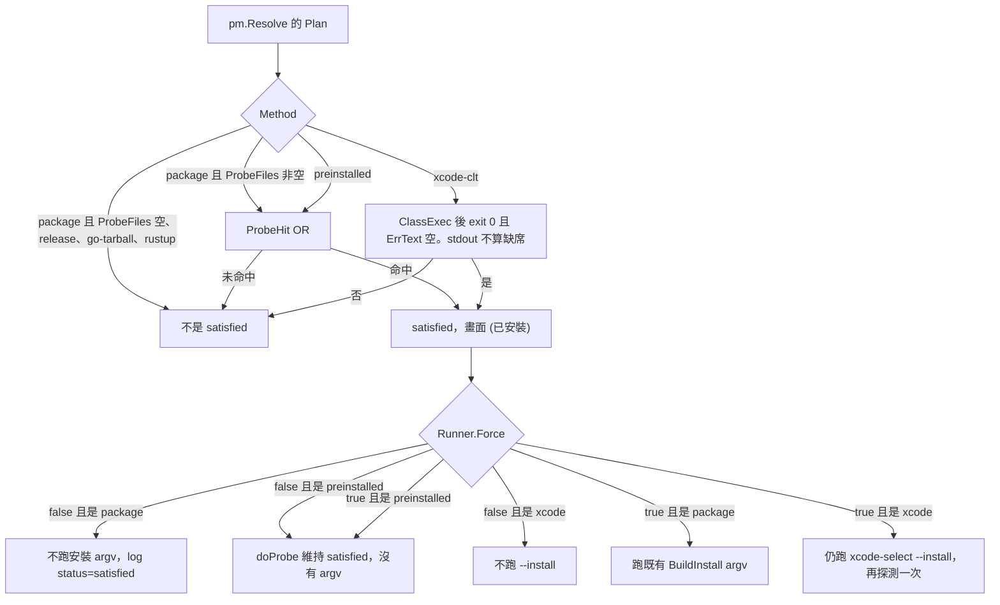
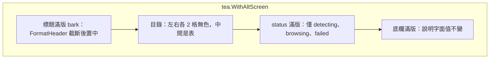
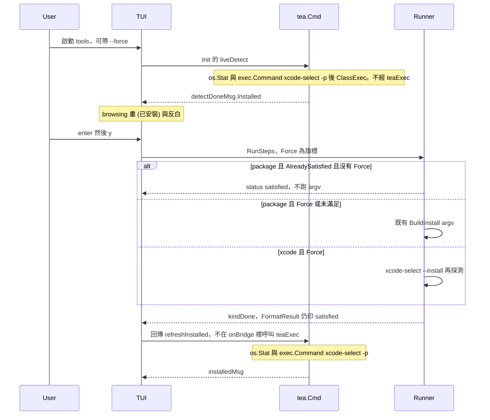

# `tools` 安裝畫面：已安裝略過、`(已安裝)` 反白、表格留白與置中標題

> **2026-11-17 更新（進度頁）：** 確認頁、python 的 y 確認、強制重裝 y/n 問句與跳出到 shell 執行命令都已移除；改為 TUI 內的進度頁與 sudo 密碼頁，見 `docs/tools-progress-design.md`。本文件與它衝突的段落以新文件為準。

> **2026-11-17 更新：** 解除安裝、設定檔部署、bash/zsh 設定區塊與色系（全部畫面不畫背景色）已改，見 `docs/tools-uninstall-design.md`。本文件與它衝突的段落以新文件為準。

| 欄位 | 值 |
| --- | --- |
| 作者 | 待填 |
| 日期 | 2026-11-12 |
| 狀態 | Draft |
| 模組 | `github.com/shuhi/dotfiles` |
| 適用樹 | `/home/shuhi/project/Dotfiles` |
| 範圍 | 目錄列如何顯示「已經滿足」、執行期如何略過、`--force` 如何只重跑既有安裝動作、標題如何置中 |
| 不取代 | `docs/tools-installer-design.md` 的套件名稱、argv、`shadowed`、alias、go tarball、release。`docs/tools-tui-earth-design.md` 的色票、底欄、按鍵字面值。本文件只在標題置入畫面時，收斂該文件「plain 不截斷標題」這一條，見 Key Decisions |

## Overview

目錄安裝器今天只在執行步驟時，對少數計畫呼叫 `install.ProbeHit` 或 `xcode-select -p`。命中就得到既有狀態 `satisfied`，套件 argv 不跑。畫面不標這些列，標題靠左，目錄列貼著終端機左緣。沒有 `--force`。

本設計不另做一套「這台機器有沒有這個套件」的政策。畫面上的 `(已安裝)` 就是 `satisfied` 的顯示字，不是新的 `ItemResult.Status`。瀏覽、偵測、失敗這三個仍走目錄的 phase，已滿足的列印出這個字並反白（SGR 7，前景與背景對調），不是新的強調色。未加 `--force` 時，執行期沿用今天的短路，結果寫 log、不當失敗。`--force` 只取消這個短路，再跑該項目今天本來就會跑的安裝 argv 或 `xcode-select --install`。它不升級整台作業系統，不改 `BuildInstall` 的參數，也不把 `shadowed`、release、go tarball 已存在、Debian alias 收成另一種「已安裝」。

標題仍是 `FormatHeader` 的整句，含系統、架構與套件管理器。放進畫面時以 `ansi.StringWidth` 置中；寬度不夠就用既有的 `ansi.Truncate(..., "…")`，不把標題折進行目錄。目錄改成固定欄，左右各留 2 格。

## Background & Motivation

現況來自這些檔案，不是構想：

- `cmd/tools/main.go` 的用法字串只有 `tools [--verbose]` 與 `tools apply [--only id,id] [--pm ...] [--dry-run] [--bashrc PATH] [--verbose]`。沒有 `--force`。`run` 只剝掉子命令前的一個 `--verbose`。
- `internal/install/plan.go` 的 `ItemResult.Status` 註解已列出 `ok, satisfied, failed, pending-user, skipped, shadowed`。沒有 `installed`。
- `internal/install/exec.go` 的 `ProbeHit`：`exists == nil` 回 false；否則任一個非空路徑 `exists(path)` 為真就回 true。這是 OR，不是 AND。
- `internal/install/runner.go` 的 `doPackage`：`len(st.ProbeFiles) > 0 && ProbeHit(...)` 時直接 `Status: "satisfied"`，不呼叫 `execClass`，不呼叫 `ConcludeExec`，因此沒有 keg-only 註記。`doProbe` 對 `MethodPreinstalled` 用同一個 `ProbeHit`。`RunXcode` 對 `xcode-select -p` 的 exit 0 回 `satisfied`。
- `Runner.exists` 在 `Exists == nil` 時是 `os.Stat` 的 `err == nil`。它跟 symlink，壞掉的 symlink 不算命中。目錄也算命中。偵測套件管理器的 `exec.LookPath` 不用在這條路上。
- `internal/tui/view.go` 的 `FormatItem` 只有 `* [x] name` 這種字。`formatRow` 在前面加 `> ` 或兩個空白。`FormatHeader` 靠左。`paintHeader` 在 styled 時 `ansi.Truncate` 到 `m.width` 再鋪滿 bark。plain 把 `FormatHeader` 整句放進一列。
- `internal/tui/styles.go` 的 `paintItem` 依片段上色：`>` 是 cream 粗體，`*` 是 gold，勾選是 clay，未勾選是 sand，游標列背景是 cursor，其餘是 bark。`padTo` 只用尾端空白補寬，不准把上好色的字串再送進 `Width`。
- `internal/tui/model.go` 的 `scroll` 沒有寫入者。`window` 每次 `View` 讀它，實際一直是 0。
- `internal/tui/update.go` 的 `phaseFailed` 吃掉 `enter`、`d`、`ctrl+c`，但 `plainHelp` 在 failed 仍印 browsing 那一整句。這次不改。
- `internal/tui/keymap.go` 的說明字面值不動。不換 `bubbles/list`，不換 `bubbles/help`。

痛點：

1. 使用者無法在勾選前看到哪些目錄項已經被既有政策當成滿足。
2. 滿足的項目仍會在「沒有 ProbeFiles」時安裝；有 ProbeFiles 時雖然會略過，但沒有旗標可以再跑一次那個 argv。
3. 目錄沒有欄對齊，列首貼著 alt screen 左緣。
4. 標題是 101 個顯示格的一列（Fedora 範例）。80 欄時 styled 會截斷但靠左；plain 整句會被終端機折進目錄區。

Fedora 45 上大多數 ID（`git`、`curl`、`wget2-wget` 等）的 cell 沒有 `@then:` 也沒有 `@pre:`。`dnf install -y git` 在 git 已存在時由 dnf 自己成功結束。安裝契約寫明這不是整機升級，也沒有把「RPM 已安裝」記成 `satisfied`。本設計維持這條。

## Goals & Non-Goals

### Goals

- 目錄列在「既有 satisfied 判斷為真」時顯示字面 `(已安裝)`。plain、`NO_COLOR`、非 TTY 都有這個字，且沒有 ANSI。
- styled 時反白只從游標畫到 `(已安裝)`：這一段的每個片段 `Reverse(true)`，也就是 SGR `7`，對調該片段自己的前景與背景。不新增色票。標記後面的兩個空白與描述維持今天的 muted、該列的列背景（游標列是 cursor，否則 bark），不加 `Reverse`，不含 `\x1b[7;`。沒有描述時，標記之後到內寬才是名稱色反白（寬度 80 的那 48 格）。鎖在寬度 100 的 wget fixture：`installed["wget"]=true` 時，描述 `Fedora 套件是 wget2-wget` 是 muted `38;2;126;130;147` on bark `48;2;43;44;58`，不含 SGR `7`。Goals 不可實作成「整列每個片段都反白」。
- 未加 `--force`：`MethodPackage` 的 `ProbeHit` 短路與 `xcode-select -p` 的短路照舊，狀態 `satisfied`，寫 log，退出碼規則不變，不當 `failed`。`MethodPreinstalled` 本來就沒有安裝 argv。
- `--force` 加在 `tools` 進入 TUI 的前置旗標，以及 `tools apply`。它只取消 `MethodPackage` 的 satisfied 短路，並讓已滿足的 `compiler` 再執行一次既有的 `xcode-select --install`。`MethodPreinstalled`（brew 的 `make`、`net-tools`）忽略這個旗標，不因此得到 `brew install` argv。
- 目錄是表：游標、`*`、勾選框、名稱、`(已安裝)` 對齊。左右各留 2 格。寬度小於 5 時留白改為 0。
- 標題一列、水平置中。字串仍是 `FormatHeader`。架構詞仍是 `ClassifyArch` 的 `ARM`、`x86_64`、`i386`，或未支援時的原始 `GOARCH`。不用 `RAM`，也不用裸的 `i86`。
- `*` 仍只代表 `catalog.Item.Default`。與勾選、與 `(已安裝)` 無關。
- `m.scroll` 維持不被寫入。

### Non-Goals

- 不新增第二種偵測：不呼叫 `rpm -q`、`dnf list installed`、`dpkg-query`、`pacman -Q`、`brew list`、`command -v`，也不為每個 ID 發明路徑表。
- 不把 `(已安裝)` 寫進 `ItemResult.Status`、`install.FormatResult`、installing 的 `  <Title>  <status>`、或 `install.log`。那些地方仍印 `satisfied`。
- 不把 `shadowed` 顯示成 `(已安裝)`。`/usr/bin/trash` 不是 trash-cli。
- 不讓 `--force` 變成 `dnf upgrade`、`apt-get upgrade`、`pacman -Syu`、`brew update`、`brew upgrade`、`brew reinstall`、`brew link --force`，也不剝掉 pacman 的 `--needed`，不加 `--reinstall`。
- 不改套件名稱。Fedora 的 `wget2-wget`、`vim-enhanced`、`bind-utils`、`fd-find`、`pkgconf-pkg-config`，以及 brew 的 `node`，維持 `internal/pm/names.go` 與安裝契約。
- 不改 `FormatItem` 的四個字串：`* [x] git`、`* [ ] git`、`  [ ] zsh`、`  [x] neovim`。標記接在列格式化，不塞進 `FormatItem`。
- 不改 `keymap.go` 的 help 字面值，不改 `update.go` 的按鍵分支。failed 的說明列仍含 `enter` 與 `d`。
- 不改 confirm、installing、report 的正文色。`ok`、`failed`、`satisfied` 仍是 cream on bark，不反白。
- 不改設定複製政策、link-bash 的「payload 已在就不追加」、go tarball 的「目錄已存在就失敗」、release 的「總是下載」。
- 不做解除安裝，不引入 `curl | sh`、`chsh`、第三方套件庫、自動安裝 Homebrew。
- 不刪 `ghostty/`、`wezterm/`、`rust/`、`WSL/`。
- 不改 `m.scroll` 的生命週期，不把視窗起點寫回 model。

## Proposed Design

### 已安裝是哪一個狀態

狀態字是 `satisfied`。顯示字是 `(已安裝)`，顯示寬度 8：`(`、`)` 各 1，`已安裝` 三個全形字各 2。括號是 ASCII，不是全形 `（）`。

判斷函式是既有的 `install.ProbeHit`，加上 `RunXcode` 裡對 `xcode-select -p` 的 exit 0。為了讓目錄與 runner 不會各寫一次條件，抽出純函式，不新增政策：

```go
// AlreadySatisfied is the existing satisfied decision, not a package-manager query.
// xcodeOK must be XcodeSelectPresent of a ClassExec result, after the caller
// has already returned on Canceled and ExecErr. It is not a process runner.
// Any other method, including release, go-tarball, and rustup, is false.
func AlreadySatisfied(method pm.Method, probes []string, exists func(string) bool, xcodeOK bool) bool {
    switch method {
    case pm.MethodPackage, pm.MethodPreinstalled:
        return len(probes) > 0 && ProbeHit(probes, exists)
    case pm.MethodXcodeCLT:
        return xcodeOK
    default:
        return false
    }
}

// XcodeSelectPresent reads an already classified ExecClass from
// argv ["xcode-select", "-p"]. ClassExec returns before inspecting output
// when ExitCode is 0, so ErrText is empty even if stdout is
// "/Library/Developer/CommandLineTools". Do not pass combined stdout as ErrText.
// Canceled and ExecErr are not present; callers must not treat those as
// "fall through to --install".
func XcodeSelectPresent(cls ExecClass) bool {
    return !cls.Canceled && cls.ExecErr == nil && cls.ErrText == "" && cls.ExitCode == 0
}
```

`ProbeHit` 本體不改。`exists` 仍是 `Runner.exists`：測試注入 `Runner.Exists`，正式路徑是 `os.Stat`。

`xcodeOK` 只准是 `XcodeSelectPresent(cls)`，而且 `cls` 必須來自 `ClassExec(manager, output, exitCode, waitErr)`。`ClassExec` 在 exit 0 時直接返回，不把 stdout 寫進 `ErrText`。成功的 `xcode-select -p` 會把 developer directory 印到 stdout；若有人把這段 stdout 當成 `ErrText`，已安裝的 CLT 會被看成不存在，`force == false` 就會掉進 `--install`，彈出本設計只允許 `--force` 或「尚未安裝」才開的對話框。

`RunXcode` 的三路必須寫在 bool 外面。bool 為 false 不得同時代表取消、啟動失敗與「真的沒裝」：

```go
out, code, err := exec.Run(ctx, []string{"xcode-select", "-p"})
cls := ClassExec("", out, code, err) // out 不是 ErrText；exit 0 時 ErrText 仍是空的
if cls.Canceled {
    return "", "", true // 中止。不跑 --install
}
if cls.ExecErr != nil {
    return "failed", cls.ErrText, false // 啟動失敗。不跑 --install
}
if !force && XcodeSelectPresent(cls) {
    return "satisfied", "", false
}
// 走到這裡才是既有的 ["xcode-select", "--install"]，然後再探測一次
```

鎖一個測試：`-p` 的 fixture 是 exit 0，且 stdout 非空（`/Library/Developer/CommandLineTools`）。`force == false` 時 argv 只有那一次 `-p`，沒有 `--install`，狀態 `satisfied`。`force == true` 時 `--install` 恰好一次，然後才是第二次 `-p`。第二次仍是 exit 0 則 `satisfied`。



### 各安裝方法怎麼算「有了」

下表是程式今天的行為。本設計不改判定，只把真的那一欄畫出來，並定義 `--force` 對那一欄做什麼。

| 情形 | 程式今天怎麼決定 | 畫面 `(已安裝)` | 沒有 `--force` | `--force` |
| --- | --- | --- | --- | --- |
| brew `whois` | `MethodPackage`，`ProbeFiles` 只有 `/usr/bin/whois`。`doPackage` 命中則 `satisfied`，不跑 `brew install whois`，不呼叫 `KegOnlyNote` | 是 | 略過 argv，log `satisfied` | 取消短路，跑既有 `brew install whois`。exit 0 後走 `ConcludeExec`，狀態 `ok` 並帶既有 keg-only 註記 |
| brew `traceroute` | `ProbeFiles` 為 `/usr/sbin/traceroute`、`/sbin/traceroute`。OR。任一個存在即 `satisfied` | 是 | 同上，不跑 `brew install traceroute` | 跑既有 `brew install traceroute` |
| 其他管理器的 `whois`、`traceroute`，以及 `git`、`curl`、`wget`、`vim`、`fd`、`bat`、`node` 等沒有 `ProbeFiles` 的 package | `parseCell` 的 default 分支不填 `ProbeFiles`。`doPackage` 的 `len > 0` 為假，總是跑 `BuildInstall`。dnf 上 git 已存在時由 dnf 成功結束，狀態是 `ok` 不是 `satisfied` | 否 | 照舊跑 argv | argv 位元組不變，所以行為與今天相同 |
| brew `make` | `MethodPreinstalled`，`ProbeFiles` 只有 `/usr/bin/make`。`doProbe` 命中為 `satisfied`。未命中失敗，`ErrText` 一字不差是 `pm.MakeMissingMessage`。禁止 `brew install make` | 命中才是 | 沒有安裝 argv 可跑 | **忽略 `--force`**。命中仍是 `satisfied`。未命中仍是同一句失敗。不改去裝 gmake |
| brew `net-tools` | `ProbeFiles` 只有 `/sbin/ifconfig`。未命中是 `pm.NetToolsMissingMessage`（`macOS 沒有對應的 net-tools formula`）。沒有 brew fallback | 命中才是 | 同 make | **忽略 `--force`**。`/usr/sbin/ifconfig` 不算 |
| brew `compiler` | `MethodXcodeCLT`。`RunXcode` 先跑 `xcode-select -p`，用 `ClassExec` 分類。stdout 印出的 developer directory 不是 `ErrText`。`Canceled` 中止；`ExecErr != nil` 是 `failed`，兩者都不跑 `--install`。只有這兩路都沒發生，且 `XcodeSelectPresent` 為真、`force == false`，才是 `satisfied`。否則 argv 是 `xcode-select --install`，不加 sudo，再探測一次。仍失敗則 `pending-user`，訊息 `pm.XcodePendingMessage` | `-p` 的 `ClassExec` 為 exit 0 且 `ErrText` 空才是。stdout 非空仍算 | 略過 `--install` | 即使 `-p` 已是 0，仍跑一次既有 `--install`，再探測。第二次仍是 0 則 `satisfied`。不改裝 `brew install gcc`，不迴圈 |
| brew `trash` | 沒有 `ProbeFiles`。總是 `brew install trash-cli`。exit 0 由 `Decorate` 設 `shadowed`，註記 `pm.TrashShadowNote`。不看 PATH 上第一個 `trash`，也不把 `/usr/bin/trash` 當成 trash-cli | 否。`shadowed` 不是這個標記 | 照舊安裝並 `shadowed` | argv 不變，成功仍是 `shadowed`，不是 `satisfied`，畫面上仍沒有 `(已安裝)` |
| Linux `trash` | 套件名 `trash-cli`，沒有 `ProbeFiles`。成功是 `ok` | 否 | 照舊 | 照舊 |
| Debian `fd`、`bat` alias | `AliasSymlinks` 在套件成功之後才看路徑。`/usr/bin/fd` 不存在且 `/usr/bin/fdfind` 存在，才做 `~/.local/bin/fd` → `/usr/bin/fdfind`。`bat`／`batcat` 同理。正確 symlink 是 no-op。`/usr/bin/fd` 存在就不做 symlink，這不是 sharkdp 的身分證明，也不讓項目變成 `satisfied` | 否 | `fd-find`／`bat` 仍安裝 | 不把 fdfind／batcat 當成已安裝，不跳過套件 |
| GitHub release（`starship` 的 dnf／yum、`zellij` 的 apt／dnf／yum、`mitos` 全部、以及其他 `@rel` 或 fallback） | `Client.Install` 不看目的地是否已有二進位。`copyExec` 用暫存檔 `Rename` 蓋過 `~/.local/bin/<binary>`。`LayoutTree` 會刪掉既有分享目錄再複製，`PlaceSymlink(..., true)` 可換 symlink。沒有 `satisfied` 短路 | 否 | 總是下載 | 不新增「檔案已在就略過」。`--force` 對這條是空操作，因為今天本來就會重下 |
| go tarball | `InstallGo` 對 `filepath.Join(destRoot, "go")` 做 `os.Lstat`。預設 `destRoot` 是 `/usr/local`，所以路徑是 `/usr/local/go`。已存在則錯誤 `已存在，不覆蓋`，項目 `failed`，不是 `satisfied` | 否 | 照舊失敗，不刪目錄 | 不刪、不覆蓋。`--force` 不改變這句 |
| rustup | `PrepareRustup` 下載 `rustup-init`，argv 是 `RustupArgv`：`init -y --no-modify-path --default-toolchain stable`。不探測 `~/.cargo` | 否 | 總是跑 | argv 不變 |
| 設定複製 | `doConfig` 只在 `successStatus`（`ok`、`satisfied`、`shadowed`）之後跑。`zsh` 是 `PolicyCopyIfMissing`，目標在則 `skipped_exists`，不改項目狀態。`zellij`、`starship` 是 `PolicyBackupReplace` | 否。這不是目錄項的 satisfied | 照舊 | 不改政策。`--force` 不把 `~/.zshrc` 改成覆蓋 |
| link-bash | `Apply` 看到標記列或 payload 列就放進 `Report.Skipped`，不追加第二份。payload 是 `internal/linkbash/apply.go` 的 `payloads` | 不是目錄列 | 照舊略過已在的 hook | 不因 `--force` 再寫一次 |

`successStatus` 仍是 `ok`、`satisfied`、`shadowed`。略過的 satisfied 項目仍做設定複製與 hooks，與今天 `runner.go` 相同。退出碼仍由 `finalCode` 決定：全是這三個成功狀態則 0；`failed` 或 `pending-user` 則 1。satisfied 不是失敗。

更新步驟不動。`hasPackage` 仍只看計畫裡有沒有 `MethodPackage`，不新增「每個項目都會 satisfied 就跳過 update」的分支，也不把 update 升成 upgrade。這個分支今天也走不到：`ProbeFiles` 只在 brew 的 `whois`、`traceroute`（package）與 `make`、`net-tools`（preinstalled）。`compiler` 是 xcode，不是 `ProbeFiles`。`BuildUpdate("brew")` 是 nil。apt、pacman 的 whois 沒有探測，不會進 satisfied 短路，所以不存在「whois 被短路、前面仍跑 `apt-get update`／`pacman -Sy`」這一次執行。規則仍是：有 `MethodPackage` 就照既有 `BuildUpdate`，不管後面的項目會不會被短路。

dry-run 不動。`tools apply --dry-run` 仍印 `Step.Title` 與 argv，即使執行時會 satisfied。TUI 的 dry-run 仍把項目記成 `skipped`，不記成 `satisfied`，也不把目錄上的 `(已安裝)` 拿掉。目錄標記是探測結果，不是這次執行的 `ItemResult`。

`BuildSteps` 不改標題。confirm 仍印 `install whois`，不改成 `(已安裝)`。`internal/install/steps_test.go` 的 Fedora 預設計畫維持原樣。

### 什麼時候探測

探測不在 `View` 裡做，避免每次重繪 `stat`。

1. TUI 的第一次探測在 `liveDetect`。它已經是 `Init` 回傳的 `tea.Cmd`，不在 `Update` 裡跑。管理器確定後，對 `catalog.IDs()` 全部 ID（含未勾選）呼叫 `install.ResolveAll`，再對每個 `Plan` 呼叫 `AlreadySatisfied`。路徑用 `os.Stat`。只有某個計畫的 `Method == MethodXcodeCLT` 才 `exec.Command("xcode-select", "-p")`，把 `CombinedOutput` 與 wait error 送進 `ClassExec`，再取 `XcodeSelectPresent`。禁止把 stdout 填進 `ExecClass.ErrText`。結果放進 `detectDoneMsg.Installed`。這條命令不經過 `teaExec`，也不呼叫 `Runner.Exec`。管理器偵測失敗時 map 為 nil，phase 仍是 `phaseFailed`，目錄照畫但沒有標記。`-p` 啟動失敗或 `Canceled` 只表示 compiler 未標記，不跑 `--install`，也不把整個 TUI 送進 failed。畫面這條路沒有安裝分支，bool 為 false 只是不畫標記。
2. 安裝結束後的重探不能寫在 `onBridge` 的 `kindDone` 裡面同步呼叫 executor。`drive.go` 已說明 `tea.ExecProcess` 必須從 `Update` 回傳；`teaExec.Run` 把 `kindAsk` 送進 channel 後就堵住等 reply。`kindDone` 當時正是 `Update`，再呼叫 `teaExec` 或 `Runner.Exec` 會死鎖。`kindDone` 只把 phase 設成 report，並回傳另一個 `tea.Cmd`（`refreshInstalled`）。那個 Cmd 用與 `liveDetect` 相同的 `os.Stat` 與 `exec.Command("xcode-select", "-p")`，完成後送 `installedMsg`。它不碰 `m.deps.Runner.Exec`。`installedMsg` 若 `runID` 不符就丟掉。使用者按鍵回 browsing 時 map 已經是這次重探的結果。不在每次 `View` 探。不把 `ok` 或 `shadowed` 反寫進 map：剛裝完的 git 若沒有 `ProbeFiles`，仍不是 `(已安裝)`。
3. `tools apply` 不需要事前 map。短路在 `doPackage`／`RunXcode` 裡面，結果經 `FormatResult` 印出 `whois  satisfied`。`apply` 的 executor 是 `OSExecutor`，不是 `teaExec`。

CLI 與 TUI 的 `exists` 都必須是 stat，不是 `LookPath`。whois 只認 `/usr/bin/whois`，不認 Homebrew prefix 裡的 whois。

### `--force` 的命令列

兩個入口都接受，語意同一個 `Runner.Force`。

```text
tools [--verbose] [--force]
tools apply [--only id,id] [--pm apt|dnf|yum|pacman|zypper|apk|xbps|brew] [--dry-run] [--bashrc PATH] [--verbose] [--force]
```

- 子命令前的 `--verbose` 與 `--force` 可以任一順序、各自最多出現一次。多的一次是未知參數，退出碼 2。今天只剝一個開頭的 `--verbose`，這次改成把這兩個旗標從 `args` 前面拆完，再看子命令。
- `apply` 裡也接受 `--force`，與 `--dry-run` 一樣是裸旗標。不接受 `--force=true`。
- 沒有子命令且 stdin 不是 TTY：照舊印用法、退出碼 2。`--force` 不變成無 TTY 的安裝。
- 沒有子命令且是 TTY：`runTUI` 把旗標放進 model，`startInstall` 設 `r.Force`。沒有新的按鍵去切換它。
- `apply` 沒有 `--only` 時仍是 `catalog.DefaultIDs()`。`--force` 作用在這次選中的項目，不是作業系統上所有套件。

`doPackage` 的短路改成：

```go
if !r.Force && AlreadySatisfied(st.Method, st.ProbeFiles, r.exists, false) {
    res := ItemResult{ID: st.ItemID, Method: st.Method, Status: "satisfied"}
    res.Note = WithFzfNote(st.ItemID, res.Status, "")
    return res, false
}
```

`doProbe` 不讀 `Force`。`doRelease`、`doGo`、`doRustup`、`doConfig`、`doLink` 不讀 `Force`。

`RunXcode` 增加 `force bool`。`force == false` 時，`-p` 成功的返回與今天相同。`force == true` 時不走那個返回，繼續既有的 `--install` 與第二次探測。第二次的 satisfied／pending-user／failed 規則不變。

被短路的結果 `Argv` 是 nil。`--verbose` 只在 `len(Argv) > 0` 時把 argv 印到 stderr，所以 satisfied 列不會多一行命令。`--force` 真的跑了 argv 時，log 的 `argv` 是那個既有切片。

### 哪個 phase 反白

| phase | 目錄表與 `(已安裝)` | 反白 |
| --- | --- | --- |
| `phaseDetecting` | 有目錄。map 還是空的，所以還沒有標記。標題可能仍是偵測前的 `FormatHeader` 零值 | 無 |
| `phaseBrowsing` | 有。這是安裝畫面本體 | 已滿足的項目列，含游標列 |
| `phaseFailed` | 有目錄，說明列仍是 browsing 那一句。管理器失敗時 map 為空，沒有標記 | 只有 map 為真的列。失敗本身不反白 |
| `phaseConfirm` | 無。仍是 `Step.Title` 清單 | 無 |
| `phaseInstalling` | 無。已完成列仍是 `  <Title>  <status>`，status 含字面 `satisfied` | 無 |
| `phaseReport` | 無。`install.FormatResult`，例如 `whois  satisfied` | 無 |

反白不是「這次會略過」的意思。加了 `--force` 仍顯示標記、仍反白，因為檔案還在。略過與否只發生在 runner。

### 表格與留白

`horizontalInset(width)`：`width >= 5` 回 2，否則回 0。左右使用同一個值。寬度 4 以下若仍扣 4 格，內寬會是 0 或負的，目錄會空掉，所以改為不留白，退回今天的滿版。

留白只加在目錄區：分類列、項目列，以及目錄 body 補高的空白列。標題列與底欄維持滿版，避免動到 `TestStyledFooterBackground` 的底欄寬度，也避免說明列再縮一次。status 的 `已勾選` 列維持滿版 cream／muted on bark。confirm、installing、report 的正文維持滿版，它們不是這張表。

左右留白是沒有 ANSI 的空白，不鋪 bark。目錄的底色因此不會貼到左右邊。補高列同樣是「左留白 + 內寬的 bark 空列 + 右留白」，不呼叫外層 `Width` 去包已經上色的項目列。

內寬 `inner = width - 2*inset`。欄位在內寬裡從 0 起算，顯示寬用 `ansi.StringWidth`：

| 欄 | 起點 | 寬 | 內容 |
| --- | --- | --- | --- |
| 游標 | 0 | 2 | `> ` 或 `  ` |
| `*` | 2 | 1 | `Item.Default` 為真才是 `*`，否則一個空白。與勾選、與已安裝無關 |
| 空白 | 3 | 1 |  |
| 勾選框 | 4 | 3 | `[x]` 或 `[ ]` |
| 空白 | 7 | 1 |  |
| 名稱 | 8 | `nameWidth` | 左對齊。`nameWidth` 是 `catalog.All()` 裡名稱的最大顯示寬，今天是 10（`traceroute`、`pkg-config`）。不要把 10 寫死在格式化字串裡，但測試可以鎖今天的 10 |
| 間隔 | 8+nameWidth | 2 | 只在有標記時印出 |
| 標記 | 10+nameWidth | 8 | 已安裝才印 `(已安裝)`。未安裝不印，也不為了對齊去補這 8 格 |

未安裝列在名稱補空白之後結束。已安裝列的 `(` 因此落在同一欄。`FormatItem` 的字元順序不變，名稱補空白接在名稱後面，所以 `> * [x] git` 仍是該列的子字串。左留白的兩個空白也不會破壞 `strings.Contains`。

`width >= 100` 才接描述，門檻不變。描述接在標記欄之後，兩個空白，用今天的描述畫法：muted 前景、該列的列背景（游標列是 cursor，否則 bark），不加 `Reverse`，不用 clay、sand 或 gold。沒有標記時，這兩個空白與描述接在名稱補空白之後。描述不再把 `(已安裝)` 往右推。反白條停在標記欄的最後一格，不延伸進描述，也不把描述塗成名稱色。描述之後剩下的內寬是該列背景的 gap（未安裝或描述尾是 bark 或 cursor，沒有 `7`），不是名稱色的反白空白。寬度 80 那條「標記後面 48 格反白」只適用於沒有描述的列。

內寬放不下整列時，plain 對邏輯字串做 `ansi.Truncate(line, inner, "…")`。styled 先把片段接好，再對這條已上色的字串做 `ansi.Truncate`（它認得 SGR，不會切在 ESC 中間）。`ansi` v0.11.6 的 `Truncate` 在全形字放不進尾端預算時，結果可以比預算短一格：Fedora 標題在寬度 2 得到顯示寬 1 的 `…`，寬度 4 得到顯示寬 3 的 `系…`。目錄列也一樣，切在 `已` 或 `（` 上會短於 `inner`。截完之後若 `ansi.StringWidth` 仍小於 `inner`，用追加的 gap 補到 `inner`：該列是已安裝且補白落在反白條內（標記之後、描述之前，或根本沒有描述）時，gap 帶該列名稱前景、列背景與 `Reverse(true)`；否則是列背景的 gap，不加 reverse。然後才接右留白。不准把已上色的字串送進 `lipgloss` 的 `Width`。截斷用的 `…` 是 U+2026，顯示寬 1；`Truncate` 自己加上的 `…` 可能沒有片段色，不足的格子靠後面的 gap，不靠外層 `Width`。整列顯示寬等於 `m.width`，右留白才會落在最後 `inset` 格。

分類列不是只截斷。結構是：左留白的無色空白、`padTo` 到 `inner` 的 olive 粗體片段（`Inline(true)`，尾端 bark gap 是接上去的，不是外層 `Width`）、右留白的無色空白。標題比 `inner` 長時先 `ansi.Truncate(title, inner, "…")`，短一格時同樣用 bark gap 補滿 `inner`。整列 `ansi.StringWidth` 等於 `m.width`。`基礎` 只有 4 格，內寬其餘是 bark，不是終端機底色。`TestStyledCategoryHeaderOlive` 只要求列裡同時有 olive 與 bark，補滿內寬才不會讓這個測試在「只畫四個字」時也通過。`TestFooterIsLastLine` 鎖的是 plain 第 2 列等於 `基礎`；寬度 ≥ 5 時這一列變成 `  基礎`，見 PR 3。寬度小於 5 時 inset 為 0，該列仍是 `基礎`。

`m.scroll` 不寫。`window(len, cursorAt, m.scroll, bodyH)` 維持現況，每次從 0 算出能看見游標的視窗。

### 反白怎麼畫

沿用 `paintItem` 的片段，不把整列收成一個 style。整列一個 style 會讓 `*` 與 `[x]` 變成同一組前景，反白之後仍是同一色。

已安裝列從游標到標記欄為止的每個可見片段，包含欄間空白與名稱補白，都要同時設前景、背景、`Inline(true)`、`Reverse(true)`。描述前的兩個空白、描述本身、以及描述後面的補白不在這條裡面：

- 背景仍是游標列的 cursor `#333648`，或其他列的 bark `#2B2D3A`。游標不因為反白而消失。
- `>` 仍是 cream `#E1E3E4`、粗體。
- `*` 仍是 gold `#EDC763`，不是 clay，也不是 key。
- 勾選框與名稱仍是 clay `#F89860` 或 sand `#E1E3E4`。
- `(已安裝)` 用名稱那一個前景，不另給顏色。勾選時與 `[x]` 同是 clay；未勾選時與名稱同是 sand。反白在這 8 格結束。
- 沒有描述時，標記之後到 `inner` 右緣的空白才用名稱前景加 reverse。這就是寬度 80、whois 那 48 格。有描述時不要這樣塗。
- 描述前的兩個空白與描述沿用 `paintItem` 今天的描述片段：muted、列背景、不 reverse。游標列的列背景是 cursor，不是把描述硬塗回 bark 而在游標列上挖洞。描述之後的空白只設列背景。
- `*` 後面的那一格空白用名稱前景，不用 gold。gold 只佔 `*` 那一格，反白後不會糊成與勾選框一樣寬的色帶。
- 只設背景再 `Reverse(true)` 的空白不可用。實測 `Background` + `Reverse` 的片段是 `\x1b[7;48;2;51;54;72m \x1b[0m`，沒有前景，終端機對調後會露出預設底色。

未安裝列的片段不加 `Reverse`。SGR 與今天的 `paintItem` 相同，只是多了名稱補白與左右留白。

在 `lipgloss` v1.1.0、`termenv` v0.16.0、`TrueColor`、`Inline(true)` 下量過。`Reverse(true)` 排在粗體之後、顏色之前。測試鎖這些參數，不鎖「反白後人眼看到的 RGB」，因為對調是終端機做的：

| 片段 | 條件 | 實測 SGR |
| --- | --- | --- |
| `>` | 游標、已安裝 | `\x1b[1;7;38;2;225;227;227;48;2;51;54;72m>\x1b[0m` |
| `*` | 游標、已安裝 | `\x1b[7;38;2;237;199;99;48;2;51;54;72m*\x1b[0m` |
| `[x]` 與 `(已安裝)` | 游標、已勾選、已安裝 | `\x1b[7;38;2;248;152;96;48;2;51;54;72m` |
| `[ ]` | 未安裝、未勾選、非游標 | `\x1b[38;2;225;227;227;48;2;43;44;58m[ ]\x1b[0m`，沒有 `\x1b[7;` |

`*` 的片段不得含 `38;2;248;152;96`。`[x]` 的片段不得含 `38;2;237;199;99`。未安裝列不得含 `\x1b[7;`。分類列不反白，仍是 olive 粗體 on bark。

`styled == false` 不呼叫 `lipgloss`。`runTUI` 的閘門維持 `isTTY(stdout) && os.Getenv("NO_COLOR") == ""`。

### 標題置中

`FormatHeader` 的字串不改。Fedora 測試案例今天的回傳值，顯示寬 101：

```text
系統: Fedora Linux 45 (WSL) [GOOS=linux]    架構: x86_64（GOARCH=amd64, uname-m=x86_64）    套件: dnf
```

函式就是 `internal/tui/view.go` 的：

```go
func FormatHeader(info platform.Info) string {
    uname := info.Arch.UnameM
    if uname == "" {
        uname = "未知"
    }
    pmName := info.Manager
    if pmName == "" {
        pmName = "未知"
    }
    fam := info.Arch.Family
    if fam == "" {
        fam = "unknown"
    }
    return fmt.Sprintf("系統: %s    架構: %s（GOARCH=%s, uname-m=%s）    套件: %s",
        info.OS.SystemText, fam, info.Arch.GOARCH, uname, pmName)
}
```

`SystemText` 來自 `platform.ClassifyOS`，不另寫「Fedora」或「x86_64 機器」。架構詞來自 `platform.ClassifyArch`：`amd64` → `x86_64`，`386` → `i386`，`arm`／`arm64` → `ARM`，空的 GOARCH → `unknown`，其他 GOARCH → 那個字本身。不支援的 GOARCH 在 release 路徑仍是 `不支援的 GOARCH=%s：此安裝方法沒有對應的上游資產或 triple`。那是安裝錯誤，不是標題錯誤。標題照樣顯示該 `Family`。不支援的 GOOS 仍是 `不支援的 GOOS=%s：v1 只支援 linux 與 darwin`，TUI 進 `phaseFailed`，但 `liveDetect` 已經填了 `OS` 與 `Arch`，標題仍可顯示。

置中演算法，plain 與 styled 共用，寬度是 `m.width`，不是內寬。留白不適用於標題，否則 80 欄會比今天再少 4 格：

```go
func placeHeader(text string, width int) (visible string, left int) {
    if width <= 0 {
        return "", 0
    }
    visible = ansi.Truncate(text, width, "…")
    w := ansi.StringWidth(visible)
    if w >= width {
        return visible, 0
    }
    return visible, (width - w) / 2
}
```

`left` 用截斷後的顯示寬來算，餘數留在右邊。比較用 `ansi.StringWidth`，不用 `len` 或位元組數。`…` 算進 `width`。全形字放不進尾端預算時，`Truncate` 的結果可以比 `width` 少 1：寬度 2 是 `…`（顯示寬 1），寬度 4 是 `系…`（顯示寬 3）。`left` 仍是 `(width - w) / 2`，少掉的那一格不拿來重算置中。

styled：左緣的 `left` 個空白用 bark 的 `gap` 畫，本文用一個 `ink(..., cream, bark, bold)`，右邊用既有 `padTo` 鋪到 `m.width`。`padTo` 補的是短出來的格子，包含全形截斷少的那一格。不要把已經上色的本文再送進 `Width`。標題不反白。

plain：`strings.Repeat(" ", left) + visible`，然後若顯示寬仍小於 `width`，在右邊再接純空白，直到顯示寬等於 `width`。那些空白是框的補齊，不是置中正文的一部分，也不上 ANSI。寬度 4 的 Fedora 標題因此是 `系…` 再一個空白。`FormatHeader` 的測試仍呼叫函式本身，整句必須還在。

寬度 80 時 Fedora 這句的 `ansi.Truncate` 結果，左緣 0，因為截斷後剛好 80。這就是置中的結果，沒有空間再墊：

```text
系統: Fedora Linux 45 (WSL) [GOOS=linux]    架構: x86_64（GOARCH=amd64, uname-m…
```

寬度 101 時是整句、左緣 0。寬度 120 時左緣 `(120-101)/2 = 9` 個空白，右邊再鋪 10 格。plain 在寬度 80 的 `render` 不再包含被截掉的 `套件: dnf`。這是對 TUI 設計文件「plain 不截斷，且 `render(m, false)` 含整句」的收斂，理由是 101 格的一列在 80 欄會折進目錄。`TestFormatHeader` 不改期望值。另加測試：寬度 ≥ 101 的 plain render 含整句；寬度 80 含上面那一列截斷，且下一列仍是目錄而不是標題後半。

### 寬度 80 的前後文

前提：`nameWidth == 10`，`inset == 2`，游標在 `whois`。`whois` 是 `Default`，且被勾選。`zsh` 不是 `Default`、未勾選、未安裝。whois 的「已安裝」只在 brew 且 `/usr/bin/whois` 存在時出現。Fedora dnf 的 whois 沒有 `ProbeFiles`，不會出現標記。下面的 after 用 brew 的那條探測當 fixture，用來鎖版面，不是說 Fedora 上的 whois 一定已安裝。Fedora 的 `git` 維持沒有標記：內文是 `> * [x] git` 再補 7 個空白，左留白兩個空白，子字串 `> * [x] git` 仍在。

**Before，plain。** 今天的 `formatRow`，不滿版，沒有標記。

已安裝預設列（whois，雖然今天根本不會標）：

```text
> * [x] whois
```

未安裝列：

```text
    [ ] zsh
```

**After，plain，寬度 80。** 邏輯列如下。右緣不補空白。whois 的 `(` 在內寬第 20 格（`8 + 10 + 2`）。

已安裝預設列：

```text
  > * [x] whois       (已安裝)
```

未安裝列：

```text
      [ ] zsh       
```

第二列在 `zsh` 後面有 7 個空白，把名稱補到 10。`    [ ] zsh` 仍是子字串。兩列都沒有 `\x1b`。

**Before，styled，寬度 80。** 沒有留白、沒有標記、沒有反白。whois 若是游標列，片段與今天相同：`>` 是 `\x1b[1;38;2;225;227;227;48;2;51;54;72m>\x1b[0m`，`*` 是 `\x1b[38;2;237;199;99;48;2;51;54;72m*\x1b[0m`，`[x]` 與 `whois` 是 clay `\x1b[38;2;248;152;96;48;2;51;54;72m`，尾端用 cursor 背景補到 80。zsh 是 sand on bark，沒有 gold、沒有 clay、沒有 `\x1b[7;`。

**After，styled，寬度 80，whois 已安裝且為游標。** 這一列沒有描述（門檻是寬度至少 100）。列的結構是 2 格無 ANSI 空白、內寬 76 的片段、2 格無 ANSI 空白。內文 28 格，其餘 48 格才是與名稱相同的 clay + cursor + reverse 空白，把反白條鋪到內寬右緣，不使用 `Width`。有描述時反白不包含這段尾端，見下方寬度 100。

可見片段接起來是：

```text
  \x1b[1;7;38;2;225;227;227;48;2;51;54;72m>\x1b[0m\x1b[7;38;2;225;227;227;48;2;51;54;72m \x1b[0m\x1b[7;38;2;237;199;99;48;2;51;54;72m*\x1b[0m\x1b[7;38;2;248;152;96;48;2;51;54;72m [x] whois       (已安裝)\x1b[0m
```

`[x]`、名稱補白、兩個間隔、`(已安裝)` 同一組 clay／cursor／reverse，所以上面把它們寫成一個片段。`*` 是獨立的 gold 片段，不含 `38;2;248;152;96`。`>` 含 `1;7;`，與 `*` 的 `7;38;2;237;199;99` 不同。

**After，styled，zsh 未安裝、非游標。** 2 格無 ANSI 空白，然後與今天相同的 bark 片段，沒有 `\x1b[7;`，沒有 `(已安裝)`。`[ ]` 與 `zsh` 是 `\x1b[38;2;225;227;227;48;2;43;44;58m`。名稱後 7 格與內寬其餘是只有 bark 背景的空白。右緣 2 格無 ANSI。

**寬度 100，已安裝且有描述。** fixture：`installed["wget"]=true`，wget 被勾選、是 `Default`、游標不在 wget。這是畫面 fixture，不是說 dnf 的 wget 有 `ProbeFiles`。plain 整列（已含左留白 2 格；游標不在此列，所以 `*` 前還有兩個空白）是：

```text
    * [x] wget        (已安裝)  Fedora 套件是 wget2-wget
```

`wget` 寬 4，名稱欄補到 10，所以 `wget` 與 `(` 之間是 6 個名稱補白再加 2 個間隔，共 8 個空白。描述是 catalog 裡的 `Fedora 套件是 wget2-wget`。styled 時 `(已安裝)` 片段含 `\x1b[7;` 與 clay `38;2;248;152;96`。描述片段是 muted on bark：`\x1b[38;2;126;130;147;48;2;43;44;58m`，不含 `\x1b[7;`，不含 clay，不含 gold。描述後面到內寬右緣是 bark gap，不是名稱色反白。右留白兩個無色空白。`TestDescriptionUsesMutedNotCheckColor` 沒有設 `installed`，蓋不到這條，所以這個 fixture 要另寫。

### 畫面結構





## API / Interface Changes

新增，不改既有簽名的回傳字串：

- `install.AlreadySatisfied(method pm.Method, probes []string, exists func(string) bool, xcodeOK bool) bool`
- `install.XcodeSelectPresent(cls ExecClass) bool`。參數是已經 `ClassExec` 過的結果，不是會自己跑程序的 callback。`ErrText` 是 `ClassExec.ErrText`，exit 0 時為空，即使 stdout 是 developer directory。
- `Runner.Force bool`
- `RunXcode(ctx, exec, force bool)`。今天的簽名沒有 `force`。唯一呼叫點是 `doXcode`，測試若直接呼叫要補上 `false` 才維持舊行為。三路順序是 `Canceled`、`ExecErr`、然後才是 `!force && XcodeSelectPresent`。
- `detectDoneMsg.Installed map[catalog.ID]bool`
- `installedMsg`，由 `refreshInstalled` 這個 `tea.Cmd` 送回。`onBridge` 的 `kindDone` 只回傳這個 Cmd，不呼叫 `teaExec`。
- `Deps.Force bool`。`SetDeps` 抄到 `model.force`。`runTUI` 今天是 `runTUI(verbose, stdout)`，要多接這個旗標。
- `tui` model 的 `installed` 與 `force`。不匯出。
- `placeHeader` 可以不匯出，留在 `internal/tui`。plain 路徑在它後面把顯示寬補到 `m.width`。

不變：

- `FormatItem`、`FormatHeader`、`FormatResult`、`BuildInstall`、`BuildUpdate`、`pm.Resolve` 的套件字面量。
- `ItemResult.Status` 的詞彙。
- `Deps.Styled` 的演算法。
- 按鍵 binding 與 `onKey` 分支。`phaseFailed` 仍只讓 `q` 離開，`enter` 與 `d` 仍被吃掉。
- 用法以外的退出碼表。

`cmd/tools` 的 `usage` 常數改成上一節那兩列。`-h` 印到 stdout，退出碼 0。

## Data Model Changes

沒有磁碟 schema、沒有遷移。`installlog.Record` 仍是 schema 1。satisfied 列的 JSON `status` 是 `satisfied`，短路時沒有 `argv`。`--force` 跑了 argv 就把該 argv 寫進去，與其他 `ok` 列相同。

model 只多兩個欄位：

```go
installed map[catalog.ID]bool
force     bool
```

`scroll` 保持 `int` 零值，`Update` 不寫它。`New` 不配置 `installed`。nil map 讀取是 false，既有測試不用填就不會看到 `(已安裝)`。

`installed` 的 key 是 `catalog.ID`。值為 true 才畫標記。false 與缺席相同。不要把「探測過但沒有」和「還沒探測」分成兩種畫面。

## Alternatives Considered

### 用套件管理器查詢每一個目錄項

對 dnf 跑 `rpm -q`，對 apt 跑 `dpkg-query -W`，對 brew 跑 `brew list`，或對名稱做 `exec.LookPath`。Fedora 上的 git 就能顯示 `(已安裝)` 並略過 `dnf install`。

駁回。這是第二套政策。`LookPath("git")` 會把別的 prefix 裡的 git 當成發行版套件。`/usr/bin/trash` 會被誤當成 trash-cli，直接違反 `shadowed` 契約。`/usr/bin/bat` 在 Fedora 上也可能是 bacula，安裝契約已經禁止用這個路徑證明 sharkdp。pacman 已經有 `--needed`，再查一次只是重複。dnf 對已安裝套件的 `install -y` 本來就成功，而且契約要求不得升級全系統。查詢還會讓瀏覽期多一次需要權限或網路索引的程序。

### 為 release 與 go 增加「目的地已存在就 satisfied」

`~/.local/bin/zellij` 存在就略過下載；`/usr/local/go` 存在就改記 `satisfied` 而不是失敗。`--force` 才重下或刪掉重裝。

駁回。release 今天的 `copyExec` 就是覆蓋，`InstallGo` 今天的契約是拒絕覆蓋。把「已存在」從失敗改成成功，會讓沒有 root 的 go fallback 從失敗變退出碼 0，也會讓 `--force` 必須刪除 `/usr/local/go`。兩者都超出「沿用 satisfied」。

### 整列一個 `Reverse`，或換一個強調色

實作較短。駁回。一個 style 無法同時保住 gold 的 `*` 與 clay 的 `[x]`。新顏色會變成第六種狀態，和「反白是對調、不是新色」相反，也會和游標的 cursor 背景搶對比。`lipgloss.AdaptiveColor` 已在 TUI 設計裡駁回。

### 留白 1 格，或連標題與底欄一起內縮

1 格在 80 欄上幾乎看不出「離周圍有距離」。標題內縮會讓 Fedora 這句比今天更早截掉 `uname-m`。底欄內縮會改 `TestStyledFooterBackground` 鎖住的滿版寬度，也會讓 Zellij 式狀態列不再貼齊 alt screen。所以目錄 2 格、標題與底欄滿版。

### 用 `bubbles/list` 做表格

駁回。安裝契約與 TUI 設計都禁止。游標、`scroll` 視窗、`FormatItem` 與按鍵都在自畫路徑上。list widget 會改選取模型。

## Security & Privacy Considerations

探測的路徑只來自 `pm.Resolve` 寫死的絕對路徑，以及固定 argv `xcode-select -p`。沒有使用者字串進 `exec`。`os.Stat` 不讀檔案內容。

`--force` 不擴大 argv 允許清單。`ValidateArgv` 仍拒絕 `sh`、`bash`、`-c` 與空白、`;|&$\``、換行。sudo 仍只由 `WithPrivilege` 在 `NeedsPrivilege && euid != 0` 時加在套件 argv 前。brew、xcode-select、release、設定複製、link-bash 仍不加 sudo。

威脅：

| 威脅 | 嚴重度 | 處理 |
| --- | --- | --- |
| 把 `/usr/bin/trash` 或 PATH 上的名字當成已安裝而略過 trash-cli | 高 | 不探測。`shadowed` 維持安裝後狀態 |
| `--force` 被做成 `brew link --force` 或整機升級 | 高 | 旗標只關 `doPackage`／`RunXcode` 的短路。argv 仍是 `BuildInstall`／`BuildUpdate`。註記仍寫「本工具不執行 brew link --force」 |
| 畫面探測誤跑 `xcode-select --install`，彈出安裝對話框 | 中 | 瀏覽期只跑 `-p`。`--install` 只在使用者確認安裝且（未滿足或 `--force`）時發生 |
| `--force` 對已安裝的 CLT 再跑 `--install` | 低 | 只有旗標加上勾選 `compiler` 才發生。不迴圈 |
| 反白片段的重置碼把背景打穿，看起來像注入了終端控制 | 低 | 每個片段自己帶前景、背景、`7`，並以 `\x1b[0m` 結束。不把片段送進外層 `Width` |
| 日誌寫入 bashrc payload | 低 | 既有 `installlog.rejectPayload` 不動。satisfied 列沒有新的自由文字，標記不進 log |

沒有新的網路呼叫。release 的下載仍只在真的執行 release 步驟時發生。目錄探測不打 GitHub。

## Observability

- stdout：TUI 目錄是 `(已安裝)`；report 與 `tools apply` 仍是 `FormatResult`，例如 `whois  satisfied`。兩者不要混。
- `~/.local/share/dotfiles-tools/install.log` 一列：`<time> whois package satisfied`。沒有 `Err`。`--verbose` 時這列沒有 argv 可印。
- `--force` 且 brew whois 真的執行：log 的 status 是 `ConcludeExec` 的結果（通常 `ok`），`argv` 是 `brew install whois`，`--verbose` 照舊把 argv 印到 stderr。
- installing 畫面的 `  install whois  satisfied` 是進度，不是第二種文案。
- 不新增 metrics 或告警。這是單機 CLI。失敗仍走既有退出碼：用法與管理器問題是 2，項目失敗或 pending-user 或取消是 1，全數 `ok`／`satisfied`／`shadowed` 是 0。
- 探測錯誤：`xcode-select` 不在 PATH 時，畫面不標 compiler，不另寫 log。真正安裝 compiler 時仍由 `RunXcode` 回 `failed` 與 `ErrText`。

## Rollout Plan

沒有 feature flag。合併後 `tools` 就是新畫面，`apply` 多一個可選旗標。不帶 `--force` 時，只有本來就會 `satisfied` 的項目改變畫面；執行結果與今天相同。

回退是 revert 這幾個 PR。`NO_COLOR` 非空或 stdout 不是字元裝置時走 plain，標記還在，反白不在。這是既有的顏色開關，不另做旗標把標記關掉。

建議手動看一次，不在這份設計裡執行安裝：

1. `go test ./internal/install/ ./internal/tui/ ./cmd/tools/`
2. 寬度 80、`NO_COLOR=1` 的 TUI：標題是截斷後那一列，whois 的 fixture 列含 `(已安裝)` 且沒有 ESC。
3. 有 TTY 且未設 `NO_COLOR`：該列的 `*` 片段含 `7;38;2;237;199;99`，不含 clay 的 `38;2;248;152;96`。
4. `tools apply --dry-run --only whois --pm brew` 仍印計畫 argv，不因為探測而改 dry-run 輸出。

## Key Decisions

1. **`(已安裝)` 對應 `satisfied`，不新增狀態字。** `plan.go` 已有這個詞，`ProbeHit` 與 `RunXcode` 已產生它。另一個詞會讓 report、log、退出碼各長一條分支。
2. **不探測沒有 `ProbeFiles` 的套件。** Fedora 的 git 即使已安裝也不畫標記、也不略過 `dnf install -y git`。這是安裝契約「已存在則 dnf 成功、且不升級全系統」的現況，不是漏做。
3. **`shadowed`、alias、release、go 已存在都不是這個標記。** 它們在程式裡各自有成功、後處理或失敗，沒有走 `ProbeHit`。
4. **`--force` 只關 `MethodPackage` 的短路，並讓 xcode 再跑一次 `--install`。** 不是「每一個 satisfied 返回都重跑」。`MethodPreinstalled` 沒有合法 argv，`doProbe` 不讀 `Force`。brew `make` 與 `net-tools` 因此不會變成 `brew install`。release、go、rustup、設定、link-bash 今天就沒有 satisfied 短路，旗標不改它們。強制更新是再裝選中的目錄項，不是升級作業系統。Goals 若只寫「取消 satisfied 短路」，會被讀成連 `make` 一起重跑，所以 Goals 與本條用同一句範圍。
5. **argv 位元組凍結。** 包含 pacman `--needed`、不加 `reinstall`、不加 `brew link --force`。因此對「沒有 ProbeFiles」的項目，`--force` 與不加旗標相同。這是誠實的後果，不是之後再補的查詢。
6. **反白用片段上的 SGR 7，而且 `*` 維持 gold。** 實測序列是 `\x1b[7;38;2;237;199;99;48;2;51;54;72m*\x1b[0m`。勾選框是 clay 的 `7;38;2;248;152;96`。空白必須自帶前景，避免只有背景的 reverse 打穿。
7. **反白只在目錄 phase。** confirm／installing／report 沒有游標、`*`、勾選框這幾欄。進度與報告繼續印 `satisfied`。
8. **標記在 `--force` 時仍顯示。** 它描述磁碟上的 satisfied 判斷，不描述這次會不會略過。
9. **左右留白 2，寬度小於 5 則為 0。** 分類列與項目列都內縮，分類列還要把 olive 片段 `padTo` 到內寬。標題與底欄滿版。`TestFooterIsLastLine` 的 `lines[1] == "基礎"` 在寬度 ≥ 5 時改成 `  基礎`；寬度小於 5 仍是 `基礎`。不能只靠 `> * [x] git` 這個子字串就說舊框還在。
10. **標題用 `FormatHeader` 整句置中，窄終端截斷而不折行。** 寬度 80 的 Fedora 列就是 `系統: Fedora Linux 45 (WSL) [GOOS=linux]    架構: x86_64（GOARCH=amd64, uname-m…`，左緣 0。函式本身仍回 101 寬的整句。這條故意不同於 TUI 設計文件對 plain render 的「整句必須出現在畫面裡」。全形字讓 `Truncate` 少一格時，plain 在右邊補空白到 `m.width`，該空白不算置中正文；styled 用 `padTo` 接上，仍不上外層 `Width`。
11. **`*`、勾選、已安裝三者獨立。** `Default` 不因已安裝而清除。未勾選的已安裝列仍是 `[ ]` 加 `(已安裝)`。
12. **不寫 `m.scroll`。** 視窗仍每次從 0 算。failed 的說明列仍提到 `enter` 與 `d`，按鍵分支仍吃掉它們。
13. **名稱欄寬向 `catalog.All()` 取最大顯示寬。** 今天是 10。描述仍只在寬度至少 100 時出現，並且排在標記欄後面。反白停在標記。描述維持 muted、不反白。沒有描述時，標記到內寬右緣才是名稱色反白。

## Open Questions

無。偵測函式、狀態字、標題字串、架構詞、trash 與 make 的特例，程式裡都已經有答案。若以後要讓 Fedora 的 git 也顯示 `(已安裝)`，那是新的探測政策，應另寫設計，不在這次用 `LookPath` 或 `rpm -q` 補上。

## References

- `docs/tools-installer-design.md`：套件表、`satisfied`、macOS `make`／`trash`／`whois`／`traceroute`／`compiler`、alias、argv、退出碼。
- `docs/tools-tui-earth-design.md`：Sonokai 色票、片段上色、禁止外層 `Width`、`m.scroll`、plain 與 styled 的標題差異。本文件只改「放進畫面的標題是否截斷」。
- `internal/install/exec.go`：`ProbeHit`、`Decorate`、`ConcludeExec`、`successStatus`。
- `internal/install/runner.go`：`doPackage`、`doProbe`、`RunXcode`、`doRelease`、`doGo`、`doConfig`、`doLink`。
- `internal/install/alias.go`：`AliasSymlinks`、`FormatResult`。
- `internal/pm/names.go`：`@pre:`、`@then:`、`@xcode`、`@rel`。
- `internal/pm/manager.go`：`MakeMissingMessage`、`TrashShadowNote`、`KegOnlyNote`。
- `internal/platform/arch.go`：`ClassifyArch`。
- `internal/platform/osrelease.go`：`ClassifyOS`。
- `internal/tui/view.go`：`FormatHeader`、`FormatItem`、`formatRow`、`paintHeader` 的呼叫點。
- `internal/tui/styles.go`：`earthStyles`、`paintItem`。
- `internal/release/gotarball.go`：`/usr/local/go` 已存在則失敗。
- `internal/release/fetch.go`：`Client.Install` 不探測既有二進位。
- `internal/linkbash/apply.go`：payload 已在則 `Skipped`。
- `github.com/charmbracelet/x/ansi@v0.11.6` 的 `Truncate` 與 `StringWidth`。寬度 80 與 120 的標題數字是對這版量的。

## PR Plan

### PR 1：抽出 `AlreadySatisfied`，`--force` 只取消 package 與 xcode 的短路

- 檔案：`internal/install/exec.go`、`internal/install/runner.go`、`internal/install/runner_test.go`，必要時 `internal/install/exec` 的新測試。
- 相依：無。
- 說明：加入 `AlreadySatisfied`、吃 `ExecClass` 的 `XcodeSelectPresent`、`Runner.Force`、`RunXcode` 的 `force`。`XcodeSelectPresent` 不接受會自己執行的 callback，也不把 stdout 當 `ErrText`。`RunXcode` 先處理 `Canceled`（中止）與 `ExecErr`（`failed`，不跑 `--install`），然後才看 `!force && XcodeSelectPresent`。測試 fixture：`-p` exit 0 且 stdout 為 `/Library/Developer/CommandLineTools`。`force == false` 時沒有 `--install`，狀態 `satisfied`。`force == true` 時 `--install` 恰好一次。`doPackage` 在 `!Force` 時行為與今天的 `ProbeHit` 短路相同，含 fzf 註記與空的 argv。`Force` 時 brew whois 會跑安裝 argv，並得到既有 keg-only 註記。`doProbe` 不看 `Force`：`/usr/bin/make` 命中仍是 `satisfied`，未命中仍是 `MakeMissingMessage`，沒有 `brew install make`。trash 沒有 `ProbeFiles`，成功仍是 `shadowed`。fd／bat 的 alias 測試不改。release 與「`/usr/local/go` 已存在」仍失敗或照舊下載，不變 `satisfied`。不改 `BuildInstall`。

### PR 2：`tools apply` 與 TUI 前置旗標接受 `--force`

- 檔案：`cmd/tools/main.go`、`internal/tui/model.go`（`Deps.Force`，`SetDeps` 抄到 `model.force`）、`internal/tui/update.go` 的 `startInstall`（`r := m.deps.Runner` 之後設 `r.Force = m.force`）、旗標測試。今天 `runTUI` 是 `runTUI(verbose, stdout)`，`Deps` 沒有 force；只改 `main.go` 會把旗標解析掉但不進 runner。
- 相依：PR 1 的 `Runner.Force`。
- 說明：更新 `usage`。子命令前的 `--verbose` 與 `--force` 可交換。`apply` 接受 `--force`，傳入 `Runner.Force`。TUI 由 `Deps.Force` 進 `startInstall`。不帶 `--only` 仍用 `DefaultIDs()`。dry-run 仍只印標題與 argv。非 TTY 且沒有子命令仍退出碼 2。未知的 `--force=true` 退出碼 2。畫面可以還沒畫標記。`onKey`、`browseKey`、`phaseFailed` 的按鍵分支不改；failed 說明列仍含 `enter` 與 `d`。本 PR 改 `update.go` 只為了把旗標交進 runner，不是改鍵。

### PR 3：目錄表格、置中標題、plain 的 `(已安裝)`

- 檔案：`internal/tui/model.go`（`installed` map；不要拿掉 PR 2 的 `force`）、`internal/tui/view.go`、`internal/tui/styles.go` 的分類列補滿（若反白留到 PR 4，這裡至少把分類列 pad 到內寬）、`internal/tui/drive.go`（`kindDone` 回傳 `refreshInstalled`，不在 `onBridge` 裡呼叫 `teaExec`）、`internal/tui/footer_test.go`、`internal/tui/format_test.go` 或新的版面測試。`liveDetect` 用 `os.Stat` 與直接的 `exec.Command("xcode-select", "-p")` 填 map。
- 相依：PR 1 的 `XcodeSelectPresent(ExecClass)`。PR 2 的 `startInstall` 已把 `Force` 接上；本 PR 不回退那段，也不改按鍵分支。
- 說明：`FormatItem` 與 `FormatHeader` 的輸出不變。項目列與分類列都左右留 2 格。分類列是無色留白加 olive 片段 `padTo` 到內寬再加右留白，`StringWidth` 等於 `m.width`。`TestFooterIsLastLine`：寬度 80（以及任何 ≥ 5）時 `lines[1] == "  基礎"`；另加寬度 4 的案例，inset 為 0，`lines[1] == "基礎"`。不要為了讓舊斷言通過而取消分類列留白。子字串 `> * [x] git` 與 `    [ ] zsh` 仍在，但它們不能證明第 2 列沒變。寬度小於 5 的項目列不留白。plain 與 styled 的標題都走 `placeHeader`；plain 在全形截斷少一格時於右邊補空白到 `m.width`。寬度 80 的 Fedora 畫面是截斷列 `系統: Fedora Linux 45 (WSL) [GOOS=linux]    架構: x86_64（GOARCH=amd64, uname-m…`。寬度至少 101 的 plain render 仍含整句。`NO_COLOR` 路徑含 `(已安裝)` 且沒有 `\x1b`。寬度 100 的 wget fixture 在標記後面接描述，描述不在反白條裡（本 PR 可先鎖 plain 字串）。`Truncate` 之後若短於內寬，追加 gap，不上外層 `Width`。confirm／installing／report 不出現這個標記。不寫 `m.scroll`。不改 `keymap.go`。`update.go` 的按鍵分支不改；`startInstall` 維持 PR 2。此 PR 的項目列可以先不反白。

### PR 4：已安裝列的片段反白

- 檔案：`internal/tui/styles.go`、`internal/tui/style_test.go`。
- 相依：PR 3 的列結構與 `installed` map。
- 說明：`paintItem` 只對游標到標記欄的片段加 `Reverse(true)`，那些空白自帶前景。沒有描述時，標記之後到內寬的空白才是名稱色反白（寬度 80 的那 48 格）。寬度 ≥ 100 且有描述時，反白停在 `(已安裝)`；後面兩個空白與描述是 muted、列背景、沒有 `\x1b[7;`，描述之後是列背景 gap。游標列的描述背景是 cursor，不要改成 bark 挖洞。測試鎖 `\x1b[7;38;2;237;199;99;48;2;51;54;72m*`，以及 `[x]` 含 `7;38;2;248;152;96` 且不含 gold。寬度 100、`installed["wget"]=true`、游標不在 wget：描述片段是 `38;2;126;130;147` 與 `48;2;43;44;58`，不含 `\x1b[7;`、不含 clay。未安裝列不含 `\x1b[7;`。不上外層 `Width`。`Truncate` 短一格時用同樣規則追加 gap。report 與 installing 的 `satisfied` 仍是 cream on bark，不含 `7;`。分類列不反白，但維持 PR 3 的內寬 bark 補滿。
