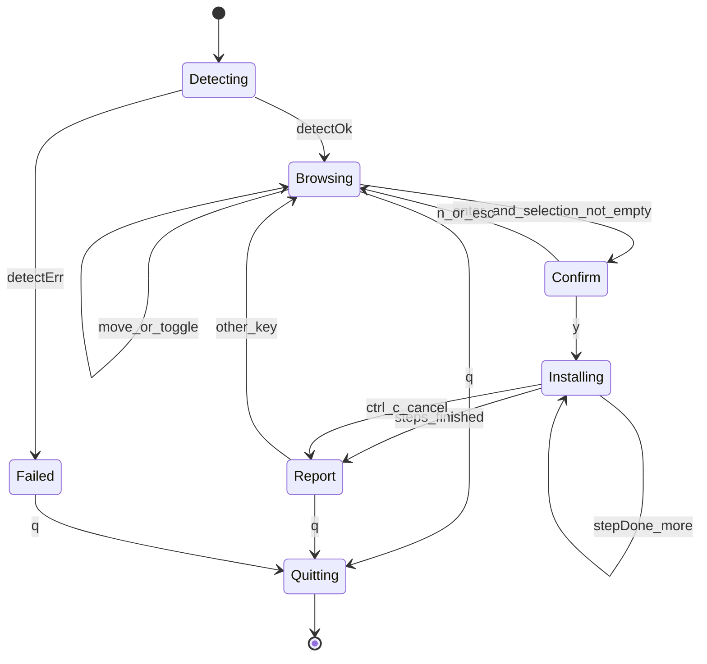
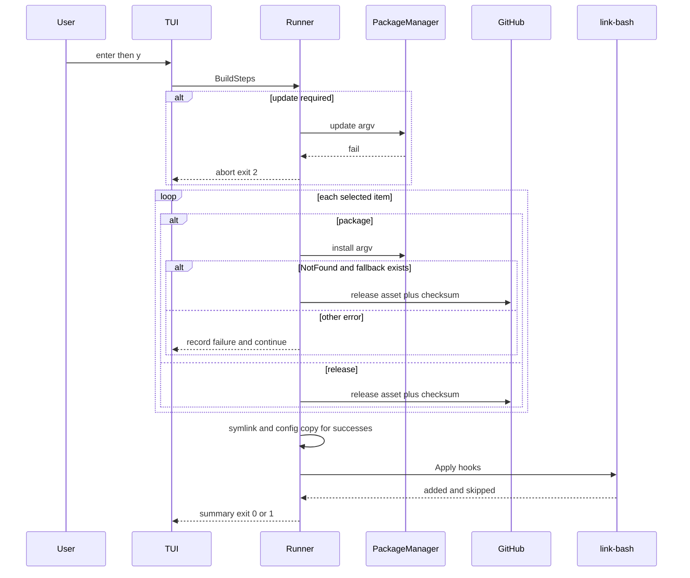

# Dotfiles `tools`：本機開發工具勾選安裝器

| 欄位 | 值 |
| --- | --- |
| 作者 | 待填 |
| 日期 | 2026-11-10 |
| 狀態 | Draft |
| 模組 | `github.com/shuhi/dotfiles` |
| 適用樹 | `/home/shuhi/project/Dotfiles` |
| 語言 | Go 1.27（本機已安裝 `go1.27.3 linux/amd64`） |

## Overview

本文件定義一個只在本機執行的 Go CLI／TUI。使用者用 Bubble Tea 勾選開發工具，程式偵測 Linux 發行版或 macOS 與 CPU 架構，呼叫對應的系統套件管理器安裝；發行版倉庫沒有的工具改走已校驗的 GitHub release。它不是下載伺服器，不聽 port，也不把套件清單傳到外部。

倉庫目前沒有 `go.mod`、沒有 git remote，也沒有任何檔案。既有目錄 `ghostty/`、`rust/`、`shells/`、`wezterm/`、`WSL/`、`zellij/` 都是空的，必須保留。新程式放在倉庫根目錄的 `cmd/` 與 `internal/`。Shell 設定放進 `shells/<shell>/`，Zellij 設定放進既有的 `zellij/config.kdl`。另一支程式 `link-bash` 把固定的 bash hook 冪等地追加到指定的 bashrc，效果等同使用者要求的：

```bash
echo 'eval "$(starship init bash)"' >> ~/.bashrc
```

但不得用 shell `echo` 實作，也不得在標記已存在時再追加一次。

`*` 與勾選框是兩件不同的事。`*` 是目錄裡的預設項目標記，畫在名稱左側，使用者無法把它關掉。勾選框是 `[x]`／`[ ]`，每一項都可以切換，包含帶 `*` 的項目。取消勾選不會拿掉 `*`。

## Background & Motivation

`/home/shuhi/project/Dotfiles` 目前只是一組空目錄，沒有安裝腳本、沒有 Go module、沒有 README。新機器要裝的工具分散在 apt、dnf、pacman、Homebrew 與上游 release，套件名稱並不一致。本機是 Fedora Linux 45 on WSL2（`uname -m` 為 `x86_64`，kernel `6.18.58.1-microsoft-standard-WSL2`）。2026-11-10 對這台機器執行 `dnf repoquery` 的結果直接寫進下面的套件表，避免把 Debian 的套件名稱套到 Fedora。

已確認的痛點：

- Fedora 45 沒有名為 `wget` 或 `vim` 的套件。`/usr/bin/wget` 由 `wget2-wget` 提供，`/usr/bin/vim` 由 `vim-enhanced` 提供。`dnf install wget` 會同時命中 `wget1-wget` 與 `wget2-wget`，不能把虛擬名稱當套件名稱。
- Fedora 45 的 `fd` 命令來自套件 `fd-find`（檔案 `/usr/bin/fd`）。Debian／Ubuntu 的 `fd-find` 命令卻是 `fdfind`，`bat` 是 `batcat`。
- Fedora 45 倉庫沒有 `starship`、沒有 `zellij`。`eza`、`fastfetch`、`ripgrep`、`neovim`、`trash-cli`、`fzf`、`bat`、`golang`、`cargo`、`rust` 有。`dnf repoquery` 看到的可用 build 包含 `golang` 1.27.1 與 1.27.3、`fzf` 0.74.4 與 0.74.5。這是當時的可用集合，不是各套件唯一的 build。安裝鎖定套件名稱，不鎖定 patch。
- `dnsutils` 只是 Debian 的套件名稱。Fedora 是 `bind-utils`。
- `mitos` 不是發行版套件。它是 Helix 的獨立分支，上游 `https://github.com/mitos-editor/mitos`，網站 `https://mitos.computer`，執行檔名稱是 `ms`，不是 `mitos`。設定目錄是 `~/.config/mitos`。v0.2.1 於 2026-11-09 發布。本倉庫不建立 mitos 設定；只安裝執行檔與 runtime。

使用者原文的「RAM」是 ARM，「i86」是 i386／i686。畫面上必須寫 `ARM` 與 `i386`，禁止寫 `RAM`。

## Goals & Non-Goals

### Goals

- 以 `github.com/charmbracelet/bubbletea` 提供可勾選、可取消的 TUI，並始終顯示基礎操作。
- 目錄、預設勾選集合、`*` 標記、OS／架構分類、每個套件管理器的套件名稱、argv、切換行為、bash hook 產生器都有單元測試。測試不安裝套件、不寫真實 `~/.bashrc`。
- 支援 apt-get、dnf、yum、pacman、zypper、apk、xbps-install、Homebrew。找不到管理器或 GOOS 不支援時，在任何安裝開始前失敗並退出碼 2。
- 預設勾選且帶 `*`：基礎全部、檔案搜尋全部、編輯器裡的 `zellij` 與 `mitos`。其餘不預設勾選、也不帶 `*`。
- Shell 設定在 `shells/<shell>/`。Zellij 設定在 `zellij/config.kdl`，安裝成功後複製到 `~/.config/zellij/config.kdl`。
- 獨立程式 `cmd/link-bash` 可單獨執行，也可在 TUI 安裝成功後被呼叫。

### Non-Goals

- 不做遠端下載伺服器、帳號、遙測、HTTP API。
- 不做解除安裝。失敗時留下已成功的套件，並把清單寫進 JSON log，由人自行移除。
- 不自動安裝 Homebrew，不自動啟用 EPEL、Copr、PPA、NodeSource、deb.griffo.io。
- 不使用 `curl | sh` 或 `sh -c` 拼接字串。rustup 若需要，下載的是 `rustup-init` 二進位，不是把腳本交給 shell。
- 不呼叫 `chsh`，不改登入 shell。`zsh` 是可安裝的套件，不是 bash hook。
- 不管理 `ghostty/`、`wezterm/`、`rust/`、`WSL/` 裡的設定。`WSL/` 維持空目錄；WSL 只在執行時偵測。
- 不支援 Windows 原生、FreeBSD、NixOS 的 `nix`。這些 GOOS 或只偵測到 nix 時直接失敗。
- 不為不需要 hook 的工具改 bashrc。禁止自動加入 `alias ls=eza`、`alias fd=fdfind`、`alias bat=batcat`、開機跑 `fastfetch`、neovim／mitos／zellij 的 shell init。
- 不做 root 密碼輸入畫面。Linux 上非 root 時把 `sudo` 放在 argv 前面，由系統 sudo 在 TUI 讓出終端機之後讀密碼。Homebrew 與 `~/.local` 安裝永不加 sudo。
- 單元測試禁止執行真實套件管理器。

## Proposed Design

### 現況與新檔案樹

保留既有空目錄。新增：

```text
/home/shuhi/project/Dotfiles/
  go.mod
  go.sum
  cmd/tools/main.go
  cmd/link-bash/main.go
  internal/catalog/catalog.go
  internal/catalog/catalog_test.go
  internal/safepath/path.go
  internal/safepath/path_test.go
  internal/platform/arch.go
  internal/platform/arch_test.go
  internal/platform/osrelease.go
  internal/platform/osrelease_test.go
  internal/platform/detect.go
  internal/platform/detect_test.go
  internal/pm/manager.go
  internal/pm/names.go
  internal/pm/names_test.go
  internal/pm/argv.go
  internal/pm/argv_test.go
  internal/pm/detect.go
  internal/pm/detect_test.go
  internal/pm/notfound.go
  internal/pm/notfound_test.go
  internal/install/plan.go
  internal/install/plan_test.go
  internal/install/steps.go
  internal/install/steps_test.go
  internal/install/runner.go
  internal/install/runner_test.go
  internal/install/alias.go
  internal/install/alias_test.go
  internal/install/hooks.go
  internal/install/hooks_test.go
  internal/installlog/log.go
  internal/installlog/log_test.go
  internal/release/spec.go
  internal/release/spec_test.go
  internal/release/fetch.go
  internal/release/fetch_test.go
  internal/release/unpack.go
  internal/release/unpack_test.go
  internal/configcopy/copy.go
  internal/configcopy/copy_test.go
  internal/linkbash/apply.go
  internal/linkbash/apply_test.go
  internal/tui/model.go
  internal/tui/model_test.go
  internal/tui/keymap.go
  internal/tui/view.go
  internal/tui/format.go
  internal/tui/format_test.go
  shells/bash/hooks/embed.go
  shells/bash/hooks/local-bin.bash
  shells/bash/hooks/starship.bash
  shells/bash/hooks/fzf.bash
  shells/bash/hooks/cargo-env.bash
  shells/bash/hooks/go-path.bash
  shells/zsh/zshrc
  shells/starship/starship.toml
  zellij/config.kdl
```

`go.mod`：

```go
module github.com/shuhi/dotfiles

go 1.27
```

目前沒有 git remote。module path 固定為 `github.com/shuhi/dotfiles`。使用者於 2026-11-10 決議不因遠端組織而改，第一個 PR 也不改它。依賴在實作時用 `go get` 取當時的最新穩定版，import path 固定為：

- `github.com/charmbracelet/bubbletea`（必須）
- `github.com/charmbracelet/bubbles/key`（按鍵與說明共用同一份 `key.Binding`，避免說明與處理器漂移）
- `github.com/charmbracelet/lipgloss`（只用於有 TTY 且未設定 `NO_COLOR` 的樣式）

不使用 `bubbles/list`。`*`、勾選框與分類標題不是 list delegate 能直接表達的，自畫 `View` 更短，也方便對純文字做測試。

`//go:embed` 不能引用套件目錄之外的 `..`。因此 hook 檔案放在 `shells/bash/hooks/`，同目錄的 `embed.go` 是 package `hooks`。`internal/linkbash` import `github.com/shuhi/dotfiles/shells/bash/hooks`。這是唯一一份內容，沒有第二份拷貝。

### 目錄資料

```go
package catalog

type ID string

type Category struct {
    ID    string // basics, shell, files, editors, languages, build
    Title string // 畫面上的分類名
    Items []Item
}

type Item struct {
    ID          ID
    Name        string // 與 ID 相同，畫在勾選框右側
    Default     bool   // true 時左側畫 *；與是否勾選無關
    Description string // 寬度足夠才顯示
}

func All() []Category
func ItemByID(id ID) (Item, bool)
func DefaultIDs() []ID
func IDs() []ID
```

分類順序與項目順序固定如下。`Default` 為 true 的項目才畫 `*`，而且初始勾選集合必須與此完全相同。

| 分類 ID | 標題 | 項目（順序固定） | Default |
| --- | --- | --- | --- |
| `basics` | 基礎 | `git` `curl` `wget` `unzip` `rsync` `vim` `less` `net-tools` `whois` `dnsutils` `traceroute` | 全部 true |
| `shell` | Shell | `zsh` `starship` | 全部 false |
| `files` | 檔案搜尋 | `eza` `trash` `ripgrep` `fd` `bat` `jq` `fzf` | 全部 true |
| `editors` | 編輯器 | `neovim` false，`zellij` true，`fastfetch` false，`mitos` true | 僅 `zellij`、`mitos` |
| `languages` | 語言 | `go` `rust` `python` `node` | 全部 false |
| `build` | 編譯 | `make` `cmake` `compiler` `pkg-config` | 全部 false |

`DefaultIDs()` 的字面值，測試直接比對這個 slice，不要從 `Default == true` 再算出一份「期望」來自己跟自己比。另外一個測試把 `All()` 裡 `Default == true` 的 ID 排序後與這份 slice 排序後比較，防止兩邊漂移。

```go
func DefaultIDs() []ID {
    return []ID{
        "git", "curl", "wget", "unzip", "rsync", "vim", "less",
        "net-tools", "whois", "dnsutils", "traceroute",
        "eza", "trash", "ripgrep", "fd", "bat", "jq", "fzf",
        "zellij", "mitos",
    }
}
```

共 32 項。預設勾選 20 項。不預設勾選的 12 項是 `zsh`、`starship`、`neovim`、`fastfetch`、`go`、`rust`、`python`、`node`、`make`、`cmake`、`compiler`、`pkg-config`。

描述（不是勾選標籤）：

| ID | Description |
| --- | --- |
| `dnsutils` | dig, nslookup |
| `net-tools` | ifconfig, netstat |
| `trash` | trash-cli |
| `fd` | Debian 上命令是 fdfind |
| `compiler` | 平台 C/C++ 編譯器 |
| `mitos` | 執行檔 ms |
| `pkg-config` | pkg-config 或 pkgconf |
| `wget` | Fedora 套件是 wget2-wget |

`FormatItem` 不包含描述。`View` 僅在 `width >= 100` 時把描述以兩個空白接在名稱後面。

### `*` 與勾選框

```go
func FormatItem(it catalog.Item, selected bool) string {
    mark := " "
    if it.Default {
        mark = "*"
    }
    box := "[ ]"
    if selected {
        box = "[x]"
    }
    return mark + " " + box + " " + it.Name
}
```

四種合法列，測試都要有：

```text
* [x] git
* [ ] git
  [ ] zsh
  [x] neovim
```

`*` 佔第一欄。非預設項目用一個空白，讓 `[` 對齊。初始 `selected[id] = item.Default`。`space` 只翻轉 `selected[id]`。`item.Default` 在執行期是常數，沒有切換它的按鍵。

`a`：若游標所在分類有任何未勾選，則該分類全部改為勾選；若已全勾，則該分類全部取消。`A` 對整個目錄做同樣的事。分類標題不可被游標停住，游標只在項目上。

### 平台偵測

```go
package platform

type ArchInfo struct {
    Family string // ARM、x86_64、i386，或其他架構的 GOARCH 原字
    GOARCH string
    UnameM string // 空字串表示未知
}

func ClassifyArch(goarch, unameM string) ArchInfo

type OSRelease struct {
    ID, IDLike, Name, Version, VersionID, PrettyName string
}

func ParseOSRelease(r io.Reader) (OSRelease, error)

type OSInfo struct {
    GOOS       string
    Pretty     string
    WSL        bool
    SystemText string // 標題用的完整「系統」片段，不含「系統:」前綴
}

func ClassifyOS(goos string, osr OSRelease, wsl bool) OSInfo
func DetectWSL(envWSLDistro string, procVersion string) bool
```

`ParseOSRelease` 只做文字解析：忽略空白列與 `#` 註解，`KEY=VALUE`，成對的單引號或雙引號剝掉一層。不執行該檔、不展開變數。`ID_LIKE` 以空白拆成 token。

`ClassifyArch` 對照：

| GOARCH | uname -m 範例 | Family | 標題必須出現的字 |
| --- | --- | --- | --- |
| `amd64` | `x86_64` | `x86_64` | `x86_64` 與 `GOARCH=amd64` |
| `386` | `i386`、`i686`、`i86` | `i386` | `i386`，禁止只寫 i86 |
| `arm64` | `aarch64`、`arm64` | `ARM` | `ARM`，禁止寫 RAM |
| `arm` | `arm`、`armv7l`、`armv6l` | `ARM` | `ARM` |
| `riscv64` | `riscv64` | `riscv64` | `riscv64` |
| `ppc64le` | `ppc64le` | `ppc64le` | `ppc64le` |
| `s390x` | `s390x` | `s390x` | `s390x` |
| `loong64` | `loong64`、`loongarch64` | `loong64` | `loong64` |
| `mips` `mipsle` `mips64` `mips64le` | 原樣 | 該 GOARCH 字串 | 該字串 |
| 其他或空 | 任何 | GOARCH；兩者都空則 `unknown` | 原始值 |

uname 讀取失敗時 `UnameM` 為空，標題寫 `uname-m=未知`，Family 仍只靠 GOARCH。不要為了標題再執行第二次 `uname`。

`DetectWSL` 為 true 的條件（任一即可）：環境變數 `WSL_DISTRO_NAME` 非空，或 `/proc/version` 內容以不區分大小寫包含 `microsoft` 或 `WSL`。

`ClassifyOS` 的 `SystemText` 必須與下表一字不差。測試用字串 fixture，不讀這台機器的活檔。

| 輸入 | SystemText |
| --- | --- |
| PrettyName=`Fedora Linux 45 (WSL)`，GOOS=`linux`，WSL=true | `Fedora Linux 45 (WSL) [GOOS=linux]` |
| PrettyName=`Ubuntu 24.04.1 LTS`，GOOS=`linux`，WSL=true | `Ubuntu 24.04.1 LTS [GOOS=linux, WSL]` |
| PrettyName=`Ubuntu 24.04.1 LTS`，GOOS=`linux`，WSL=false | `Ubuntu 24.04.1 LTS [GOOS=linux]` |
| GOOS=`darwin`，無 os-release | `macOS [GOOS=darwin]` |
| GOOS=`linux`，os-release 空白，WSL=false | `linux [GOOS=linux]` |

規則：有 `PRETTY_NAME` 就用它，否則 `NAME + " " + VERSION` 去掉多餘空白，再否則用 GOOS。WSL 且 pretty 文字尚未包含 `WSL`（不分大小寫）時，括號寫 `[GOOS=linux, WSL]`。其餘寫 `[GOOS=<goos>]`。GOOS 永遠要出現。

標題整列由 `FormatHeader` 產生，三段以四個空白相接：

```text
系統: Fedora Linux 45 (WSL) [GOOS=linux]    架構: x86_64（GOARCH=amd64, uname-m=x86_64）    套件: dnf
系統: macOS [GOOS=darwin]    架構: ARM（GOARCH=arm64, uname-m=aarch64）    套件: brew
系統: Ubuntu 24.04.1 LTS [GOOS=linux, WSL]    架構: i386（GOARCH=386, uname-m=i686）    套件: apt
```

套件管理器尚未決定時第三段是 `套件: 未知`。這是本機 Fedora 45 WSL 開發機預期看到的第一列（管理器 `dnf`，架構 `x86_64`）。

### 套件管理器偵測

```go
package pm

func DetectManager(goos string, osr platform.OSRelease, lookup func(bin string) bool) (string, error)
```

`lookup` 在正式程式是 `exec.LookPath`。測試傳入 map。

支援的 ID 與實際二進位：

| manager ID | 二進位 | 需要 root 時加 sudo |
| --- | --- | --- |
| `apt` | `apt-get` | 是 |
| `dnf` | `dnf` | 是 |
| `yum` | `yum` | 是 |
| `pacman` | `pacman` | 是 |
| `zypper` | `zypper` | 是 |
| `apk` | `apk` | 是 |
| `xbps` | `xbps-install` | 是 |
| `brew` | `brew` | 永不 |

決策順序：

1. `goos == "darwin"`：結果是 `brew`。PATH 沒有 `brew` 則回 `ErrBrewMissing`。不要讀 os-release，不要替使用者執行 Homebrew 安裝腳本。
2. `goos` 不是 `linux` 也不是 `darwin`：回 `ErrOSUnsupported`。訊息寫明 v1 只支援 `linux` 與 `darwin`。
3. Linux 依 `ID`，對不上再依 `ID_LIKE` token 順序：
   - `debian` `ubuntu` `linuxmint` `pop` `elementary` `raspbian` `kali` → `apt`
   - `fedora` → `dnf`。沒有 `dnf` 就失敗，不准改走 `yum`。
   - `rhel` `centos` `rocky` `almalinux` `ol` `amzn` `scientific` → PATH 有 `dnf` 用 `dnf`，否則有 `yum` 用 `yum`，否則失敗。
   - `arch` `manjaro` `endeavouros` `garuda` `arcolinux` → `pacman`
   - `opensuse` `opensuse-tumbleweed` `opensuse-leap` `opensuse-slowroll` `sles` → `zypper`
   - `alpine` → `apk`
   - `void` → `xbps`
4. 仍未知：在 `apt-get`、`dnf`、`yum`、`pacman`、`zypper`、`apk`、`xbps-install` 中探測。恰有一個存在就用它。零個回 `ErrManagerMissing`。兩個以上回 `ErrManagerAmbiguous`，訊息列出找到的二進位。不准因為 apt-get 排在前面就選它。
5. 選中的家族但二進位不在 PATH：回錯誤，訊息含發行版 ID 與缺少的二進位名稱。

`--pm` 只能是上表八個 ID。它跳過家族對應，但仍檢查二進位存在。不存在則退出碼 2，安裝迴圈不開始。

NixOS 只有 `nix`、Gentoo 只有 `emerge` 時走步驟 4 的 missing 錯誤。訊息要寫「不支援的套件管理程式，本次不會安裝任何套件」。這就是「任何常見 Linux 套件管理器」的邊界：八個 adapter 是具體實作，其餘明確失敗，不嘗試通用 shell。

### 套件名稱表

`names.go` 的 `Resolve(id catalog.ID, manager string) (Plan, error)` 是唯一查表入口。未知 ID 或未知 manager 回錯誤。套件名稱另外用正則驗證：`^[A-Za-z0-9][A-Za-z0-9+_.-]*$`。`gcc-c++` 合法。含空白、`;`、`|`、`&`、`$`、反引號、換行、`/` 的名稱非法。使用者不能輸入套件名稱，`--only` 只接受 `catalog.IDs()`。

```go
type Method string

const (
    MethodPackage      Method = "package"
    MethodRelease      Method = "release"
    MethodPreinstalled Method = "preinstalled"
    MethodXcodeCLT     Method = "xcode-clt"
    MethodRustup       Method = "rustup"
    MethodGoTarball    Method = "go-tarball"
)

type Plan struct {
    ID           catalog.ID
    Method       Method
    Packages     []string
    Fallback     *Plan  // 只有 package 計畫可以有；fallback 本身的 Fallback 必須是 nil
    ReleaseRepo  string // owner/name
    ProbeFiles   []string
    NeedsLocalBin bool // 解析當下就能知道二進位會放在 ~/.local/bin 時為 true
}
```

`NeedsLocalBin` 在 `Resolve` 就設定，不留到安裝之後才猜：

- 該 `Plan` 自己的 `Method` 是 release，且佈局會把執行檔或 symlink 放到 `~/.local/bin`：true。這包含 starship、eza、zellij、fastfetch、ripgrep、fd、bat、fzf、neovim、mitos 的 release 計畫。
- 套件管理器安裝到 `/usr` 或 Homebrew prefix：false。主方法是 package、只是 `Fallback` 指向 release 時，`Plan.NeedsLocalBin` 仍是 false。runner 若實際走了那個 fallback 且成功，把對應 `ItemResult.NeedsLocalBin` 改成 true。Debian 的 `fdfind`／`batcat` symlink 同樣是安裝後才知道的，不在 `Plan.NeedsLocalBin`。runner 若真的建立了該 symlink，也把 `ItemResult.NeedsLocalBin` 改成 true。
- `MethodGoTarball` 與 `MethodRustup`：false。它們的 PATH 分別靠 `go-path` 與 `cargo-env`，不是 `~/.local/bin`。
- `MethodPreinstalled` 與 `MethodXcodeCLT`：false。

`internal/install` 負責在 package 安裝回傳 `*pm.NotFoundError` 時執行 `Fallback` 恰好一次。其他錯誤不 fallback。sudo 要密碼、鎖檔、網路中斷、行程啟動失敗、或 exit 非 0 但輸出不像 not-found，都是硬失敗。`ClassifyFailure` 只吃 exit code 與輸出，不吃 `Executor` 的 `err`。呼叫條件見「安裝步驟與失敗政策」。

not-found 判定在 `ClassifyFailure(manager string, exitCode int, output string) error`。輸出同時含 stdout 與 stderr。必須同時滿足 exit code 與子字串，避免把「已經安裝」當成找不到。

| manager | not-found |
| --- | --- |
| `apt` | exit 100，且輸出含 `Unable to locate package` 或 `has no installation candidate` |
| `dnf` | exit 1，且輸出含 `No match for argument` 或 `Unable to find a match`。`Nothing to do` 不是 not-found |
| `yum` | exit 1，且輸出含 `No match for argument` 或 `No package` 後面接 `available` |
| `pacman` | exit 1，且輸出含 `target not found` |
| `zypper` | exit 104（`ZYPPER_EXIT_INF_CAP_NOT_FOUND`） |
| `apk` | exit 非 0，且輸出含 `no such package` 或 `unable to select packages`（不分大小寫） |
| `xbps` | exit 非 0，且輸出含 `not found in repository pool` |
| `brew` | exit 1，且輸出含 `No available formula` 或 `No formulae found` |

`sudo: a password is required` 或 `a terminal is required` 永遠是硬失敗，即使 exit code 碰巧符合上表。

下表的「套件」欄是一次 `install` 的全部套件，順序要保留。`—` 表示這個 manager 不走套件，改走方法欄。Fallback 空白表示沒有。Release repo 見再下一節。

Fedora 45 列於 2026-11-10 用 `dnf repoquery --available` 與 `--whatprovides` 在本機核對過，不是從 Debian 推過來的。apt／pacman／apk／xbps／zypper／brew 的名稱是各上游文件與套件慣例，實作測試必須把期望值寫成字面量，不能讀回 `names.go` 再比對自己。

#### 基礎

| ID | apt | dnf | yum | pacman | zypper | apk | xbps | brew |
| --- | --- | --- | --- | --- | --- | --- | --- | --- |
| `git` | git | git | git | git | git | git | git | git |
| `curl` | curl | curl | curl | curl | curl | curl | curl | curl |
| `wget` | wget | wget2-wget | wget | wget | wget | wget | wget | wget |
| `unzip` | unzip | unzip | unzip | unzip | unzip | unzip | unzip | unzip |
| `rsync` | rsync | rsync | rsync | rsync | rsync | rsync | rsync | rsync |
| `vim` | vim | vim-enhanced | vim-enhanced | vim | vim | vim | vim | vim |
| `less` | less | less | less | less | less | less | less | less |
| `net-tools` | net-tools | net-tools | net-tools | net-tools | net-tools | net-tools | net-tools | 見 darwin 特例 |
| `whois` | whois | whois | whois | whois | whois | whois | whois | 見 darwin 特例 |
| `dnsutils` | dnsutils | bind-utils | bind-utils | bind | bind-utils | bind-tools | bind-utils | bind |
| `traceroute` | traceroute | traceroute | traceroute | traceroute | traceroute | traceroute | traceroute | 見 darwin 特例 |

這些基礎項目沒有 release fallback。yum 上 `whois` 若因未啟用 EPEL 而 not-found，項目失敗，訊息寫「可能需要 EPEL，本工具不會啟用它」。不要自動改 repo。

#### Shell、檔案搜尋、編輯器

| ID | apt | dnf | yum | pacman | zypper | apk | xbps | brew | Fallback repo |
| --- | --- | --- | --- | --- | --- | --- | --- | --- | --- |
| `zsh` | zsh | zsh | zsh | zsh | zsh | zsh | zsh | zsh | 無 |
| `starship` | starship | release | release | starship | starship | starship | starship | starship | `starship/starship` |
| `eza` | eza | eza | release | eza | eza | eza | eza | eza | `eza-community/eza` |
| `trash` | trash-cli | trash-cli | trash-cli | trash-cli | trash-cli | trash-cli | trash-cli | trash-cli | 無 |
| `ripgrep` | ripgrep | ripgrep | ripgrep | ripgrep | ripgrep | ripgrep | ripgrep | ripgrep | `BurntSushi/ripgrep` |
| `fd` | fd-find | fd-find | fd-find | fd | fd | fd | fd | fd | `sharkdp/fd` |
| `bat` | bat | bat | bat | bat | bat | bat | bat | bat | `sharkdp/bat` |
| `jq` | jq | jq | jq | jq | jq | jq | jq | jq | 無 |
| `fzf` | fzf | fzf | fzf | fzf | fzf | fzf | fzf | fzf | `junegunn/fzf` |
| `neovim` | neovim | neovim | neovim | neovim | neovim | neovim | neovim | neovim | `neovim/neovim` |
| `zellij` | release | release | release | zellij | zellij | zellij | zellij | zellij | `zellij-org/zellij` |
| `fastfetch` | fastfetch | fastfetch | release | fastfetch | fastfetch | fastfetch | fastfetch | fastfetch | `fastfetch-cli/fastfetch` |
| `mitos` | release | release | release | release | release | release | release | release | `mitos-editor/mitos` |

有 Fallback repo 且該格是套件名稱時，`Plan.Fallback` 是對應的 release 計畫。該格寫 `release` 時，主方法就是 release，`Fallback` 為 nil。依據：

- Starship 上游 README：Debian 13+ 與 Ubuntu 25.04+ 才有 apt 套件；Arch、Alpine、openSUSE、Void、Homebrew 有套件。Fedora 45 `dnf repoquery starship` 為空，所以 dnf／yum 直接 release，不先打一發必然失敗的 dnf。apt 仍先裝 `starship`，舊 Ubuntu not-found 才 fallback。
- `eza` 在 Fedora 45 是 `eza-0:0.23.5-1.fc45`。yum 基底倉庫通常沒有，直接 release。
- `zellij` 在 Fedora 45 repoquery 為空，dnf 直接 release。pacman 與 brew 有套件。apt 沒有穩定的發行版套件（上游 deb 不算發行版倉庫），直接 release。
- `fastfetch` 上游：Debian 13+／Ubuntu 25.04+ 可用 apt；更舊的版本 not-found 後 fallback。Fedora 45 有 `fastfetch`。
- `trash` 的套件名稱全平台都是 `trash-cli`（`https://github.com/andreafrancia/trash-cli`），不用 macOS 專用的 `ali-rantakari/trash`。Fedora 45 的這個套件提供 `/usr/bin/trash`。darwin 的 Homebrew formula 是 keg-only，見 macOS 特例，不能把 `brew install` 的 exit 0 當成 PATH 上的 `trash` 已是 trash-cli。
- `mitos` 所有管理器都是 release。沒有發行版套件名稱可填。

`fd` 與 `bat` 的命令名稱差由安裝後探測處理，不靠 alias：

```go
package install

type Symlink struct {
    Link   string
    Target string
}

func AliasSymlinks(home string, stat func(path string) bool) []Symlink
```

這個函式在 `internal/install/alias.go`，不在 `pm`。

- 若 `/usr/bin/fd` 不存在且 `/usr/bin/fdfind` 存在：`{home}/.local/bin/fd` → `/usr/bin/fdfind`。
- 若 `/usr/bin/bat` 不存在且 `/usr/bin/batcat` 存在：`{home}/.local/bin/bat` → `/usr/bin/batcat`。
- 目標已是正確 symlink：no-op。目標存在但指向別處或是普通檔：該後處理失敗，不覆蓋。
- 探測只看路徑在不在。`/usr/bin/bat` 存在就不要再做 batcat symlink。這個路徑不是 sharkdp bat 的身分證明：Fedora 上 `bacula-console-bat` 也提供 `/usr/bin/bat`。套件名稱仍然是 `bat`，檔案衝突交給套件管理器，本工具不讀 binary 來分辨 bacula 與 sharkdp。
- `TestFedoraNoAlias` 的 fixture 是 `/usr/bin/fd` 與 `/usr/bin/bat` 都存在，期望空 slice。測試註解要寫明「路徑存在不等於 sharkdp」。`TestDebianFdBatSymlink` 的 fixture 只有 `fdfind` 與 `batcat`。

有建立 symlink 時，runner 把該項目的 `ItemResult.NeedsLocalBin` 設為 true。`HooksFor` 因此加入 `local-bin`。

yum 上 `ripgrep`、`fd-find`、`bat`、`neovim`、`fzf` 先試套件。未開 EPEL 時 not-found，才 fallback。不要啟用 EPEL。

#### 語言與編譯

| ID | apt | dnf | yum | pacman | zypper | apk | xbps | brew |
| --- | --- | --- | --- | --- | --- | --- | --- | --- |
| `go` | golang-go | golang | golang | go | go | go | go | go |
| `rust` | rustc, cargo | rust, cargo | rust, cargo | rust | rust, cargo | rust, cargo | rust, cargo | rust |
| `python` | python3 | python3 | python3 | python | python3 | python3 | python3 | python |
| `node` | nodejs | nodejs | nodejs | nodejs | nodejs | nodejs | nodejs | node |
| `make` | make | make | make | make | make | make | make | preinstalled，見下 |
| `cmake` | cmake | cmake | cmake | cmake | cmake | cmake | cmake | cmake |
| `compiler` | build-essential | gcc, gcc-c++ | gcc, gcc-c++ | base-devel | gcc, gcc-c++ | build-base | base-devel | xcode-select，見下 |
| `pkg-config` | pkg-config | pkgconf-pkg-config | pkgconfig | pkgconf | pkg-config | pkgconf | pkg-config | pkgconf |

Fedora 45 核對：沒有名為 `rustc` 的套件，`rust` 提供 `rustc`；`cargo` 單獨存在。`pkgconf-pkg-config` 提供 `pkg-config` 命令。可用 build 包含 `golang` 1.27.1 與 1.27.3、`nodejs` 22.23.1。安裝用套件名稱 `golang` 與 `nodejs`，不把 patch 寫進 argv。dnf 的 `compiler` 用明確的 `gcc` 與 `gcc-c++`，不用 `dnf group install`。pacman 的 `base-devel` 與 xbps 的 `base-devel` 是群組，argv 仍把這個名稱當一個參數；pacman 必須帶 `--needed`。

`go` 的 fallback 是 `MethodGoTarball`，不是任意 GitHub repo。`rust` 的 fallback 是 `MethodRustup`。`python`、`node`、`cmake`、`pkg-config`、`compiler` 沒有 release fallback。Linux 的 `make` 也沒有。node 不用 nvm、不用 NodeSource。發行版沒有 `nodejs` 時該項目失敗。

Homebrew 的 node formula 名稱是 `node`。`nodejs` 只是指向 `node` 的 alias。`BuildInstall("brew", ...)` 的參數必須是 `node`，禁止 `nodejs`。`TestResolvePackageNames` 的 brew／`node` 列期望 `[]string{"node"}`。

`build-essential` 含 make。使用者同時勾 `make` 與 `compiler` 時仍是兩次安裝。apt 重入是成功，不要在計畫層合併。

#### macOS 特例

`net-tools`：`MethodPreinstalled`，`ProbeFiles` 為 `/sbin/ifconfig`。存在則結果 `satisfied`。不存在則失敗，訊息寫 macOS 沒有對應的 net-tools formula。沒有 brew fallback。

`traceroute`：先探測 `/usr/sbin/traceroute` 與 `/sbin/traceroute`。存在則 `satisfied`。都不存在才 `brew install traceroute`。

`whois`：先探測 `/usr/bin/whois`。存在則 `satisfied`，沒有 keg-only 註記。否則 `brew install whois`。這條 brew 路徑要加下面的一般 keg-only 註記，因為 formula `whois` 是 keg-only。

`make`：`MethodPreinstalled`，`ProbeFiles` 只有 `/usr/bin/make`。存在則 `satisfied`。不存在則失敗，訊息一字不差：`macOS 的 make 是 /usr/bin/make，由 Xcode Command Line Tools 提供。Homebrew formula make 只安裝 gmake，本工具不安裝它。請改勾 compiler。` 禁止 `brew install make`。理由：該 formula 把二進位裝成 `gmake`，exit 0 不會讓目錄項 `make` 出現在 PATH 上。GNU make 不是這個目錄項。

`trash`：仍是 `brew install trash-cli`，不用 `ali-rantakari/trash`。formula 是 `keg_only :shadowed_by_macos`，因為 Sonoma 以後有 `/usr/bin/trash`，而且它與 formula `trash` 衝突。`brew` exit 0 的狀態是 `shadowed`，不是 `ok`。`shadowed` 算安裝成功，退出碼仍可為 0，但報告必須有這句，不能省略：`keg-only，系統 /usr/bin/trash 仍在預設 PATH；trash-cli 在 Homebrew prefix 的 opt/trash-cli/bin/trash。本工具不執行 brew link --force，也不改 bashrc。` 不探測「PATH 上第一個 trash 是誰」來把狀態改回 `ok`。

`compiler`：`MethodXcodeCLT`。先執行 `xcode-select -p`。exit 0 則 `satisfied`。否則 argv 是 `["xcode-select", "--install"]`，不加 sudo。這個命令通常在打開 GUI 後就返回。返回 0 之後再探測一次。仍失敗則項目狀態 `pending-user`，訊息「已要求安裝 Xcode Command Line Tools，完成對話框後請再執行一次」。不要迴圈，不要改裝 `brew install gcc`。`pending-user` 使行程退出碼為 1。

keg-only 註記由 `func KegOnlyNote(id catalog.ID, manager string, method Method) string` 產生。`manager=="brew"` 且 `method==MethodPackage` 才可能非空：

| ID | 註記 |
| --- | --- |
| `curl`、`dnsutils`、`whois` | `keg-only，預設 PATH 仍使用系統命令。本工具不執行 brew link --force。` |
| `trash` | 上一節那句完整的 `shadowed` 註記 |

其他 ID 回空字串。`make` 不走 brew，所以沒有這句。禁止 `brew link --force`。註記放在 `ItemResult.Note`，不是 `ErrText`。`satisfied` 的 whois 不呼叫這個函式。

### argv

```go
func BuildInstall(manager string, pkgs []string) ([]string, error)
func BuildUpdate(manager string) ([]string, error) // 不需要更新步驟時 argv 為 nil, err 為 nil
func WithPrivilege(argv []string, need bool, euid int) []string
```

`WithPrivilege` 在 `need && euid != 0` 時把 `"sudo"` 加在前面。測試用 euid `0` 與 `1000`，正式程式把 `os.Geteuid()` 傳進去。`brew`、release、xcode-select、symlink、設定複製、link-bash 的 `need` 都是 false。

每個項目一次 argv，方便把失敗歸到單一 ID。更新步驟每個行程最多一次，而且只在至少有一個 package 方法時執行。更新失敗則退出碼 2，後面的項目一個都不裝。

| manager | BuildUpdate | BuildInstall |
| --- | --- | --- |
| `apt` | `apt-get update` | `apt-get install -y --no-install-recommends <pkgs...>` |
| `dnf` | nil | `dnf install -y <pkgs...>` |
| `yum` | nil | `yum install -y <pkgs...>` |
| `pacman` | `pacman -Sy --noconfirm` | `pacman -S --needed --noconfirm <pkgs...>` |
| `zypper` | `zypper --non-interactive refresh` | `zypper --non-interactive install --no-recommends <pkgs...>` |
| `apk` | `apk update` | `apk add <pkgs...>` |
| `xbps` | nil | `xbps-install -y -S <pkgs...>` |
| `brew` | nil | `brew install <pkg>` |

不執行 `pacman -Syu`、`dnf upgrade`、`apt-get upgrade`、`brew update`。那些會升級整台機器，超出「安裝勾選的工具」。

xbps 每次都帶 `-S`，adapter 無狀態，測試不用記「是不是第一個」。apk 不加 `--no-cache`，那是容器用法，會忽略本機 index。

`BuildInstall` 拒絕空套件列表。組好的 argv 再檢查：`argv[0]` 屬於 `apt-get`、`dnf`、`yum`、`pacman`、`zypper`、`apk`、`xbps-install`、`brew`、`xcode-select`。若呼叫端已加 sudo，則 `argv[0]=="sudo"` 且 `argv[1]` 屬於該集合。任何參數含空白或 `;|&$\`` 或換行即錯誤。禁止出現 `sh`、`bash`、`-c`。

pacman 更新與安裝分開。先 `-Sy` 成功，再逐項 `-S`。不要把 `-Sy` 塞進每一個安裝 argv，避免測試與正式行為分叉；只有 xbps 因為 adapter 無狀態才例外，上面已寫死。

### GitHub release

```go
package release

type AssetQuery struct {
    GOOS   string
    GOARCH string
    Libc   string // "gnu" 或 "musl"
}

type Spec struct {
    Repo          string
    BinaryName    string
    Layout        Layout
    ShareSubdir   string // LayoutTree：mitos、nvim、fastfetch
    SymlinkRel    string // LayoutTree：相對於解壓後頂層目錄的路徑
    Match         func(names []string, q AssetQuery) (asset string, err error)
}

type Layout int

const (
    // LayoutBinDirect：壓縮檔根目錄就是名為 BinaryName 的普通檔，
    // 或根目錄只有這一個普通檔。複製到 ~/.local/bin/<BinaryName>。
    // 根目錄上其他非 BinaryName 的檔案不安裝。
    // 用於 starship、eza、zellij、fzf。
    LayoutBinDirect Layout = iota

    // LayoutBinInTopDir：恰好一個頂層目錄。只複製 <top>/<BinaryName>
    // 到 ~/.local/bin/<BinaryName>。不安裝 man、completion、README。
    // <top>/<BinaryName> 不存在就失敗。用於 fd、bat、ripgrep。
    LayoutBinInTopDir

    // LayoutTree：整個壓縮檔解到 ~/.local/share/<ShareSubdir>/<top>/。
    // symlink ~/.local/bin/<BinaryName> 指向該目錄下的 SymlinkRel。
    // 用於 fastfetch、neovim、mitos。ShareSubdir 與 SymlinkRel 必填。
    LayoutTree
)
```

HTTP 只透過介面：

```go
type HTTPDoer interface {
    Do(req *http.Request) (*http.Response, error)
}
```

兩個 client，不要共用一個會把 body 算進去的 60 秒 `Client.Timeout`。

- 中繼資料：`releases/latest` 與 `https://go.dev/dl/?mode=json` 用 `http.Client{Timeout: 30 * time.Second}`。body 是小 JSON，這個 timeout 含 body。
- 檔案本體：release 資產、checksum、`rustup-init` 與 `rustup-init.sha256` 用 `http.Client{Timeout: 0}`。每個請求是 `http.NewRequestWithContext`，context deadline 5 分鐘，含 response body。沒有另外的 60 秒連線 timeout。

`GET https://api.github.com/repos/<repo>/releases/latest` 的 header 是 `Accept: application/vnd.github+json` 與 `User-Agent: dotfiles-tools`。同一個行程對同一個 repo 只請求一次，結果放記憶體 map。HTTP 403 且 body 提到 rate limit：該項目失敗，訊息含「GitHub API rate limit」，不重試。這條只適用中繼資料請求。不使用認證 token。

沒有 checksum 就不安裝。checksum 資產名稱符合 `(?i)(checksums|sha256sums).*\.txt$`，或與目標資產同名加 `.sha256`。解析兩種內容：

- 一行 `HEX`、`HEX filename`、`HEX  filename` 或 `HEX *filename`。
- 整個檔案只有一段 hex。此時檔名是把資產名的 `.sha256` 去掉。

用 `crypto/sha256` 比對下載檔。不合或沒有對應列：失敗，刪除暫存，不放到 `~/.local`。

`DetectLibc`：注入的檔案存在函數若看到任一 `/lib/ld-musl*` 則 `musl`，否則 `gnu`。Alpine 也會因 ID 為 `alpine` 而當 musl。測試用 map，不掃真實 `/lib`。

資產選擇失敗時，錯誤列出最多 30 個資產名，不猜下一個。兩個以上的檔名同時符合同一條規則時也失敗並列出候選，禁止挑第一個。表上沒有該 GOARCH 的列時，錯誤文字一字不差為 `不支援的 GOARCH=<goarch>：此安裝方法沒有對應的上游資產或 triple`，其中 `<goarch>` 是實際的 `GOARCH`。禁止執行別的架構的二進位。該項目失敗，其他項目繼續。標題分類仍然顯示這個 GOARCH；不支援只發生在安裝方法，不發生在標題。

解壓只接受 `.tar.gz` 與 `.tar.xz`。拒絕絕對路徑、拒絕清理後含 `..` 的路徑、拒絕指向目標目錄之外的 symlink。解壓總量上限 512 MiB，檔案數上限 20000，超過就失敗。暫存目錄用 `os.MkdirTemp("", "dotfiles-tools-")`，結束刪除。

| 工具 | Repo | Layout | BinaryName | ShareSubdir | SymlinkRel | 選擇規則 |
| --- | --- | --- | --- | --- | --- | --- |
| starship | `starship/starship` | LayoutBinDirect | `starship` | | | 檔名含 triple token 與 `.tar.gz`。linux+gnu 優先 `unknown-linux-gnu`，linux+musl 優先 `unknown-linux-musl`。darwin 要 `apple-darwin`。排除含 `.sha256` 的檔 |
| eza | `eza-community/eza` | LayoutBinDirect | `eza` | | | 同上，檔名以 `eza_` 或 `eza-` 開頭 |
| zellij | `zellij-org/zellij` | LayoutBinDirect | `zellij` | | | 同上。上游常見 musl 建構。gnu 不存在時可接受 musl。兩者都在時依 Libc |
| fastfetch | `fastfetch-cli/fastfetch` | LayoutTree | `fastfetch` | `fastfetch` | `usr/bin/fastfetch` | 見 fastfetch 表。保留 `usr/share/fastfetch`。不要 `.deb`，不要 AppImage，不要只拷 `usr/bin/fastfetch` |
| ripgrep | `BurntSushi/ripgrep` | LayoutBinInTopDir | `rg` | | | 檔名以 `ripgrep-` 開頭、含 triple token、以 `.tar.gz` 結尾。linux 優先 musl。只取出 `<top>/rg` |
| fd | `sharkdp/fd` | LayoutBinInTopDir | `fd` | | | 檔名以 `fd-` 開頭。libc 規則同 starship。只取出 `<top>/fd` |
| bat | `sharkdp/bat` | LayoutBinInTopDir | `bat` | | | 檔名以 `bat-` 開頭。libc 規則同 starship。只取出 `<top>/bat` |
| fzf | `junegunn/fzf` | LayoutBinDirect | `fzf` | | | 不用 triple token。見 fzf 表。必須含 OS token |
| neovim | `neovim/neovim` | LayoutTree | `nvim` | `nvim` | `bin/nvim` | 見 neovim 表。解到 `~/.local/share/nvim/<top>/` |
| mitos | `mitos-editor/mitos` | LayoutTree | `ms` | `mitos` | `ms` | 見 mitos 表。解到 `~/.local/share/mitos/<top>/`。`runtime/` 留在 `ms` 旁邊 |

triple token 只給 starship、eza、zellij、ripgrep、fd、bat 用：`amd64`→`x86_64`，`arm64`→`aarch64`，`386`→`i686`，`arm`→`arm`。darwin 的 GOARCH 同樣對應。這四個以外的 GOARCH（含 `ppc64le`、`s390x`、`riscv64`、`loong64`、`mips*`）對這六個工具用「不支援的 GOARCH」那句，不要把 GOARCH 原字串拼進檔名。fzf 禁止使用這張表。

fzf 的 goreleaser 名稱是 `fzf-<version>-<os>_<arch>.tar.gz`，arch 用 Go 的名字，不是 `x86_64`／`aarch64`。0.75.0 的實例包含 `fzf-0.75.0-linux_amd64.tar.gz`、`fzf-0.75.0-linux_arm64.tar.gz`、`fzf-0.75.0-darwin_amd64.tar.gz`、`fzf-0.75.0-darwin_arm64.tar.gz`。checksum 檔 `fzf_<version>_checksums.txt` 仍符合既有的 checksum 正則。比對的是完整 OS token，不是子字串 `amd64`，否則 `linux_amd64` 與 `darwin_amd64` 會同時命中。

| GOOS | GOARCH | uname -m | fzf token |
| --- | --- | --- | --- |
| linux | amd64 | 任意 | `linux_amd64` |
| linux | arm64 | 任意 | `linux_arm64` |
| linux | arm | `armv5l` | `linux_armv5` |
| linux | arm | `armv6l` | `linux_armv6` |
| linux | arm | `armv7l` | `linux_armv7` |
| linux | loong64 | 任意 | `linux_loong64` |
| linux | ppc64le | 任意 | `linux_ppc64le` |
| linux | s390x | 任意 | `linux_s390x` |
| linux | riscv64 | 任意 | `linux_riscv64` |
| darwin | amd64 | 任意 | `darwin_amd64` |
| darwin | arm64 | 任意 | `darwin_arm64` |

`GOARCH=arm` 但 uname 不是 `armv5l`、`armv6l`、`armv7l`：錯誤 `不支援的 GOARCH=arm：uname-m 不足以選擇 linux_armv5、linux_armv6 或 linux_armv7`。`386`、`mips`、`mipsle`、`mips64`、`mips64le` 用通用的「不支援的 GOARCH」那句。選中的檔名必須等於 `fzf-<version>-<token>.tar.gz`。`TestMatchFzfAsset` 的 fixture 至少含 `fzf-0.75.0-linux_amd64.tar.gz` 與 `fzf-0.75.0-darwin_amd64.tar.gz`。linux／amd64 必須選到前者，不准選到後者。

fastfetch 精確檔名。darwin 兩邊架構都用同一個 universal 檔；該檔不在 release 裡就失敗並列出資產名，不要改配別的 tar。

| GOOS | GOARCH | uname -m | 資產 |
| --- | --- | --- | --- |
| linux | amd64 | 任意 | `fastfetch-linux-amd64.tar.gz` |
| linux | arm64 | 任意 | `fastfetch-linux-aarch64.tar.gz` |
| linux | 386 | 任意 | `fastfetch-linux-i686.tar.gz` |
| linux | arm | `armv6l` | `fastfetch-linux-armv6l.tar.gz` |
| linux | arm | `armv7l` | `fastfetch-linux-armv7l.tar.gz` |
| darwin | amd64 或 arm64 | 任意 | `fastfetch-macos-universal.tar.gz` |

其餘 GOARCH，以及 `GOARCH=arm` 但 uname 不是 `armv6l` 或 `armv7l`，用「不支援的 GOARCH」那句。解壓後必須同時存在 `usr/bin/fastfetch` 與 `usr/share/fastfetch`。只 symlink `fastfetch`，不 symlink `flashfetch`。

neovim 精確檔名，不要 AppImage，不要帶 `-puc` 的建構。表以外的 GOARCH 用「不支援的 GOARCH」那句：

| GOOS | GOARCH | 資產 |
| --- | --- | --- |
| linux | amd64 | `nvim-linux-x86_64.tar.gz` |
| linux | arm64 | `nvim-linux-arm64.tar.gz` |
| darwin | amd64 | `nvim-macos-x86_64.tar.gz` |
| darwin | arm64 | `nvim-macos-arm64.tar.gz` |

解壓後執行檔在 `<top>/bin/nvim`。`top` 分別是 `nvim-linux-x86_64`、`nvim-linux-arm64`、`nvim-macos-x86_64`、`nvim-macos-arm64`。安裝前綴是 `~/.local/share/nvim/<top>/`，不是臨時目錄，也不是 `~/.local/bin` 裡的一份裸檔。symlink 是 `~/.local/bin/nvim` → 該前綴的 `bin/nvim`。

mitos 精確檔名（`VERSION` 來自 release tag，去掉前綴 `v`）：

| GOOS | GOARCH | 資產 |
| --- | --- | --- |
| linux | amd64 | `mitos-v<VERSION>-x86_64-linux.tar.xz` |
| linux | arm64 | `mitos-v<VERSION>-aarch64-linux.tar.xz` |
| darwin | amd64 | `mitos-v<VERSION>-x86_64-macos.tar.xz` |
| darwin | arm64 | `mitos-v<VERSION>-aarch64-macos.tar.xz` |

不要用 `mitos_...deb`，arm64 沒有對應 deb，一條 tar.xz 路徑就夠。表以外的 GOARCH 用「不支援的 GOARCH」那句。`~/.local/bin/ms` 若已是指向其他 mitos 版本的 symlink，原子替換。若是普通檔，失敗且不覆蓋。不設定 `MITOS_RUNTIME`；上游會沿 symlink 找到旁邊的 `runtime/`。

`~/.local/bin` 的建立模式 `0755`。新執行檔 `0755`。symlink 用 `os.Symlink` 加上同目錄暫名再 `Rename`。

### Go tarball 與 rustup

只在套件方法回 `NotFoundError` 時使用。

Go：`GET https://go.dev/dl/?mode=json` 走 30 秒中繼資料 client。取第一個 `stable == true` 的 release，再取 `filename` 符合 `go<version>.<goos>-<arch>.tar.gz` 的檔。下載該檔走 5 分鐘 context。`sha256` 欄位就在 JSON 裡，必須比對。`goos` 是 `linux` 或 `darwin`。`<arch>` 只允許下表。沒有列就用「不支援的 GOARCH」那句，不要下載別的 arch。

| GOOS | GOARCH | filename 的 arch |
| --- | --- | --- |
| linux | amd64 | `amd64` |
| linux | arm64 | `arm64` |
| linux | 386 | `386` |
| linux | arm | `armv6l` |
| linux | ppc64le | `ppc64le` |
| linux | s390x | `s390x` |
| linux | riscv64 | `riscv64` |
| linux | loong64 | `loong64` |
| darwin | amd64 | `amd64` |
| darwin | arm64 | `arm64` |

`mips`、`mipsle`、`mips64`、`mips64le` 沒有列。解到 `/usr/local/go`。該目錄已存在則失敗，不刪除、不覆蓋。這一步的 argv 是解壓程式自己的函式，不是 shell；若 euid 不是 0，寫 `/usr/local` 前的權限錯誤直接失敗並說明需要 root，不要用 `sudo tar`。v1 的實作方式：非 root 時這個 fallback 失敗，訊息寫「發行版沒有 go 套件，且沒有權限寫入 /usr/local/go」。root 才解壓。避免再做一套 sudo 複製。TUI 在 Fedora 上不會走到這裡，因為 `golang` 存在。

成功後才允許 hook `go-path`。

Rust：從 `https://static.rust-lang.org/rustup/dist/<triple>/rustup-init` 下載二進位，並下載同目錄 `rustup-init.sha256` 做比對。這兩個檔都走 5 分鐘 context。沒有列的組合用「不支援的 GOARCH」那句，不下載。

| GOOS | GOARCH | uname -m | libc | triple |
| --- | --- | --- | --- | --- |
| linux | amd64 | 任意 | gnu | `x86_64-unknown-linux-gnu` |
| linux | amd64 | 任意 | musl | `x86_64-unknown-linux-musl` |
| linux | 386 | 任意 | gnu | `i686-unknown-linux-gnu` |
| linux | 386 | 任意 | musl | `i686-unknown-linux-musl` |
| linux | arm64 | 任意 | gnu | `aarch64-unknown-linux-gnu` |
| linux | arm64 | 任意 | musl | `aarch64-unknown-linux-musl` |
| linux | arm | `armv6l` | gnu | `arm-unknown-linux-gnueabihf` |
| linux | arm | `armv6l` | musl | `arm-unknown-linux-musleabihf` |
| linux | arm | `armv7l` | gnu | `armv7-unknown-linux-gnueabihf` |
| linux | arm | `armv7l` | musl | `armv7-unknown-linux-musleabihf` |
| linux | ppc64le | 任意 | gnu | `powerpc64le-unknown-linux-gnu` |
| linux | ppc64le | 任意 | musl | `powerpc64le-unknown-linux-musl` |
| linux | s390x | 任意 | gnu | `s390x-unknown-linux-gnu` |
| linux | s390x | 任意 | musl | `s390x-unknown-linux-musl` |
| linux | riscv64 | 任意 | gnu | `riscv64gc-unknown-linux-gnu` |
| linux | riscv64 | 任意 | musl | `riscv64gc-unknown-linux-musl` |
| linux | loong64 | 任意 | gnu | `loongarch64-unknown-linux-gnu` |
| linux | loong64 | 任意 | musl | `loongarch64-unknown-linux-musl` |
| darwin | amd64 | 任意 | | `x86_64-apple-darwin` |
| darwin | arm64 | 任意 | | `aarch64-apple-darwin` |

`GOARCH=arm` 但 uname 不是 `armv6l` 或 `armv7l`（含 `armv5l`）用「不支援的 GOARCH」那句，不要改配 armv7 triple。argv 是 `[tempRustupInit, "-y", "--no-modify-path", "--default-toolchain", "stable"]`。不是 `sh`。成功後才允許 hook `cargo-env`。發行版套件安裝成功時不加這個 hook，因為 `cargo` 已在預設 PATH。

### 安裝步驟與失敗政策

```go
package install

type Executor interface {
    // err 只表示行程沒有啟動，或 ctx 已取消。
    // 行程已啟動並以非 0 結束時，err 必須是 nil，exitCode 是那個非 0 值，
    // combined 是 stdout 與 stderr。runner 只有在 err == nil 且 exitCode != 0
    // 時才呼叫 ClassifyFailure。err != nil 不是 not-found，禁止 fallback。
    Run(ctx context.Context, argv []string) (combined string, exitCode int, err error)
}

type Step struct {
    ItemID catalog.ID
    Title  string
    Argv   []string // 非空則交給 Executor。release、複製、Apply 的 Argv 是 nil
    // Hooks 只有 Title=="link-bash" 的那一步非空。型別是 []string，
    // 值等於 linkbash.HookID 的字面值。install 在 PR 4 不 import linkbash。
    Hooks []string
    Local func(ctx context.Context) error
}

type ItemResult struct {
    ID            catalog.ID
    Method        pm.Method
    Status        string // ok, satisfied, failed, pending-user, skipped, shadowed
    NeedsLocalBin bool
    Note          string // keg-only 或 shadowed 的固定註記，不是錯誤
    ErrText       string
    Argv          []string
}

func BuildSteps(plans []Plan, euid int, home string) ([]Step, error)
```

`BuildSteps` 是純函式，Local 閉包在 runner 測試裡可以被替換成記錄呼叫的 fake。單元測試不斷言真實副作用。

順序：

1. 勾選為空：不產生步驟，CLI 退出碼 2，TUI 只顯示「尚未勾選任何項目」。
2. 任一 `Resolve` 失敗：不產生步驟，退出碼 2。這是程式錯誤或 `--only` 非法。
3. `--dry-run`：回傳計畫與步驟標題，Executor 不被呼叫，不寫 bashrc、不複製設定、不建立也不修改 `~/.local/share/dotfiles-tools/` 下的任何檔案。退出碼 0。
4. 若有 package 步驟且 `BuildUpdate` 非 nil：第一個步驟是更新。失敗則中止，退出碼 2，不進入項目迴圈。
5. 依目錄順序逐項。項目失敗（含 fallback 也失敗）記錄後繼續下一項。
6. 只對成功、`satisfied` 或 `shadowed` 的項目做後處理：alias symlink、設定複製、hooks。後處理失敗把該項目標成失敗，但不回滾套件。
7. 不是 dry-run 才寫 log，包含使用者取消的那次。任一項目失敗、有 `pending-user`、或使用者取消：退出碼 1。全部是 `ok`、`satisfied` 或 `shadowed`：退出碼 0。

取消：`err != nil` 且 `errors.Is(err, context.Canceled)` 時，不跑後面的步驟，包含尚未執行的 `link-bash`。保留已完成的 `ItemResult`，寫 log。runner 的結果是退出碼 1。`tools apply` 印完已完成項目後立刻以 1 結束。TUI 進入 report。report 的 `q` 進入 Quitting 並離開；其他鍵，包含 `ctrl+c`，回 browsing，勾選保留。沒有另一次成功安裝時，離開 TUI 的退出碼是 1。`tea.ExecProcess` 使用同一個 install context，所以 installing 的 `ctrl+c` 會走到這條路。其他 `err != nil`（找不到二進位、無法 fork）只讓該步驟硬失敗，不 fallback，然後繼續下一項。

`TestBuildStepsFedoraDefaults` 的期望是下面這個完整的 `[]Step`，管理器 dnf，euid 非 0，勾選等於 `DefaultIDs()`。`Title` 與 `Argv` 都要相等。沒有 update 步驟。沒有 alias 步驟。release 與複製的 `Argv` 是 nil。hook 只有最後一步，而且是一次 `Apply`，順序是 `local-bin` 然後 `fzf`。標題裡不准出現「無 sudo」。

| # | Title | ItemID | Argv |
| --- | --- | --- | --- |
| 1 | `install git` | `git` | `sudo dnf install -y git` |
| 2 | `install curl` | `curl` | `sudo dnf install -y curl` |
| 3 | `install wget` | `wget` | `sudo dnf install -y wget2-wget` |
| 4 | `install unzip` | `unzip` | `sudo dnf install -y unzip` |
| 5 | `install rsync` | `rsync` | `sudo dnf install -y rsync` |
| 6 | `install vim` | `vim` | `sudo dnf install -y vim-enhanced` |
| 7 | `install less` | `less` | `sudo dnf install -y less` |
| 8 | `install net-tools` | `net-tools` | `sudo dnf install -y net-tools` |
| 9 | `install whois` | `whois` | `sudo dnf install -y whois` |
| 10 | `install dnsutils` | `dnsutils` | `sudo dnf install -y bind-utils` |
| 11 | `install traceroute` | `traceroute` | `sudo dnf install -y traceroute` |
| 12 | `install eza` | `eza` | `sudo dnf install -y eza` |
| 13 | `install trash` | `trash` | `sudo dnf install -y trash-cli` |
| 14 | `install ripgrep` | `ripgrep` | `sudo dnf install -y ripgrep` |
| 15 | `install fd` | `fd` | `sudo dnf install -y fd-find` |
| 16 | `install bat` | `bat` | `sudo dnf install -y bat` |
| 17 | `install jq` | `jq` | `sudo dnf install -y jq` |
| 18 | `install fzf` | `fzf` | `sudo dnf install -y fzf` |
| 19 | `release zellij` | `zellij` | nil |
| 20 | `release mitos` | `mitos` | nil |
| 21 | `config zellij` | `zellij` | nil |
| 22 | `link-bash` | 空字串 | nil，`Hooks` 為 `local-bin`、`fzf` |

沒有 `starship` hook，因為預設沒勾 starship。`local-bin` 出現是因為 zellij 與 mitos 的 release 計畫 `NeedsLocalBin` 為 true，不是因為 dnf 的 fzf。

### 設定檔部署

```go
package configcopy

type Policy int

const (
    PolicyBackupReplace Policy = iota
    PolicyCopyIfMissing
)

type Result struct {
    Action string // created, unchanged, backed_up, skipped_exists
}

func Deploy(src, dst string, policy Policy, now time.Time) (Result, error)
func AllowedDest(dst, home, xdgConfig string) bool
```

`RejectEscapingSymlink` 只有一份，套件是 `safepath`，檔案是 `internal/safepath/path.go`。`configcopy` 與 `linkbash` 都不定義第二份。`configcopy` 不 import `linkbash`，`linkbash` 不 import `configcopy`。

```go
package safepath

func RejectEscapingSymlink(path, root string) error
```

`AllowedDest` 與 bashrc 路徑檢查都呼叫這一個函式。

1. `filepath.Clean` 之後，`filepath.Rel(root, path)` 不得是 `..` 或以 `../` 開頭。`root` 是 home，若 `XDG_CONFIG_HOME` 是絕對路徑則也要對它再查一次，兩個有一個通過即可。
2. 從 `path` 往上走到 `root` 為止。每一個已經存在的祖先，包含 `path` 自己若存在，都 `Lstat`。任一是 symlink 就拒絕，錯誤文字含 `拒絕 symlink：`。不要 `EvalSymlinks`，那會跟著走出去。
3. 遇到第一個不存在的路徑元件就停止。之後 `Deploy` 才以 `0755` 建立缺少的目錄。新建的目錄是真實目錄，不是 symlink。

因此 `home/link` → `/etc` 且目標 `home/link/config.kdl` 尚不存在時，`AllowedDest` 必須回 false。只檢查最終元件是不夠的。測試 `TestRefuseParentSymlink` 用 `t.TempDir()` 做這個 fixture。另外仍要拒絕 `/etc/passwd`、`home/../../etc/passwd`，以及最終元件本身是 symlink 的 `TestRefuseSymlinkDest`。

`dst` 的最終元件若是 symlink，同樣拒絕，不跟隨。父目錄不存在則以 `0755` 建立。內容位元組相同則 `unchanged`，不開寫、不改 mtime。

`PolicyBackupReplace`：內容不同時把舊檔重新命名為 `<name>.bak.<UTC>`，UTC 格式 `20060102T150405Z`。名稱已存在就加 `-1`、`-2`。然後寫新檔 `0644`。寫入用同目錄暫存檔再 `Rename`。

`PolicyCopyIfMissing`：目標已存在則 `skipped_exists`，不看內容、不備份、不覆蓋。

| 來源 | 目標 | 政策 | 何時做 |
| --- | --- | --- | --- |
| `<repo>/zellij/config.kdl` | `$XDG_CONFIG_HOME/zellij/config.kdl`，未設定或非絕對路徑時用 `~/.config/zellij/config.kdl` | BackupReplace | `zellij` 安裝成功或 satisfied |
| `<repo>/shells/starship/starship.toml` | `$XDG_CONFIG_HOME/starship.toml` 或 `~/.config/starship.toml` | BackupReplace | `starship` 安裝成功或 satisfied |
| `<repo>/shells/zsh/zshrc` | `~/.zshrc` | CopyIfMissing | `zsh` 安裝成功或 satisfied |
| bash hooks | 不複製成一份新的 `~/.bashrc` | 由 link-bash 追加 | 見下節 |

Starship 不是 shell。官方讀的是 `~/.config/starship.toml`，bash 與 zsh 共用。所以檔案放在 `shells/starship/`，而不是塞進 `shells/bash/` 或 `shells/zsh/` 各一份。`shells/bash/` 只放 bash hook，`shells/zsh/` 只放 zshrc。這符合「一個 shell 一個目錄」，並把跨 shell 的 prompt 設定單獨放一個目錄。

來源檔內容就是下面這些位元組，實作時原樣建立。測試 `Deploy` 用暫存目錄，並另有測試讀倉庫檔確認與這裡一致。

`zellij/config.kdl`：

```kdl
// dotfiles: zellij user config
// destination: ~/.config/zellij/config.kdl
default_shell "bash"
```

`default_shell` 是 Zellij KDL 設定的既有鍵。固定 `bash`，因為 hook 程式的對象是 bash。不在執行時改寫成使用者的 `$SHELL`。

`shells/starship/starship.toml`：

```toml
# Shared by bash and zsh. Destination: ~/.config/starship.toml
add_newline = true

[character]
success_symbol = "[>](bold green)"
error_symbol = "[>](bold red)"
```

不用 Nerd Font 符號，避免沒裝字型的終端機出現亂碼。

`shells/zsh/zshrc`：

```zsh
# Deployed only when ~/.zshrc does not already exist.
export PATH="$HOME/.local/bin:$PATH"
if command -v starship >/dev/null 2>&1; then
  eval "$(starship init zsh)"
fi
```

zsh 的 starship 行在這份檔案裡，不由 `link-bash` 寫入。`link-bash` 只碰 bashrc。

### `link-bash`

使用者要的是一支獨立 Go 程式，不是只藏在 TUI 裡的函式。

- 路徑：`cmd/link-bash/main.go`
- 二進位名稱：`link-bash`
- 函式庫：`internal/linkbash`，TUI 與 CLI 都呼叫它
- 理由：hook 規則只有一份；CLI 是薄包裝，方便單獨修 bashrc 而不打開安裝器

```go
type HookID string

const (
    HookLocalBin HookID = "local-bin"
    HookStarship HookID = "starship"
    HookFzf      HookID = "fzf"
    HookCargoEnv HookID = "cargo-env"
    HookGoPath   HookID = "go-path"
)

type Report struct {
    Added   []HookID
    Skipped []HookID
}

func Apply(path string, hooks []HookID) (Report, error)
```

`Apply` 沒有 `require-cmd` 參數。PATH 過濾只在 `cmd/link-bash`。TUI 與 `tools apply` 先呼叫 `install.HooksFor`，再把回傳的 slice 傳給 `Apply`。

`HooksFor` 不在 `linkbash`，簽名在 `internal/install/hooks.go`：

```go
func HooksFor(results []ItemResult) []linkbash.HookID
```

它不看 PATH。回傳順序固定，缺的項目就跳過，不准按 `results` 的出現順序排：

1. `local-bin`：任一筆狀態是 `ok`、`satisfied` 或 `shadowed`，且 `NeedsLocalBin` 為 true。
2. `starship`：ID 是 `starship` 且狀態是上述三者之一。
3. `fzf`：同上，ID 是 `fzf`。
4. `cargo-env`：ID 是 `rust`、`Method` 是 `rustup`、狀態是 `ok`。
5. `go-path`：ID 是 `go`、`Method` 是 `go-tarball`、狀態是 `ok`。

`failed` 與 `pending-user` 不產生 hook。`Apply` 若收到別的順序，先排成這個順序再寫，重複的 ID 只留一個。未知 ID 回錯誤。

CLI：

```text
link-bash [--bashrc PATH] [--hooks local-bin,starship,fzf,cargo-env,go-path] [--require-cmd=true]
```

`--bashrc` 預設是 `filepath.Join(os.UserHomeDir(), ".bashrc")`。`--hooks` 省略時，standalone 的候選是 `local-bin`、`starship`、`fzf`，不含 `cargo-env` 與 `go-path`。那兩個只由 `HooksFor` 在對應安裝方法成功時產生。

`--require-cmd` 預設 true，而且只存在於 CLI。PATH 沒有 `starship` 就從候選拿掉 starship，沒有 `fzf` 就拿掉 fzf。`local-bin` 在 `~/.local/bin` 存在，或過濾後仍留下 starship 或 fzf 時才保留。過濾之後仍排成上面的固定順序。TUI 不讀這個旗標，因為剛裝進 `~/.local/bin` 的二進位可能不在目前行程的 PATH。測試直接呼叫 `Apply`，不經過 PATH 探測。每個會呼叫 `Apply` 的測試先取 `dir := t.TempDir()`，再 `t.Setenv("HOME", dir)`，然後傳 `filepath.Join(dir, ".bashrc")`。正式程式不呼叫 `Setenv`，root 仍是 `os.UserHomeDir()`。`TestRejectsPathWithNewline` 同樣先設定這個 `HOME`，但傳入的 path 含換行，用來觸發規則 1 的拒絕。`TestRejectsParentSymlink` 的祖先在這個 `HOME` 底下並指向 `HOME` 之外，最終元件尚不存在；斷言的是錯誤含 `拒絕 symlink：`，不是「路徑在 home 之外」。

`Apply` 規則：

1. `path` 必須是絕對路徑，不得含 NUL 或換行。root 是 `os.UserHomeDir()`，不是參數。以這個 root 呼叫 `safepath.RejectEscapingSymlink`。最終元件或任一已存在的祖先是 symlink 都拒絕。`UserHomeDir` 失敗就回傳該錯誤，不寫檔。
2. 不存在可以建立。
3. 讀完整檔。對每個已排序的 hook：
   - 標記是 snippet 第一行，例如 `# dotfiles:starship`。任一列 `TrimSpace` 後等於標記：`Skipped`。即使後面的 payload 被使用者刪了，也不再追加。要恢復就刪掉標記。
   - 否則若 payload 列已作為一整列存在（TrimSpace 後相等）：`Skipped`。註解列不相等，仍會追加。
   - 否則追加。原檔非空且末尾不是換行時先補一個換行，再寫入 snippet 位元組。
4. 寫入同目錄暫存檔，`Rename` 覆蓋。原檔存在則保留原 mode。新建則 `0644`。
5. 不使用 `echo`、不啟動 shell、不把使用者輸入拼進 snippet。snippet 全部來自 embed 檔。

payload 列：

| hook | TrimSpace 後必須全等的列 |
| --- | --- |
| `starship` | `eval "$(starship init bash)"` |
| `fzf` | `eval "$(fzf --bash)"` |
| `local-bin` | `export PATH="$HOME/.local/bin:$PATH"` |
| `cargo-env` | `. "$HOME/.cargo/env"` |
| `go-path` | `export PATH="$PATH:/usr/local/go/bin"` |

`local-bin` snippet 裡的 `*) export PATH="$HOME/.local/bin:$PATH" ;;` 與 `go-path` snippet 裡的 `*) export PATH="$PATH:/usr/local/go/bin" ;;` 都不是 payload 列。使用者檔裡若已有單獨的 `export PATH="$HOME/.local/bin:$PATH"` 或 `export PATH="$PATH:/usr/local/go/bin"`，則跳過對應 hook，不追加第二份。

`shells/bash/hooks/starship.bash` 的精確位元組（結尾有換行）：

```bash
# dotfiles:starship
eval "$(starship init bash)"
```

`shells/bash/hooks/fzf.bash`：

```bash
# dotfiles:fzf
eval "$(fzf --bash)"
```

`fzf --bash` 需要 fzf 0.48.0 以上。Fedora 45 的可用 build 包含 0.74.4 與 0.74.5，不是只有 0.74.4。不加舊版 `/usr/share/doc/fzf/examples/key-bindings.bash` 的第二條路徑，避免 PATH 探測把未信任路徑寫進 bashrc。若使用者的 fzf 太舊，hook 仍寫入，bash 啟動時該列會失敗；這比搜尋系統上某個 `.bash` 再 `source` 安全。文件與 TUI 報告列註明最低版本 0.48.0。

`shells/bash/hooks/local-bin.bash`：

```bash
# dotfiles:local-bin
case ":$PATH:" in
  *:"$HOME/.local/bin":*) ;;
  *) export PATH="$HOME/.local/bin:$PATH" ;;
esac
```

`shells/bash/hooks/cargo-env.bash`：

```bash
# dotfiles:cargo-env
. "$HOME/.cargo/env"
```

`shells/bash/hooks/go-path.bash`：

```bash
# dotfiles:go-path
case ":$PATH:" in
  *:/usr/local/go/bin:*) ;;
  *) export PATH="$PATH:/usr/local/go/bin" ;;
esac
```

`$HOME` 留到 bash 啟動時展開。Go 不把 home 路徑嵌進這些檔。因此沒有引號逃逸問題。

`zsh`、`eza`、`bat`、`fd`、`jq`、`ripgrep`、`neovim`、`zellij`、`fastfetch`、`mitos`、基礎工具、編譯工具、發行版套件的 `go`／`rust` 都沒有 bash hook。fd／bat 的 Debian 名稱差只用 symlink；symlink 真的建立時才把該筆 `ItemResult.NeedsLocalBin` 設為 true，從而讓 `HooksFor` 排出 `local-bin`。dnf 裝好的 fzf 本身不設 `NeedsLocalBin`。

### TUI

```go
package tui

type phase int

const (
    phaseDetecting phase = iota
    phaseBrowsing
    phaseConfirm
    phaseInstalling
    phaseReport
    phaseFailed
)

type model struct {
    info     platform.Info
    cats     []catalog.Category
    flat     []catalog.ID
    cursor   int
    selected map[catalog.ID]bool
    phase    phase
    width    int
    height   int
    scroll   int
    steps    []install.Step
    stepIdx  int
    results  []install.ItemResult
    status   string
    dryRun   bool
    errMsg   string
}

func New(info platform.Info) model
func (m model) Init() tea.Cmd
func (m model) Update(msg tea.Msg) (tea.Model, tea.Cmd)
func (m model) View() string
```

`platform.Info` 聚合 `OSInfo`、`ArchInfo` 與 manager ID，供標題使用。偵測放在 `Init` 回傳的 `tea.Cmd`，完成時送 `detectDoneMsg`。測試可以呼叫 `New` 時直接塞好 `info`，把 phase 設為 `phaseBrowsing`，不必跑偵測。

訊息：

```go
type detectDoneMsg struct {
    Info platform.Info
    Err  error
}

type stepDoneMsg struct {
    Index  int
    Result install.ItemResult
}
```

按鍵定義在 `keymap.go`，用 `bubbles/key`。每個 phase 的說明列是下面的精確字串，畫在標題正下方。不要等使用者按 `?`。瀏覽列由 browsing 的 `key.Binding` help 以兩個空白接起來，前面再加 `操作  `。這個接合結果必須等於瀏覽列字面值。confirm、installing、report 不用 browsing 的 binding 清單。分隔一律兩個空白，不准四個空白。

| Binding | Keys | 說明文字 | phaseBrowsing 行為 |
| --- | --- | --- | --- |
| Up | `up`, `k` | `↑/k 上一項` | cursor 減 1，最小 0 |
| Down | `down`, `j` | `↓/j 下一項` | cursor 加 1，最大 len-1 |
| Toggle | ` ` | `space 勾選/取消` | 翻轉目前項目 |
| Install | `enter` | `enter 安裝已勾選` | 有勾選則進 confirm；沒有則 status 設「尚未勾選任何項目」 |
| CatAll | `a` | `a 切換本類` | 見上 |
| All | `A` | `A 切換全部` | 見上 |
| Dry | `d` | `d 只顯示計畫` | 設 dryRun，進入 confirm，確認後不執行 |
| Top | `g`, `home` | `g 頂端` | cursor = 0 |
| Bottom | `G`, `end` | `G 底端` | cursor = last |
| Quit | `q`, `ctrl+c` | `q 離開` | `tea.Quit` |

confirm 階段只認 `y` 開始、`n` 或 `esc` 回到 browsing。

installing 階段忽略勾選鍵。`ctrl+c` 取消 install context。目前步驟若已在 `tea.ExecProcess` 裡，取消會送給該行程，runner 依取消規則停止後續步驟並以退出碼 1 結束。

report 階段 `q` 進入 Quitting。其他鍵回 browsing，不清掉勾選。report 不用 browsing 的 Quit binding，所以這裡的 `ctrl+c` 也回 browsing，不離開。

偵測失敗時 phase 為 `phaseFailed`。目錄仍畫出來，但 `enter` 不產生步驟，status 是完整錯誤。只有 `q` 離開。這保證不會靜默跳過整次安裝。failed 的說明列與 browsing 相同。

四個畫面的純文字，`styled=false` 時從上到下就是這些列。說明列字面值：

- browsing 與 failed：`操作  ↑/k 上一項  ↓/j 下一項  space 勾選/取消  enter 安裝已勾選  a 切換本類  A 切換全部  d 只顯示計畫  g 頂端  G 底端  q 離開`
- confirm：`操作  y 開始  n/esc 返回`
- installing：`操作  ctrl+c 取消`
- report：`操作  任意鍵返回  q 離開`

browsing 與 failed 的其餘列：

1. `FormatHeader`
2. 上面的 browsing 說明列
3. 分類標題與 `FormatItem` 列。游標列前加 `>`，其他列前加空白，與 `*` 之間再空一格：`> * [x] git`、`  * [x] curl`、`    [ ] zsh`
4. 底部：`已勾選 N    游標 <id>`，再加上 status

confirm 不畫目錄。列是：

1. `FormatHeader`
2. confirm 說明列
3. 若 `dryRun`：單獨一列 `只顯示計畫，不會執行`。不是 dry-run 就沒有這列
4. `BuildSteps` 的每一個 `Step.Title`，一行一個，順序相同

installing：

1. `FormatHeader`
2. installing 說明列
3. `目前  <Step.Title>`，`<Step.Title>` 是正在跑的那一步
4. 一列 `已完成`
5. 已結束的步驟各一列：`  <Title>  <status>`。status 是 `ok`、`failed`、`satisfied`、`pending-user`、`shadowed`、`skipped` 之一
6. 一列 `待執行`
7. 尚未開始的步驟各一列：`  <Title>`

report：

1. `FormatHeader`
2. report 說明列
3. 每個 `ItemResult` 一列。`ErrText` 與 `Note` 都空：`<id>  <status>`。只有 `ErrText`：`<id>  <status>  <ErrText>`。只有 `Note`：`<id>  <status>  <Note>`。兩者都有：`<id>  <status>  <ErrText>  <Note>`。沒有尾端空白

視窗高度不夠時調 `scroll`，讓游標列留在清單區。測試用 `width=80`、`height=40`、`styled=false`。`NO_COLOR` 或非 TTY 時 lipgloss 不著色。`render` 拆成 `func render(m model, styled bool) string`，測試只呼叫 `styled=false`。

外部命令的執行：TUI 的 Executor 對非空 argv 使用 `tea.ExecProcess(exec.Command(argv[0], argv[1:]...), ...)`。Bubble Tea 會先離開 alt screen，sudo 才能讀密碼，使用者也看得到 apt／dnf 的輸出。Local 步驟（複製、symlink、Apply）用一般 `tea.Cmd`，不閃終端機。`cmd/tools apply` 的 Executor 直接 `exec.Command` 並把輸出接到目前終端機，不經過 Bubble Tea。

狀態機：



安裝序列：



上圖是跑完的路徑。`context.Canceled` 時立刻離開迴圈，不跑剩餘步驟，也不呼叫後面的 `Apply`。已完成的項目仍寫 log。CLI 退出碼 1。TUI 改走 report。report 的 `q` 離開，其他鍵回 browsing。沒有另一次成功安裝時，離開碼仍是 1。

### CLI

`cmd/tools/main.go`：

```text
tools [--verbose]
tools apply [--only id,id] [--pm apt|dnf|yum|pacman|zypper|apk|xbps|brew] [--dry-run] [--bashrc PATH] [--verbose]
```

無子命令且 stdin 是 TTY：開 TUI。無子命令且不是 TTY：印用法，退出碼 2。不要在沒有 TTY 時啟動 Bubble Tea。

`apply` 沒有 `--only` 時使用 `DefaultIDs()`。有 `--only` 時使用該清單，忽略預設，並拒絕未知 ID。`--bashrc` 預設 `~/.bashrc`。安裝結束後呼叫 `HooksFor(results)` 再 `Apply`，不在 TUI 或 `apply` 做 `--require-cmd` 過濾。`--verbose` 對 TUI 與 `apply` 都有效：每個 argv 多打一行到 stderr。dry-run 即使加了 `--verbose` 也不寫 `install.log` 或 `last-install.json`。

退出碼：

| 碼 | 意義 |
| --- | --- |
| 0 | 未安裝就離開，或全部是 `ok`、`satisfied` 或 `shadowed`，或 dry-run 成功 |
| 1 | 至少一項失敗或 pending-user，或使用者取消。取消時停止項目迴圈，不跑剩餘步驟 |
| 2 | 用法錯誤、不支援的 OS、管理器缺失或歧義、更新步驟失敗、非法 ID。項目迴圈沒有開始 |

### 日誌

實作在 `internal/installlog`。PR 4 的 runner 只持有一個可為 nil 的 logger 介面，不 import 這個套件。PR 7 把 `installlog.Write` 接上，路徑只在 `Write` 裡組。nil logger 與 dry-run 都不寫檔。寫出去的 `dry_run` 一定是 false。

```go
package installlog

type Item struct {
    ID     string   `json:"id"`
    Method string   `json:"method"`
    Argv   []string `json:"argv,omitempty"`
    Status string   `json:"status"`
    Note   string   `json:"note,omitempty"`
    Err    string   `json:"err,omitempty"`
}

type Record struct {
    Schema int    `json:"schema"`
    Time   string `json:"time"`
    GOOS   string `json:"goos"`
    GOARCH string `json:"goarch"`
    PM     string `json:"pm"`
    DryRun bool   `json:"dry_run"`
    Items  []Item `json:"items"`
}

func Write(dir string, rec Record, verbose bool, stderr io.Writer) error
```

`dir` 預設 `~/.local/share/dotfiles-tools`，模式 `0755`。測試傳 `t.TempDir()`。`Write` 拒絕任一 `Err`、`Note` 或 argv 元素含換行。產生的位元組不得包含 `eval "$(starship` 或 `# dotfiles:`。日誌沒有欄位可放 bashrc 本文或環境變數，測試讀回檔案確認這兩個子字串不存在。

目錄 `~/.local/share/dotfiles-tools/`，模式 `0755`。只有非 dry-run 會建立它。

`install.log` 以文字追加。每項一行：時間、ID、方法、狀態、錯誤訊息。不寫 bashrc 內容、不寫環境變數。

`last-install.json` 每次執行覆蓋：

```json
{
  "schema": 1,
  "time": "2026-11-10T00:00:00Z",
  "goos": "linux",
  "goarch": "amd64",
  "pm": "dnf",
  "dry_run": false,
  "items": [
    {
      "id": "wget",
      "method": "package",
      "argv": ["sudo", "dnf", "install", "-y", "wget2-wget"],
      "status": "ok"
    }
  ]
}
```

`--verbose` 再把同一行 argv 打到 stderr。沒有遠端指標。

## API / Interface Changes

沒有 HTTP API。對外介面是兩個二進位與上面的 Go 函式。

`cmd/tools` 與 `cmd/link-bash` 是新程式。既有空目錄的行為不變：工具不讀、不寫 `ghostty/`、`wezterm/`、`rust/`、`WSL/`。

TUI 不 export 給其他模組以外的穩定 plugin API。其他套件只應依賴 `catalog`、`safepath`、`platform`、`pm`、`install`、`installlog`、`release`、`configcopy`、`linkbash` 的已列簽名。`linkbash` 不得 import `install` 或 `configcopy`。`configcopy` 不得 import `linkbash`。兩邊都可以 import `safepath`。

## Data Model Changes

沒有資料庫。目錄是 Go 常數。持久狀態只有：

- 使用者的套件資料庫（由系統套件管理器擁有）
- `~/.local/bin` 與 `~/.local/share/mitos`、`~/.local/share/nvim`、`~/.local/share/fastfetch`，以及 go／rustup 自己的目錄
- `~/.config/zellij/config.kdl` 與 `~/.config/starship.toml`
- `~/.zshrc`（僅在不存在時建立）
- bashrc 裡的 `# dotfiles:` 標記區塊
- `~/.local/share/dotfiles-tools/last-install.json`

`schema` 為 1。之後加欄位必須保持舊檔仍可被人類閱讀；程式不讀回舊 JSON 做遷移。沒有 migration。

## Alternatives Considered

1. 用 bash 腳本而不是 Go TUI。駁回。需求明確要求 Go、Bubble Tea、以及不碰真實系統的單元測試。shell 腳本無法在不執行安裝的情況下可靠測試 argv。
2. 用 `bubbles/list` 畫目錄。駁回。`*` 與勾選框是兩個欄位，分類標題也不是 list item 的預設外觀。自畫 `View` 的 `FormatItem` 可以直接被表驅動測試覆蓋。
3. 用 Homebrew on Linux 當唯一後端。駁回。需求是支援各 Linux 套件管理器。Linux 上若同時有 dnf 與 brew，家族規則選 dnf。使用者仍可用 `--pm brew` 強制，但 brew 不在 PATH 就失敗。
4. 以 `curl | sh` 安裝 starship、mitos、rustup。駁回作為主路徑。mitos 上游的 `https://mitos.computer/install.sh` 會檢查 checksum，但仍是把遠端腳本交給 shell。本設計改下載 release 壓縮檔並在 Go 內比對 SHA-256，目錄佈局與上游文件的 tar.xz 相同。rustup 用靜態二進位加 `.sha256`。
5. 所有發行版共用一個套件名稱。做不到。Fedora 45 的 wget 是 `wget2-wget`、vim 是 `vim-enhanced`、dnsutils 是 `bind-utils`、fd 是 `fd-find`。表是必要的。
6. 用倉庫裡的 bashrc 覆蓋 `~/.bashrc`。駁回。那會清掉使用者既有設定。只追加帶標記的固定區塊，且標記存在就跳過。
7. 用 mise、asdf 或 nix 裝語言。駁回於 v1。它們會改 shell rc，而且不是每台機器都有。發行版的 `golang`、`rust`／`cargo`、`python3`、`nodejs` 可預期，也與「不發明不需要的 hook」一致。

## Security & Privacy Considerations

威脅模型是本機攻擊者與被替換的上游 release。沒有帳號系統。

| 威脅 | 嚴重度 | 處理 |
| --- | --- | --- |
| 套件名稱或 `--only` 被拼進 shell | 高 | 只有 argv 陣列。`exec.Command(argv[0], argv[1:]...)`。名稱正則。測試掃描 `;|&$` 與 `sh -c` |
| 未校驗二進位 | 高 | 沒有 checksum 就失敗。SHA-256 不符就刪暫存 |
| 壓縮檔路徑穿越 | 高 | 拒絕絕對路徑、`..`、指向目標外的 symlink。大小與檔案數上限 |
| bashrc symlink 被拿來寫任意檔 | 高 | `safepath.RejectEscapingSymlink` 拒絕最終元件與已存在的祖先 symlink。暫存檔同目錄 `Rename` |
| 設定目標被指到 `/etc` | 高 | `AllowedDest` 限制在 home 或 `XDG_CONFIG_HOME`，並拒絕指向外面的父層 symlink |
| sudo 密碼被 TUI 吃掉或被程式記錄 | 中 | `tea.ExecProcess` 把終端機還給 sudo。不設 `SUDO_ASKPASS`。不讀密碼。log 不記環境變數 |
| GitHub release 與 checksum 一起被換掉 | 中 | 殘餘風險。v1 不 pin 版本，使用 `releases/latest`。log 記錄實際資產名稱供事後追查 |
| 惡意套件倉庫 | 中 | 使用系統已設定的倉庫。不新增 repo、不匯入 GPG key |
| API rate limit 造成半套安裝 | 中 | 該項目失敗並繼續其他項目。不重試風暴。同一 repo 只請求一次 |
| 倉庫內 hook 被改寫 | 中 | 與任何 dotfiles 相同的信任邊界。hook 是 embed 檔，PR 看得到 diff |
| 讀取 bashrc 時把秘密送出 | 低 | 只在本機讀寫。不上傳 os-release、uname、bashrc。GitHub 請求只有 repo 路徑與 User-Agent |

`Apply` 的 snippet 不含未加引號的外部輸入。home 路徑不由 Go 嵌入那五個 hook 檔。

## Observability

- TUI 底部 status 與 report 列出每一項的 `ok`、`satisfied`、`shadowed`、`failed`、`pending-user`、`skipped`（dry-run）。
- `~/.local/share/dotfiles-tools/install.log` 追加。
- `last-install.json` 的 `schema` 為 1，含 argv。
- `--verbose` 把 argv 打到 stderr。
- 沒有 metrics endpoint、沒有 tracing backend、沒有告警。這是本機一次性工具。失敗的告警就是退出碼與報告畫面。
- 預期規模：最多 32 項。預設勾選 20 項。Fedora 預設路徑有 2 個 GitHub 下載（zellij、mitos），其餘是本機 dnf。中繼資料 timeout 30 秒。單一資產、checksum 與 rustup-init 的 context deadline 是 5 分鐘，含 body。解壓上限 512 MiB。

## Rollout Plan

沒有遠端 feature flag。安全開關是 `--dry-run`。

1. 合併後在倉庫執行 `go test ./...`。這一步不需要 root、不需要網路。
2. 在本機 Fedora 45 執行 `go run ./cmd/tools apply --dry-run`。確認套件是 `wget2-wget`、`vim-enhanced`、`bind-utils`、`fd-find`、`trash-cli`，且 `starship` 不在預設清單，`zellij` 與 `mitos` 的方法是 release。
3. 再開 TUI，確認標題含 `Fedora Linux 45 (WSL)`、`GOOS=linux`、`x86_64`、`GOARCH=amd64`、`套件: dnf`，以及操作列。確認 `git` 是 `* [x]`，`zsh` 是 `  [ ]`，取消 `git` 後變成 `* [ ]`。
4. 第一次真實安裝先只跑 `go run ./cmd/tools apply --only git`。git 已存在時 dnf 應成功結束，不得升級全系統。
5. 再跑預設集合。失敗項目留在 JSON。不要自動移除已成功的套件。
6. 回滾工具本身是還原 git commit。回滾已裝套件是人手對照 `last-install.json` 呼叫該管理器的 remove。v1 不提供 remove 子命令。
7. macOS 在有 Homebrew 的機器上另做一次 `--dry-run`。沒有 brew 的 darwin 必須在安裝前退出碼 2。

## 已決議

沒有仍在等待輸入的問題。下列五項由使用者於 2026-11-10 決議，與原本的 v1 預設相同。

1. `node` 維持發行版套件名稱 `nodejs`。v1 不加 NodeSource、官方 tarball 或 fnm。2026-11-10 的 Fedora 45 repoquery 看到的可用 build 包含 22.23.1，不鎖定 patch。Debian 舊版可能很舊。
2. Fedora 的 starship 維持 GitHub release。不啟用 Copr `atim/starship`。
3. macOS 的 `trash` 維持 `brew install trash-cli`，成功狀態是 `shadowed`。不改用 `ali-rantakari/trash`。不把 `/usr/bin/trash` 當成 trash-cli。不執行 `brew link --force`。
4. `zellij/config.kdl` 的 `default_shell` 固定 `bash`。不跟隨 `$SHELL`。
5. Go module path 固定 `github.com/shuhi/dotfiles`。倉庫還沒有 git remote，也不因此改 path。

`mitos` 不曾是待決項。上游是 `mitos-editor/mitos`，執行檔 `ms`，授權 MPL-2.0，安裝佈局以上游 2026-11 的文件為準。`dmyyy/mitos` 是同一專案的空鏡像，不要用它。

## 測試對照

`go test ./...` 必須離線通過。所有 Executor、HTTP、檔案系統探測都是注入的 fake。bashrc 與設定目標使用 `t.TempDir()`。每個呼叫 `Apply` 的測試把 `HOME` 設成該暫存目錄。除了含換行的路徑與父層 symlink fixture，傳入的 path 是 `$HOME/.bashrc`。`AllowedDest` 的測試把暫存目錄當成 `home` 參數，不必改 `HOME`。正式的 `Apply` 仍用 `os.UserHomeDir()`。

| 檔案 | 函式 | 斷言 |
| --- | --- | --- |
| `internal/safepath/path_test.go` | `TestRejectEscapingParentSymlink` `TestRejectEscapingOutsideRoot` | 父目錄是指向 root 之外的 symlink、最終元件尚不存在時，錯誤含 `拒絕 symlink：`。`../` 與 root 之外的路徑也拒絕。這是唯一一份實作的測試 |
| `internal/catalog/catalog_test.go` | `TestDefaultSelectionSet` | 勾選初值等於 `DefaultIDs()` 的 20 個 ID，且不多不少 |
| 同檔 | `TestDefaultMarkerIndependentOfChecked` | 取消 `git` 後 `Default` 仍 true；勾選 `neovim` 後 `Default` 仍 false |
| 同檔 | `TestCatalogIDsUnique` | 32 個 ID 無重複 |
| 同檔 | `TestCategoryOrder` | 六個分類的標題與項目順序 |
| `internal/platform/arch_test.go` | `TestClassifyArch` | 上表每個 GOARCH，含 `arm64`→`ARM`、`386`＋`i686`→`i386`、`riscv64` 保持原名 |
| `internal/platform/osrelease_test.go` | `TestParseOSRelease` | 引號、註解、`ID_LIKE` 多 token |
| `internal/platform/osrelease_test.go` | `TestClassifyOS` | 五個 SystemText fixture |
| `internal/platform/detect_test.go` | `TestDetectWSL` | env、`microsoft`、`WSL`、兩者都沒有 |
| `internal/pm/detect_test.go` | `TestDetectManager` | fedora→dnf、fedora 無 dnf 不降級 yum、rhel 有 dnf 用 dnf、rhel 只有 yum 用 yum、debian→apt、darwin→brew、darwin 無 brew 錯誤、同時有 apt 與 dnf 且 ID 未知則歧義錯誤、windows 錯誤 |
| `internal/pm/names_test.go` | `TestResolvePackageNames` | 每個 ID × 八個 manager 的套件字面量或方法。32×8。包含 `wget`／dnf=`wget2-wget`、`vim`／dnf=`vim-enhanced`、`dnsutils`／dnf=`bind-utils`、`fd`／apt=`fd-find`、Linux 的 `trash` 是 `trash-cli`、brew／`node`=`node`、brew／`make` 是 preinstalled 而不是 `make`、`compiler`／apt=`build-essential`、`compiler`／apk=`build-base`。每個 release 計畫的 `NeedsLocalBin` 為 true，套件計畫為 false |
| 同檔 | `TestEveryCatalogIDHasPlan` | `catalog.IDs()` 每一項在八個 manager 都有計畫，沒有空套件又不是 release／preinstalled／xcode |
| `internal/pm/argv_test.go` | `TestBuildArgvNoShell` | 所有 manager 的 argv 都不含 `sh` 與 `-c` |
| 同檔 | `TestAptArgv` `TestDnfArgv` `TestYumArgv` `TestPacmanArgv` `TestZypperArgv` `TestApkArgv` `TestXbpsArgv` `TestBrewArgv` | 與 argv 表一字不差，含 `gcc-c++` 這種多套件 |
| 同檔 | `TestSudoPrefix` | euid 1000 加 sudo，euid 0 不加 |
| 同檔 | `TestBrewNeverSudo` | euid 1000 的 brew 仍不加 |
| 同檔 | `TestArgvRejectsMetacharacters` | `git;rm`、含空白、含換行被拒 |
| `internal/pm/notfound_test.go` | `TestClassifyFailure` | 每個 manager 一則 not-found fixture 與一則硬失敗 fixture。sudo 密碼失敗不得標成 not-found |
| `internal/install/steps_test.go` | `TestBuildStepsFedoraDefaults` | 上表 22 列的 `Title`、`ItemID`、`Argv` 與最後一步的 `Hooks` |
| 同檔 | `TestUpdateFailureAbortsBeforeItems` | apt update 失敗時項目 argv 未被執行 |
| 同檔 | `TestItemFailureDoesNotStopLaterItems` | 第一項回硬錯誤，第二項仍執行 |
| `internal/install/runner_test.go` | `TestFallbackOnlyOnNotFound` | `err==nil` 且 exit 符合 not-found 才跑 fallback。`err!=nil` 不跑 |
| 同檔 | `TestNonZeroExitIsNotAnError` | fake Executor 回 `err=nil, exitCode=100` 時 runner 有呼叫 `ClassifyFailure` |
| 同檔 | `TestCancelStopsLaterSteps` | 第二步回 `context.Canceled` 時第三步不跑，退出碼 1，logger 有被呼叫 |
| 同檔 | `TestDryRunWritesNothing` | dry-run 不呼叫 Executor，也不呼叫 logger |
| `internal/release/spec_test.go` | `TestMatchStarshipAsset` `TestMatchEzaAsset` `TestMatchZellijAsset` `TestMatchFastfetchAsset` `TestMatchRipgrepAsset` `TestMatchFdAsset` `TestMatchBatAsset` `TestMatchFzfAsset` `TestMatchNeovimAsset` `TestMatchMitosAsset` | 給定資產名 fixture，選中的檔名符合規則。`TestMatchFzfAsset` 的清單含 `fzf-0.75.0-linux_amd64.tar.gz` 與 `fzf-0.75.0-darwin_amd64.tar.gz`，linux／amd64 只選前者。`TestMatchFastfetchAsset` 含 `fastfetch-linux-i686.tar.gz`、`fastfetch-linux-armv6l.tar.gz`、`fastfetch-linux-armv7l.tar.gz`。表外 GOARCH 的錯誤是 `不支援的 GOARCH=<goarch>：此安裝方法沒有對應的上游資產或 triple` |
| `internal/release/fetch_test.go` | `TestChecksumRequired` `TestChecksumMismatch` `TestSidecarSha256File` | 無 checksum 失敗；不符失敗；純 hex sidecar 成功 |
| `internal/release/unpack_test.go` | `TestRejectPathTraversal` `TestRejectSymlinkEscape` `TestUnpackBinInTopDir` `TestUnpackFastfetchTree` `TestUnpackNeovimTree` | 路徑穿越用記憶體內的 tar。`TestUnpackBinInTopDir` 的 tar 含 `<top>/fd`、`<top>/fd.1` 與 README，只有 `fd` 進入 `bin`。fastfetch fixture 保留 `usr/share/fastfetch` 並只 symlink `usr/bin/fastfetch`。neovim fixture 的前綴是 `share/nvim/<top>/`，symlink 指向 `bin/nvim` |
| `internal/configcopy/copy_test.go` | `TestCopyZellij` `TestBackupOnDiff` `TestSkipIfSame` `TestCopyZshOnlyIfMissing` `TestRefuseSymlinkDest` `TestRefuseDestOutsideHome` `TestRefuseParentSymlink` | `t.TempDir()`。`TestRefuseParentSymlink` 讓 home 下的父目錄指向 temp 之外，最終檔尚不存在 |
| `internal/linkbash/apply_test.go` | `TestStarshipSnippet` `TestFzfSnippet` `TestLocalBinSnippet` `TestCargoEnvSnippet` `TestGoPathSnippet` | embed 位元組與本文件的區塊相同 |
| 同檔 | `TestApplyIdempotent` | `t.Setenv("HOME", t.TempDir())` 後對 `$HOME/.bashrc` 呼叫兩次，第二次 `Added` 為空，位元組不變 |
| 同檔 | `TestApplyCreatesFile` | 檔案不存在時建立且 mode 是 `0644` |
| 同檔 | `TestApplyDoesNotDuplicateExistingUpstreamLine` | 檔內已有精確的 `eval "$(starship init bash)"`、`. "$HOME/.cargo/env"` 或 `export PATH="$PATH:/usr/local/go/bin"` 則不追加對應 hook |
| 同檔 | `TestApplyOrdersHooks` | 傳入 `fzf` 再 `local-bin` 時，檔案裡先出現 `local-bin` |
| 同檔 | `TestRejectsParentSymlink` | `HOME` 是 `t.TempDir()`。祖先 `$HOME/link` 指向該 `HOME` 之外，path 是 `$HOME/link/.bashrc` 且最終元件尚不存在。錯誤含 `拒絕 symlink：` |
| 同檔 | `TestCommentedLineDoesNotCount` | 只有註解列時仍追加 |
| 同檔 | `TestMarkerWithoutPayloadDoesNotReadd` | 有標記但 eval 被刪，仍不追加 |
| 同檔 | `TestRejectsSymlinkBashrc` `TestRejectsPathWithNewline` | 拒絕 |
| `internal/tui/format_test.go` | `TestFormatItem` | 四種 `*`／勾選組合 |
| 同檔 | `TestFormatHeader` | Fedora WSL、macOS ARM、Ubuntu i386 三列 |
| `internal/tui/model_test.go` | `TestToggle` | space 翻轉 `git`，`Default` 不變，純文字 view 含 `* [ ] git` |
| 同檔 | `TestToggleAllInCategory` | `a` 與 `A` |
| 同檔 | `TestEnterWithEmptySelection` | 先用 `A` 全取消，enter 不進 confirm |
| 同檔 | `TestKeymapHelpVisible` | browsing 的說明列等於本文件的整行字面值，含 `g 頂端` 與 `G 底端`。confirm 的說明列等於 `操作  y 開始  n/esc 返回`，其下是 `Step.Title`。installing 含 `目前  ` 與 `待執行`。report 一項一行 |
| 同檔 | `TestReportQQuitsOtherKeyReturns` | report 收到 `q` 進入 Quitting。收到其他鍵，包含 `ctrl+c`，回到 browsing，勾選不變 |
| `internal/install/alias_test.go` | `TestDebianFdBatSymlink` `TestFedoraNoAlias` | 探測 fixture。Fedora fixture 不得把 `/usr/bin/bat` 的存在寫成 sharkdp 身分 |
| `internal/install/hooks_test.go` | `TestHooksFor` | Fedora 預設成功時回 `local-bin`、`fzf`。只有 dnf fzf 時沒有 `local-bin`。rustup 的 `cargo-env` 排在 `local-bin` 與 `fzf` 之後。`failed` 不產生 hook |
| `internal/installlog/log_test.go` | `TestWriteJSON` `TestWriteOmitsBashrc` `TestVerboseArgv` | 暫存目錄裡的 JSON 含 `schema` 1、`dry_run` 與 sudo argv。位元組不含 `eval "$(starship` 與 `# dotfiles:`。`--verbose` 把 argv 寫進注入的 stderr |

每個目錄 ID 都出現在 `TestResolvePackageNames` 的字面量裡。每個 adapter 都有自己的 `Test*Argv`。這滿足「每個項目與每個套件管理器 adapter 都有單元測試」。

## Risks

| 風險 | 嚴重度 | 緩解 |
| --- | --- | --- |
| Fedora 套件名稱若照 Debian 填，`wget` 與 `vim` 會裝錯或詢問 | 高 | 表內寫 `wget2-wget`、`vim-enhanced`，並由 `TestResolvePackageNames` 鎖住。本機 repoquery 已核對 |
| sudo 在 alt screen 裡看不到密碼提示 | 中 | 只經 `tea.ExecProcess` 跑有 argv 的步驟 |
| 單一項目失敗被吞掉 | 中 | 繼續其餘項目，但退出碼 1，JSON 逐項記錄。管理器缺失與 update 失敗則在迴圈前退出碼 2 |
| 舊版 apt 沒有 starship／fastfetch | 中 | not-found 才 fallback。其他錯誤不 fallback |
| 表上沒有的 GOARCH | 中 | 該項目失敗，錯誤是 `不支援的 GOARCH=<goarch>：此安裝方法沒有對應的上游資產或 triple`。標題仍顯示該架構。不執行別的架構的二進位 |
| `xcode-select --install` 返回 0 但使用者還沒裝完 | 中 | 再探測一次，否則 `pending-user` |
| 覆蓋使用者的 zellij 或 starship 設定 | 中 | 位元組相同則不動；不同則先備份 |
| 覆蓋 `~/.zshrc` | 中 | 只在不存在時複製 |
| 未 pin 的 `releases/latest` 某天改資產名稱 | 中 | Match 失敗時列出資產名稱，不猜。測試用固定 fixture，不打網路 |
| fzf 低於 0.48 沒有 `--bash` | 低 | 仍寫入固定 snippet。不搜尋系統上的 key-bindings 檔 |

## References

- 倉庫現況：`/home/shuhi/project/Dotfiles` 僅有空目錄 `ghostty/`、`rust/`、`shells/`、`wezterm/`、`WSL/`、`zellij/`。2026-11-10 確認不是 git repository。
- 本機：Fedora Linux 45 (WSL)，`VERSION_ID=45`，`uname -m=x86_64`，Go `1.27.3`。套件名稱來自當日 `dnf repoquery`。
- Mitos：`https://github.com/mitos-editor/mitos`，安裝說明 `https://mitos.computer/docs/install.html`。執行檔 `ms`。Linux／macOS 壓縮檔名稱如 `mitos-vVERSION-x86_64-linux.tar.xz`。設定目錄 `~/.config/mitos`，本工具不寫它。
- Zellij：`https://github.com/zellij-org/zellij`。設定檔 `~/.config/zellij/config.kdl`。
- Starship bash init：`eval "$(starship init bash)"`。上游記載 Debian 13+、Ubuntu 25.04+、Arch、Alpine、openSUSE、Void、Homebrew 有套件。Fedora 預設倉庫沒有。
- fzf shell integration：`eval "$(fzf --bash)"`，0.48.0 起。Debian 舊包裝的路徑是 `/usr/share/doc/fzf/examples/key-bindings.bash`，v1 不採用。
- fastfetch：`https://github.com/fastfetch-cli/fastfetch`。Debian 13+／Ubuntu 25.04+ 有 apt 套件。
- Neovim release 資產：`nvim-linux-x86_64.tar.gz`、`nvim-linux-arm64.tar.gz`、`nvim-macos-x86_64.tar.gz`、`nvim-macos-arm64.tar.gz`，執行檔在 `<top>/bin/nvim`。
- Bubble Tea：`https://github.com/charmbracelet/bubbletea`。`tea.ExecProcess` 用來把終端機還給 sudo。

## Key Decisions

- `*` 是 `Item.Default` 的顯示，勾選框是 `selected` map。兩者的測試分開，避免實作者把預設標記做成第二種勾選。
- 預設勾選只有基礎 11 項、檔案搜尋 7 項、以及 `zellij` 與 `mitos`。`zsh`、`starship`、`neovim`、`fastfetch` 與語言、編譯都不預設勾選。
- 套件表以管理器分開，不共用一個名稱。Fedora 45 的 `wget2-wget`、`vim-enhanced`、`fd-find`、`bind-utils`、`pkgconf-pkg-config`、`rust`＋`cargo` 以本機 repoquery 為準。
- 管理器偵測失敗、二進位不存在、或 GOOS 不支援時，退出碼 2，且不開始任何安裝。單一項目失敗則繼續，退出碼 1。
- 不使用 `curl | sh`。release 必須有 SHA-256。mitos 用 tar.xz 保留 `runtime/`，symlink `ms`。
- Debian 的 `fdfind`／`batcat` 用 `~/.local/bin` symlink，不用 bash alias。
- bashrc 只追加五個固定 snippet，而且只有真正需要的那些。`link-bash` 是獨立 `cmd`，TUI 呼叫同一個 `Apply`。冪等靠 `# dotfiles:<id>` 標記與精確有效列。
- 不覆蓋 `~/.bashrc`。`~/.zshrc` 只在缺少時建立。Zellij 與 starship.toml 不同才備份後覆蓋。
- Starship 設定放 `shells/starship/starship.toml`，因為它不是 shell，且 bash 與 zsh 共用 `~/.config/starship.toml`。
- TUI 用 Bubble Tea 自畫清單，只用 `bubbles/key` 共享按鍵與永遠可見的操作列。有 argv 的步驟用 `tea.ExecProcess`，讓 sudo 讀得到密碼。
- 不自動安裝 Homebrew、不啟用第三方 repo、不 `chsh`、不升級全系統。
- 測試期望值是字面量。`go test ./...` 不連網、不呼叫真實套件管理器、不寫真實 home。
- fzf release 用 `linux_amd64` 這類 OS token，不用 `x86_64`。fd、bat、ripgrep 是 `LayoutBinInTopDir`。fastfetch、neovim、mitos 是 `LayoutTree`，前綴分別在 `~/.local/share/fastfetch`、`~/.local/share/nvim`、`~/.local/share/mitos`。
- macOS 的 `make` 探測 `/usr/bin/make`，不安裝 Homebrew 的 `gmake`。`trash-cli` 在 darwin 的成功狀態是 `shadowed`。brew 的 node 參數是 `node`。
- 中繼資料 timeout 30 秒。資產與 rustup-init 的 deadline 是 5 分鐘。`Executor` 的非 0 exit 不是 `err`。
- `Apply` 不做 PATH 過濾。`HooksFor` 在 `internal/install`，順序固定為 `local-bin`、`starship`、`fzf`、`cargo-env`、`go-path`。`cargo-env`、`go-path` 與 `local-bin` 都有 payload 列。套件計畫的 `NeedsLocalBin` 維持 false，直到真的走了 release fallback 或建立了 Debian symlink。取消不跑剩餘步驟。
- 瀏覽說明列是含 `g`／`G` 的那一行字面值。dry-run 不寫 `~/.local/share`。父層 symlink 與最終 symlink 一樣拒絕，實作只有 `internal/safepath`，由 PR 1 擁有。`Apply` 的 root 是 `os.UserHomeDir()`。呼叫 `Apply` 的測試把 `HOME` 設成 `t.TempDir()`。
- report 的 `q` 離開。其他鍵回 browsing。取消之後沒有另一次成功安裝時，離開碼是 1。
- 表上沒有的 GOARCH 用固定錯誤句子失敗。標題仍然顯示該架構。
- 使用者於 2026-11-10 確認：`node` 用發行版套件名稱 `nodejs`，不加 NodeSource、官方 tarball 或 fnm；Fedora 的 starship 用 GitHub release，不啟用 Copr `atim/starship`；`zellij/config.kdl` 的 `default_shell` 固定 `bash`；module path 固定 `github.com/shuhi/dotfiles`。

## PR Plan

### PR 1: 建立 Go module 與工具目錄

- Files/components affected: `go.mod`、`internal/catalog/catalog.go`、`internal/catalog/catalog_test.go`、`internal/safepath/path.go`、`internal/safepath/path_test.go`
- Dependencies: 無
- Description: 建立 `github.com/shuhi/dotfiles` 與 Go 1.27。放入六個分類、32 個 ID、`DefaultIDs()`。測試鎖住預設集合、`*` 與勾選分離、ID 唯一與順序。同時放入唯一的 `safepath.RejectEscapingSymlink`，讓 PR 5 與 PR 6 都能 import，且不必互相依賴。測試覆蓋父層 symlink 與 root 之外的路徑。不安裝任何東西，不改既有空目錄。

### PR 2: OS、架構與套件管理器偵測

- Files/components affected: `internal/platform/*`、`internal/pm/detect.go`、`internal/pm/detect_test.go`
- Dependencies: PR 1
- Description: 實作 os-release 解析、ARM／x86_64／i386／其他 GOARCH 分類、WSL 偵測、八個管理器的家族規則與歧義失敗。標題字串函式可先放在 `platform` 或暫時放在呼叫端，但 `TestClassifyArch` 與 `TestClassifyOS` 必須在這個 PR 變綠。

### PR 3: 套件名稱與 argv

- Files/components affected: `internal/pm/names.go`、`internal/pm/names_test.go`、`internal/pm/argv.go`、`internal/pm/argv_test.go`、`internal/pm/notfound.go`、`internal/pm/notfound_test.go`、`internal/pm/manager.go`
- Dependencies: PR 1、PR 2
- Description: 落地完整名稱表、fallback 指標、sudo 規則、八個 adapter 的 argv，以及 not-found 分類。`TestResolvePackageNames` 用字面量覆蓋每個 ID 與每個管理器。仍然不執行外部命令。

### PR 4: 安裝步驟產生器與 dry-run

- Files/components affected: `internal/install/plan.go`、`internal/install/steps.go`、`internal/install/runner.go` 及對應 `_test.go`、`cmd/tools/main.go` 裡只有 `apply --dry-run` 的最小入口
- Dependencies: PR 3
- Description: `BuildSteps` 產生 Fedora 預設的 22 列 `Title` 與 argv。fake Executor 把非 0 exit 放在 `exitCode` 且 `err==nil`。驗證更新失敗會中止、項目失敗會繼續、not-found 才 fallback、取消會停掉後續步驟。`--dry-run` 印出計畫並退出碼 0，不呼叫 logger，不寫磁碟。這個 PR 不包含 `HooksFor`、`alias.go` 或 `installlog`。logger 是 runner 上的可選介面，nil 表示不寫。

### PR 5: 設定檔樹與複製

- Files/components affected: `zellij/config.kdl`、`shells/zsh/zshrc`、`shells/starship/starship.toml`、`internal/configcopy/*`
- Dependencies: PR 1
- Description: 放入本文件規定的三份設定內容。`Deploy` 實作備份覆蓋與僅缺少時複製。路徑檢查呼叫 PR 1 的 `safepath.RejectEscapingSymlink`，不在本 PR 再寫一份。拒絕最終 symlink、拒絕父層 symlink、拒絕 home 之外的目標。與 PR 4、PR 6 都無程式依賴，可平行，但在 PR 7 之前合併。

### PR 6: `link-bash`

- Files/components affected: `shells/bash/hooks/*`、`internal/linkbash/apply.go`、`internal/linkbash/apply_test.go`、`cmd/link-bash/main.go`
- Dependencies: PR 1。不依賴 PR 4，也不依賴 PR 5，因此可與 PR 5 平行
- Description: 只有 embed、`Apply` 與 CLI。`Apply` import `safepath.RejectEscapingSymlink`，這是對 PR 1 的程式依賴。沒有第二份實作，沒有 `HooksFor`，沒有 `internal/linkbash/hooks.go`，不 import `internal/install` 或 `internal/configcopy`。每個 `Apply` 測試把 `HOME` 設成 `t.TempDir()`。一般路徑是 `$HOME/.bashrc`；父層 symlink fixture 用 `$HOME/link/.bashrc`；換行測試傳含換行的路徑。冪等測試含 starship、cargo-env、go-path 的既有 payload 列、註解列、殘留標記、最終 symlink、父層 symlink 與換行路徑。CLI 的 `--require-cmd` 預設 true，並把 hook 排成固定順序。這個 PR 不從 TUI 呼叫。

### PR 7: release 下載、解壓與後處理

- Files/components affected: `internal/release/*`、`internal/install/alias.go`、`internal/install/alias_test.go`、`internal/install/hooks.go`、`internal/install/hooks_test.go`、`internal/installlog/log.go`、`internal/installlog/log_test.go`、runner 接上 fake HTTP 與 `installlog.Write`
- Dependencies: PR 4、PR 5、PR 6
- Description: 資產選擇含 fzf 的 `linux_amd64` token、三種 layout 的解壓測試、checksum、路徑穿越拒絕。fastfetch 保留 `usr/share`。neovim 前綴是 `~/.local/share/nvim/<top>/`。mitos 的 tree 加 `ms` symlink。`AliasSymlinks` 與 `HooksFor` 在這個 PR 才出現，因為它們依賴 PR 4 的 `ItemResult` 與 PR 6 的 `HookID`。`TestHooksFor` 鎖住 `local-bin` 然後 `fzf`。`installlog.Write` 寫暫存目錄，dry-run 仍然不呼叫它。正式的 `apply` 在這個 PR 把非 dry-run 接到 `Write`，並接受 `--verbose`。測試不連網。

### PR 8: Bubble Tea TUI

- Files/components affected: `internal/tui/*`、`cmd/tools/main.go` 的 TTY 預設路徑與 `apply` 子命令
- Dependencies: PR 4、PR 7
- Description: 瀏覽、切換、分類全選、確認、安裝中、報告四個畫面都用文件裡的精確說明列與佈局。report 的 `q` 進入 Quitting，其他鍵回 browsing。`tea.ExecProcess` 跑有 argv 的步驟。installing 的 `ctrl+c` 取消後不跑剩餘步驟，然後進入 report。沒有另一次成功安裝時離開碼是 1。TUI 呼叫 `HooksFor` 再 `Apply`。標題顯示系統、GOOS、架構家族、GOARCH、uname -m 與套件管理器。偵測失敗停留在 Failed，不能開始安裝。`go test ./...` 全綠後，才在 Fedora 上做文件 Rollout Plan 的人工 `--dry-run`。
