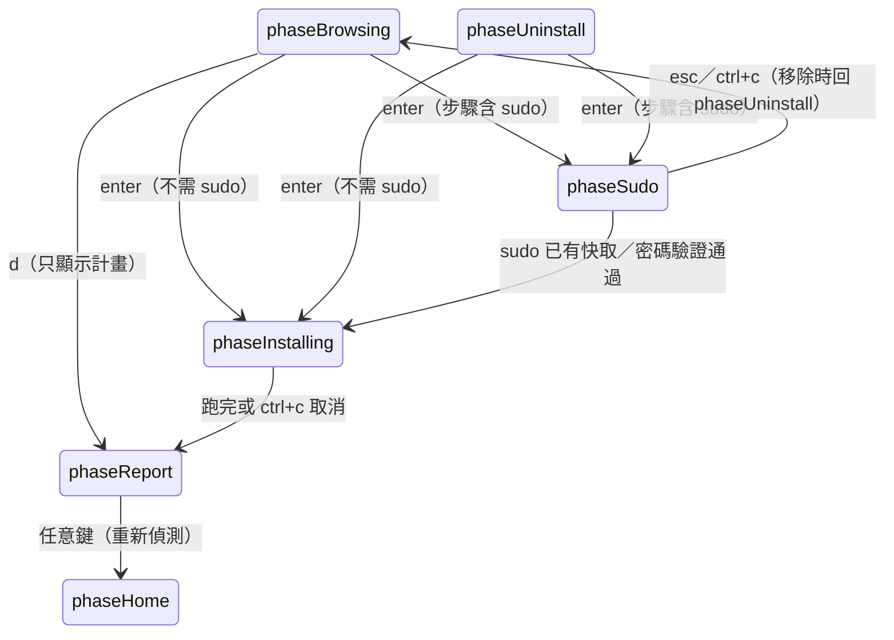

# `tools` 進度頁、TUI 內 sudo、拿掉所有 y 確認

| 欄位 | 值 |
| --- | --- |
| 日期 | 2026-11-17 |
| 範圍 | `internal/tui`（`progress.go`、`stream.go`、`sudo.go`、`update.go`、`uninstall.go`） |

## 1. 需求

1. 解除安裝畫面拿掉「只列出已安裝的工具；基礎類（git、curl、vim…）不可移除」這列字。基礎類仍然不列出。
2. 安裝與移除不再跳出 alt screen 到 shell 執行命令（不再用 `tea.ExecProcess`）。改成 TUI 內的進度頁，即時顯示過程。
3. 所有 `y` 確認都拿掉：安裝確認頁、移除確認頁、python 警告的 `y`、強制重裝的 y/n 問句。在清單按 `enter` 就直接開始。
4. 結束後在同一頁顯示結果，按任意鍵回首頁，首頁重新偵測已安裝狀態。

## 2. 流程

- `phaseConfirm`、`phasePythonWarn`、`askName/askTold` 全部刪除。
- 在已安裝的工具上按 `space` 直接勾選，代表「重新下載」；執行時 `Runner.Force` 會打開（`m.force || m.reinstalling()`）。`a`／`A` 仍然跳過已安裝的工具。
- `d` 不再經過確認頁，直接在報告頁列出計畫（全部 `略過`）。
- python 的警告改成進度頁與報告頁上的一列（金色、會換行不截斷），不擋流程。

## 3. 進度頁

`phaseInstalling` 與 `phaseReport` 共用 `progressLines`，排版固定在視窗高度內：

1. 標題列：`安裝中  3/7  <目前步驟>`（移除為 `移除中`）；取消後為 `取消中…`；結束為 `安裝完成：成功 N、失敗 M`、`安裝已取消（k/N）` 或 `安裝失敗：更新套件清單失敗`。
2. 警告列（python）。
3. 步驟清單：`等待`、`執行中`、`完成`、`已安裝`、`略過`、`失敗`、`已取消` 加上步驟標題。清單太長時以執行中的步驟為中心開窗，最後一列寫 `…還有 N 項`。報告頁改列 `install.FormatResult` 的每個工具結果。
4. `輸出` 與即時輸出的尾端：stdout 與 stderr 合併、一行一個 tea 訊息。以 `\r` 結尾的行（進度條）會被下一行取代。保留最後 500 行，只畫放得下的。

顏色只用前景色：執行中桃色 `#F0ADA0`、成功青色 `#9EE2F0`、失敗 `#F28B82`、等待與標籤 muted、警告金色、輸出 sand。沒有任何背景色（`TestNoScreenEmitsBackground` 也涵蓋進度頁與 sudo 頁）。

底欄：執行中 `操作  ctrl+c 取消`，結束 `操作  任意鍵回主頁`。

被截斷的行少用一欄（`fitLine`），因為 tmux 會把 `…` 畫成兩欄寬，換行會把標題列擠出畫面。

## 4. 執行與串流（`stream.go`）

- `streamExec` 實作 `install.Executor`：`exec.CommandContext`，stdin 關閉（`/dev/null`），stdout 與 stderr 接到同一個 pipe，`splitLines` 切行、去 ANSI 與控制字元後送 `bridgeMsg{kind: kindOutput}`。完整輸出仍回傳給 `pm.ClassifyFailure` 判斷錯誤。
- 進度（`Runner.Progress`）送 `kindProgress`，結束送 `kindDone`。channel 有緩衝；Update 在 `phaseInstalling` 期間一直重新 `listen`，所以 worker 不會卡住。
- 取消：`ctrl+c` 呼叫 context cancel。子程序收到 `SIGTERM`（sudo 會轉送給實際命令），5 秒後（`WaitDelay`）才強制結束。runner 回傳後進報告頁，執行中的步驟標成 `已取消`。
- 測試可以設 `Deps.Runner.Exec` 換掉 `streamExec`；`Deps.Detect` 換掉回首頁時的重新偵測。

## 5. sudo（`sudo.go`）

子程序拿不到終端機，所以 sudo 絕對不能自己在 `/dev/tty` 問密碼，否則會弄壞畫面。做法：

1. 開始前檢查步驟裡有沒有 `sudo ...`（root 時 `WithPrivilege` 不加 sudo，就不會檢查）。
2. 有的話先跑 `sudo -n true`（非同步）。成功表示憑證快取還有效，直接開始。
3. 失敗就進 `phaseSudo`：TUI 內的遮罩輸入框（顯示 `*`），`enter` 送出、`backspace` 刪字、`ctrl+u` 清空、`esc` 返回清單。
4. 送出時立刻把輸入框清零，在背景跑 `sudo -S -p '' -v`，密碼從 stdin 送入。失敗時顯示 sudo 的最後一行訊息（例如 `Sorry, try again.`），可以重打。
5. 驗證通過後，這次執行的每個 sudo 命令都改成 `sudo -n ...`（用快取，不會再問）。執行期間每 60 秒跑一次 `sudo -n -v` 延長快取，避免長時間安裝中途過期。
6. 只有 sudoers 不保留快取（`timestamp_timeout=0`，驗證後 `sudo -n true` 仍失敗）時，才改用 `sudo -S -p '' ...`，把密碼從 stdin 送給每個 sudo 命令。這時密碼只放在記憶體裡、只在這次執行期間保留，結束時清零。

密碼不寫進 log、檔案、畫面、tea 的輸出訊息，也不會送到串流輸出。選這個做法而不是「進 TUI 前先 `sudo -v`」的理由：只有真的需要 sudo 時才問，而且同一個 TUI 可以連續安裝、移除很多次，快取過期後也能在 TUI 裡重新輸入。

## 6. 其他修正

- `View()` 不再以換行結尾。Bubble Tea 會把結尾的換行算成多一列，滿版畫面因此被切掉最上面一列，頂端系統列一直看不到。測試要求每個畫面剛好 `height` 列，而且不以換行結尾。

## 7. 測試

- `progress_test.go`：`splitLines`（`\r\n`、`\r`、ANSI、tab）；`sudoArgv`；`streamExec` 串流 stdout/stderr 與結束碼、取消；用假的 `sudo` 腳本確認快取模式不送 stdin、stdin 模式只送密碼且不會出現在輸出；串流訊息驅動步驟狀態、計數、輸出尾端、fallback 步驟、報告；視窗大小內排版；`ctrl+c` 取消；報告頁任意鍵回首頁並重新偵測；`enter` 直接開始安裝；sudo 密碼頁（遮罩、錯誤重打、esc 清除）；無快取時用 stdin 而且結束後清零；原始碼與畫面不再有 y 確認。
- `uninstall_test.go`：清單不再有那列說明字；`enter` 直接開始移除並跑完；python 只顯示警告，不等 `y`。
- `installed_test.go`：在已安裝工具上按 `space` 直接勾選重新下載，沒有問句。
- `nobg_test.go`：所有畫面（含 sudo 頁、進度頁、取消中、報告、只顯示計畫、移除進度）都沒有背景色、剛好 `height` 列、不以換行結尾。
