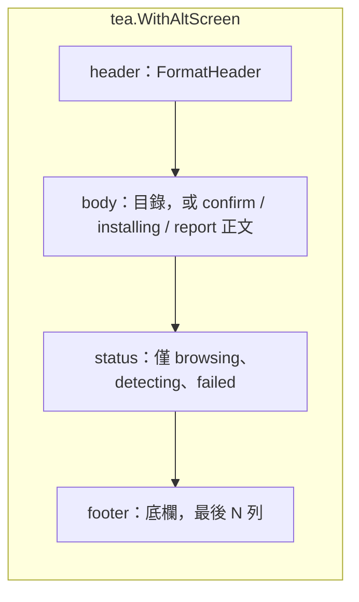
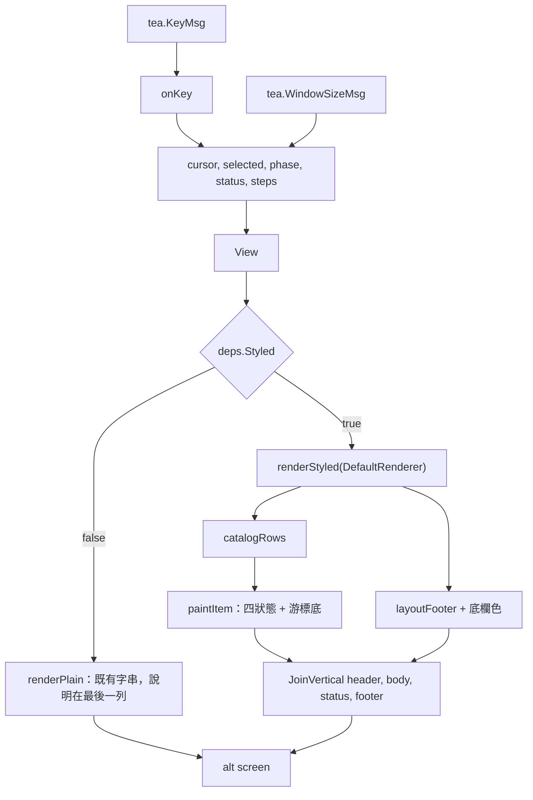

# `tools` TUI 目錄視覺修訂：Andromeda 區塊與 Zellij 式底欄

> **2026-11-17 更新：** 解除安裝、設定檔部署、bash/zsh 設定區塊與目錄色系已改，見 `docs/tools-uninstall-design.md`。本文件與它衝突的段落以新文件為準。

| 欄位 | 值 |
| --- | --- |
| 作者 | 待填 |
| 日期 | 2026-11-12 |
| 狀態 | Draft |
| 模組 | `github.com/shuhi/dotfiles` |
| 適用樹 | `/home/shuhi/project/Dotfiles` |
| 範圍 | `internal/tui` 的畫面。不改安裝語意 |
| 取代範圍 | 只取代 `docs/tools-installer-design.md` 裡「說明列畫在標題正下方」的呈現順序與著色。說明列字面值、按鍵、勾選字元、安裝流程仍以該文件為準 |

## Overview

`cmd/tools` 在 stdin 是 TTY 時啟動 Bubble Tea。目錄畫面今天是 `internal/tui/render` 串起來的純文字：標題、一行操作說明、分類與項目、最後是 `已勾選 N    游標 <id>`。`styled == true` 時只有標題被 `lipgloss` 加粗。目錄本身沒有顏色，勾選與未勾選只差 `[x]` 與 `[ ]`，操作說明也不在畫面底部。

本修訂只改呈現。目錄改用 Sonokai Andromeda 色票，以 `lipgloss` 把畫面分成 header、body、status、footer 四塊。勾選項目用 orange，未勾選用 fg，游標列用 CursorLine 的底色蓋上去。`*` 仍是預設項目標記，不拿來當勾選框，也不跟這兩個顏色共用。操作說明改成釘在 alt screen 最底部、有自己底色的欄，按鍵與說明分色，排法對齊 Zellij 狀態列。`Deps.Styled == false` 時不呼叫 `lipgloss`，字面值維持現有測試。

## Background & Motivation

現況來自這些檔案，不是構想：

- `internal/tui/view.go` 的 `render`、`catalogLines`、`FormatItem`、`FormatHeader`
- `internal/tui/keymap.go` 的 `newKeyMap`、`browsing`、`browsingHelp`，以及 `confirmHelp`、`installingHelp`、`reportHelp`
- `internal/tui/model.go` 的 `phase`、`Deps.Styled`、`New` 預設 `width=80`、`height=40`
- `internal/tui/update.go` 的 `Update`（`tea.WindowSizeMsg`）與 `onKey`
- `cmd/tools/main.go` 的 `runTUI`：`Styled: isTTY(stdout) && os.Getenv("NO_COLOR") == ""`，程式是 `tea.NewProgram(m, tea.WithAltScreen())`
- `go.mod` 已有 `github.com/charmbracelet/bubbletea v1.3.10`、`github.com/charmbracelet/bubbles v1.0.0`、`github.com/charmbracelet/lipgloss v1.1.0`。`github.com/charmbracelet/x/ansi v0.11.6` 是 indirect

`zellij/config.kdl` 只有 `default_shell "bash"`，沒有狀態列配色，也沒有 key hint。本文件對 Zellij 的描述是產品行為，不是這份 kdl。

痛點：

1. 目錄 6 個分類、32 個項目、共 38 列（`catalog.All`），全是同一種終端機預設色。勾選與否要讀 `[x]`／`[ ]`。
2. `browsingHelp` 的顯示寬度是 125 欄，但 `New` 預設寬度是 80。說明列寫在標題底下，終端機會自行折行，而 `listH := m.height - 3` 仍把它當成 1 列。說明列因此既不在底部，也會偷走目錄列。
3. `scroll` 只讓游標留在清單區。confirm、installing、report 沒有視窗，步驟一多就把說明列推出 alt screen。
4. 前一份規格禁止 `bubbles/list`，這次仍不該為了上色而換成 list widget。缺的是區塊與顏色，不是另一套選取模型。

## Goals & Non-Goals

### Goals

- 目錄列著色，色票用下面的 hex，不用「大地色」這四個字代替色碼。
- 畫面由 header、body、status、footer 四個 `lipgloss` 區塊組成。`styled == false` 時走純文字路徑，零 ANSI。
- 底欄釘在 `tea.WithAltScreen` 的最後幾列，有自己的背景色。browse、confirm、installing、report 的說明文字與 `keymap.go` 現字面值一致。
- 勾選與未勾選是兩種前景色。游標是第三種處理（整列底色），而且蓋上去之後仍看得出勾選色與 `*`。
- 窄終端有明確的折行、截斷與捲動規則。測試鎖的是 SGR 參數與字串，不是截圖。

### Non-Goals

- 不新增工具、不改 `catalog.ID`、不改 `internal/install`、`internal/pm`、`internal/linkbash`、`cmd/link-bash`。
- 不改按鍵行為。`onKey`、`browseKey`、`enterConfirm`、`startInstall`、`cancelInstall` 的分支維持原樣。底欄文字必須描述這些已存在的鍵，不准為了版面改鍵。
- 不加滑鼠。`runTUI` 繼續只傳 `tea.WithAltScreen()`，不加 `tea.WithMouseCellMotion` 或 `tea.WithMouseAllMotion`。
- 不做主題檔、不做 `lipgloss.AdaptiveColor`、不做淺色／深色切換。
- 不改 `FormatItem` 的字元。`*`、`[x]`、`[ ]`、游標前綴 `>` 都留著。
- 不把 `phaseFailed` 的說明列改短。今天 failed 仍畫 browsing 那一行，雖然 `enter`、`d`、`ctrl+c` 在 `onKey` 裡被吃掉。這是已知落差，本修訂不修。
- 不依安裝結果改色。`ok`、`failed`、`satisfied` 都是同一種 cream on bark，不用 clay、gold 或 olive 區分狀態。字元仍是 `install.FormatResult` 與既有的 `  <Title>  <status>`，不改文案。
- 不刪 `model.scroll`。它今天沒有被寫入，見下方捲動一節。

## Proposed Design

### 色票

色票是 [Sonokai Andromeda](https://github.com/sainnhe/sonokai) 的 token，對應 `colors/sonokai.vim` 的 Normal、CursorLine、StatusLine。每塊都畫自己的背景，所以終端機本身是淺色時，畫面仍是這組顏色，不跟著終端主題翻轉。

| Token | Andromeda | Hex | 用途 |
| --- | --- | --- | --- |
| bark | `bg0` | `#2B2D3A` | Normal 背景：header、目錄、status、confirm／installing／report 正文 |
| cursor | `bg1` | `#333648` | CursorLine。游標列背景，不改前景 |
| footer | `bg3` | `#393E53` | StatusLine 背景。比游標列更亮，兩塊不會糊成同一條 |
| mode | `bg0` | `#2B2D3A` | 底欄裡 `操作` 的色塊。與頁面同色，嵌在較亮的底欄上 |
| cream | `fg` | `#E1E3E4` | Normal 前景：header、游標的 `>`、底欄說明、confirm／installing／report 的正文，含 `Step.Title`、`  <Title>  <status>` 與 `FormatResult` |
| clay | `orange` | `#F89860` | 勾選：`[x]` 與名稱 |
| sand | `fg` | `#E1E3E4` | 未勾選：`[ ]` 與名稱。與 cream 是同一個 token |
| gold | `yellow` | `#EDC763` | 只有 `*`。不是勾選色，也不是底欄按鍵色 |
| key | `blue` | `#6DCAE8` | 底欄按鍵 |
| olive | `green` | `#9ED06C` | 分類標題，粗體。分類列沒有游標底色 |
| muted | `grey` | `#7E8294` | `width >= 100` 的描述，以及 `已勾選` 那一列 |

`earthStyles` 把這些 hex 傳給 `lipgloss.Color`。`lipgloss` v1.1.0 的 `Color.color` 走到 `termenv` v0.16.0 的 `Profile.Color`，hex 變成 `RGBColor`。`RGBColor.Sequence`（`color.go`）用 `colorful.Hex`（`go-colorful` v1.3.0）再 `uint8(f.R*255)`，小數被截斷，不是四捨五入。`CompleteColor` 同樣走這條路，不能拿來避開截斷。本設計不另寫 `TerminalColor` 去還原整數 RGB。色票的來源是 hex，測試的契約是這個模組實際印出的參數。

在 `NewRenderer(io.Discard)`、`SetColorProfile(termenv.TrueColor)`、`Inline(true)` 下量過。`bg1`、orange、yellow、blue、green 的通道與整數 RGB 相同。`bg0` 的 G 從 45 截成 44，`bg3` 的 R 從 57 截成 56，`fg` 的 B 從 228 截成 227，grey 的 B 從 148 截成 147。前景與背景用同一組通道，只差 `38` 與 `48`。sand 與 cream 都是 `fg`，mode 與 bark 都是 `bg0`，所以這兩對印出同一組參數。勾選列沒有 `fg`，因此「curl 不含 sand」仍然成立。

| 用途 | `lipgloss.Color` 實際印出的參數 |
| --- | --- |
| clay 前景 | `38;2;248;152;96` |
| sand 前景 | `38;2;225;227;227` |
| gold 前景 | `38;2;237;199;99` |
| olive 前景 | `38;2;158;208;108` |
| cream 前景 | `38;2;225;227;227` |
| key 前景 | `38;2;109;202;232` |
| muted 前景 | `38;2;126;130;147` |
| bark 背景 | `48;2;43;44;58` |
| cursor 背景 | `48;2;51;54;72` |
| footer 背景 | `48;2;56;62;83` |
| mode 背景 | `48;2;43;44;58` |

測試鎖的是這些參數，不是完整 CSI，也不是 hex 的整數 RGB。`*` 的渲染結果不得含 `38;2;248;152;96` 或 `38;2;109;202;232`。勾選名稱不得含 gold 或 key 的前景參數。

### 四種目錄狀態，加上游標

字元繼續由 `FormatItem` 決定，測試仍是：

```text
* [x] git
* [ ] git
  [ ] zsh
  [x] neovim
```

`catalogLines` 再在前面加游標前綴：目前列 `> `，其他列兩個空白。所以畫面上的純文字仍是 `> * [x] git`、`  * [x] curl`、`    [ ] zsh`、`>   [ ] zsh`。`TestToggle` 檢查的 `> * [ ] git` 不准改。

顏色打在片段上，不打在整列的單一前景上。否則游標列會把勾選色洗掉。

| 狀態 | 純文字例子 | `*` | 勾選框與名稱 | 列背景 | `>` |
| --- | --- | --- | --- | --- | --- |
| default+checked | `  * [x] curl` | gold `#EDC763` | clay `#F89860` | bark `#2B2D3A` | 無，前綴是兩個空白 |
| default+unchecked | `  * [ ] git` | gold `#EDC763` | sand `#E1E3E4` | bark | 無 |
| non-default+checked | `    [x] neovim` | 沒有 `*`，那個空格不上 gold | clay `#F89860` | bark | 無 |
| non-default+unchecked | `    [ ] zsh` | 沒有 `*` | sand `#E1E3E4` | bark | 無 |
| 游標覆蓋 | 上面四種都可以，前綴改 `> ` | 規則不變，仍是 gold 或沒有 | 規則不變，仍是 clay 或 sand | cursor `#333648` 鋪滿整列 | cream `#E1E3E4`、粗體 |

分類標題不是第五種項目狀態。`catalog.Category.Title` 原樣輸出（`基礎`、`Shell`、`檔案搜尋`、`編輯器`、`語言`、`編譯`），olive、粗體、bark 背景，沒有 `>`、沒有 `*`、沒有勾選框。游標只會落在 `m.flat` 的項目上，不會落在分類列。這是 `catalogLines` 今天的行為。

描述只在 `m.width >= 100` 而且 `it.Description != ""` 時，用兩個空白接在名稱後面。這條寬度門檻維持 `view.go` 現況。描述用 muted，不用勾選色。`wget` 的描述是 `Fedora 套件是 wget2-wget`。

片段著色必須用同一個 `*lipgloss.Renderer` 的 `NewStyle()`，並且 `Inline(true)`。目錄、status、正文、底欄用同一種畫法，見下方「著色與鋪底」。分類列與項目列都要鋪滿寬度，目錄區才會是一整片 bark，而不是終端機底色上的幾段彩字。

### 誰畫哪一塊

不採用 `bubbles/list`，也不採用 `bubbles/help`。理由在 Alternatives。畫面結構如下。



| 區塊 | 函式 | Widget | 內容 |
| --- | --- | --- | --- |
| header | `renderHeader` | `lipgloss`，不是 widget | `FormatHeader`。styled 時 1 列、粗體、cream on bark，超寬用 `ansi.Truncate` |
| body／目錄 | `catalogRows` + `paintItem` | 自畫。不是 `bubbles/list.Model` | 分類列與項目列。捲動算法留在 `render`，不搬進 list |
| body／其他 phase | `renderBody` | 自畫 `lipgloss` 文字塊 | confirm、installing、report 的正文都是 cream on bark，包含已完成列與 `FormatResult`。`ok`、`failed`、`satisfied` 不另上色。字串規則不變 |
| status | `renderStatus` | 自畫 `lipgloss` | `已勾選 %d    游標 %s` 是 muted on bark。`m.status` 是 cream on bark。confirm、installing、report 沒有這塊 |
| footer | `renderFooter` | 自畫 `lipgloss` 底欄。不是 `bubbles/help.Model` | 按鍵來自既有 `key.Binding.Help()`，三個常數列維持原句。每個片段自帶 footer 或 mode 背景 |
| 補高 | `padBody` | bark 的空白列 | body 短於 `bodyH` 時，補上的每一列都是 bark，不用終端機底色 |

`model.View` 仍是 `return render(m, m.deps.Styled)`。`render` 的簽名不改，既有測試繼續呼叫 `render(m, false)`。

```go
func render(m model, styled bool) string {
    if !styled {
        return renderPlain(m)
    }
    return renderStyled(m, lipgloss.DefaultRenderer())
}

func renderStyled(m model, r *lipgloss.Renderer) string
```

顏色測試不准只呼叫 `render(m, true)`。`DefaultRenderer` 在 `go test` 裡常常沒有 TTY，`ColorProfile()` 會是 `termenv.Ascii`，ANSI 會被拿掉，hex 斷言會抖。測試用獨立 renderer：

```go
func testRenderer() *lipgloss.Renderer {
    r := lipgloss.NewRenderer(io.Discard)
    r.SetColorProfile(termenv.TrueColor)
    r.SetHasDarkBackground(true)
    return r
}
```

樣式一律 `r.NewStyle()`，不准在測試裡呼叫 `lipgloss.SetColorProfile` 改全域 renderer。正式路徑在 `styled == true` 時用 `DefaultRenderer()`，讓 256 色終端機降階。`styled == false` 時函式根本不碰 `lipgloss`，所以 `NO_COLOR` 與非 TTY 不會出現半套色。

`lipgloss` v1.1 的 `Renderer.SetColorProfile` 接收 `termenv.Profile`。本模組的 `termenv` 是 v0.16.0。TrueColor 測試鎖的是色票一節量到的那張 SGR 表，不是 hex 的整數 RGB。

### 著色與鋪底

`termenv` 每個片段結尾都寫 `\x1b[0m`。`lipgloss` v1.1.0 的 `Style.Render` 若收到已經上色的字串，外層背景只活到第一個重置。在這份模組上量過：`key.Render("q") + " " + label.Render("離開")` 再包進 `Background(#393E53).Width(20)` 時，`q` 在第一個 `\x1b[0m` 之前還帶著外層背景，中間的空白和 `離開` 沒有 `48;2;56;62;83`。尾端補白反而有背景，因為 `align.go` 的 `alignTextHorizontal` 會用外層 style 單獨畫那些空格。所以「重置碼會讓尾端補白失去背景」是錯的。洞在片段之間，不在行尾。

因此不准把上好色的字串再丟進只設背景或 `Width` 的 `Render`。目錄、status、正文、底欄都一樣：

- 每個可見片段用 `Inline(true)`，同時設自己的前景與背景。分隔用的兩個空白也是一個片段，背景是該列的底色，不另設前景。
- 列寬不足時，尾端空格用同一個背景、`Inline(true)` 再畫一次接上去。不要靠外層 `Width` 去補已經上色的字串。
- mode 色塊只有 `操作` 這幾個字：cream 前景、mode 背景。它後面的兩個空白是 footer 背景，不是 mode，也不是沒上色的洞。
- body 比 `bodyH` 短時，缺的每一列是 `Background(bark).Width(m.width).Render("")`。這會走 `alignTextHorizontal`，空格帶 bark。不要把已經上色的正文塞進 `Height` 來補背景。`alignTextVertical` 的 style 參數在 v1.1 被忽略；`Width` 與 `Height` 同時設定時，多出來的列在這份程式裡雖然會帶背景，但同一列裡先上色的字仍會在重置碼之後露出洞。補高只准用空的 bark 列。

`TestStyledFooterBackground` 除了底欄要出現 `48;2;56;62;83`，還要檢查 `q` 與 `離開` 之間的那個空白也含這組背景參數。只要求整列某個地方出現過 footer 背景，會讓中間的洞過關。

### 直向配置與高度

優先順序：footer、header、status、body。高度不夠時先把 body 縮到 0，不准再把 footer 擠出畫面。這改掉今天的保底。

今天的程式是：

```go
listH := m.height - 3
if m.status != "" {
    listH--
}
if listH < 1 {
    listH = 1
}
```

`-3` 是標題、說明列、`已勾選` 列各 1。說明列在標題底下。`listH < 1` 時仍畫 1 列目錄，總列數就會超過 `m.height`，底欄留不住。

新的算法先把底欄列數夾進 `m.height`。`footerLineCount` 是 `layoutFooter` 的自然列數，可以是 2 或 3，大於視窗時不准照單全畫。

```go
natural := footerLineCount(m, styled) // plain 永遠是 1；styled 是 1、2 或 3
footerN := natural
if footerN > m.height {
    footerN = m.height
}
headerN := 0
if m.height-footerN >= 1 {
    headerN = 1
}
statusN := 0
if showsStatus(m.phase) && m.height-footerN-headerN >= 1 {
    statusN = 1
    if m.status != "" && m.height-footerN-headerN-statusN >= 1 {
        statusN = 2
    }
}
bodyH := m.height - headerN - footerN - statusN
if bodyH < 0 {
    bodyH = 0
}
```

畫出的底欄是 `layoutFooter` 的前 `footerN` 列。若 `natural > footerN`，最後一列保留下來的底欄用與截斷相同的規則收成 ` …`（先留 2 欄），避免高度裁切把 `q` 悄悄拿掉卻沒有任何記號。`footerN == 0` 只有 `m.height == 0`，實務上不畫。

`showsStatus` 只在 `phaseDetecting`、`phaseBrowsing`、`phaseFailed` 為真。這三個 phase 今天都走 `render` 的 `default` 分支。detecting 與 failed 繼續走這條，不另做版面。status 只有 1 列而且 `m.status != ""` 時，那一列印 `m.status`，不印 `已勾選`。兩列都放得下時才是先 `已勾選`、再 `m.status`。

`bodyH == 0` 時不畫 body。目錄可以暫時消失。底欄的列數永遠 ≤ `m.height`，框架的總列數也是 `m.height`，不會再把 footer 擠出去。

下面的例子都是 browsing，而且 `m.status` 是空的。`footerN == 1` 是 plain，或 styled 且寬度 ≥ 125。`footerN == 2` 是 styled 且寬度 63 到 124，包含預設的 80。

| 視窗高度 | 自然底欄 1 列 | 自然底欄 2 列（寬度 80） |
| --- | --- | --- |
| 1 | 只有底欄 | 只有底欄的第一列，尾端 ` …`。沒有 header |
| 2 | header + 底欄 | 兩列都是底欄。沒有 header |
| 3 | header + `已勾選` + 底欄。沒有目錄 | header + 兩列底欄。沒有 `已勾選`，沒有目錄 |
| 4 | header + `已勾選` + 1 列目錄 + 底欄 | header + `已勾選` + 兩列底欄。沒有目錄 |
| 40 | header + 37 列目錄 + `已勾選` + 1 列底欄 | header + 36 列目錄 + `已勾選` + 2 列底欄 |

自然底欄 3 列（styled 寬度 45 到 62）時，高度 3 是三列底欄、沒有 header；高度 4 才開始有 header；高度 5 才有 `已勾選`。預設 80 欄不是這個情況。

body 比 `bodyH` 短時，styled 用「著色與鋪底」的空 bark 列補滿，footer 才會貼在 alt screen 底部，而不是貼在最後一筆資料後面。plain 用空行補滿，不補 ANSI。輸出以 `\n` 結尾。去掉最後一個空切片之後，列數等於 `m.height`，最後 `footerN` 列是底欄。`TestNarrowFooterStaysOnScreen` 仍只鎖 plain、`height=3`、`width=80` 的一列底欄。styled 的短視窗另由 `TestStyledShortFrameClampsFooter` 鎖：寬度 80 時 `height=1` 只有 1 列，`height=2` 只有 2 列且不含 `系統:`，`height=3` 是 header 加兩列底欄、不含 `已勾選`。

### 目錄捲動

捲動仍只作用在目錄列，不作用在 header、status、footer。算法沿用 `render` 裡的區域變數，不開始寫入 `m.scroll`。

今天的程式：

```go
scroll := m.scroll
if scroll > cursorAt {
    scroll = cursorAt
}
if cursorAt >= scroll+listH {
    scroll = cursorAt - listH + 1
}
if scroll < 0 {
    scroll = 0
}
end := scroll + listH
if end > len(lines) {
    end = len(lines)
}
if scroll > len(lines) {
    scroll = len(lines)
}
```

`New` 沒有設定 `scroll`，`Update` 也不寫它，所以 `m.scroll` 一直是 0。上面的區域變數每次 `View` 都從 0 算到「游標可見、盡量靠上」。本修訂保留這個行為，只把 `listH` 換成上面的 `bodyH`。不要把結果存回 `m.scroll`。存回去會變成另一種捲動，而且 `View` 不該改 model。

`cursorAt` 仍是游標項目在目錄列裡的索引，含分類列。`catalogLines` 今天在 `it.ID == cur` 時把 `cursorAt` 設成 `len(lines)`，也就是該項目列自己的索引。這個定義不變。

38 列目錄在預設 `height=40`、`width=80` 時：

| 模式 | footer 列數 | chrome | bodyH | 看得到的目錄列 |
| --- | --- | --- | --- | --- |
| plain，或 styled 且寬度 ≥ 125 | 1 | header 1 + status 1 + footer 1 | 37 | 38 列中的 37 列 |
| styled，寬度 63 到 124（含預設 80） | 2 | 4 | 36 | 36 列 |
| styled，寬度 45 到 62 | 3 | 5 | 35 | 35 列 |
| styled，寬度 ≤ 44 | 3，尾段截掉 | 5 | 35 | 35 列 |

游標在第 0 項 `git` 時，被切掉的是目錄尾端，不是底欄。游標在最後一項 `pkg-config` 時，視窗跟著移，`git` 可以離開視窗，`pkg-config` 與 `>` 必須還在。

### 其他 phase 的正文

confirm、installing、report 的文字順序維持前一份規格，只是說明列從第 2 列移到底欄，不再插在標題與正文之間。

- confirm：可選的 `只顯示計畫，不會執行`，然後每個 `Step.Title` 一列。這兩種列都是 cream on bark。
- installing：`目前  <title>`、`已完成`、`待執行`、未開始的 `  <Title>`，以及已完成的 `  <Title>  <status>`，全部是 cream on bark。狀態字不改成 clay、gold 或 olive。
- report：每個 `install.FormatResult` 一列都是 cream on bark，`ok`、`failed`、`satisfied` 用同一前景。`m.status` 若非空，仍接在結果後面，屬於 body，也是 cream on bark。它不是 browsing 的 status 塊。failed 的錯誤字串則仍是 browsing status，因為 failed 走目錄畫面。

正文列數大於 `bodyH` 時，留下前 `bodyH-1` 列，最後一列改成 `…還有 N 行`。`N` 是沒畫出來的資料列數，不含這行提示。`bodyH == 0` 時不畫提示，只留 footer。`bodyH == 1` 且有溢出時，body 只有 `…還有 N 行`。提示用 cream on bark。plain 也印這句，否則短視窗的純文字一樣會把底欄擠掉。

既有測試的 `height` 是 40，confirm 沒有步驟、report 只有一列，不會碰到這句。不要為了提示去改 `install.FormatResult`。

### 底欄

#### Zellij 在做什麼

Zellij 的狀態列鎖在終端機最底部，橫跨整個寬度，背景與窗格內容不同。它不跟著窗格捲動。列上先是模式（NORMAL、LOCKED、PANE 這類色塊），後面每個提示是「按鍵 + 動作」。按鍵一種前景，動作另一種前景，提示之間用空白分開。一列塞不下的提示會被省略，而不是畫進窗格。

本倉庫的 `zellij/config.kdl` 沒有覆寫這套外觀。

對應關係：

| Zellij | 本 TUI |
| --- | --- |
| 模式色塊 | `操作`，cream on mode `#2B2D3A` |
| 按鍵色 | key `#6DCAE8` |
| 動作色 | cream `#E1E3E4` |
| 列背景 | footer `#393E53`，寬度等於 `m.width` |
| 不跟著內容捲動 | footer 是最後 `footerN` 列，目錄只捲 body |
| 塞不下就省略 | 不照做。見下方折行。browsing 全文 125 欄，80 欄一列會把 `q 離開` 切掉 |

提示之間維持兩個空白，與 `browsingHelp` 的 `strings.Join(parts, "  ")` 相同。不加 `bubbles/help` 的預設分隔 `" • "`。兩個空白不另上前景色，它們只是底欄背景上的空格。

#### 四個 phase 的字面值

這些字串就是底欄要顯示的全部操作，來自 `keymap.go`，不是新文案。

| phase | 字面值 |
| --- | --- |
| browsing、detecting、failed | `操作  ↑/k 上一項  ↓/j 下一項  space 勾選/取消  enter 安裝已勾選  a 切換本類  A 切換全部  d 只顯示計畫  g 頂端  G 底端  q 離開` |
| confirm | `操作  y 開始  n/esc 返回` |
| installing | `操作  ctrl+c 取消` |
| report | `操作  任意鍵返回  q 離開` |

browsing 那行由 `browsing()` 的 `Help().Key` 與 `Help().Desc` 用兩個空白接起來，前面加 `操作  `。`browsingHelp` 的結果必須仍等於上表。confirm、installing、report 繼續用三個常數，不走 `browsing()`。

按鍵與說明的切法：

| 片段 | 按鍵 | 說明 | 實際還會反應的鍵，但不寫進底欄 |
| --- | --- | --- | --- |
| Up | `↑/k` | `上一項` | `up` 與 `k`。`key.NewBinding` 的鍵是 `up`, `k` |
| Down | `↓/j` | `下一項` | `down`, `j` |
| Toggle | `space` | `勾選/取消` | 空白鍵 |
| Install | `enter` | `安裝已勾選` | browsing 有勾選才進 confirm；沒有則 `m.status = "尚未勾選任何項目"` |
| CatAll | `a` | `切換本類` | 只翻目前分類 |
| All | `A` | `切換全部` | 大寫 A |
| Dry | `d` | `只顯示計畫` | 進 confirm，`dryRun == true` |
| Top | `g` | `頂端` | `home` 也會到頂，底欄不寫 `home` |
| Bottom | `G` | `底端` | `end` 也會到底，底欄不寫 `end` |
| Quit | `q` | `離開` | browsing 的 `ctrl+c` 也會離開，因為它在 Quit binding 裡。底欄維持只寫 `q` |

confirm 的 `y`、`n`、`esc` 不在 `keyMap` 裡，是 `onKey` 的字串分支。installing 只認 `ctrl+c`，呼叫既有的 `cancelInstall`。report 的 `q` 送 `tea.Quit`；其他鍵，包含 `ctrl+c` 與 `enter`，回 browsing，勾選不變。底欄照這三句寫，不去「補正」這些差異。

styled 底欄的畫法與目錄相同，不把上好色的片段再包進 `Background` + `Width`。`操作` 是 cream on mode 的 `Inline` 片段。每個按鍵是 key 前景加 footer 背景，每個說明是 cream 前景加 footer 背景。按鍵與說明之間的一個空白、提示與提示之間的兩個空白，都是只設 footer 背景的 `Inline` 片段。列尾空格也用 footer 背景接上，直到 `ansi.StringWidth` 等於 `m.width`。mode 色塊不會延伸到後面的空格。這樣 `q` 與 `離開` 之間的空白含 `48;2;56;62;83`，不會在 `\x1b[0m` 之後露出終端機底色。

#### 折行與截斷

先算顯示寬度，再決定列數。寬度用 `github.com/charmbracelet/x/ansi` v0.11.6 的 `Truncate`／`StringWidth`（預設 `EastAsianWidth: false`）。CJK 是寬字，寬度 2。`…`（U+2026）在這個設定下是 1 欄。實作時把 `x/ansi` 加進 `go.mod` 的 direct require。它已經在 `go.sum`，不是新的版本選擇。

測量過的片段寬度：`操作` 是 4；`↑/k 上一項` 與 `↓/j 下一項` 各 10；`space 勾選/取消` 是 15；`enter 安裝已勾選` 是 16；`a 切換本類` 與 `A 切換全部` 各 10；`d 只顯示計畫` 是 12；`g 頂端`、`G 底端`、`q 離開` 各 6。含 `操作  ` 與片段間的兩個空白，browsing 全文是 125。confirm 與 report 是 24。installing 是 17。

`layoutFooter(segments []string, width, maxLines int) (lines []string, truncated bool)` 是純函式。`maxLines` 是 3。片段是原子，不在按鍵與說明中間切開。前 `maxLines-1` 列能塞多少整段就塞多少。最後一列先試著把剩下的片段全部放進 `width`。放得下就結束，`truncated == false`，不加省略號。放不下時，最後一列的預算是 `width-2`，先留給 ` …`（一個空白加 U+2026，`ansi.StringWidth` 是 2）。只接受放得進這個預算的整段，然後接上 ` …`，其餘丟掉，`truncated == true`。寬度 44 時若不先留這 2 欄，第三列會剛好以 `g 頂端` 收在 44 欄，再加 ` …` 就溢出。先留 2 欄之後，`g 頂端` 不被接受，第三列是 `a 切換本類  A 切換全部  d 只顯示計畫 …`，顯示寬度 38，小於 44。

單一片段比該列預算還寬時，才用 `ansi.Truncate(segment, width, "…")` 占掉整列。會被這樣截開的是寬度 4 到 9 的 `↑/k 上一項` 與 `↓/j 下一項`，以及寬度小於 4 的 `操作`。`enter 安裝已勾選` 是 16 欄。寬度小於 16 時，前面的片段已經占滿 3 列，`enter` 是整段被丟掉，不是被截成 `enter …`。

用 `ansi.StringWidth` 對 browsing 片段跑過這條規則：

| 寬度 | 列數 | 結果 |
| --- | --- | --- |
| ≥ 125 | 1 | 與 `browsingHelp` 逐字相同 |
| 63–124 | 2 | 不截斷。兩行用 `  ` 接回去等於全文 |
| 45–62 | 3 | 不截斷。三行用 `  ` 接回去等於全文 |
| ≤ 44 | 3 | 截斷。最後一列以 ` …` 結尾，而且 `StringWidth` ≤ 寬度 |

兩列時第一列的結尾隨寬度變，不是 63 到 124 都停在同一個片段。75 到 86（含預設的 80）第一列停在 `a 切換本類`，第二列是 `A 切換全部  d 只顯示計畫  g 頂端  G 底端  q 離開`。63 到 74 停在 `enter 安裝已勾選`。87 到 100 停在 `A 切換全部`。101 到 108 停在 `d 只顯示計畫`。109 到 116 停在 `g 頂端`。117 到 124 停在 `G 底端`，第二列只剩 `q 離開`。

寬度 40 與 44 的第三列都是 `a 切換本類  A 切換全部  d 只顯示計畫 …`。移動、勾選、安裝、分類與 dry-run 還在，`g 頂端`、`G 底端`、`q 離開` 不在。寬度 45 開始三列都放得下，不含 `…`。寬度 48 仍是這組三列，不是截斷點。

confirm 與 report 的全文是 24 欄，寬度 ≥ 24 時是 1 列。installing 是 17 欄，寬度 ≥ 17 時就是 1 列，不是到 24 才變 1 列。更窄時走同一個 `layoutFooter`。

plain 路徑不在說明字串中間插 `\n`。`TestKeymapHelpVisible` 要求整句是連續子字串。125 欄的那一行在 80 欄終端上會被終端機自己折行，這是 `styled == false` 的退化，不是第二套版面。plain 仍把這一整行放在框架的最後一列，並用空行把框架補到 `m.height`。

styled 則在底欄內部折行。每一列的 `ansi.StringWidth` 都 ≤ `m.width`，不是畫完再交給終端機折。只有單一片段比該列預算還寬時才呼叫 `Truncate`。alt screen 不會因為說明列再捲一次。`footerLineCount` 是 `layoutFooter` 的列數，而且會先夾到 `m.height`，body 高度跟著減。

最小寬度沒有硬拒絕。今天的程式也沒有。`m.width >= 100` 才接描述，這條維持不變。寬度 ≤ 44 才開始丟 browsing 尾端提示。`New` 在第一個 `tea.WindowSizeMsg` 之前用 80×40。`Update` 只在 `msg.Width > 0` 與 `msg.Height > 0` 時覆寫，這個判斷不改。

header 的寬度：Fedora 範例 `FormatHeader` 的顯示寬度是 101。plain 不截斷，`TestFormatHeader` 的整句必須仍能從 `FormatHeader` 拿到，而且 `render(m, false)` 裡也要有這整句。styled 的 header 是一列，`ansi.Truncate(FormatHeader(...), m.width, "…")`，再上 cream、粗體、bark，並鋪滿寬度。

### `styled == false` 的框架

browsing、detecting、failed，由上到下：

1. `FormatHeader` 整句，不加粗
2. 視窗內的目錄列。游標列 `> `，其餘兩個空白，然後 `FormatItem`。`width >= 100` 才接描述
3. `已勾選 %d    游標 %s`
4. `m.status` 非空時再一列
5. 空行，補到剩下的高度
6. 最後一列是 browsing 說明整句

confirm：

1. `FormatHeader`
2. `只顯示計畫，不會執行`，只有 `dryRun`
3. 每個 `Step.Title`
4. 溢出時最後一列正文是 `…還有 N 行`
5. 空行補滿
6. 最後一列 `操作  y 開始  n/esc 返回`

installing、report 同樣把說明整句放在最後一列。installing 的 `目前  `、`已完成`、`待執行` 與 report 的結果列都在正文裡，不在底欄。

沒有任何 `\x1b`。

### 資料流



`selected` 仍是 `map[catalog.ID]bool`。顏色只讀這個 map 與 `catalog.Item.Default`，不寫回。

## API / Interface Changes

對外套件簽名不變。`tui.New`、`SetDeps`、`ExitCode`、`model.Init`、`Update`、`View` 的型別不變。`cmd/tools` 的 `Styled` 運算式不變。

套件內部新增，都不 export：

```go
type rowKind int

const (
    rowHeader rowKind = iota
    rowItem
)

type catalogRow struct {
    Kind     rowKind
    Title    string
    Item     catalog.Item
    Selected bool
    Cursor   bool
}

func (m model) catalogRows() (rows []catalogRow, cursorAt int)

type hint struct {
    Key  string
    Desc string
}

func footerHints(m model) []hint
func layoutFooter(segments []string, width, maxLines int) (lines []string, truncated bool)
func renderStyled(m model, r *lipgloss.Renderer) string
```

`catalogLines` 改成呼叫 `catalogRows` 再格式化，輸出字串與今天相同，避免兩套走訪。`FormatItem` 與 `FormatHeader` 的簽名與輸出不變。

`footerHints` 的資料來源：

- browsing、detecting、failed：`browsing()` 裡每個 binding 的 `Help()`，第一個 hint 不是 binding，是固定的 `操作`（只有 Key，Desc 空，拿來當模式塊）
- confirm：`操作`、`y`／`開始`、`n/esc`／`返回`
- installing：`操作`、`ctrl+c`／`取消`
- report：`操作`、`任意鍵`／`返回`、`q`／`離開`

plain 組句仍用 `browsingHelp` 與三個常數，不從 styled 的 ANSI 反推。styled 用同一批 hint，避免兩份文案。

`keyMap` 不實作 `bubbles/help.KeyMap`。不加 `ShortHelp` 或 `FullHelp`。

## Data Model Changes

沒有 schema、沒有磁碟格式、沒有遷移。`model` 不新增欄位。`scroll` 維持零值。勾選、phase、steps、results 的意義不變。

## Alternatives Considered

### 1. 改用 `bubbles/list`

駁回。前一份規格已經駁回，理由現在還在。`bubbles/list.Model` 的 `ItemDelegate` 一列一個 item，分類標題、`*`、勾選框是三個獨立欄位。要做四狀態加游標底色，還是得寫 custom delegate，捲動還會與 `render` 裡已經正確的 `cursorAt` 算法重疊。`TestFormatItem` 與 `TestToggle` 鎖的是純文字，list 的 `View` 會把 ANSI 與省略號混進同一條路徑。目錄只有 38 列，自畫更短。

### 2. 改用 `bubbles/help`

駁回。`help.New()` 的 `ShortSeparator` 是 `" • "`，`ShortHelpView` 會在一列塞不下時直接丟掉後面的 binding。80 欄會丟掉尾端，包含 `q 離開`。預設 `ShortKey`、`ShortDesc` 是 `lipgloss.AdaptiveColor`，明暗各一套灰，不是本文件的 hex。`FullHelpView` 是多欄，不是整寬底欄。`help.Model` 也不畫 footer 背景。我們已經有 `key.Binding.Help()`，差的只是上色與折行，不需要這個 widget。

### 3. 只加前景色，說明列留在標題底下

駁回。使用者要的是底部有底色的操作欄，而且不能浮在目錄中間。只上色不搬位置，125 欄的說明列仍會在 80 欄終端折進行內，目錄高度繼續算錯。

### 4. 淺色／深色兩套，或獨立主題檔

駁回。`AdaptiveColor` 會在淺色終端上改掉 orange 與 fg 的對比，測試也得鎖兩套 SGR。主題檔是另一種設定格式，超出這次視覺修訂。色碼集中在一個未 export 的 `earthStyles(r *lipgloss.Renderer)`，要改色就改這個函式。

### 5. 用 `✓` 或填色方塊取代 `[x]`

駁回。`FormatItem` 的四個字串是既有契約。`*` 若改成顏色本身，預設項目與勾選項目就分不開。

## Security & Privacy Considerations

這是本機畫面。沒有新的網路、沒有新的檔案、沒有新的環境變數。勾選狀態仍只活在 `model.selected`。底欄不記錄按鍵。`tea.ExecProcess` 讓出終端機給 sudo 的路徑不改，顏色不會進 argv，也不會進 `installlog`。

威脅：

| 威脅 | 嚴重度 | 處理 |
| --- | --- | --- |
| 步驟標題若含 ESC，styled 正文的 ANSI 會被打亂 | 低 | `Step.Title` 與 `catalog.Item` 都是程式自己組的，不是使用者輸入。本修訂不把標題當 markup。不另做清洗器 |
| `NO_COLOR` 被忽略，測試或管線輸出 ANSI | 中 | 閘門留在 `runTUI`。`render` 只看傳入的 `styled`。`styled == false` 不呼叫 `lipgloss` |
| 全域 `lipgloss.SetColorProfile` 影響其他測試 | 中 | 禁止。測試用 `NewRenderer(io.Discard)` |
| 對比不足，勾選色在游標列上讀不出來 | 中 | 實際印出的 clay 對 cursor 約 4.71，sand 約 6.12。測試鎖這兩組前景參數同時出現在游標列，避免實作成整列單一前景 |

不處理終端機紀錄裡的 ANSI。那是終端機的行為，程式本來就在 alt screen 裡畫。

## Observability

沒有 metrics，也沒有新的 log。TUI 不是服務。操作者看得到的仍是既有的 `m.status`（例如 `尚未勾選任何項目`）與 report 列。

回歸靠測試，不靠截圖：

| 測試 | 斷言 |
| --- | --- |
| `TestFormatItem` | 四個字串不變：`* [x] git`、`* [ ] git`、`  [ ] zsh`、`  [x] neovim` |
| `TestKeymapHelpVisible` | `render(m, false)` 仍包含三句常數與 browsing 整句。不改這個測試的字面值 |
| `TestFooterIsLastLine` | `height=40`、`width=80`、`styled=false`。去掉尾端空列後，browsing 的最後一列等於 `browsingHelp`，第 2 列是 `基礎`，不是說明列。confirm、installing、report 的最後一列分別是三句常數 |
| `TestNoColorIsPlainText` | `render(m, false)` 不含 `\x1b`，含 `> * [x] git` 與 `    [ ] zsh` |
| `TestStyledCheckedAndUncheckedColors` | `renderStyled` + `testRenderer()`。非游標的 `curl` 列含 `38;2;248;152;96` 與 `38;2;237;199;99`，不含 `38;2;225;227;227`。`zsh` 列含 `38;2;225;227;227`，不含 clay 與 gold。不斷言 hex 的整數 RGB |
| `TestStyledCursorOverlayDistinct` | 游標在 `git` 且為勾選。該列含 `48;2;51;54;72`、`38;2;248;152;96`、gold 前景。`curl` 列不含 `48;2;51;54;72` |
| `TestStyledUncheckedCursorKeepsSand` | 把游標停在未勾選的 `zsh`。該列同時含 cursor 背景與 `38;2;225;227;227`，不含 `38;2;248;152;96` |
| `TestStyledStarIsNotCheckColor` | `*` 片段含 `38;2;237;199;99`，不含 `38;2;248;152;96`，不含 `38;2;109;202;232` |
| `TestStyledCategoryHeaderOlive` | `基礎` 列含 `38;2;158;208;108` 與 `48;2;43;44;58` |
| `TestStyledFooterBackground` | 寬度 80 的 browsing 底欄兩列都含 `48;2;56;62;83`。`q` 與 `離開` 之間的空白也含 `48;2;56;62;83`。`q` 含 `38;2;109;202;232`，`離開` 含 `38;2;225;227;227`，`操作` 含 `48;2;43;44;58` |
| `TestFooterLayoutWidth` | `layoutFooter` 用 `ansi.StringWidth`。寬度 125 是 browsing 整句一列。寬度 80 與 63 是兩列，寬度 48 與 45 是三列，這四個寬度 `truncated == false`，用 `  ` 接回整句。寬度 80 的第一列停在 `a 切換本類`。寬度 44 與 40 `truncated == true`，最後一列以 ` …` 結尾，`StringWidth` 不大於該寬度，不含 `q 離開`，也不含 `g 頂端` |
| `TestNarrowFooterStaysOnScreen` | `height=3`、`width=80`、plain。列數 3，最後一列是說明整句 |
| `TestStyledShortFrameClampsFooter` | styled、寬度 80。`height=1` 只有 1 列。`height=2` 只有 2 列，不含 `系統:`。`height=3` 含 `系統:`，不含 `已勾選`，列數是 3 |
| `TestCatalogScrollKeepsCursor` | 游標在 `pkg-config`，`height=10`。畫面含 `pkg-config` 與 `>`，最後一列仍是說明，不含已被捲走的 `基礎` |
| `TestDescriptionUsesMutedNotCheckColor` | `width=100`，`wget` 列含描述與 `38;2;126;130;147`，名稱仍是 `38;2;248;152;96` |
| `TestStyledStatusAndConfirmBody` | `已勾選` 列含 `38;2;126;130;147` 與 `48;2;43;44;58`。confirm 的 `Step.Title` 含 `38;2;225;227;227` 與 `48;2;43;44;58`。report 的 `git  ok  note` 同時含 `38;2;225;227;227` 與 `48;2;43;44;58`，不含 clay `38;2;248;152;96`，不含 gold `38;2;237;199;99`。installing 的 `  <Title>  <status>` 同樣是這組 cream on bark |
| `TestBodyClipShowsRemainder` | confirm 塞進超過 `bodyH` 的假步驟，最後一列正文是 `…還有 N 行`，最後一列框架仍是 confirm 說明。styled 時這句提示含 cream 與 bark |

`TestToggle`、`TestToggleAllInCategory`、`TestEnterWithEmptySelection`、`TestReportQQuitsOtherKeyReturns` 維持原斷言。它們走 `render(m, false)` 或只看 model，不該因為上色而改。

## Rollout Plan

沒有 feature flag。合併後使用者執行 `tools` 就是新畫面。退路是 revert 這幾個 TUI commit。`NO_COLOR` 非空，或 stdout 不是字元裝置，會走 plain，這是現成的關閉開關，不新增旗標。

發布順序就是下面的 PR。每一個 PR 之後 `go test ./internal/tui` 必須通過。不在這些 PR 裡跑真實套件安裝。前一份規格的 Fedora 人工 `--dry-run` 不因換色而重做。

Rollback：plain 路徑的字面值沒變，revert 之後 `TestKeymapHelpVisible` 與 `TestFormatItem` 仍是同一份契約。沒有資料要遷回。

## Open Questions

沒有會擋住實作的未決事項。下面兩件是故意不做，若要做就是另一份設計：

1. `phaseFailed` 的底欄仍寫 `enter 安裝已勾選` 與 `d 只顯示計畫`，但 `onKey` 會把這兩個鍵吃掉。要改文案就會改 `TestKeymapHelpVisible` 的字面值，也會讓 failed 與 browsing 分成兩句。本修訂不改。
2. 寬度 ≤ 44 時 browsing 底欄會丟掉尾端按鍵。若日後實機常駐在 40 欄，再考慮把 `maxLines` 從 3 提高。現在不加，避免底欄吃掉僅有的目錄列。

## References

- `docs/tools-installer-design.md`：安裝契約與原本的 TUI 字面值。本文件只取代說明列的位置與顏色。
- `internal/tui/view.go`：`render`、`catalogLines`、`FormatItem`、`FormatHeader`，以及 `width >= 100` 與 `listH := m.height - 3`。
- `internal/tui/keymap.go`：`newKeyMap`、`browsing`、`browsingHelp`、三個 help 常數。
- `internal/tui/update.go`：`onKey` 的 phase 分支。底欄不得描述不存在的鍵，也不得改變這些分支。
- `internal/tui/model.go`：`Deps.Styled`、`New` 的 80×40。
- `cmd/tools/main.go`：`runTUI` 的 `Styled` 閘門、`isTTY`、`tea.WithAltScreen()`。
- `internal/catalog/catalog.go`：6 類 32 項，標題與 `Default`。
- `zellij/config.kdl`：只有 `default_shell "bash"`。
- `github.com/charmbracelet/lipgloss` v1.1.0：`NewRenderer`、`Renderer.SetColorProfile`、`Style.Inline`、`Style.Render`、`JoinVertical`。`align.go` 的 `alignTextHorizontal` 只給補白上色。`alignTextVertical` 忽略 style 參數。
- `github.com/muesli/termenv` v0.16.0：`RGBColor.Sequence` 的 `uint8(f.R*255)`。`go-colorful` v1.3.0 的 `Hex`。
- `github.com/charmbracelet/bubbles` v1.0.0：`key.Binding`；明確不使用 `list` 與 `help`。
- `github.com/charmbracelet/x/ansi` v0.11.6：`Truncate`、`StringWidth`。`EastAsianWidth` 預設 false。

## Key Decisions

1. **自畫目錄，不用 `bubbles/list`。** 四狀態、`*` 與分類標題不是 list item。捲動已經在 `render` 裡，再用一個 widget 會有兩套視窗。
2. **自畫底欄，不用 `bubbles/help`。** `ShortHelpView` 會以 `" • "` 連接並在一列內截掉按鍵，而且預設是 `AdaptiveColor`。底欄必須是整寬色帶，文字還要能接回既有整句。
3. **勾選色、未勾選色、游標底、`*` 四件分開。** 勾選是 Andromeda orange `#F89860`，未勾選是 fg `#E1E3E4`，游標是整列 bg1 `#333648`，`*` 是 yellow `#EDC763`。游標不改前兩種前景，否則蓋上去就分不出有沒有勾。
4. **底欄優先於目錄，而且底欄列數不得超過 `m.height`。** 取消 `listH < 1` 時仍畫一列的保底。先取 `min(自然列數, m.height)`，剩下的高度才分給 header、status、body。寬度 80 的自然列數是 2，所以 `height == 1` 只畫第一列底欄，`height == 2` 兩列都是底欄，`height == 3` 是 header 加兩列底欄，沒有 `已勾選`。
5. **plain 不折行，styled 才在底欄內折行。** plain 要保住 `TestKeymapHelpVisible` 的連續整句。styled browsing 用 `ansi.StringWidth` 的貪心結果：寬度 ≥ 125 是 1 列，63 到 124 是 2 列，45 到 62 是 3 列且不丟鍵，≤ 44 才截斷。預設 80 落在 75 到 86，第一列停在 `a 切換本類`。最後一列若截斷，先留 2 欄給 ` …`。這和 Zellij「一列塞不下就省略」不同，原因是我們的說明比 Zellij 的一列提示長，80 欄不能把 `q` 切掉。
6. **不改鍵、不改 `FormatItem`、不改 `Styled` 閘門。** `runTUI` 繼續用 `isTTY(stdout) && os.Getenv("NO_COLOR") == ""`。顏色測試走 `renderStyled` 與獨立的 `termenv.TrueColor` renderer，不依賴 `render(m, true)`。
7. **不持久化 `m.scroll`。** 每次 `View` 從 0 算出能看見游標的視窗。把區域變數寫回欄位會變成新的捲動行為。
8. **單一深色色票，寫死在 `earthStyles`。** hex 是寫進程式的值。測試鎖 `termenv` v0.16.0 實際印出的 SGR，不鎖 hex 的整數 RGB，也不自製 `TerminalColor` 去避開 `uint8` 截斷。淺色終端不切換。不做主題檔。
9. **背景與前景都畫在每個片段上。** 不把上色後的字串包進外層 `Width` 或 `Height`。分隔空白與補高空列各自帶背景。report 的 `FormatResult` 與 installing 已完成的 `  <Title>  <status>` 都是 cream on bark，與其他正文相同。`ok`、`failed`、`satisfied` 不改用 clay、gold 或 olive。淺色終端的預設前景不能留在 bark 上。

## Risks

| 風險 | 嚴重度 | 緩解 |
| --- | --- | --- |
| styled 說明列中間插入 ANSI 或換行，`strings.Contains(view, browsingHelp)` 失敗 | 高 | 該斷言只留在 `render(m, false)`。styled 改測 `layoutFooter` 接回後的純文字，以及 SGR |
| `DefaultRenderer` 在 CI 無色，hex 測試誤走 `render(m, true)` | 高 | 色測只走 `renderStyled(m, testRenderer())` |
| 片段先上色再外包一層背景，按鍵與說明之間沒有 footer 背景 | 高 | 背景設在每個 `Inline` 片段上，含兩個空白。`TestStyledFooterBackground` 檢查 `q` 與 `離開` 之間含 `48;2;56;62;83`。尾端補白在 v1.1 本來就有背景，不把那個現象當成洞 |
| 80 欄的 2 列底欄讓 `bodyH` 比今天少 1，最後一兩個工具要捲動才看得到 | 低 | 可接受。38 列目錄在 40 列視窗本來就放不下。游標可見的算法還在 |
| confirm 步驟很多時 `…還有 N 行` 藏起尾端標題 | 中 | 提示寫出剩餘列數。40 列視窗、少量步驟不會觸發。不改步驟本身的順序 |
| 實作者順手修改 `onKey` 或 help 字串 | 高 | PR 不得改 `update.go` 的鍵分支。`TestKeymapHelpVisible` 的字面值是閘門 |

## PR Plan

### PR 1: `tui: pin and wrap the help line inside the frame`

- Files/components: `internal/tui/view.go`、`internal/tui/footer.go`、`internal/tui/footer_test.go`、`internal/tui/keys_test.go`、`go.mod`、`go.sum`
- Dependencies: 無
- Description: 把 `render` 拆成 header、body、status、footer。plain 的說明仍是一整句，放在框架最後一列，`TestKeymapHelpVisible` 的字面值不變。styled 在這個 PR 就呼叫 `layoutFooter`，用 `github.com/charmbracelet/x/ansi` v0.11.6 的 `StringWidth` 與 `Truncate`，並把它改成 direct require。預設 80 欄的 browsing 底欄是 2 列，都在 `m.height` 裡面，不再把 125 欄的一整列交給終端機去折。`footerN` 先夾到 `m.height`。`bodyH` 可以是 0，拿掉 `listH < 1` 的保底。confirm、installing、report 溢出時在正文末列印 `…還有 N 行`。本 PR 不上大地色；styled 底欄只是折好的文字，標題若仍只加粗就維持到 PR 2。加入 `TestFooterIsLastLine`、`TestNarrowFooterStaysOnScreen`、`TestStyledShortFrameClampsFooter`、`TestCatalogScrollKeepsCursor`、`TestBodyClipShowsRemainder`、`TestFooterLayoutWidth`（含寬度 125、80、63、48、45、44、40）。不改 `update.go`、`keymap.go` 的鍵、`cmd/tools/main.go`。

### PR 2: `tui: paint catalog, status, and body with the earth palette`

- Files/components: `internal/tui/styles.go`、`internal/tui/view.go`、`internal/tui/style_test.go`
- Dependencies: PR 1
- Description: 加入 `earthStyles` 與 `paintItem`。目錄四狀態、游標整列底色、分類 olive、描述與 `已勾選` 的 muted 都在這個 PR。header、`m.status`、confirm 的 `Step.Title`、installing 小標、已完成的 `  <Title>  <status>`、report 的 `FormatResult` 與 `…還有 N 行` 全部是 cream on bark。`ok`、`failed`、`satisfied` 不另上色。body 不足的高度用空 bark 列補滿。片段自帶背景，不靠外層 `Width` 去補上色後的字串。header 單列截斷沿用 PR 1 的 `ansi.Truncate`。底欄文字在本 PR 仍不上 footer 色。SGR 斷言用色票一節量到的實際參數，包含 clay 的 `38;2;248;152;96` 與 muted 的 `38;2;126;130;147`。加入 `TestStyledCheckedAndUncheckedColors`、`TestStyledCursorOverlayDistinct`、`TestStyledUncheckedCursorKeepsSand`、`TestStyledStarIsNotCheckColor`、`TestStyledCategoryHeaderOlive`、`TestDescriptionUsesMutedNotCheckColor`、`TestStyledStatusAndConfirmBody`、`TestNoColorIsPlainText`。`render(m, false)` 繼續沒有 ANSI。

### PR 3: `tui: paint the footer bar without gaps`

- Files/components: `internal/tui/footer.go`、`internal/tui/styles.go`、`internal/tui/view.go`、`internal/tui/footer_test.go`、`internal/tui/style_test.go`
- Dependencies: PR 1、PR 2
- Description: 底欄套上 footer `#393E53`、按鍵 `#6DCAE8`、說明 `#E1E3E4`（實際 SGR 是 `38;2;225;227;227`）、`操作` 的 mode `#2B2D3A`。按鍵、說明、中間空白與列尾空白各自帶 footer 背景，不把上色片段包進 `Width().Render`。折行列數已在 PR 1 定案，本 PR 不改 63／45／44 那些斷點。plain 仍是一整句。加入 `TestStyledFooterBackground`，並檢查 `q` 與 `離開` 之間的背景。三個 PR 之後視覺修訂才算完整；每一個都能單獨合併，而且不改變安裝行為。
